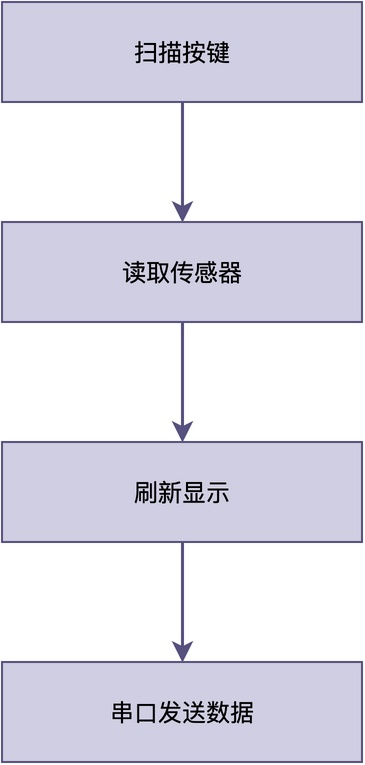
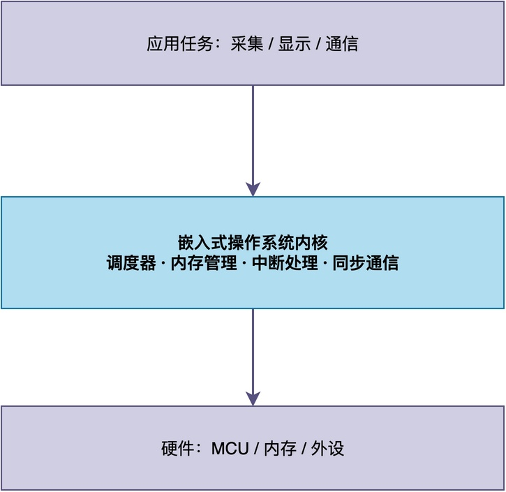
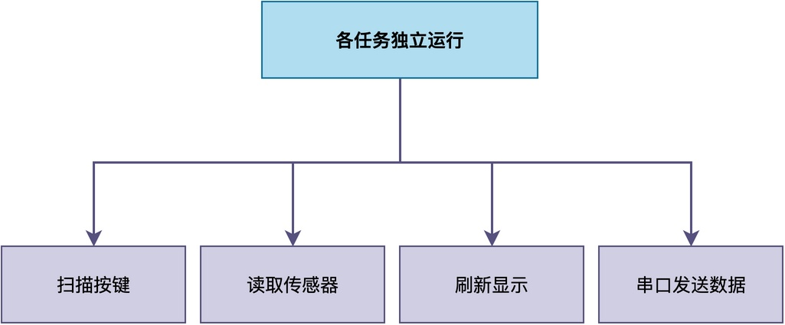
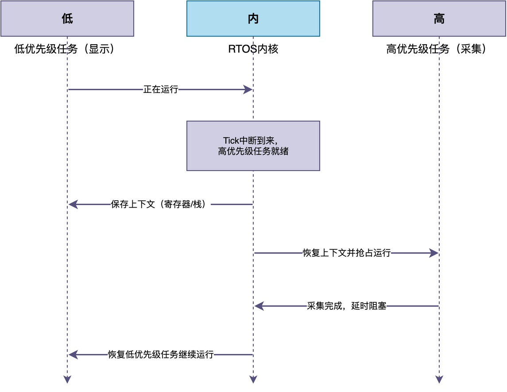

# 什么是嵌入式操作系统？它和裸机程序到底有什么区别？

很多同学在第一次接触单片机开发时，写出来的程序几乎都是同一个样子：在 main 函数里完成各种初始化操作，然后进入到一个 while (1) 大循环中，并在该循环中不停地执行轮询按键、读取传感器、刷新屏幕等工作。

当项目简单的时候，这种写法没有任何问题，逻辑上比较简单且较好调试。不过，随着功能一点点增加，你可能会发现出现按键偶尔失灵、传感器采样间隔忽长忽短、串口数据一多整个程序就像卡住了一样等异常情况。

由此可见，当项目逐渐变复杂，我们就不得不面对这样一个问题：有没有一种更合理的方式来组织整个程序？这正是嵌入式操作系统要解决的问题。

## 一、先看看没有操作系统时，程序是怎么写的

不使用任何操作系统的程序通常被称为裸机程序。这种程序最常见的架构，就是一个无限主循环，在这个循环中把所有事情依次做一遍，下面给出了一串简单的示例代码：

```
int main(void)
{
   hardware_init();
   while (1)
   {
       key_scan();        /* 扫描按键 */
       sensor_read();     /* 读取传感器 */
       display_update();  /* 刷新显示 */
       uart_send();       /* 串口发送数据 */
   }
}
```

这种结构的问题在于：**所有功能共享同一条执行路径，如果任何一个函数执行得慢了，后面的事情都得排队等着。**


有的同学可能会想到，引入中断，把紧急的事情放到中断服务函数里处理，从而形成 "主循环加中断" 的前后台结构。不过，中断只能处理单个事件，多个功能模块之间的并发关系依然要靠我们用大量全局变量和状态标志去手工维护，功能越多越容易出错。

所以，这种架构并不是万能的。

有的同学可能会结合自己以往的经验，开发出一种新的程序架构。也有的同学可能会直接选择市面上成熟的程序架构，比如嵌入式操作系统。

## 二、嵌入式操作系统到底是什么

简单来说，**嵌入式操作系统就是运行在嵌入式设备上、夹在硬件和应用程序之间的一层管理软件，它把 CPU、内存、中断、外设这些硬件资源统一管理起来，再以服务的形式提供给上层应用**。


不过，我们平常在开发中使用的是，常常是RTOS（Real Time Operating System），即嵌入式操作系统中的实时操作系统，比如 FreeRTOS、RT-Thread、μC/OS、Zephyr等。

这种操作系统虽然和我们电脑上的 Windows、Linux 属于同一类概念，但设计目标完全不同。嵌入式设备的内存和算力通常非常有限，所以该系统必须足够小巧、可以按需裁剪。

此外，**RTOS 最核心的追求是确定性**。这种确定性并不是要求系统运行的速度很快，而是要保证关键任务必须在规定的时间内得到响。

## 三、它是怎么让多个任务 "同时运行" 的

与祼机程序不同，**RTOS可以将一个一个完整的应用拆分成若干个相对独立的任务，每个任务有自己的优先级和专属的栈空间，并且都写成无限循环的形式**。

以常见的 RTOS 写法为例，当需要一秒钟采集一次温湿度时，可以创建如下所示的任务：

```
void sensor_task(void *arg)
{
   while (1)
  {
       read_temp_humi();
       vTaskDelay(pdMS_TO_TICKS(1000));
   }
}
```

这样一来，整个系统就可以根据需要创建多个任务，每个任务可以专心做自己的事情，可以减少不同功能模块之间的相互干扰。


在RTOS内部，系统依靠一个周期性的时钟节拍（Tick）来推动时间运转，调度器会按照优先级决定此刻该让哪个任务占用 CPU。

例如，当高优先级任务就绪时，它会立刻抢占低优先级任务，RTOS把当前任务的寄存器和栈指针保存到它自己的栈上，再把高优先级任务的现场恢复出来继续执行。这个保存和恢复的过程叫做上下文切换，整个切换发生在很短的时间内，于是在我们看来，多个任务就像在同时运行一样。


## 四、总结

综上所述，所谓嵌入式操作系统，就是运行在资源受限的嵌入式设备上、统一管理硬件资源并为应用提供任务调度、内存管理、中断处理和任务间通信等服务的一层系统软件。

其中 ，RTOS 凭借基于优先级的抢占式调度，保证了关键任务响应的确定性，把裸机程序中难以维护的并发逻辑变成了清晰的多任务模型。

---

> 如果你希望系统地学习RTOS底层原理，可以了解我的《RTOS开发与实战》课程。
>
> 课程不是简单地讲解FreeRTOS API的使用，而是带你从零开始编写一个RTOS内核，逐步实现任务管理、任务调度、上下文切换、同步与通信等核心机制，并通过一个远程温湿度监控设备项目，将操作系统原理应用到实际嵌入式开发中。
>
> 适合希望深入理解RTOS工作原理、提升嵌入式底层开发能力的同学。
>
> [课程详情](/blog/diyrtos/)
