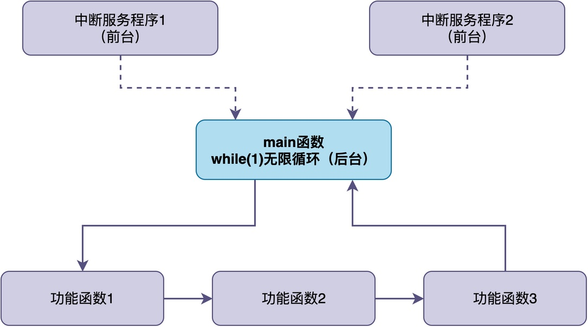
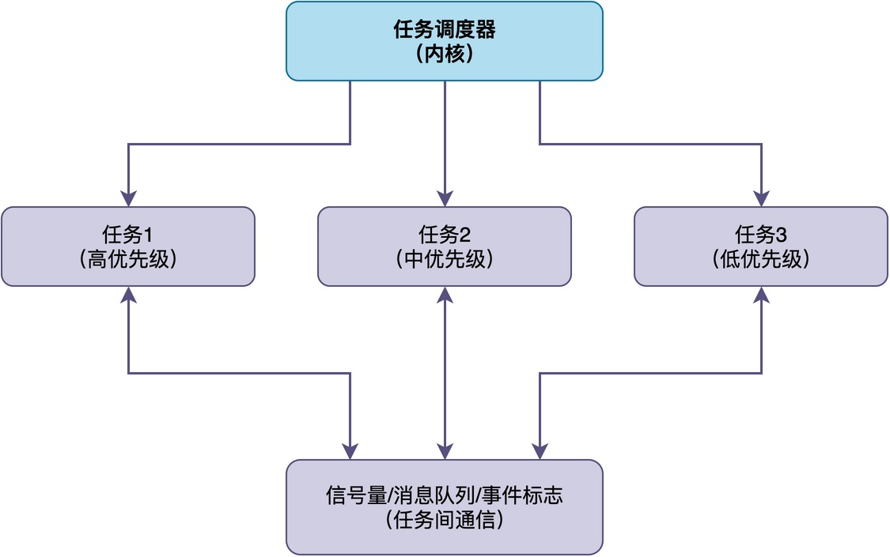
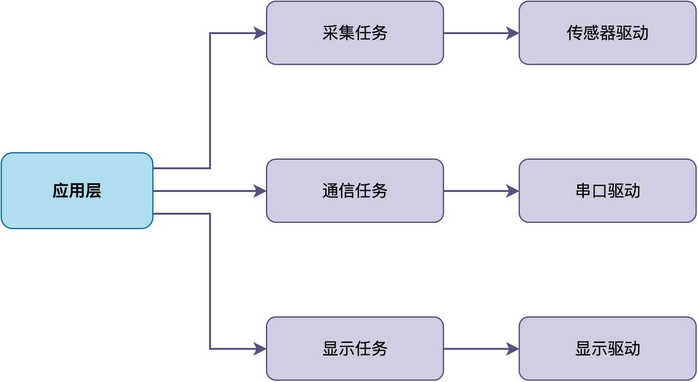
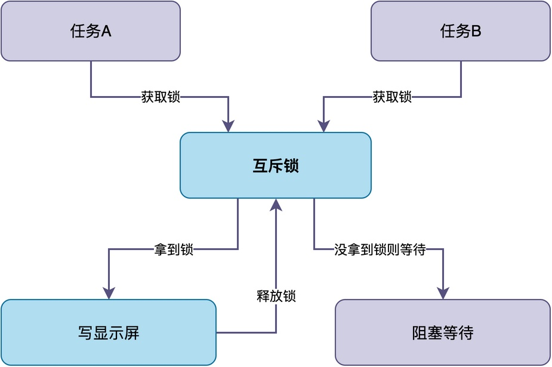

# 你的项目真的需要RTOS吗？

很多人在做嵌入式项目的时候，都会纠结一个问题：我这个项目，到底要不要上RTOS？

> 有人觉得RTOS是标配，不管项目多简单都要套一个FreeRTOS或RT-Thread，这样才显得专业。
>
> 也有人觉得裸机就够了，上RTOS纯属浪费资源、自找麻烦。

实际上，一个项目中到底需不需要用RTOS，需要综合硬件资源、开发效率等多种因素进行考虑。

今天的这篇文章，将把这些问题彻底讲清楚：到底什么时候需要RTOS，什么时候不需要？使用RTOS会带来哪些优势和问题？

## 裸机和RTOS在程序结构的差异

要判断在项目中需不需要使用RTOS，首先要明白裸机和RTOS在程序结构上的区别。

**裸机程序**，也叫前后台系统，其结构非常简单：一个main函数，包含一个无限循环while (1)。该循环里通常依次调用各个功能函数；与此同时，再加上若干中断服务程序，用于处理紧急事件。



**RTOS则不同**，它把程序拆成多个任务，每个任务是一个独立的无限循环函数，任务有自己的栈和优先级。

同时，RTOS里有一个调度器，它可以根据任务的优先级和状态，决定当前让哪个任务占用CPU运行。通常情况下，高优先级的任务可以抢占低优先级的任务，保证优先处理紧急的事情。任务与任务之间，可以通过信号量、消息队列、事件标志等机制进行同步和通信。



用更形象化的方式来说，**裸机程序相当于一个人从头做到尾完成所有工作，RTOS则相当于多个人分工协作，每个人只负责自己的那一块，由工头统一调度**。

## 裸机程序的主要问题

裸机结构虽然简单，但当项目功能逐渐增多时，会暴露出一系列问题。

1. **主循环臃肿，功能之间互相影响**。由于所有功能都挤在一个while (1) 里按顺序执行，如果其中一个功能耗时较长，那么后面所有功能都会被延迟。比如，当需要同时完成传感器采集、串口通信、显示更新等功能时，如果串口通信在长时间等待接收数据，将使得显示更新无法完成，表现出来的现象就是整个系统卡住。

2. **中断里做的事情越来越多、越来越复杂**。为了不被主循环延迟，有些人选择往中断里加功能，这导致中断服务程序越来越长、中断嵌套越来越深，调试和维护也变得困难。

3. **全局标志位满天飞，模块耦合严重**。不同功能模块之间通常靠全局变量加标志位相互配合，相互可以直接读写对方的数据，耦合度高。

4. **状态机越写越复杂**。为了处理异步逻辑，往往会引入状态机。但是，当状态较多时，状态之间的跳转关系会变得更为复杂，严重影响代码的可读性和可维护性。

当然，这些问题不是不能解决。有的高手会自己开发协程、软定时器等，也就是搞一套自研的程序架构。

但问题是，**你可能会发现，开发这些程序架构是比较耗时的，其中某些程序架构的复杂度和功能，已经非常接近一个小型的RTOS内核了**。

既然如此，为什么不直接用一个成熟的、经过大量项目验证的RTOS，而要重复造轮子呢？

## RTOS能带来哪些优势

于是，当项目复杂度超过一定程度时，很多人会不自觉地选择使用RTOS，体验到RTOS带来的多种优势。

### 抢占式调度

这是RTOS真正不可替代的能力。

这里举个简单的例子：某个电机控制系统需要同时处理电机控制（高优先级）、传感器数据采集（中优先级）、人机界面显示（低优先级）。

在裸机系统中，如果界面更新函数耗时较长，电机控制就会被延迟，可能导致电机失步或震荡。而在RTOS中，由于电机控制任务优先级最高，即使界面更新正在执行，电机控制任务也能立即抢占CPU执行。

### 模块化的代码组织

**RTOS支持将不同功能拆成独立任务，每个任务专注自己的事情，独立运行。任务之间可以通过明确的接口通信，模块之间耦合度低。**



以RT-Thread为例，每个功能就是一个独立的任务，各自在无限循环中工作。任务之间通过消息队列交换数据：

```c
/* 采集任务 */
static void sensor_task(void *param)
{
    while (1) {
        data = read_sensor();
        rt_mq_send(data_mq, &data, sizeof(data));
        rt_thread_mdelay(100);
    }
}

/* 通信任务：阻塞等待消息，没数据时不占 CPU */
static void comm_task(void *param)
{
    struct data buf;
    while (1) {
        rt_mq_recv(data_mq, &buf, sizeof(buf), RT_WAITING_FOREVER);
        send_uart(&buf);
    }
}
```

这种方式对团队开发协作特别有价值。**不同开发者可以并行开发不同任务模块，只需定义好任务间的通信接口**。

### 成熟的同步与通信机制

在裸机中，主循环与中断的配合需要使用全局标志位，功能有限且容易出错。**而RTOS提供了信号量、互斥锁等同步与通信机制，你可以直接在实际项目中使用，无需重复开发**。

比如，当多个任务都要写显示屏时，可以用互斥锁防止显示内容错乱：



任务在写屏之前，必须先拿到锁，谁拿到锁谁才能写，写完释放锁；未拿到锁的任务，只能等待。

### 资源管理

**很多RTOS还提供动态内存分配、内存池、栈溢出检测等功能，这些功能能大大避免自己在项目中重复"造轮子"。**

例如，在RT-Thread中，提供了动态内存分配和内存池两种管理方式：

```c
/* 动态内存分配：大小灵活，适合大小不固定的数据 */
void *buf = rt_malloc(128);
if (buf != RT_NULL) {
    /* 使用 buf */
    rt_free(buf);
}

/* 内存池：固定大小块，分配释放快且不会产生碎片 */
rt_mp_t mp = rt_mp_create("data_pool", 10, 64);
void *block = rt_mp_alloc(mp, RT_WAITING_FOREVER);
rt_mp_free(block);
```

### 易于和第三方软件结合

很多第三方组件，如TCP/IP协议栈（如LWIP）都是为RTOS环境设计的，集成更方便。

虽然这些组件有些也支持裸机环境，但是其使用难度会大很多。

以LWIP为例，裸机模式下需要自己实现定时轮询、数据包收发的事件循环，所有操作都要在主循环中主动调用，代码复杂且容易出问题。

而在RTOS环境下，LWIP可以运行在独立任务中，使用信号量和消息队列与应用任务通信，阻塞等待网络事件，代码结构清晰得多。

## 引入RTOS后的代价

虽然引入RTOS会带来很多优势，但是这些优势是有代价的。

### 更多的资源开销

**RTOS的每一个任务都必须分配独立的栈空间、独立的TCB，需要消耗掉部分内存空间。** 

以FreeRTOS为例，每个任务栈通常 128 到 1024 字节不等，任务控制块约 100 多字节。对于小资源的MCU来说，这些开销是相当大的。

此外，**由于任务切换需要保存和恢复上下文，这将额外消耗掉一部分CPU运行时间。**

### 新的问题

虽然使用RTOS可以将程序划分为多个任务独立执行，但实际上这些任务在很多情况下需要相互协作。**这会引入一系列裸机中不存在的新问题，例如：优先级反转、死锁、资源竞争、栈溢出等。**

很多时候，这些问题往往是间歇性的，难以重现和调试，需要开发者具备相应的经验和工具。

### 学习和调试成本

使用RTOS需要理解任务、优先级、调度、信号量、消息队列等概念，**它的学习曲线要比裸机陡很多**。

同时，你可能也深有体会，**多任务环境下的调试也比裸机复杂**，有些问题非常难以复现和调试。

## 总结

综上所述，**你的项目是否需要RTOS，没有标准答案，取决于项目的具体需求**。

RTOS真正不可替代的优势是抢占式调度，让高优先级任务获得确定性的实时响应。此外，RTOS在模块化组织、成熟的同步通信机制、资源管理和第三方组件集成方面也有显著价值。

不过，这些优势是有成本的：RAM和CPU资源开销、优先级反转和死锁等新问题、更陡的学习曲线和更复杂的调试。

在项目中，需要综合以上因素进行权衡。不要为了用RTOS而用RTOS，也不要因为不熟悉而排斥RTOS，根据项目需求做出最合适的选择。

---

> 如果你希望系统地学习RTOS底层原理，可以了解我的《RTOS开发与实战》课程。
>
> 课程不是简单地讲解FreeRTOS API的使用，而是带你从零开始编写一个RTOS内核，逐步实现任务管理、任务调度、上下文切换、同步与通信等核心机制，并通过一个远程温湿度监控设备项目，将操作系统原理应用到实际嵌入式开发中。
>
> 适合希望深入理解RTOS工作原理、提升嵌入式底层开发能力的同学。
>
> [课程详情](/blog/diyrtos/)
