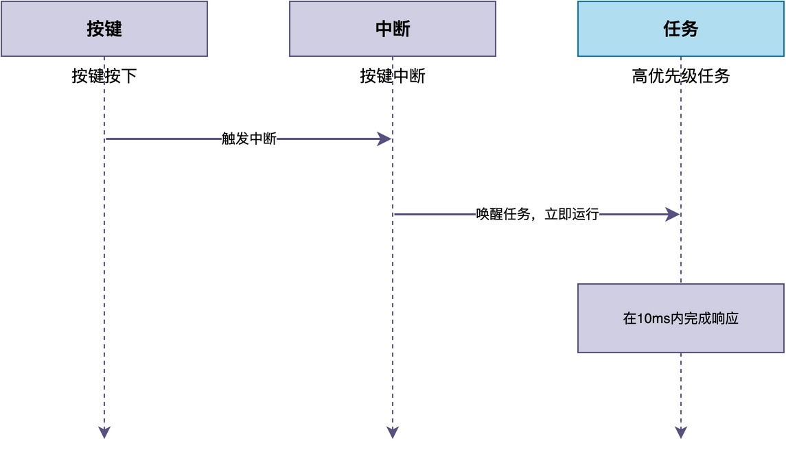
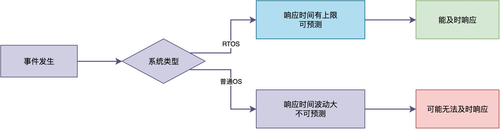
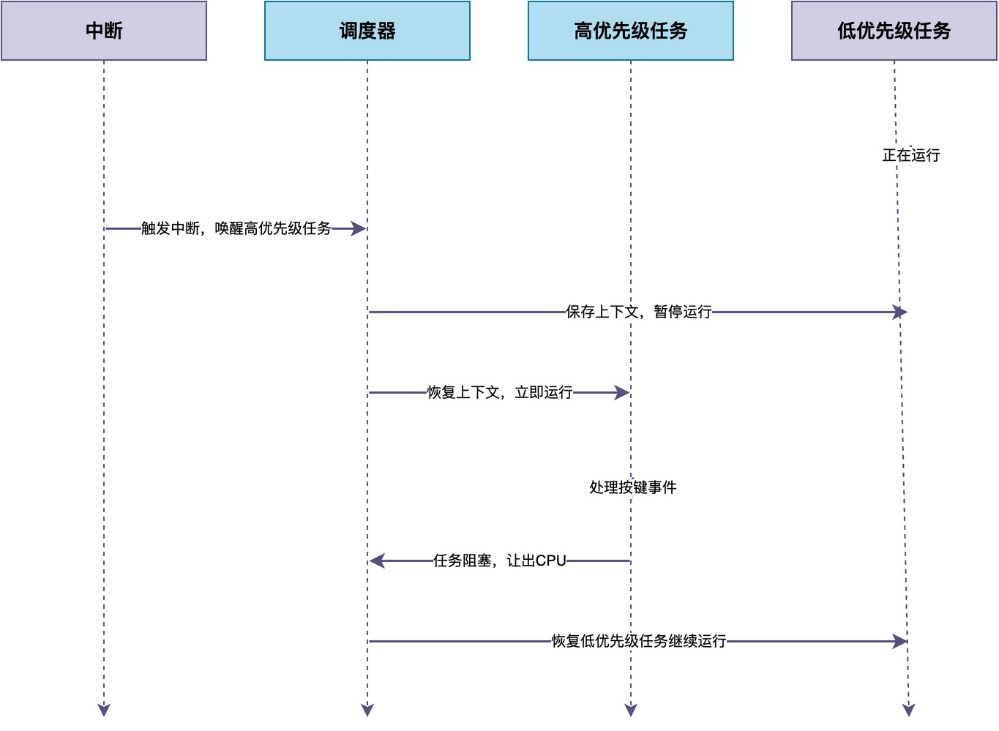

# RTOS中的"实时"到底是什么意思？

我们知道，RTOS的全称是（Realtime  Operating System）。有的同学可能对其中的Realtime产生这样的误解：

> "实时（Realtime）"是不是指系统运速度快吗？
> 
> Windows跑在高性能处理器上，速度肯定比跑在单片机上的RTOS快，那为什么人们不说Windows是RTOS？

那么，RTOS的"实时"到底是什么意思？在这篇文章中，我将详细解答这个问题。

## 先从银行办业务说起

在正式讲“实时”概念之前，我们先来看一个生活中的现象。

假设你去银行办业务，大厅里有两个窗口，它们都叫号排队。

第一个窗口的业务员手脚麻利、一天能办很多业务，但安排很灵活，会根据现场情况随时调整。比如优先办简单业务、给VIP让路。这样整体效率很高，但是你却没法准确知道自己几点能办上。

第二个窗口的业务员速度稍慢，但规则明确、不随便更改：紧急业务走绿色通道优先，普通业务严格按号码顺序来。你拿到号，就能准确知道自己还要等多久。

对比两个窗口可以发现：办理速度快、办的总量多，并不等于能在可预期的时间内办上业务。

我们可以将这两个窗口对应两类操作系统：
> 
> 第一个类似Windows，追求的是吞吐量、调度灵活，不过单个任务的响应时间不好预测；
> 第二个类似RTOS，规则明确、优先级严格，关键业务一定能在可预期的时间内得到处理。

这两者没有一定谁优谁劣的问题，而是各自适用的场合不同。

## "实时"不是快，而是确定

要弄清楚这个问题，我们先要明白"实时"这两个字到底是什么意思。

**所谓实时，指的是系统能够在规定的时间内，对外部发生的事件做出响应并完成处理**。这个规定的时间，通常叫做截止时间。换句话说，**实时强调的并不是算得快，而是在要求的时间之内一定能把事情做完。**

**因此，对于RTOS而言，它追求的并不是速度快，而是指确定性。** 比如，给定一个任务，我们能够准确地知道它最晚在什么时候能够得到响应。

例如，假设有一个任务，需要在按键按下之后的10毫秒内做出响应。

在Windows系统中，常常会发现由于某个软件卡死，使得我们按下按键后没有任何反应、鼠标也无法拖动。这是因为Windows这类通用操作系统更注重吞吐量和公平性，任务的响应时间受到很多因素的影响，如当前有多少任务在运行、系统负载高不高等等。

而在RTOS里，可以把任务设置为高优先级，只要按键中断触发、任务就绪，调度器就会立刻让这个任务运行。这使得它的响应时间是有上限的、可预测的，也就是说可以在最迟多少时间（比如10ms）内得到处理。

由此可见，面对同一个事件，RTOS能保证响应时间有上限；而普通操作系统，则无法提供这种保证。

## 为什么RTOS能做到确定性

那么，RTOS是怎么做到响应时间可预测的呢？

具体来说，RTOS主要通过抢占式调度、可预测的中断响应和时间片轮转等机制来实现确定性。

这里仍然以前面的按键为例，逐个分析这些机制所发挥的作用。

### 抢占式调度

当按键中断唤醒高优先级任务之后，调度器会立即切换到高优先级任务运行，从而实现抢占式调度，从而保证按键这一件事情能够尽快得到执行，而不会受其他低优先级任务运行的影响。

在实际开发中，**我们把关键任务设置为高优先级、非关键任务设置为低优先级**。如此一来，关键任务的响应时间也就有了保障。

### 可预测的中断响应时间

当中断触发之后，任务唤醒任务、上下文切换这些动作的执行路径都是固定的，它们所花费的时间也就有了明确的上限。

通常情况下，RTOS的中断处理过程通常比较短小，关中断的临界区也很短，这就保证了从按键事件发生到任务运行之间的时间是可预测的。

### 时间片轮转

当面临系统中多个任务拥有相同优先级的情况下，会不会出现某个任务长时间占用CPU运行，导致按键处理任务迟迟无法运行，使得按键的响应时间变得不可预测？

不会。对于优先级相同的任务，RTOS通常采用时间片轮转的方式，让每个任务轮流运行一段时间。这样既保证了同优先级任务之间的公平性，又不会让某个任务长时间独占CPU。

## 总结

综上所述，**RTOS中的"实时"不是指速度快，而是指确定性，也就是系统的响应时间是可预测的**。

RTOS通过抢占式调度、可预测的中断响应时间、时间片轮转来保证实时性，让关键任务能在截止时间之前完成。

普通操作系统虽然在高性能处理器上运行速度可能更快，但它的响应时间是不可预测的，不能保证关键任务总能在截止时间之前完成，所以它不是实时操作系统。

---

> 如果你希望系统地学习RTOS底层原理，可以了解我的《RTOS开发与实战》课程。
>
> 课程不是简单地讲解FreeRTOS API的使用，而是带你从零开始编写一个RTOS内核，逐步实现任务管理、任务调度、上下文切换、同步与通信等核心机制，并通过一个远程温湿度监控设备项目，将操作系统原理应用到实际嵌入式开发中。
>
> 适合希望深入理解RTOS工作原理、提升嵌入式底层开发能力的同学。
>
> [课程详情](/blog/diyrtos/)
