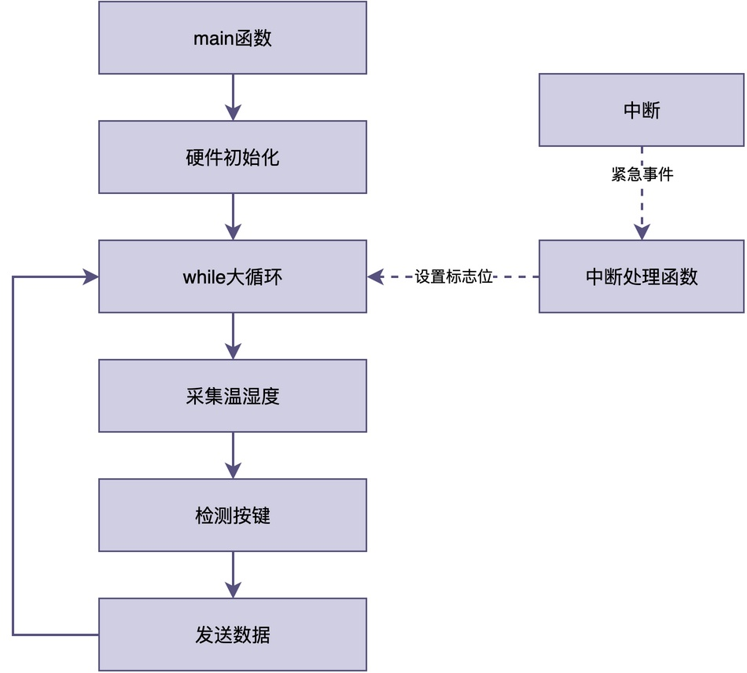
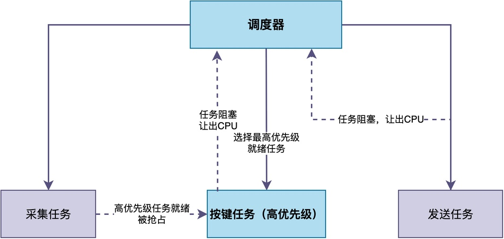

# RTOS和裸机程序最大的区别是什么？

有些同学从裸机开发转到使用RTOS的时候，可能会有这样一个疑问：

> 我写裸机程序也能实现功能，用大循环加中断不也挺好的吗？
> 裸机程序和RTOS的本质区别到底是什么？

在这篇文章中，我将对裸机程序和RTOS程序分别进行分析，相信同学会自己得出相应的结论。

## 裸机程序的执行方式

假设我们要做一个简单的温湿度采集设备，它需要同时做三件事：

1. 每隔一秒采集一次温湿度数据；
2. 检测按键，用户按下后要立刻响应；
3. 把数据通过串口发送出去。

如果用裸机程序来写，最常见的写法就是一个大循环，里面依次调用这三个功能函数，示例代码如下：

```c
int main(void)
{
    hw_init();
    while (1)
    {
        read_temp_humi();
        scan_key();
        send_data();
    }
}
```

上述代码看起来好像没问题，但实际运行起来就会发现：如果串口发送数据send_data()需要比较长的时间，那么在这段时间里，按键检测无法执行。具体表现就是：**用户按下按键可能要等好一会儿才有反应**。

这就是裸机程序最典型的问题：
> 所有功能都挤在一个大循环里，它们之间是顺序执行的，一个功能卡住了，其他功能都得等着。

这种大循环也叫做"超级循环"，与中断相互配合，形成**前后台系统**。**大循环是后台，负责处理不紧急的事情；中断是前台，负责处理紧急的事件**。中断与循环之间，可以通过标志位来进行协作。



可以看到，这种结构的优点是：简单、直观、占用资源少。

但缺点也很明显：大循环里的函数是顺序执行的。如果前面的函数执行时间越长，后面的函数响应就越慢。当功能越来越多时，**这个大循环会变得越来越臃肿**，各个函数之间的耦合也会越来越严重。

## RTOS的执行方式

那么，RTOS是怎么解决这个问题的呢？

RTOS的典型做法是：**把程序拆分成多个独立的任务，每个任务负责一个功能，然后由调度器来决定优先运行哪个任务**。比如，对于前面的例子，当使用RT-Thread之后，相关代码如下：

```c
int main(void)
{
    hw_init();
    rt_thread_t tid;

    tid = rt_thread_create("sensor", sensor_task, RT_NULL, 1024, 10, 10);
    rt_thread_startup(tid);
    tid = rt_thread_create("key", key_task, RT_NULL, 512, 5, 10);
    rt_thread_startup(tid);
    tid = rt_thread_create("send", send_task, RT_NULL, 512, 8, 10);
    rt_thread_startup(tid);
}

void sensor_task(void *parameter)
{
    while (1)
    {
        ...
    }
}

void key_task(void *parameter)
{
    while (1)
    {
        ...
    }
}

void send_task(void *parameter)
{
    while (1)
    {
        ...
    }
}
```

可以看到，**在RTOS里，每个任务都是一个独立的无限循环，有自己的栈和优先级**。调度器会根据优先级来决定哪个任务运行。

假设按键任务的优先级比采集任务高，那么即使采集任务正在运行，只要按键任务就绪了，调度器就会立刻切换到按键任务去执行。这就使得用户按下按键的这一事件，能够立即得到处理。



由此可见，RTOS和裸机程序最根本的区别：

> 裸机程序：靠程序员手动在大循环里安排执行顺序。在裸机程序里，一个函数卡住了，后面所有函数都得被迫等待。
> RTOS：靠调度器自动管理任务的执行。高优先级任务可以随时抢占低优先级任务，关键任务的响应时间有保障。

或许，我们也可以用一个生活中的例子来获得更为直观的理解。

> 整个处理器相当于是一间厨房。
> 
> 裸机程序相当于其中的厨师，而且是唯一的厨师，需要负责多道菜。他必须按照菜单顺序一道一道地做，做第一道的时候，第二道只能等着。如果某道菜特别费时间，后面的菜就都得延迟。
> 
> 当使用RTOS后，这个厨房有了多个厨师（任务），每个厨师只负责一道菜。RTOS相当于领班，他管理所有的厨师，哪道菜更紧急（优先级更高），领班就让哪个厨师先做。这样即使某道菜比较费时间，也不会影响其他紧急菜品的出餐速度。

## 总结

综上所述，RTOS和裸机程序最大的区别在于执行方式的不同。

> 裸机程序采用前后台结构，所有功能顺序执行，响应时间容易没有保障；
> RTOS采用多任务结构，按优先级调度执行，关键任务的响应时间有保障。

因此，当项目功能比较简单时，裸机程序完全够用；但当项目功能增多、对响应时间有要求时，RTOS的优势就会更加明显。

---

> 如果你希望系统地学习RTOS底层原理，可以了解我的《RTOS开发与实战》课程。
>
> 课程不是简单地讲解FreeRTOS API的使用，而是带你从零开始编写一个RTOS内核，逐步实现任务管理、任务调度、上下文切换、同步与通信等核心机制，并通过一个远程温湿度监控设备项目，将操作系统原理应用到实际嵌入式开发中。
>
> 适合希望深入理解RTOS工作原理、提升嵌入式底层开发能力的同学。
>
> [课程详情](/blog/diyrtos/)
