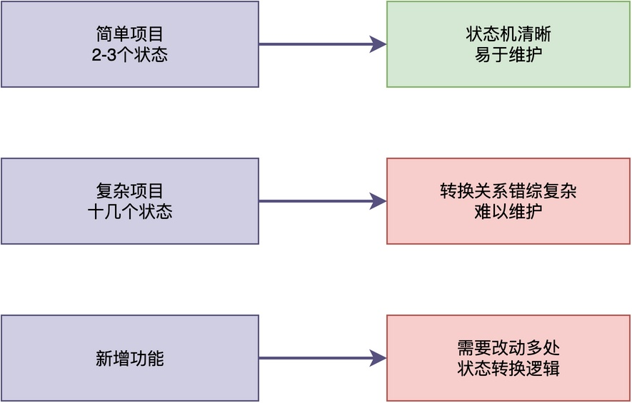
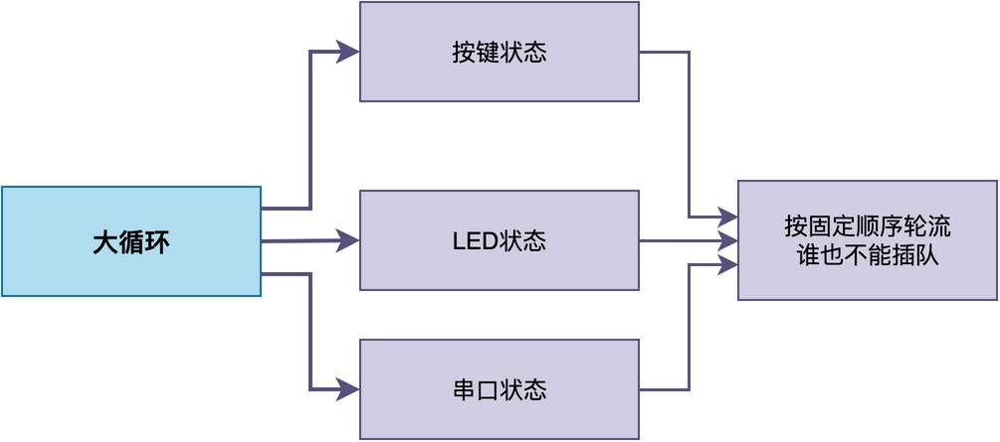

# 裸机程序使用状态机，能代替RTOS吗？

不少写过裸机程序的同学，在掌握了状态机这个技巧之后，都会有一种豁然开朗的感觉：

>原来不用RTOS，也能让一个程序看起来像是在同时处理好几件事情。
>既然功能上看起来和RTOS的多任务差不多，那还有必要专门上一个RTOS吗？

状态机真的能完全代替RTOS吗？它和RTOS的多任务之间到底差在哪里？

在这篇文章中，我们将看到状态机到底能解决什么问题，也能看到它的局限。相信最后你能得出自己的结论：什么时候用状态机就够了，什么时候最好是用RTOS。

## 状态机的应用示例

不得不说，状态机确实是一种非常强大的编程技巧，它可以让裸机程序有条不紊地同时处理好几件事。

比如，某个设备中需要做三件事：检测按键、闪烁LED、处理串口数据。我们先来看最普通的写法，其中，LED闪烁通常会这样写：

```c
int main(void)
{
	hw_init();
	while (1)
	{
		scan_key();
		led_task();
		process_uart();
	}
}

void led_task(void)
{
	led_on();
	delay_ms(500);
	led_off();
	delay_ms(500);
}
```

注意，delay_ms(500)是通过让CPU空转500毫秒实现的，led_task()将耗时1秒钟才能执行完。在这段时间里，如果用户恰好在这时按下按键，就没法及时响应。

但如果用状态机来写，**可以把功能拆成若干个小状态，每次循环只推进一小步、做完立刻返回，不在某一步里死等**。这样一来，每个功能每次只占用CPU很短的时间，也就不会出现一个功能把其他功能卡住的情况。

我们可以对LED的代码进行修改，采用状态机来进行处理。

```c
typedef enum { LED_ON, LED_OFF } led_state_t;

void led_task(void)
{
    static led_state_t state = LED_OFF;
    static uint32_t last_time = 0;

    switch (state)
    {
        case LED_OFF:
            if (get_time() - last_time >= 500)
            {
                led_on();
                last_time = get_time();
                state = LED_ON;
            }
            break;
        case LED_ON:
            if (get_time() - last_time >= 500)
            {
                led_off();
                last_time = get_time();
                state = LED_OFF;
            }
            break;
    }
}
```

通过修改，每次led_task()被调用时，仅仅检查是否到达指定的时间点，到达时间点后才点亮或熄灭LED。这就使得led_task()可以快速执行完，CPU可以去处理按键检测和串口数据。

如此一来，**我们就不用在工程中引入RTOS，只需要在裸机环境中就能解决问题，避免引入RTOS后带来的各种弊端**。

## 状态机的局限性

不过，虽然状态机很强大，但它并不能完全代替RTOS。它的一些局限性决定了在复杂项目中使用时会力不从心。

### 代码复用性比较差

从led_task()的示例可以看到，**每个状态机都是针对特定功能写的，状态和状态转换逻辑都与具体功能紧密耦合**。

**当我们需要在另一个项目里使用类似功能时，往往很难把原来的状态机直接搬过去，大多数情况下都要重新写一遍。**

此外，就我自己的体验来说，**状态机这种写法其实非常不自然**。

> 对于led_task()来说，最自然的写法不过是点亮、延时、熄灭、再延时。
> 可一旦改成状态机，就要定义状态枚举、使用静态变量，以便记住当前走到了哪一步。并且，每次函数被调用时还要判断现在该执行哪个分支。
>
> 这样一来，原本简单的流程被硬拆成很多次断断续续的执行流程，无论写起来和读起来都比较费劲。与此同时，这些静态变量还占用了额外的存储空间。

### 复杂度随状态增多而急剧上升

当项目比较简单、只有两三个状态的时候，状态机看起来很清晰、很好维护。



但当状态数量增加到十几个、几十个的时候，状态之间的转换关系会变得非常复杂。

与此同时，**代码也会变得难以理解和维护**。当有新的业务需求时，为了增加一个新功能，可能需要修改很多地方的状态转换逻辑。

### 无法处理优先级

即便使用了状态机，main()中的大循环里按照固定顺序依次处理每个状态。



即便我们将led_task()每次调用的时间压缩到很短，也改变不了这样一个事实：led_task()执行期间，按键处理必须等它调用完成后才能进行。

## 什么时候用状态，什么时候要RTOS

那么，到底什么时候用状态机，什么时候用RTOS呢？我们可以从以下几个方面来判断。

如果你的项目功能比较简单、硬件资源有限、功能模块之间没有严格的优先级要求，那么用状态机就可以了。

但是，如果你的项目功能较复杂、需要保证任务的响应时间、需要考虑后期功能的扩展，那么使用RTOS也许会是一个更好的选择。虽然RTOS会带来额外的开销，但是相对它带来的好处，这些开销是可以忍受的。

## 总结

综上所述，无论是裸机程序还是RTOS，在具体使用时都应根据项目的复杂性、资源等诸多因素来选择，不存在必须用谁的问题。

状态机和RTOS不是对立的，它们各有适用的场景，选择哪种方式取决于项目的具体需求。

---

> 如果你希望系统地学习RTOS底层原理，可以了解我的《RTOS开发与实战》课程。
>
> 课程不是简单地讲解FreeRTOS API的使用，而是带你从零开始编写一个RTOS内核，逐步实现任务管理、任务调度、上下文切换、同步与通信等核心机制，并通过一个远程温湿度监控设备项目，将操作系统原理应用到实际嵌入式开发中。
>
> 适合希望深入理解RTOS工作原理、提升嵌入式底层开发能力的同学。
>
> [课程详情](/blog/diyrtos/)
