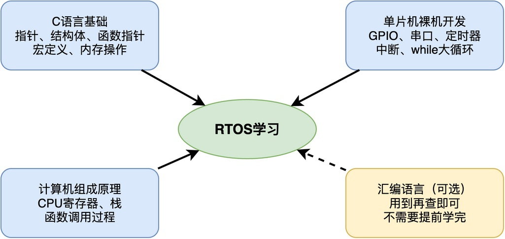
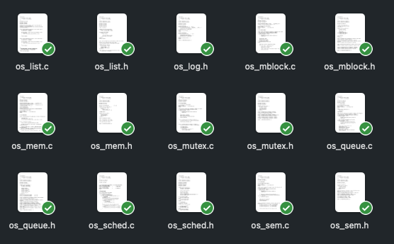
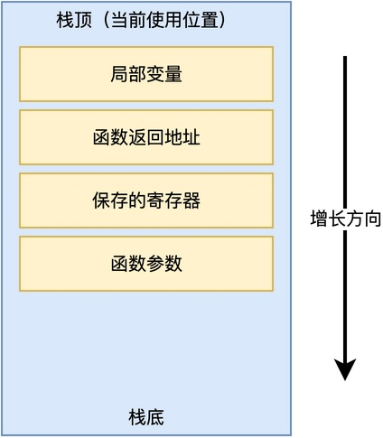
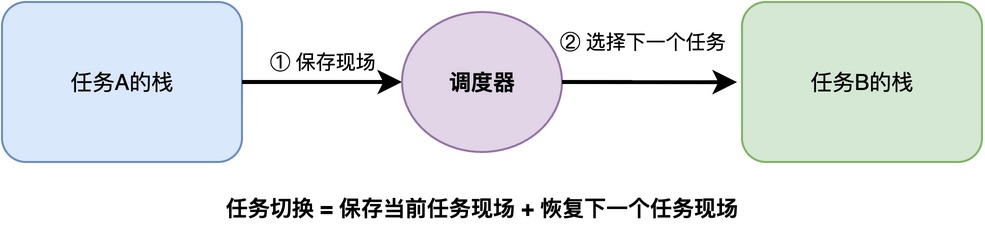

# 学习RTOS需要哪些前置知识？

对于之前一直在使用裸机开发，现在尝试使用RTOS的同学来说，他们可能会有这样一个顾虑：

> 我是不是需要懂很多东西才能学RTOS？
> 需不需要先把操作系统原理、编译原理、汇编语言等这些知识都学完了再开始？

其实，完全不用那么担心，学习RTOS只需要如下图所示的几个方面知识。而其中的很多知识，可能你已经掌握了。



接下来，我将具体介绍这些前置知识都包含哪些内容，以及哪些知识可以边学边补。

## C语言

首先，也是最重要的，就是C语言。RTOS的内核代码绝大部分都是用C语言写的，所以你需要对C语言比较熟练。

例如，下面给出我的《从0手写嵌入式操作系统》课程开发的RTOS源码，可以看到几乎都是C源文件。



具体来说，除基本C语法外，还需要熟练掌握这几个方面的知识：指针的使用，包括函数指针、结构体指针这些；结构体的定义和使用；宏定义和条件编译；内存操作相关的函数；链表的定义和实现。

特别是函数指针，在RTOS里用得非常多，比如任务入口函数、钩子函数等本质上都是函数指针。如果对函数指针不太熟悉，建议先花点时间补一下。

## 裸机开发经验

你需要用过至少一款单片机，比如STM32，知道怎么配置GPIO、串口等外设，并且写过裸机程序。

比如，下面这段代码就是配置GPIO引脚的初始化函数，你需要能看懂这些代码是怎么和硬件配合的：

```c
void led_init (void) {
    GPIO_InitTypeDef GPIO_InitStructure = {0};

    RCC_APB2PeriphClockCmd(RCC_APB2Periph_GPIOA, ENABLE);
    GPIO_InitStructure.GPIO_Pin = GPIO_Pin_0 | GPIO_Pin_1 | GPIO_Pin_2 | GPIO_Pin_3;
    GPIO_InitStructure.GPIO_Mode = GPIO_Mode_Out_PP;
    GPIO_InitStructure.GPIO_Speed = GPIO_Speed_50MHz;
    GPIO_Init(GPIOA, &GPIO_InitStructure);

    GPIO_SetBits(GPIOA, GPIO_Pin_0 | GPIO_Pin_1 | GPIO_Pin_2 | GPIO_Pin_3);
}
```

你还需要理解中断是怎么触发的、中断服务程序是怎么执行的、中断和主循环之间是怎么配合的。因为RTOS的任务切换、系统节拍，本质上都是靠中断来实现的。

比如，下面就是一个典型的中断服务函数的写法，你需要理解这种函数是怎么被硬件自动调用的：

```c
void NMI_Handler(void) __attribute__((interrupt("WCH-Interrupt-fast")));

void NMI_Handler(void)
{
    // 中断处理代码
}
```

## 计算机组成原理

你还需要了解CPU的基本工作方式，知道CPU里面有哪些寄存器，程序是怎么一条一条执行的。

特别是栈这个概念，需要理解栈是怎么工作的，函数调用的时候栈里面会压入什么内容，函数返回的时候又是怎么恢复的。



因为RTOS的任务切换，本质上就是保存当前任务的寄存器和栈，然后恢复下一个任务的寄存器和栈。如果理解了栈和函数调用的过程，再看任务切换就会觉得很自然。



## 汇编语言

有些同学问：要不要学汇编语言？其实，如果只是简单的使用RTOS，不需要。但如果你想比别人更深入理解，花费一些时间学习是很有必要的。

RTOS的核心代码里，确实有一小部分是用汇编写的，比如任务上下文切换。但这部分代码量很小，而且在学习的过程中，用到哪条指令再去查就可以了，不需要提前把整个汇编指令集都学完。

比如，下面这段就是RISC-V平台上任务切换的汇编代码（来源于我的《从0手写嵌入式操作系统》课程），其核心就是把当前任务的寄存器保存到栈里，然后从下一个任务的栈里恢复寄存器：

```asm
os_task_switch:
    sw ra, X1_RA_OFFSET(a0)
    sw sp, X2_SP_OFFSET(a0)
    sw gp, X3_GP_OFFSET(a0)
    sw tp, X4_TP_OFFSET(a0)
    sw t0, X5_T0_OFFSET(a0)
    ...
    call os_sched_switch_ctx

    lw ra, X1_RA_OFFSET(a1)
    lw sp, X2_SP_OFFSET(a1)
    lw gp, X3_GP_OFFSET(a1)
    ...
    mret
```

其中，sw、lw就是RISC-V平台上的存储和加载指令，mret是中断返回指令。这些指令不需要提前全部记住，用到的时候再查就可以了。而且不同架构的汇编指令还不一样，ARM的汇编和RISC-V的汇编就差别很大，提前学了也不一定用得上。

## 总结

综上所述，学习RTOS需要的前置知识其实并不多：C语言、裸机开发经验、计算机组成原理和汇编语言。

当然，最最重要的是积极学习的心态，有了这一点，掌握RTOS是手到擒来的事情。

---

> 如果你希望系统地学习RTOS底层原理，可以了解我的《RTOS开发与实战》课程。
>
> 课程不是简单地讲解FreeRTOS API的使用，而是带你从零开始编写一个RTOS内核，逐步实现任务管理、任务调度、上下文切换、同步与通信等核心机制，并通过一个远程温湿度监控设备项目，将操作系统原理应用到实际嵌入式开发中。
>
> 适合希望深入理解RTOS工作原理、提升嵌入式底层开发能力的同学。
>
> [课程详情](/blog/diyrtos/)
