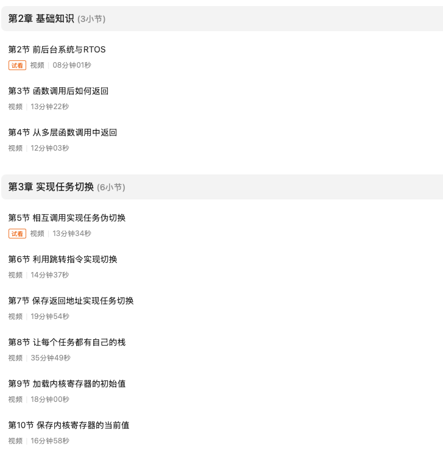
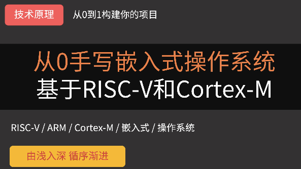
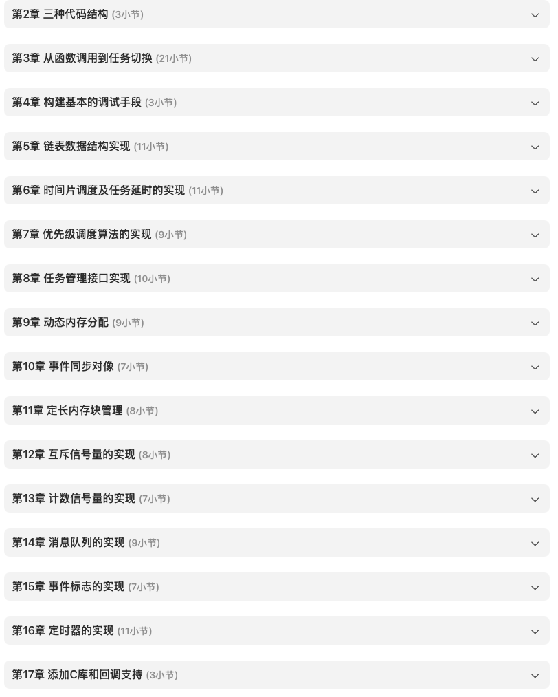
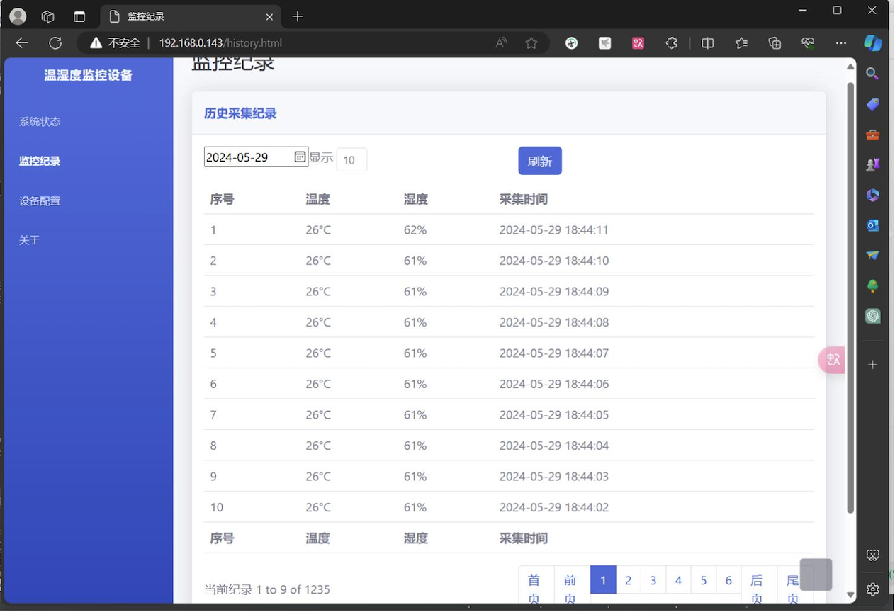

# 用了好几年RTOS，如何真正深入理解RTOS？

很多同学在项目中使用FreeRTOS或RT-Thread已经两三年，各种API用得很熟练，产品也能正常运行。

> 但是，当系统偶尔卡死、任务延时不符合预期、出现栈溢出等异常情况时，就会发现无从下手。

**主要原因通常不是API用得不够熟**，而是还没有真正理解RTOS的工作机制。

而真正理解RTOS，不是记住了多少个API，而是能够解释系统为什么这样运行，并且在出现问题时找到原因，甚至自己实现一个简化版本。

下面，我将根据自己的经验和理解，详细介绍如何做到真正理解RTOS。
## 第一步：熟悉一种RTOS

**理解RTOS的第一步，是先熟悉怎么用一种RTOS，从而搞清楚RTOS是什么。**

如果连任务、延时和线程间通信都还不能熟练使用，就直接阅读内核源码，往往很容易陷入宏定义和细节中。因此，应当选一款主流的RTOS，在实际工程中把它用起来。

**用熟RTOS的目的不是成为API使用专家**，而是先在真实项目中遇到问题，建立对任务调度和任务间通信的直观认识，为后续理解内核原理做好准备。

## 第二步：带着问题阅读内核源码

在知道RTOS是什么之后，就可以尝试开始阅读源码，深入了解其内部工作机制。

不过，不建议从main()函数开始，一行一行地往下追。**更有效的方式是提出一个具体问题，然后沿着相关数据结构和函数调用逐步追踪，弄清楚系统实际做了什么**。

比如，可以优先研究以下三个问题：

1. **调度器怎样决定下一个运行的任务？** 可以先找到任务控制块、就绪队列，再分析选择下一个任务的核心逻辑，从而理解内核如何判断哪些任务当前可以运行，以及如何根据优先级和调度策略作出选择。
2. **任务切换究竟发生了什么？** 从芯片的定时器中断或其他触发调度的事件入手，追踪上下文保存、调度器选择任务和上下文恢复的过程。
3. **任务为什么会阻塞，又是怎样被唤醒的？** 观察任务等待延时、信号量或消息队列时，内核如何改变任务状态、将任务挂入相应的等待结构，以及事件发生后如何让任务重新具备运行资格。

## 第三步：手写一个最小内核

虽然阅读源码能够帮助我们理解RTOS的实现，**但更好的做法是手写一个内核**。

通过这个过程，可以迫使我们深入理解更多问题，比如：任务控制块需要保存什么，任务切换时哪些寄存器必须保存，延时任务如何管理等？只有自己实现过，才能更清楚地理解每个机制解决了什么问题，以及设计中有哪些取舍。

在所有这些问题中，最难的莫过于理解：RTOS是怎么实现任务切换的？

对于这个问题，我之前专门做过一期视频课程《RTOS任务切换机制详解》，将其中的原理和工作机制掰开、揉碎讲。整个课程只有10余节课程，代码行数约100行左右。

如果你能顺利地将这些视频内容看完，相信可以对RTOS的任务切换机制有非常好的理解。你也可以继续在此基础之上开发新的功能。

## 第四步：尝试跨CPU架构移植

当一个最小内核稳定运行后，可以尝试把它移植到另一种CPU架构，例如从ARM Cortex-M移植到RISC-V。这一步能够**检验内核设计是否真正区分了通用机制与硬件相关机制**。

如果移植时发现任务调度、链表管理和架构相关的寄存器操作混杂在一起，就可以借这个机会优化实现。

这个过程不仅是在验证代码的可移植性，也是在检验自己对操作系统分层设计的理解。

## 第五步：用自己写的内核完成一个实际项目

最后，可以将内核放进一个实际项目中。

当我们在单独测试RTOS的某个功能模块时，很多问题并不容易暴露；只有在真正的实际多任务环境中，任务之间的竞争关系才会真正显现出来，一些隐藏的问题才会显现。

例如，可以实现一个远程温湿度监控设备：一个任务周期性采集传感器数据，一个任务负责将数据写入SD卡文件系统，另一个任务通过LwIP上传数据，最后由HTTP服务提供远程查看功能。这个项目会带来一系列需要权衡的问题：

- 任务优先级如何安排？
- 每个任务需要多少栈空间？
- 哪些共享资源需要互斥保护？
- 临界区应该如何设计？
- 内存分配和网络缓冲区如何管理？

这些问题没有一个适用于所有项目的固定答案，而是需要结合实时性要求、硬件资源和具体RTOS实现进行分析。

可以看到，通过实际项目，我们才能验证自己写的内核不仅能”跑多任务”，而且能在真实环境下稳定工作。

## 怎样判断自己已经真正理解了RTOS？

综上所述，**深入理解RTOS，不是靠多看几篇博客或记住更多API，而是能够深入理解RTOS的工作机制。**

在这五个阶段中，手写最小内核并应用于实际项目，是一个重要的学习支点。

只有在源码分析、跨架构移植和实际项目中反复验证这些理解，才能逐步形成真正可靠的系统开发能力。

## 如果想进一步深入学习，可以从哪里开始？

在我的《从0手写嵌入式操作系统》课程中，就是带着大家从空白工程开始，一步步实现一个完整的RTOS内核。

这门课程基于RISC-V和ARM Cortex-M两大主流处理器内核，总共约140个课时、34+小时、共18章，代码完全重写，

课程中的RTOS不是裁剪别人的内核，而是参考主流RTOS的实现原理，**从零开始自行设计和开发**，结构和实现方式都经过优化和重构，更适合教学与实战。

- 🧠 **教学内容重构**：更系统地讲解任务、调度、中断、时间管理等 RTOS 核心机制，知识体系更清晰
- ⚙️ **支持双架构实战**：全新开发板集成 ARM + RISC-V 双芯片，课程内容基于这两个平台展开
- 🔧 **实战体验升级**：全流程从 0 实现可运行 RTOS，支持真实硬件测试，强化工程实践能力
- 📦 **工具链全面支持**：提供配套开发板、Keil + RISC-V GCC 工具链配置教程，开箱即学，快速上手！

课程的18章内容覆盖了RTOS内核的所有核心模块：任务管理、事件同步、存储管理、互斥信号量、计数信号量、消息队列、事件标志、定时器等，支持ARM Cortex-M和RISC-V双架构。

每一个机制都不是停留在讲概念，而是带着大家亲手写代码实现，在真实硬件上运行和调试。

同时，课程还配套了远程温湿度监控设备的实战项目，利用自己亲手实现的RTOS，开发一个功能完整的物联网设备。这个项目会让你把自己写的内核用到真实项目中，完成从底层原理到工程实践的完整闭环。

---

> 如果你希望系统地学习RTOS底层原理，可以了解我的《RTOS开发与实战》课程。
>
> 课程不是简单地讲解FreeRTOS API的使用，而是带你从零开始编写一个RTOS内核，逐步实现任务管理、任务调度、上下文切换、同步与通信等核心机制，并通过一个远程温湿度监控设备项目，将操作系统原理应用到实际嵌入式开发中。
>
> 适合希望深入理解RTOS工作原理、提升嵌入式底层开发能力的同学。
>
> [课程详情](/blog/diyrtos/)
