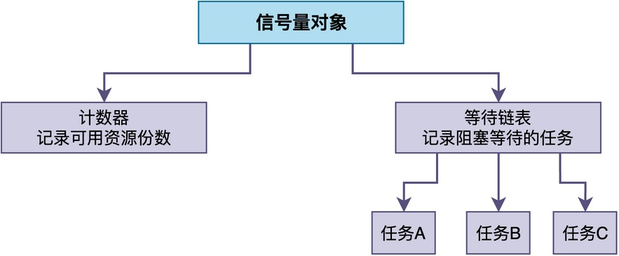
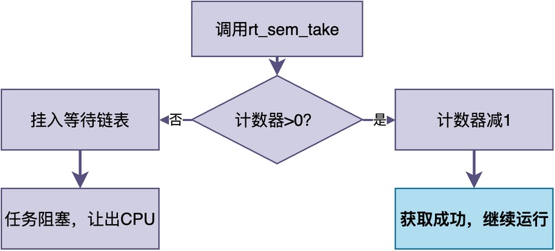
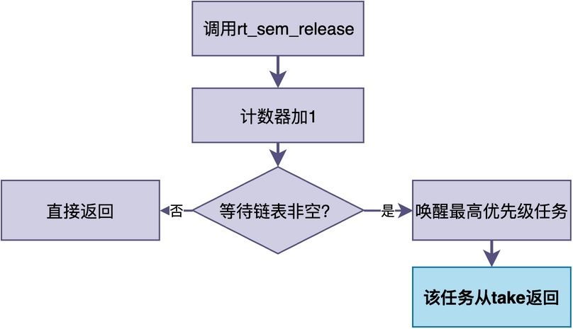
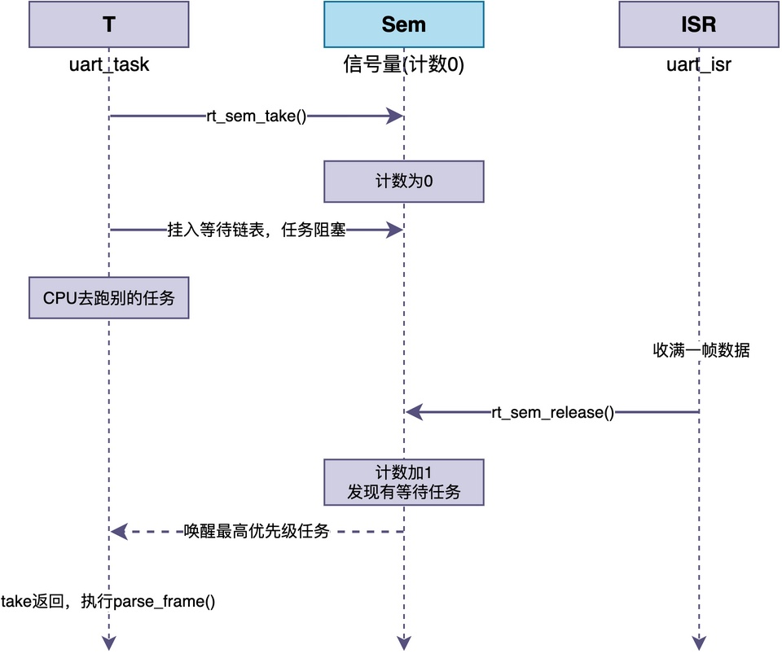

# 什么是信号量？

在裸机环境中，如果串口中断收到了一帧数据，但中断服务程序里不能做耗时的协议解析；那么我们可能会设置一个标志，然后在主循环中检查该标志。一旦发现标志位置位，就意味着收到完整的帧数据，之后进行协议解析。

> 当引入RTOS之后，协议解析工作应该交给任务去做。那么，中断里怎么告诉那个任务：数据来了，你起来干活？
> 还是设置全局标志位让任务去轮询吗？
>
> 很显然，轮询既费CPU，实时性又差，有没有更好的办法？

实际上，RTOS提供了信号量机制，用于快速地帮助我们这种要求，同时又能够避免轮询、保证实时性。

## 信号量的本质：计数器加等待链表

要理解什么是信号量，首先要明白它在RTOS里到底由什么构成。

很多教材一上来就说信号量提供了两个操作：P操作、V操作，这种抽象的表述很容易让人摸不清头脑。

实际上，如果把它拆开看，**一个信号量其实由两样东西组成：一个整型计数器，再加一条因为等待它而被阻塞的任务链表。**



通常情况下，**计数器表示可用的资源份数，等待链表记录现在都有哪些任务在排队等待资源**。

这里说的"资源份数"是一个抽象概念，具体含义取决于信号量的使用场景：

> - 用于事件同步时，计数表示事件发生的次数，0表示事件还没发生，1表示事件已经发生；
> - 用于管理多个同类资源时，计数表示当前可用的资源数量，比如可用的缓冲区个数、DMA通道数；
> - 用于互斥保护时，计数表示共享资源是否被占用，0表示已被占用，1表示空闲可用。

所有关于信号量的操作，本质上都是围绕这两个数据进行的。

一般情况下，RTOS至少为信号量提供两种基本的操作：获取信号量和释放信号量。

### 获取信号量

该操作将计数器减一。如果减完之后大于等于0，说明还有余量，任务直接继续运行；如果减完变成负数，或者说本来就是0，说明已经没有余量了，则将当前任务挂到等待链表上，进入阻塞状态，CPU让给别的任务。


### 释放信号量

该操作将计数器加一。加完之后查看等待链表，如果上面正排着任务，就挑选一个，通常是优先级最高的那个，唤醒它，让它继续运行。


## RT-Thread中信号量的使用方法

为便于进一步理解，这里给出RT-Thread的信号量使用方法，其余RTOS的使用方法类似。

在RT-Thread中，信号量的使用主要围绕三个接口展开。

1. **rt_sem_create**：创建信号量。
2. **rt_sem_take**：获取信号量。
3. **rt_sem_release**：释放信号量。

这三个接口的使用示例如下：

```c
static rt_sem_t rx_sem;

/* 任务侧：等待串口数据 */
static void uart_task_entry(void *param)
{
    while (1) {
        /* 没数据就阻塞在这，直到中断里release */
        rt_sem_take(rx_sem, RT_WAITING_FOREVER);
        parse_frame();          /* 真正的协议解析放到任务里做 */
    }
}

/* 串口接收中断：只收数据，然后释放信号量通知任务 */
void uart_isr(void)
{
    char ch = uart_read_byte();
    buf_push(ch);
    if (frame_ready()) {
        rt_sem_release(rx_sem);  /* 告诉任务：一帧好了 */
    }
}

int main(void)
{
    /* 初始值为0：一开始还没收到帧，任务take就会阻塞等待 */
    rx_sem = rt_sem_create("rx_sem", 0, RT_IPC_FLAG_FIFO);
    rt_thread_create("uart_task", uart_task_entry, RT_NULL, 1024, 10, 10);
    return 0;
}
```

在这个例子中，中断uart_isr只做最轻量的数据接收和判断，之后释放信号量并退出；耗时的协议解析全部放在uart_task_entry任务中执行。

可以看出，**rx_sem的计数表示是否接收到完整的帧，当为0时表示帧未收到，当为1时表示帧已收到。**

## 获取和释放的配合过程

这里将上面的过程画成时序图，以便更好的理解信号量的释放和获取操作的相互配合关系。


当uart_task任务发现计数为0时，表明未收到完整的帧，则任务进入阻塞状态，CPU转而去执行其它任务。

等到串口中断uart_isr收满一帧数据后，调用rt_sem_release释放信号量，计数加1。内核发现等待链表上有任务在等待，就把uart_task从等待链表上摘下来，唤醒它。

uart_task被唤醒后，rt_sem_take返回，任务继续执行parse_frame进行协议解析。

整个过程中，**任务在等待时不占用CPU空转，中断释放信号量后任务才被唤醒，既避免了轮询的CPU浪费，又保证了实时性**。

## 其他典型使用场景

理解了信号量的工作原理之后，我们来看信号量在实际项目中的其他常见用法。

### 任务间同步：一个任务等另一个任务完成

**当两个任务需要按顺序配合完成一件事时，可以用信号量进行同步。**

比如，只有采集任务collect_task把数据准备好，并释放信号量之后，处理任务process_task才能开始处理。相关示例代码如下：

```c
/* RT-Thread示例：任务间同步 */
static rt_sem_t data_ready_sem;

/* 采集任务：准备好数据后通知处理任务 */
static void collect_task(void *param)
{
    while (1) {
        collect_sensor_data();
        rt_sem_release(data_ready_sem);  /* 数据准备好了 */
        rt_thread_mdelay(100);
    }
}

/* 处理任务：等采集任务通知后才处理 */
static void process_task(void *param)
{
    while (1) {
        rt_sem_take(data_ready_sem, RT_WAITING_FOREVER);  /* 阻塞等待 */
        process_data();
    }
}

int main(void)
{
    /* 初始值为0：一开始数据还没准备好，处理任务take就会阻塞 */
    /* 只有采集任务release一次，处理任务才能被唤醒 */
    data_ready_sem = rt_sem_create("data_ready", 0, RT_IPC_FLAG_FIFO);
    rt_thread_create("collect", collect_task, RT_NULL, 1024, 10, 10);
    rt_thread_create("process", process_task, RT_NULL, 1024, 11, 10);
    return 0;
}
```

注意，信号量的初始值需要设置为0，表示还没有采集到任何数据。

### 管理多个同类资源

当系统中有多个相同的可复用资源时（比如3个DMA通道、4个串口缓冲区），可以用信号量来管理。

此时，**信号量的初始值设为资源总数，任务在每次使用前先获取信号量，表示等待可用的资源；用完资源之后，再释放信号量，表示释放掉资源。**

```c
/* RT-Thread示例：用计数信号量管理4个缓冲区 */
static rt_sem_t buf_sem;

/* 使用缓冲区前先take */
void use_buffer(void)
{
    rt_sem_take(buf_sem, RT_WAITING_FOREVER);  /* 拿一个缓冲区 */
    /* ...使用缓冲区... */
    rt_sem_release(buf_sem);                     /* 用完归还 */
}

int main(void)
{
    /* 初始值为4：系统一开始有4个缓冲区全部可用 */
    buf_sem = rt_sem_create("buf_sem", 4, RT_IPC_FLAG_FIFO);
    return 0;
}
```

例如，将信号量初始值设为4，表示系统中有4个缓冲区，并且初始时全部可用。

在整个过程中，信号量的计数表示当前可用的缓冲区资源计数。当计数为0时，表示缓冲区资源全被占用，再来的任务就排队等待。

## 总结

综上所述，**信号量就是内核里一个受保护的计数器加一条等待链表。

获取信号量将计数减一、如果不够减就阻塞任务；释放信号量将计数加一，如果等待的任务则唤醒。

**初始值为0时，常用于中断与任务之间、任务与任务之间的同步；初始值为N时，常用于管理多个同类资源的计数器。

---

> 如果你希望系统地学习RTOS底层原理，可以了解我的《RTOS开发与实战》课程。
>
> 课程不是简单地讲解FreeRTOS API的使用，而是带你从零开始编写一个RTOS内核，逐步实现任务管理、任务调度、上下文切换、同步与通信等核心机制，并通过一个远程温湿度监控设备项目，将操作系统原理应用到实际嵌入式开发中。
>
> 适合希望深入理解RTOS工作原理、提升嵌入式底层开发能力的同学。
>
> [课程详情](/blog/diyrtos/)
