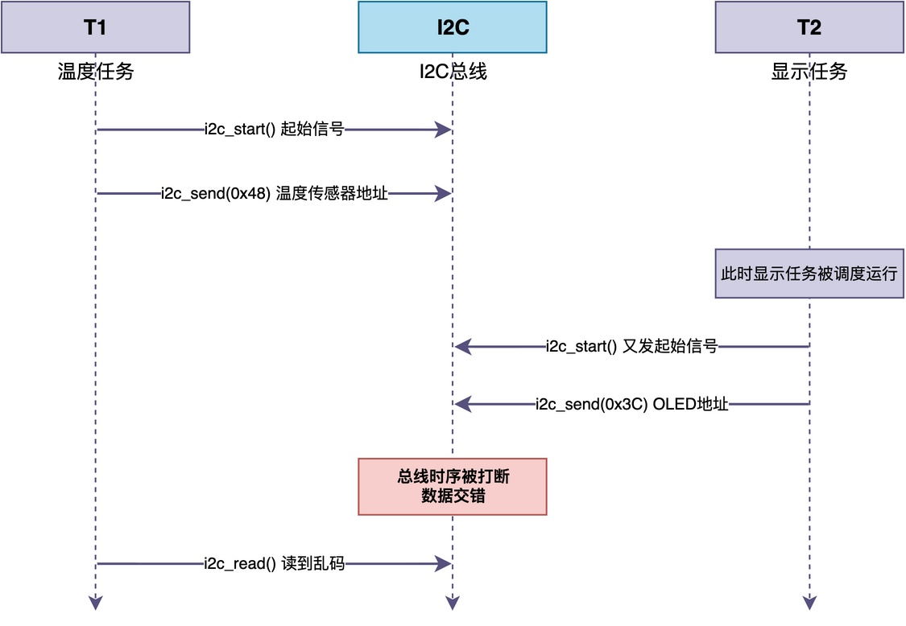
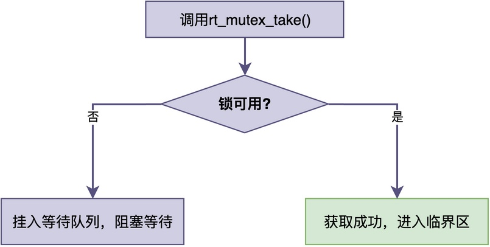
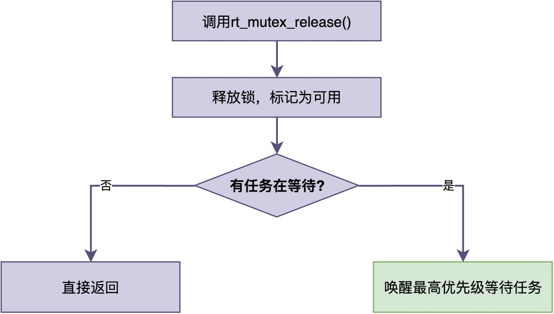
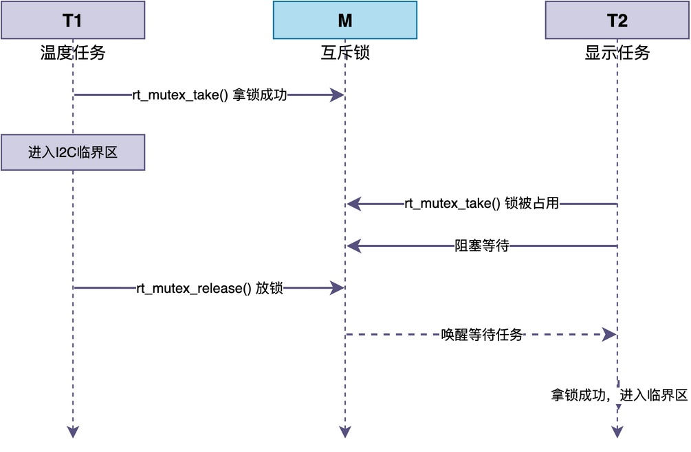

# 什么是互斥锁？

有位同学在项目中碰到了一个棘手的问题：

> 两个任务同时操作同一根I2C总线，单独任意都正常，但是一起跑就偶尔读到乱码。
> 他查了不少资料，发现用互斥锁来保护。但互斥锁到底是什么、它为什么能解决这个问题，他一直一知半解。

在这篇文章，我将向你详细介绍什么是互斥锁及其工作原理。

## 问题需求

为了方便说明互斥锁的功能，让我们先看下这位同学的项目。该项目中任务的功能代码大体如下所示。

```c
/* 所有用到I2C的任务，都通过这个封装来访问 */
static int i2c_read_reg(rt_uint8_t dev, rt_uint8_t reg, rt_uint8_t *val)
{
    i2c_start();
    i2c_send(dev);
    i2c_send(reg);
    *val = i2c_read();
    i2c_stop();
    return 0;
}

/* 温度任务：读传感器 */
static void temp_task(void *param)
{
    rt_uint8_t t;
    while (1) {
        i2c_read_reg(0x48, 0x00, &t);
        rt_thread_mdelay(500);
    }
}

/* 显示任务：读OLED参数 */
static void disp_task(void *param)
{
    rt_uint8_t v;
    while (1) {
        i2c_read_reg(0x3C, 0x10, &v);
        rt_thread_mdelay(300);
    }
}
```

可以看到，两个任务各自通过i2c_read_reg()操作I2C总线。单纯只看任意任务本身，似乎没有什么问题。

然而，**在RTOS的多任务环境中，两个任务的I2C操作可能在任意时刻被调度器打断，进而导致总线时序交错**。


上面的时序图展示了这个过程：温度任务的I2C操作刚执行到一半，就被显示任务打断，两个任务的总线时序交错在一起，最终温度任务读到的数据已经乱了。

## 临界资源和临界区

这个I2C总线竞争的问题，本质上是因为：**两个任务同时访问了同一段只能串行操作的共享资源。**为了避免这种竞争，我们应当让任意任务在访问的过程中不被打断**。

为了说明如何来实现这种保护，我们需要先引入两个概念：临界资源和临界区。

1. **临界资源**：同一时刻只允许一个任务访问的资源。
2. **临界区**：任务里操作这段临界资源的那一小段代码，这段代码应当同一时刻只有一个任务在执行。

例如，在上述例子中，临界资源就是I2C总线，临界区就是i2c_read_reg()函数中从i2c_start()到i2c_stop()之间的那段代码。

## 互斥锁

**互斥锁就是用来保护临界区的，限制同一时刻只有一个任务在执行临界区。** 它的工作原理很简单：

> 任务进入临界区之前先获取锁，持有锁的任务才能进入。
> 出来的时候把锁释放掉，下一个排队的任务才能进入。

形象化而言，互斥锁相当于对资源加了一把锁，持有锁的任务可以把资源锁上来给自己用，其他任务只能等待。

具体来说，互斥锁的操作有两个：获取锁和释放锁。

### 获取锁

任务在进入临界区之前，需要先获取锁。

如果锁当前可用，任务直接获取成功，进入临界区执行；如果锁正被别的任务持有，则当前任务插入互斥锁的等待队列，进入阻塞状态。


### 释放锁

任务离开临界区时，释放锁。

释放之后，内核检查等待队列，如果有任务正在等待这把锁，就唤醒其中优先级最高的那个，让它获取锁并进入临界区；如果没有任务等待，锁就保持可用状态。


## RT-Thread中互斥锁的使用方法

在RT-Thread里，互斥锁的接口和信号量很像，主要接口如下：

1. **rt_mutex_create()**：创建互斥锁。
2. **rt_mutex_take()**：获取锁。
3. **rt_mutex_release()**：释放锁。

使用上述接口，对问题代码进行调整，修改如下：

```c
static rt_mutex_t i2c_lock;

/* 所有用到I2C的任务，都通过这个封装来访问 */
static int i2c_read_reg(rt_uint8_t dev, rt_uint8_t reg, rt_uint8_t *val)
{
    rt_mutex_take(i2c_lock, RT_WAITING_FOREVER);  /* 先拿锁 */
    i2c_start();
    i2c_send(dev);
    i2c_send(reg);
    *val = i2c_read();
    i2c_stop();
    rt_mutex_release(i2c_lock);                    /* 用完放锁 */
    return 0;
}

/* 温度任务：读传感器 */
static void temp_task(void *param)
{
    rt_uint8_t t;
    while (1) {
        i2c_read_reg(0x48, 0x00, &t);
        rt_thread_mdelay(500);
    }
}

/* 显示任务：读OLED参数 */
static void disp_task(void *param)
{
    rt_uint8_t v;
    while (1) {
        i2c_read_reg(0x3C, 0x10, &v);
        rt_thread_mdelay(300);
    }
}
```

可以看到，和无锁版本相比，多了三样东西：一个全局的互斥锁i2c_lock、i2c_read_reg()开头的rt_mutex_take()、以及结尾的rt_mutex_release()。两个任务函数的代码完全没有变化。

相应地，整个程序的时序发生了变化，具体如下图所示：


分析上图可知，不管温度任务还是显示任务，在操作I2C寄存器时序时，都得先在i2c_lock这把锁前排队。I2C总线不会再被两个任务同时访问，读出来的数据自然就稳定了。

## 总结

综上所述，**互斥锁提供了特殊的资源独占机制，用来保护同一时刻只能被一个任务操作的临界资源**。

使用互斥锁的原则也很简单：**在访问共享资源之前获取锁，访问完成后立即释放锁，并且确保获取和释放成对出现、由同一个任务完成。**

---

> 如果你希望系统地学习RTOS底层原理，可以了解我的《RTOS开发与实战》课程。
>
> 课程不是简单地讲解FreeRTOS API的使用，而是带你从零开始编写一个RTOS内核，逐步实现任务管理、任务调度、上下文切换、同步与通信等核心机制，并通过一个远程温湿度监控设备项目，将操作系统原理应用到实际嵌入式开发中。
>
> 适合希望深入理解RTOS工作原理、提升嵌入式底层开发能力的同学。
>
> [课程详情](/blog/diyrtos/)
