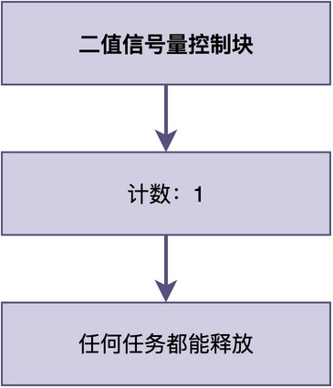
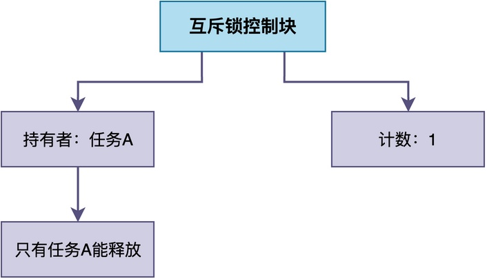
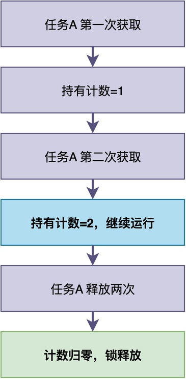
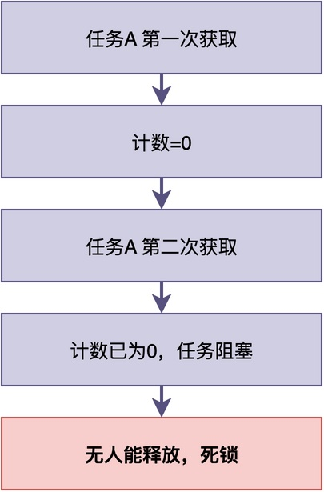
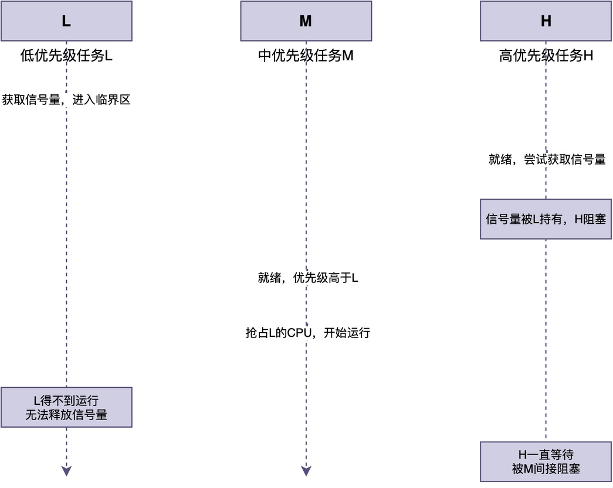
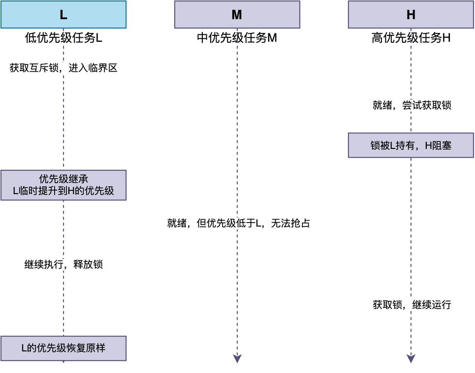

# 互斥锁和二值信号量有什么区别？

有位同学在看完我的前面两篇文章（什么是二值信号量和什么是互斥锁）后，提出了一个很有意思的问题：

> 如果将二值信号量的计数看作是能否进入临界区访问，那么将二值信号量初始值设为1，任务进入临界区前获取信号量，出来后释放信号量，不也能实现互斥锁的效果吗？

表面上看，二值信号量确实能模拟互斥锁的行为。但两者在设计目的和内部实现上有着本质区别，并不能相互替代。

下面，我将从几个关键角度，深入说明这二者之间的区别。

## 是否拥有所有权

互斥锁和二值信号量最根本的区别，在于：**互斥锁内部记录了当前是谁持有这把锁**，而二值信号量内部只有一个计数器。

二值信号量内部只有一个计数器，没有持有者信息：


而在互斥锁的内部，除了锁计数器之外，还专门有一个字段记录当前持有者是谁：


这使得互斥锁在被获取时，RTOS会把当前任务的信息记录到锁的控制块里，标记这个任务就是持有者。

之后，**只有这个持有者才能释放锁，其他任务即使调用释放操作也会失败。这就保证了"谁获取谁释放"。二值信号量没有这个机制，任何任务、甚至中断都可以调用释放操作。**

## 是否支持递归

互斥锁因为有所有权记录，所以很多RTOS实现的互斥锁可以支持**递归锁定：同一个任务多次获取同一把锁。** 

对于互斥锁来说，多次递归获取不会出现问题，具体原理如下图所示：**当同一任务多次获取时，持有计数累加，并不会阻塞任务；之后，释放相同次数，计数归零后，锁才真正释放**。


二值信号量做不到这一点。当任务第一次获取后计数变成0，第二次获取时发现计数已经是0，任务直接阻塞，如果没有其他任务释放信号量，任务将进入死锁状态。


互斥锁的这种支持递归特性，在某些情况下特别有用。

例如，在RT-Thread中，任务调用outer_func()函数，outer_func()内部调用了inner_func()。这两个函数恰好都有对同一互斥锁的上锁操作。由于互斥锁支持递归上锁，此时任务不会死锁，程序能正常运行。

```c
/* 互斥锁支持递归获取：同一任务多次获取不会死锁 */
void outer_func(void)
{
    rt_mutex_take(lock, RT_WAITING_FOREVER);  /* 第一次获取，持有计数=1 */
    inner_func();                               /* 内部又获取一次 */
    rt_mutex_release(lock);                     /* 释放一次，持有计数=1 */
}

void inner_func(void)
{
    rt_mutex_take(lock, RT_WAITING_FOREVER);  /* 同一任务再次获取，持有计数=2 */
    /* 操作共享资源 */
    rt_mutex_release(lock);                     /* 释放一次，持有计数=1 */
}
```

## 能否解决优先级反转问题

除以上区别外，**互斥锁和二值信号量之间最重要的区别是：能否解决优先级反转问题。**

这里先解释一下什么是优先级反转。假设系统中有三个任务：高优先级任务H、中优先级任务M、低优先级任务L。

> L先获取了信号量进入临界区，此时H就绪了，它也要获取同一个信号量，发现被L持有，只好阻塞等待。
> 此时，M也就绪了，因为M的优先级比L高，M抢占了L的CPU开始运行。
> 由于L一直得不到运行机会，也就一直没法释放信号量，H因此一直只好阻塞等待。
 


这样一来，原本的优先级顺序是 **H > M > L**，H 应该比 M 先执行。但实际情况变成了：**M 在运行，H 在等待**，相当于执行顺序变成了 **M > H**。

也就是说，**高优先级的 H 反而排在了中优先级的 M 后面执行，这就是 "优先级反转"，即优先级的高低顺序被颠倒了**。

对于这种问题，只有互斥锁提供了相应的解决方法，常见的方法有：**优先级继承**。

如果采用优先级继续，**RTOS会临时把L的优先级提升到和H一样高，避免被M抢占。如此一来，可以让L尽快执行完临界区并释放锁，从而使得H尽早拿到锁继续运行**。


## 总结

综上所述，互斥锁和二值信号量的设计目的完全不同。

**互斥锁为保护临界资源而生，有所有权、支持递归获取、支持优先级继承；而二值信号量为事件同步而生，没有所有权，任何任务和中断都能释放，。**

---

> 如果你希望系统地学习RTOS底层原理，可以了解我的《RTOS开发与实战》课程。
>
> 课程不是简单地讲解FreeRTOS API的使用，而是带你从零开始编写一个RTOS内核，逐步实现任务管理、任务调度、上下文切换、同步与通信等核心机制，并通过一个远程温湿度监控设备项目，将操作系统原理应用到实际嵌入式开发中。
>
> 适合希望深入理解RTOS工作原理、提升嵌入式底层开发能力的同学。
>
> [课程详情](/blog/diyrtos/)
