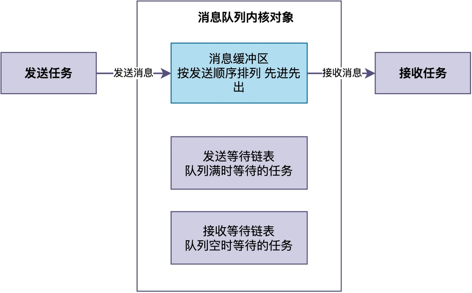
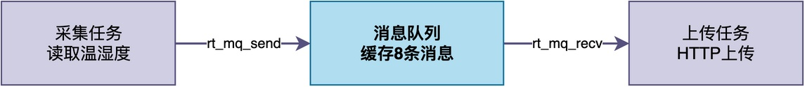
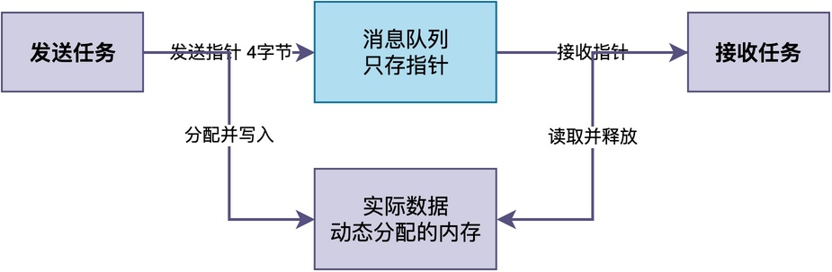

# 什么是消息队列？

很多人在学习RTOS任务间通信的时候，都会碰到一个很实际的问题：

> 两个任务之间要传递数据，为什么不能直接用一个全局变量？
> 而是要专门创建一个消息队列，通过消息队列进行发送、接收？

接下来，我将通过一个具体的例子简要说明其必要性，进而介绍什么是消息队列。

## 问题需求

假设，我们要开发一个远程温湿度监控设备。在该设备中，采集任务sensor_thread每100毫秒读一次温湿度，上传任务upload_thread负责把数据通过HTTP协议发出去。

如果用全局变量来传递读取的温湿度值，实现代码如下所示：

```c
/* 全局变量版：采集任务写，上传任务读 */
static rt_int16_t g_temp;
static rt_int16_t g_humi;

static void sensor_thread(void *p)
{
    while (1) {
        g_temp = read_temp();
        g_humi = read_humi(); 
        rt_thread_mdelay(100);
    }
}

static void upload_thread(void *p)
{
    while (1) {
        http_post_env(g_temp, g_humi); 
        rt_thread_mdelay(100);
    }
}
```

仔细分析上述代码，会发现存在比较严重的问题：

1. **读写可能冲突。** 例如，当采集任务刚写完g_temp、还没来得及写g_humi时，被上传任务抢占了，上传任务读到的是新温度配旧湿度，这个数据显然是错误的。
2. **不知道数据什么时候更新。** 上传任务根本不知道采集任务什么时候写了新数据，只能靠自行轮询，白白浪费CPU。
3. **连续写入会覆盖。** 由于是全局变量，只能保存同一份数据。如果上传任务来不及处理，采集任务采集得比较快，这将导致中间的数据全被覆盖。

为了解决这些问题，常见的RTOS内核都提供了一种专门的机制，用于方便任务之间的数据交换（消息通信），这就是消息队列。

## 消息队列是什么

**消息队列就是一块受内核保护的定长缓冲区，专门用来在任务之间传递消息。**

> 换句话来说：这些消息，就是任务之间想要通信的内容。而消息队列，用于将这些消息进行有序排列，方便任务取出。

如下图所示，展示了消息队列的基本结构：


从图中可以看到，消息队列内部主要有三部分：

1. **消息缓冲区**：所有发送的消息按顺序排列在这里、先进先出，常使用环形缓冲区实现；
2. **发送等待链表**：当队列满了的时候，想发消息的任务就挂在这里等空位；
3. **接收等待链表**：当队列空了的时候，想收消息的任务就挂在这里等新消息。

**当任务想要发数据，就把内容拷贝进队尾的空闲块；当想要接收数据，就从队首拷贝出来。** 注意，这个拷贝动作是在内核的保护下完成的，中间不会被其他任务切换打断，所以收发双方永远不会撞上同一块正在读写的数据。

通过上述分析可以看出，消息队列主要有三个关键性质：

1. **按值拷贝。** 发消息时将数据内容复制进队列，收消息时再复制出来。收发双方操作的是各自栈上的副本。
2. **先进先出，天然有序。** 消息按发送顺序排好队，先到的先被取走。
3. **空则收方阻塞，满则发方可等。** 当队列里没消息时，接收任务可以挂起等待；队列塞满时，发送任务要么选择立刻返回、要么等待腾出空位。

## 消息队列的基本用法

下面以RT-Thread为例，介绍消息队列的基本使用方法。在RT-Thread中，消息队列的接口主要有三个，这些接口如下：

1. **rt_mq_create()**：创建消息队列。
2. **rt_mq_send()**：发送消息。
3. **rt_mq_recv()**：接收消息。

回到前面的温湿度数据转发的例子，如果用消息队列改进原来的程序，可以用下图表示：


采集任务每100毫秒读取一次温湿度，打包成消息后通过rt_mq_send()发进队列；上传任务调用rt_mq_recv()阻塞等待，一有消息就被唤醒，取出数据后通过HTTP上传。

可以看到，**消息队列在中间起到缓冲作用**，即使上传任务偶尔慢了，采集任务发来的消息也会按顺序排在队列里，不会丢失。

相应地，对代码进行修改，修改方法如下：

```c
struct env_msg {
    rt_int16_t temp;
    rt_int16_t humi;
};

static rt_mq_t env_mq;

static void sensor_thread(void *p)
{
    struct env_msg msg;
    while (1) {
        msg.temp = read_temp();
        msg.humi = read_humi();
        rt_mq_send(env_mq, &msg, sizeof(msg));
        rt_thread_mdelay(100);
    }
}

static void upload_thread(void *p)
{
    struct env_msg msg;
    while (1) {
        rt_mq_recv(env_mq, &msg, sizeof(msg), RT_WAITING_FOREVER);
        http_post_env(msg.temp, msg.humi);
    }
}

int env_mq_init(void)
{
    /* 每条消息sizeof(env_msg)，一共缓存8条 */
    env_mq = rt_mq_create("env", sizeof(struct env_msg), 8, RT_IPC_FLAG_PRIO);
    rt_thread_create("sensor", sensor_thread, RT_NULL, 512, 10, 10);
    rt_thread_create("upload", upload_thread, RT_NULL, 1024, 12, 10);
    return 0;
}
```

需要特别注意的是，**无论是每条消息的大小还是消息队列能容纳的消息条数，都是在创建队列时就固定下来的**，使用时要根据实际需求合理设置。

## 大消息如何传递

在前面的例子中，每条消息只有4个字节（两个int16_t），按值拷贝进队列完全没问题。但在实际项目中，我们经常需要传递比较大的数据。如果还是按值拷贝，既浪费内存又浪费CPU时间。

此时，更加合适的选择是：**传递指向数据的指针**。在32位的处理器中，指针大小仅为4字节，拷贝成本几乎可以忽略。


下面给出了一个传递大块传感器数据的例子：

```c
/* 大消息结构体：可能包含上KB的数据 */
struct big_data {
    uint8_t buffer[1024];
    int length;
};

static rt_mq_t big_mq;

static void sender_thread(void *p)
{
    while (1) {
        /* 发送方分配一块内存，填充数据 */
        struct big_data *data = rt_malloc(sizeof(struct big_data));
        data->length = read_sensor_data(data->buffer, 1024);
        /* 只把指针发进队列，4字节而已 */
        rt_mq_send(big_mq, &data, sizeof(data));
        rt_thread_mdelay(100);
    }
}

static void receiver_thread(void *p)
{
    struct big_data *data;
    while (1) {
        rt_mq_recv(big_mq, &data, sizeof(data), RT_WAITING_FOREVER);
        /* 通过指针访问实际数据 */
        process_data(data->buffer, data->length);
        /* 用完释放，约定由接收方释放 */
        rt_free(data);
    }
}
```

虽然这种做法可以有效降低拷贝成本，但是也带来了一些新的问题。

在使用这种做法时，需要注意以下几点：

1. **约定内存释放规则。** 如果消息是从堆中分配的，双方必须约定清楚分配和释放的规则，以免内存泄漏或重复释放。常见的做法是：发送方分配消息，接收方用完后释放消息。
2. **发送之后不能再修改数据。** 消息发送后，这块内存的所有权就转移给了接收方，发送方不能再去写它。

## 总结

综上所述，**消息队列本质上就是一块受内核保护的定长消息缓冲区，用于将消息按序进行排列**。

它提供了**按值拷贝、先进先出和阻塞唤醒**等机制，方便任务之间进行数据传输和通信。对于小消息直接按值拷贝即可，对于大消息则可以通过传递指针的方式来降低拷贝开销。

---

> 如果你希望系统地学习RTOS底层原理，可以了解我的《RTOS开发与实战》课程。
>
> 课程不是简单地讲解FreeRTOS API的使用，而是带你从零开始编写一个RTOS内核，逐步实现任务管理、任务调度、上下文切换、同步与通信等核心机制，并通过一个远程温湿度监控设备项目，将操作系统原理应用到实际嵌入式开发中。
>
> 适合希望深入理解RTOS工作原理、提升嵌入式底层开发能力的同学。
>
> [课程详情](/blog/diyrtos/)
