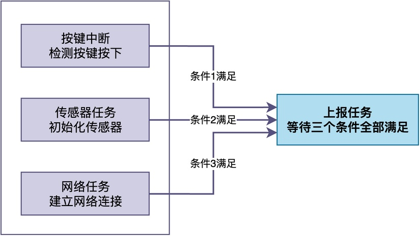
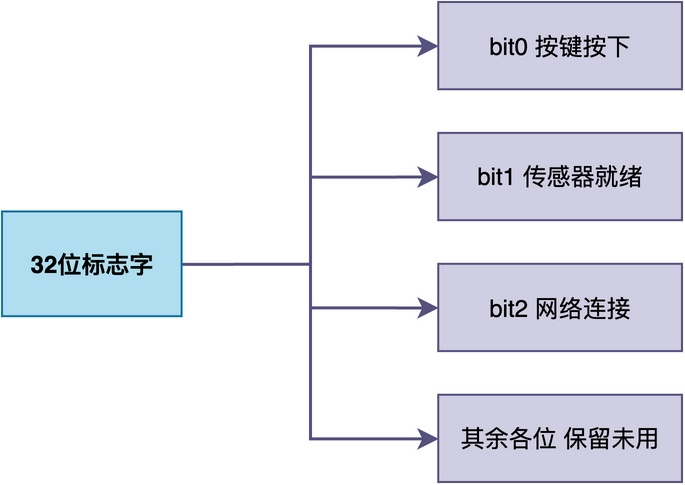
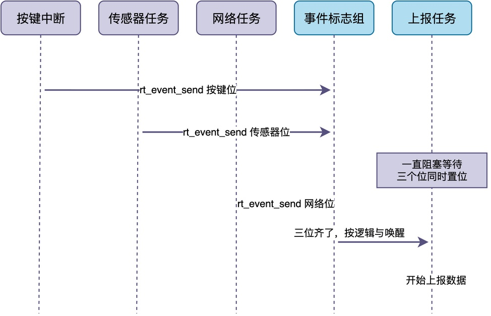

# 什么是事件标志组？

在我们进行嵌入式开发时，有时会碰到这样一种场景：

> 一个任务要往下执行，得同时等好几个条件都满足才行。

虽然你可能想到用信号量来进行同步，但面对多个条件时，难道要创建好几个信号量、一个一个去等吗？这显然不太现实。

今天我们就从一个具体的案例出发，看看这个问题到底怎么解决。

## 问题需求

假设我们要做一个远程温湿度监控设备。设备要往服务器上报数据，不过，在开始上报之前，系统得先确认三件事：

1. 用户按下了按键，表示允许上报；
2. 传感器初始化完成，可以读取温湿度；
3. 网络连接成功，可以和服务器通信。

这三件事分别由不同的任务或中断来负责：按键按下由按键中断来检测，传感器初始化由传感器任务来完成，网络连接由网络任务来建立。上报任务则要等这三个条件全部满足，才能进行数据上报工作。


**如果继续沿用裸机的方法，最直接的做法就是用几个全局标志位**。谁的工作完成了，就将对应的标志位置成1；上报任务则在循环里不断检查这三个标志位，看是不是全都变成1了。

采用这种做法的实现代码如下所示：

```c
/* 三个全局标志位 */
static volatile int g_key_ready = 0;
static volatile int g_sensor_ready = 0;
static volatile int g_net_ready = 0;

/* 按键中断：按键按下后置位 */
void key_isr(void)
{
    g_key_ready = 1;
}

/* 传感器任务：初始化完成后置位 */
void sensor_thread(void)
{
    sensor_init();
    g_sensor_ready = 1;
}

/* 网络任务：连接成功后置位 */
void net_thread(void)
{
    while (net_connect() != 0) {
        rt_thread_mdelay(500);
    }
    g_net_ready = 1;
}

/* 上报任务：轮询检查三个标志位 */
void report_thread(void)
{
    while (1) {
        if (g_key_ready && g_sensor_ready && g_net_ready) {
            http_start_report();
            break;
        }
        rt_thread_mdelay(10);  /* 轮询间隔，白白浪费CPU */
    }
}
```

仔细分析这段代码，会发现几个明显的问题：

1. **持续不断地轮询CPU。** 由于上报任务不知道条件什么时候满足，只能定期检查标志位，白白浪费CPU时间。
2. **多条件组合逻辑写起来麻烦。** 在不同应用场合中，标志位检查有的要全部满足、有的只要满足任意一个，这将使得检查逻辑越来越复杂。
3. **全局标志位没有保护。** 多个任务和中断同时在读写这些标志位，有可能会出现访问竞态。虽然写一个int在大多数架构上是原子的，但如果要同时操作好几个标志位，中间被打断就可能出现不一致的状态。

为了解决这些问题，RTOS内核提供了一种专门的同步机制，这就是事件标志组。

## 事件标志组的结构和原理

简单来说，**事件标志组就是一个受内核保护的32位标志字，每一位代表一个事件，1表示该事件已经发生，0表示还没发生。**

对于前面的问题，可以选择其中的bit0~bit2这三个标志位。谁的事办完了，就把对应的那一位置成1。


事件标志组提供的基本操作主要有两种：置位和等待。下面以RT-Thread提供的操作接口为例分别说明。

### 置位操作

**置位操作使用的是rt_event_send()，用于设置一个或多个标志位**。置位之后，内核会自动检查正在等待的任务，判断是否需要唤醒任务。

比如，在按键中断里，只需要置按键这一位：

```c
rt_event_send(&ready_event, EVT_KEY);   // bit0
```

也可以同时一次性设置好几个位：

```c
rt_event_send(&ready_event, EVT_SENSOR_OK | EVT_NET_OK);   // bit1 + bit2
```

### 等待操作

**等待操作使用的是rt_event_recv()，任务通过该接口指定自己关心哪些位、指定等待的逻辑、以及唤醒后要不要自动清除**。

例如，只等一个事件（按键按下）的写法：

```c
rt_event_recv(&ready_event, EVT_KEY, RT_EVENT_FLAG_AND, RT_WAITING_FOREVER, &recv);
```

同时等多个事件（按键按下、传感器就绪、网络连接成功）：

```c
rt_event_recv(&ready_event, EVT_KEY | EVT_SENSOR_OK | EVT_NET_OK,
              RT_EVENT_FLAG_AND, RT_WAITING_FOREVER, &recv);
```

注意到，上述示例中使用了RT_EVENT_FLAG_AND参数，该参数用于指定等待的逻辑。有两种常见的逻辑：

* **逻辑与**：使用的是RT_EVENT_FLAG_AND，表示等待的这几个位必须全部置位，任务才会被唤醒。也就是说，必须所有的事件都发生了才行。这种方式**适合"所有条件都满足了才能往下执行"的场景**。
* **逻辑或**：使用的是RT_EVENT_FLAG_OR，表示等待的这几个位中只要有任意一个置位，任务就会被唤醒。也就是说，只要有一个事件发生就够了。这种方式适合"只要有一件事发生就需要处理"的场景。

除了等待哪些位和用什么逻辑，还可以加上RT_EVENT_FLAG_CLEAR这个选项，用于指明任务被唤醒的同时，将相应的标志位自动清成0。例如：

```c
rt_event_recv(&ready_event, EVT_KEY | EVT_SENSOR_OK | EVT_NET_OK,
              RT_EVENT_FLAG_AND | RT_EVENT_FLAG_CLEAR,
              RT_WAITING_FOREVER, &recv);
```

在加上这个选项后，任务被唤醒的同时，内核会自动把等待的这几个位清成0，这样下一轮等待又是从头等起，不会因为位还保持1而空跑一圈。

## RT-Thread中的使用示例

下面我们把前面例子用事件标志组完整实现一遍。首先，用一张时序图直观展示事件标志组是如何发挥作用的。


从图中可以看到，**按键中断、传感器任务先后置位标志位，直至网络任务也置位标志位时，上报任务才被唤醒。** 整个过程中，上报任务不需要轮询检查标志位，RTOS会在条件满足的那一刻自动把它唤醒。

对应的完整代码如下所示：

```c
#define EVT_KEY        (1 << 0)
#define EVT_SENSOR_OK  (1 << 1)
#define EVT_NET_OK     (1 << 2)

static struct rt_event ready_event;

/* 按键中断：按键按下后置位 */
static void key_isr_hook(void)
{
    rt_event_send(&ready_event, EVT_KEY);
}

/* 传感器任务：初始化完成后置位 */
static void sensor_init_thread(void *p)
{
    sensor_hw_init();
    rt_event_send(&ready_event, EVT_SENSOR_OK);
}

/* 网络任务：连接成功后置位 */
static void net_connect_thread(void *p)
{
    while (net_connect() != 0) {
        rt_thread_mdelay(500);
    }
    rt_event_send(&ready_event, EVT_NET_OK);
}

/* 上报任务：等待三个位全部置位 */
static void report_thread(void *p)
{
    rt_uint32_t recv;
    while (1) {
        /* 三个位全部置位才唤醒，醒来自动清除这三位 */
        rt_event_recv(&ready_event,
                      EVT_KEY | EVT_SENSOR_OK | EVT_NET_OK,
                      RT_EVENT_FLAG_AND | RT_EVENT_FLAG_CLEAR,
                      RT_WAITING_FOREVER, &recv);
        http_start_report();
    }
}
```

## 总结

综上所述，**事件标志组本质上就是一个受内核保护的32位标志位。每个标志位代表一个事件，通过置位和带逻辑的等待，任务可以一次性等待一个或多个事件的发生。**

和全局标志位加轮询的方式相比，它减少了CPU时间的浪费，使用也更加方便，是RTOS中处理多条件同步的标准方式。

---

> 如果你希望系统地学习RTOS底层原理，可以了解我的《RTOS开发与实战》课程。
>
> 课程不是简单地讲解FreeRTOS API的使用，而是带你从零开始编写一个RTOS内核，逐步实现任务管理、任务调度、上下文切换、同步与通信等核心机制，并通过一个远程温湿度监控设备项目，将操作系统原理应用到实际嵌入式开发中。
>
> 适合希望深入理解RTOS工作原理、提升嵌入式底层开发能力的同学。
>
> [课程详情](/blog/diyrtos/)
