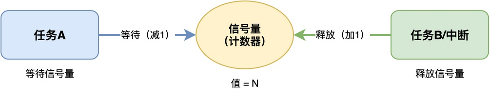
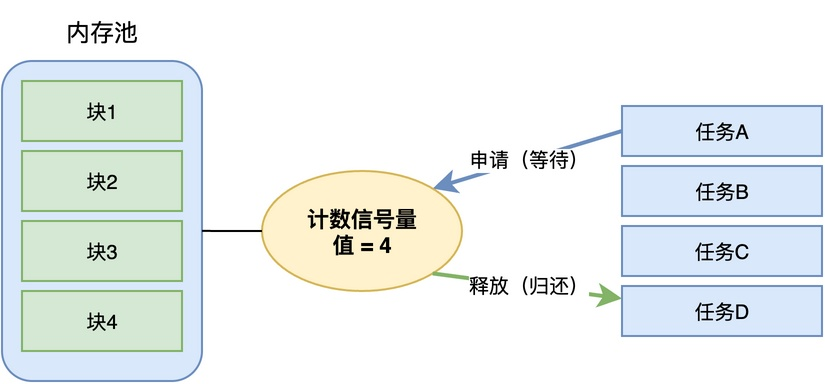
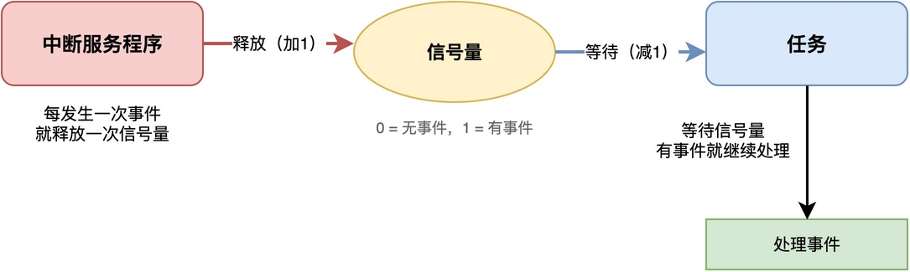
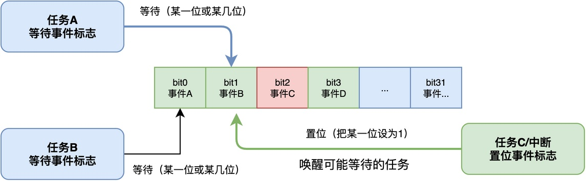
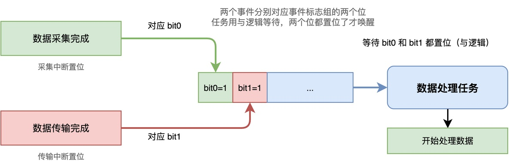
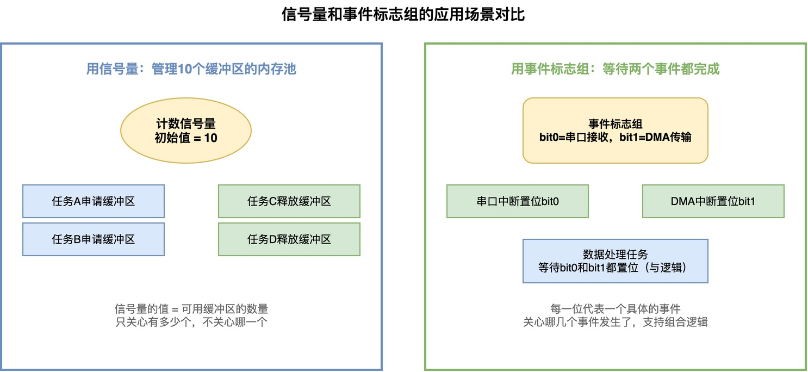

# 事件标志组和信号量有什么区别？

我们知道，信号量可以用来做任务之间的同步，也可以用来管理资源的数量；事件标志组可以用来表示多个事件的状态，也可以用来等待多个事件的组合。

那么你可能会有疑问：在实际使用过程中，这两种同步机制到底有什么区别？它们分别用在哪些场合？在这篇文章中，我们就来详细介绍一下。

## 信号量的特点

首先，回顾一下信号量是什么。**信号量本质上是一个计数器，它的核心操作有两个：等待和释放。**

等待操作是把计数器减1，如果计数器已经是0了，任务就阻塞等待。释放操作是把计数器加1，如果有任务在等待，就唤醒一个任务。

例如，在下图中，任务A等待信号量，如果信号量计数为0则阻塞；任务B释放信号量，当发现A处于阻塞状态时，则唤醒任务A。

通常情况下，**信号量适合表示"有多少个资源可用"，或者"事件发生了多少次"**。

比如，可以用信号量管理4个空闲内存块，信号量的初始值为4。每次申请一块内存块时就等待信号量，释放一块内存时就释放信号量。**信号量的值代表了当前可用的内存块数量**。

类似地，中断里每发生一次事件就释放一次信号量，任务里通过等待信号量就知道事件发生了。

通过上述介绍可知，**信号量的特点是：只有一个计数值，每次操作只改变这个值。它能告诉你"有事件发生了"或者"有资源可用了"，以及相应的数量或次数，但不能告诉你具体是哪个事件发生了**。

## 事件标志组的特点

**事件标志组本质上是一个整数，每一位代表一个事件的状态，某一位是1就表示对应的事件发生了，是0就表示没发生**。

例如，在下图中，任务A和任务B等待一位或某几位标志位置位，如果条件不满足则等待；任务C或中断置位标志位，当发现任务A处于阻塞状态时，则唤醒任务A。

**与信号量不同，事件标志组可以同时跟踪多个事件是否发生，并且可以选择"任意一位置位就唤醒"（或逻辑），或者"所有位都置位才唤醒"（与逻辑）。**

比如，一个任务需要等待"数据采集完成"和"数据传输完成"两个事件都发生了才能继续处理，可以将这两个事件分别对应到两个位，等待的时候用与逻辑，两个位都置位了才唤醒任务。

通过上述介绍可知，**事件标志组的特点是：可以同时表示多个事件的状态，而且支持灵活的与或逻辑。它能告诉你具体是哪几个事件发生了，以及它们的组合状态**。

## 区别与适用场景

回到文章开头提出的两个问题：这两种同步机制到底有什么区别？它们分别用在哪些场合？

先说说两者的核心区别，主要区别如下。

1. **信号量是一维的计数器，只能表示一个数量；事件标志组是多维的状态集合，可以同时表示多个事件的状态。**
2. **信号量每次等待会消耗一个计数值，是有"消耗性"的；事件标志组的等待可以选择是否清除标志位，比较灵活。**
3. **信号量适合管理资源数量或者统计事件发生次数；事件标志组适合等待多个事件的组合**。

再说说各自的适用场合，这里结合下面的图示进行具体说明。

如果是管理一个有10个内存块的内存池，用计数信号量就更合适，因为我们只关心"还有多少个缓冲区可用"，不关心具体是哪一个缓冲区。**信号量的值就代表了可用资源的数量，每次申请就等待，释放就释放，简单直接**。

而如果任务需要同时等待串口接收完成和DMA传输完成这两个事件，**用事件标志组就很合适。因为我们需要知道"哪几个事件都发生了"，而且需要等待两个事件的组合**。

总结来说，信号量和事件标志组都是任务间同步的机制，但适用场景不同。

> 信号量是一个一维的计数器，适合表示资源数量或事件发生次数；
> 事件标志组是一个多维的状态集合，用每一位表示一个事件的状态，支持与逻辑和或逻辑的等待。

简单来说，如果只需要知道"有没有"或者"有多少"，用信号量；如果需要知道"哪几个事件发生了"，特别是需要等待多个事件的组合，就用事件标志组。

---

> 如果你希望系统地学习RTOS底层原理，可以了解我的《RTOS开发与实战》课程。
>
> 课程不是简单地讲解FreeRTOS API的使用，而是带你从零开始编写一个RTOS内核，逐步实现任务管理、任务调度、上下文切换、同步与通信等核心机制，并通过一个远程温湿度监控设备项目，将操作系统原理应用到实际嵌入式开发中。
>
> 适合希望深入理解RTOS工作原理、提升嵌入式底层开发能力的同学。
>
> [课程详情](/blog/diyrtos/)
