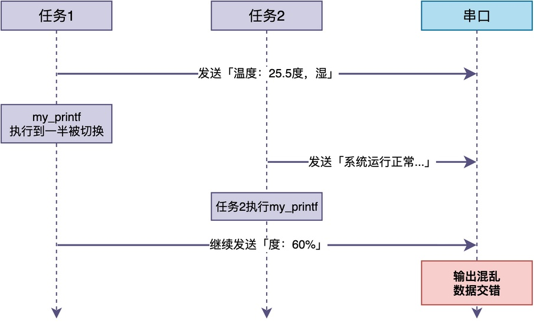
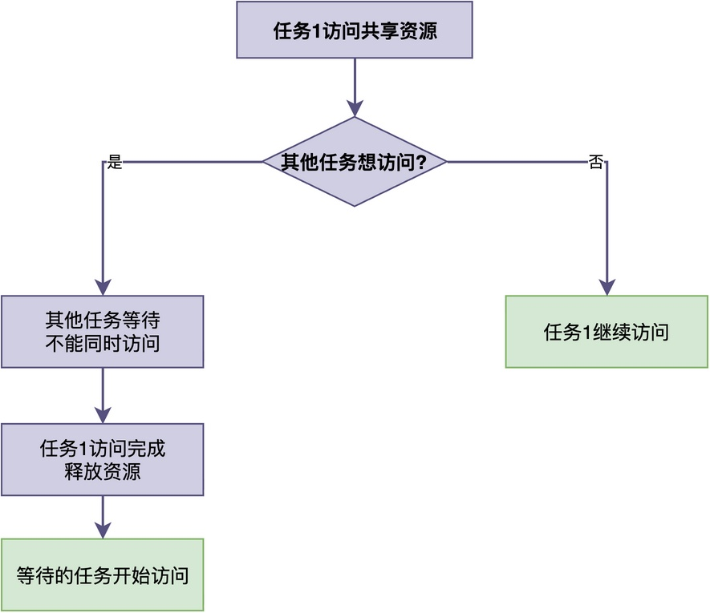

# 多个任务同时访问共享资源时，为什么需要进行互斥保护？

在使用RTOS进行多任务开发时，我们经常会碰到这样的情况：

> 多个任务同时访问一些外设（比如串口）或者共享全局变量时，程序会出现一些莫名其妙的问题，比如串口输出混乱、变量值不对等异常现象。

通过排查下来，我们会发现：问题出在多个任务访问设备或变量时没有进行保护导致的。

那么，为什么多个任务访问共享资源时需要进行保护？常见的保护方法又有哪些呢？

今天这篇文章，我们就来好好聊一聊这个问题。

## 问题是怎么产生的

这里假设我们有两个任务，都需要往串口发送数据，任务中调用了打印函数my_printf()：

```c
/* 自定义的打印函数，直接操作串口发送数据 */
void my_printf(const char *fmt, ...)
{
    /* 解析格式，逐个字符发送到串口 */
    /* ... 具体实现略 ... */
}

/* 任务1：发送传感器数据 */
void task1(void *parameter)
{
    while (1)
    {
        my_printf("温度：25.5度，湿度：60%%\n");
        rt_thread_mdelay(1000);
    }
}

/* 任务2：发送日志信息 */
void task2(void *parameter)
{
    while (1)
    {
        my_printf("系统运行正常，当前时间：1000ms\n");
        rt_thread_mdelay(500);
    }
}
```

粗看起来，上述代码似乎没什么问题。但实际运行时，串口输出可能是这样的：

```
温度：25.5度，湿系统运行正常，当前时间：1000ms
度：60%
```

很明显，输出的结果出现了混乱，两个任务的输出交错在一起！

根据输出结果，我们可以推出整个输出的流程如下图所示：


从上图可以看出，问题的根本原因在于：**当任务1执行my_printf()到一半的时候，切换到了任务2运行。任务2也开始执行my_printf()，这样两个任务的输出就混在一起**。

推广到更一般的情况：多个任务同时访问外设（如串口、SPI、I2C）或者全局变量等共享资源时，都可能发生类似的冲突。

## 冲突与保护

为了解决这种冲突，我们需要对共享资源的访问进行互斥保护。

**所谓互斥，就是指同一时间只能有一个任务访问共享资源，其他任务必须等待。这种机制的工作原理如下图所示。**


我们把**访问共享资源的那段代码叫做临界区**。互斥保护的核心思想就是：**确保临界区的代码是互斥执行的，中间不能被其他任务打断**。

结合上面的例子，my_printf()函数中访问串口发送数据的那段代码就是临界区，需要加以互斥保护，确保一个任务的打印完成后，另一个任务才能开始打印。

## 常见的互斥保护方法

那么，具体有哪些方法可以实现互斥保护呢？RTOS提供了以下几种常见方法。

### 关中断

最简单的方法就是关中断。也就是，**在进入临界区之前关闭中断，退出临界区之后再打开中断**。

对于之前的代码，可以简单处理如下：

```c
/* 任务1：发送传感器数据 */
void task1(void *parameter)
{
    rt_base_t level;
    while (1)
    {
        /* 关中断 */
        level = rt_hw_interrupt_disable();

        /* 临界区：访问串口 */
        my_printf("温度：25.5度，湿度：60%%\n");

        /* 开中断 */
        rt_hw_interrupt_enable(level);

        rt_thread_mdelay(1000);
    }
}
```

**关中断的优点是简单直接**，而且可以防止中断和任务同时访问共享资源。

但是，在关中断期间，所有中断都无法响应，当临界区（如my_printf()）的执行时间比较长时，将会严重影响系统的实时性。

所以，关中断只适合非常短的临界区，比如：

```c
/* 关中断 */
rt_base_t level = rt_hw_interrupt_disable();

/* 临界区：简单的变量操作 */
global_counter++;

/* 开中断 */
rt_hw_interrupt_enable(level);
```

### 关调度器

第二种方法是关调度器。**在进入临界区之前关闭调度器，退出临界区之后再打开调度器**，例如：

```c
/* 任务1：发送传感器数据 */
void task1(void *parameter)
{
    while (1)
    {
        /* 关调度器 */
        rt_enter_critical();

        /* 临界区：访问串口 */
        my_printf("温度：25.5度，湿度：60%%\n");

        /* 开调度器 */
        rt_exit_critical();

        rt_thread_mdelay(1000);
    }
}

/* 任务2：发送日志信息 */
void task2(void *parameter)
{
    while (1)
    {
        /* 关调度器 */
        rt_enter_critical();

        /* 临界区：访问串口 */
        my_printf("系统运行正常，当前时间：1000ms\n");

        /* 开调度器 */
        rt_exit_critical();

        rt_thread_mdelay(500);
    }
}
```

关调度器的优点是：**不会影响中断的响应，只是防止任务切换**。相比关中断来说，它适合中等长度的临界区。

不过，正是由于它不影响中断的响应。**如果某个中断处理程序也访问同一个共享资源，那么关调度器是不够的**。

此外，关调度器会禁止切换至其他无关的任务，这使得其他任务也无法运行。

### 互斥锁

第三种方法，也是最常用的方法，是使用互斥锁。

**任务在访问共享资源之前先获取锁，访问完成后释放锁。如果锁已经被其他任务获取了，当前任务就会阻塞等待，直到锁被释放**。使用方法如下：

```c
/* 任务1 */
void task1(void *parameter)
{
    while (1)
    {
        rt_mutex_take(mutex, RT_WAITING_FOREVER);
        my_printf("温度：25.5度，湿度：60%%\n");
        rt_mutex_release(mutex);
        rt_thread_mdelay(1000);
    }
}

/* 任务2 */
void task2(void *parameter)
{
    while (1)
    {
        rt_mutex_take(mutex, RT_WAITING_FOREVER);
        my_printf("系统运行正常，当前时间：1000ms\n");
        rt_mutex_release(mutex);
        rt_thread_mdelay(500);
    }
}

int main(void)
{
    /* 创建互斥锁 */
    rt_mutex_t mutex = rt_mutex_create("mutex", RT_IPC_FLAG_FIFO);
    /* 略 */
}
```

**这种方法使用方便，并且互斥锁支持优先级继承，可以避免优先级反转问题。与此同时，其他任务不受影响，其他高优先级的任务仍然可以抢占运行。**

因此，互斥锁是最常用的互斥保护方法，适合较长的临界区。

### 信号量

第四种方法是使用信号量（二值信号量）。

其实，**信号量也可以用于互斥保护，只把信号量的初始值设为1，就可以实现和互斥锁类似的效果**。

同样用前面的串口打印的例子来改写：

```c
/* 任务1：发送传感器数据 */
void task1(void *parameter)
{
    while (1)
    {
        /* 获取信号量 */
        rt_sem_take(sem, RT_WAITING_FOREVER);

        /* 临界区：访问串口 */
        my_printf("温度：25.5度，湿度：60%%\n");

        /* 释放信号量 */
        rt_sem_release(sem);

        rt_thread_mdelay(1000);
    }
}

/* 任务2：发送日志信息 */
void task2(void *parameter)
{
    while (1)
    {
        /* 获取信号量 */
        rt_sem_take(sem, RT_WAITING_FOREVER);

        /* 临界区：访问串口 */
        my_printf("系统运行正常，当前时间：1000ms\n");

        /* 释放信号量 */
        rt_sem_release(sem);

        rt_thread_mdelay(500);
    }
}

int main(void)
{
    /* 创建信号量，初始值为1 */
    rt_sem_t sem = rt_sem_create("sem", 1, RT_IPC_FLAG_FIFO);
    /* 略 */
}
```

只不过，**信号量没有优先级继承机制，可能导致优先级反转问题**。

对于一些实时性要求不高的场合，这个影响不大；我们可以在RTOS中去掉互斥锁机制，从而进一步减少RTOS占用的存储空间。

## 总结

简单来说，多个任务同时访问串口、全局变量等共享资源时，会产生冲突，进而引发问题。

因此，**需要对共享资源的访问进行互斥保护，确保同一时间只有一个任务在访问**。常见的保护方法有四种：关中断、关调度器、互斥锁、信号量。

在实际开发中，需要根据临界区的长度、是否有中断访问同一资源、以及对实时性的要求来选择合适的保护方法。

---

> 如果你希望系统地学习RTOS底层原理，可以了解我的《RTOS开发与实战》课程。
>
> 课程不是简单地讲解FreeRTOS API的使用，而是带你从零开始编写一个RTOS内核，逐步实现任务管理、任务调度、上下文切换、同步与通信等核心机制，并通过一个远程温湿度监控设备项目，将操作系统原理应用到实际嵌入式开发中。
>
> 适合希望深入理解RTOS工作原理、提升嵌入式底层开发能力的同学。
>
> [课程详情](/blog/diyrtos/)
