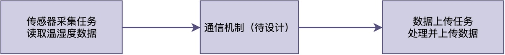
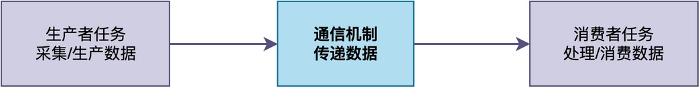
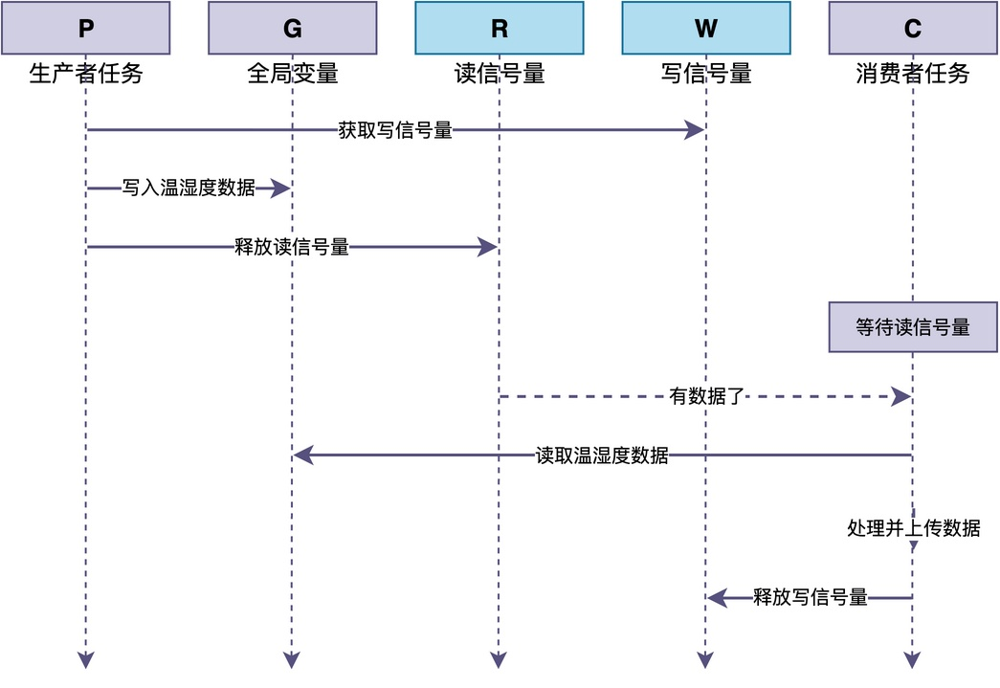
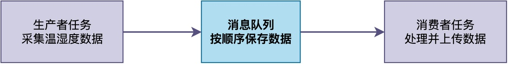
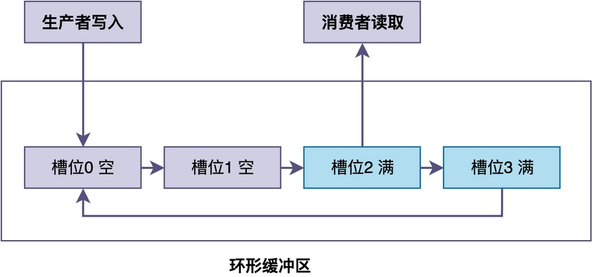
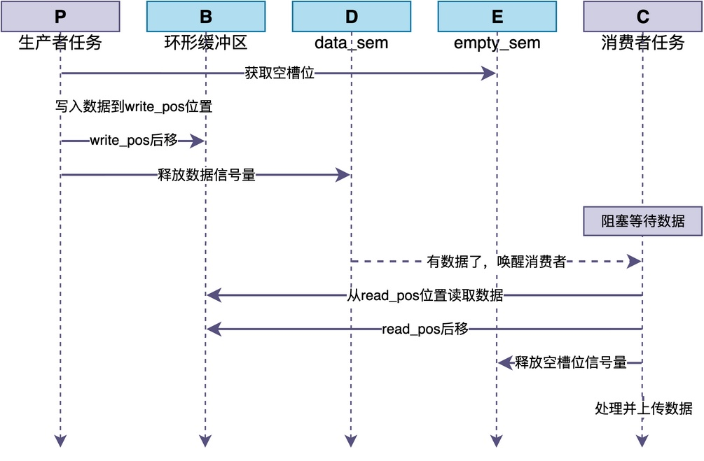

# 任务生产的数据如何交由另一任务处理？

在嵌入式开发中，我们经常会遇到这样的场景：一个任务负责从传感器采集数据，另一个任务负责处理和上传数据。这两个任务应该如何相互协作？

在我的《从0手写嵌入式操作系统》系列课程的配套温湿度监控的实践项目中，就有类似的需求：采集到的温湿度数据需要通过网络上传。


## 经典的生产者-消费者模型

在介绍具体的机制之前，我们可以将这个问题推广到更一般的情况。

如果不去深究到底是谁和谁协作、要传什么数据，这个问题其实可以抽象为：**生产者-消费者模型**。这是嵌入式系统中最常见的任务协作模型之一。

简单来说，这种模型就是：**一个任务负责生产数据（生产者），另一个任务负责处理数据（消费者）**。


**至于数据内容的格式和含义，则由开发者根据实际项目需要自行决定。**

在我们的日常开发中，常见的有以下几种生产者-消费者模型的例子：

- 一个任务从传感器采集温湿度数据，另一个任务把数据上传到服务器。
- 一个任务从串口接收数据帧，另一个任务解析和处理数据帧。
- 一个任务产生日志信息，另一个任务把日志写入存储设备。

那么，对于这些例子，具体有哪些方法可以实现生产者和消费者之间的数据传递呢？下面我们来逐一介绍。

## 方法一：全局变量加信号量

最简单的方法是使用全局变量加信号量。

这里有两个问题需要说明一下：

1. **消费者何时能拿到全局变量的读写权限**：使用读信号量。即消费者必须等待生产者释放读信号量，才能访问数据。
2. **生产者写的速度比较快，可能覆盖上次写入的数据**：使用写信号量。即生产者必须等消费者释放写信号量，才能写下一个数据。

整个流程如下图所示：


对应的代码如下：

```c
/* 全局变量，用于传递数据 */
float temperature = 0;
float humidity = 0;
rt_sem_t data_sem;   /* 读信号量：通知消费者有数据 */
rt_sem_t write_sem;  /* 写信号量：通知生产者可以写 */

/* 生产者任务：采集温湿度 */
void producer_task(void *parameter)
{
    while (1)
    {
        /* 等待可以写 */
        rt_sem_take(write_sem, RT_WAITING_FOREVER);

        /* 采集温湿度数据 */
        temperature = read_temperature();
        humidity = read_humidity();

        /* 通知消费者数据已就绪 */
        rt_sem_release(data_sem);

        rt_thread_mdelay(1000);
    }
}

/* 消费者任务：处理并上传数据 */
void consumer_task(void *parameter)
{
    while (1)
    {
        /* 等待数据就绪 */
        rt_sem_take(data_sem, RT_WAITING_FOREVER);

        /* 处理并上传数据 */
        printf("温度：%.1f度，湿度：%.1f%%\n", temperature, humidity);
        upload_data(temperature, humidity);

        /* 通知生产者可以写下一个数据了 */
        rt_sem_release(write_sem);
    }
}

int main(void)
{
    /* 读信号量初始值为0：一开始没有数据 */
    data_sem = rt_sem_create("data_sem", 0, RT_IPC_FLAG_FIFO);
    /* 写信号量初始值为1：一开始可以写 */
    write_sem = rt_sem_create("write_sem", 1, RT_IPC_FLAG_FIFO);
    /* 略 */
}
```

这种方法的优点是：**简单直接，容易理解**，而且通过两个信号量的配合，不会丢失数据。同时，也不会出现读写冲突的情况，无须加互斥锁进行保护。

**如果生产者生产的速度较慢、消费者消费的速度较快，甚至可以省去写信号量。**

但它也有几个明显的缺点：
- **每次只能传递一个数据**：生产者必须等消费者处理完才能写下一个，效率不高。
- **只能一对一传递**：不适合多个生产者或多个消费者的场景。

因此，这种方法只适合简单的、数据量小的场景。

## 方法二：消息队列

第二种方法，也是最常用的方法，是使用消息队列。

消息队列是RTOS提供的一种任务间通信机制。**生产者可以将数据发送到消息队列，消费者从队列中读取数据**。RTOS的消息队列通常自带阻塞和互斥机制，使用非常方便。

整个流程如下图所示：


对应的代码如下：

```c
/* 消息队列 */
rt_mq_t mq;

/* 数据结构 */
typedef struct {
    float temperature;
    float humidity;
} sensor_data_t;

/* 生产者任务：采集数据 */
void producer_task(void *parameter)
{
    sensor_data_t data;
    while (1)
    {
        /* 采集数据 */
        data.temperature = read_temperature();
        data.humidity = read_humidity();

        /* 发送到消息队列 */
        rt_mq_send(mq, &data, sizeof(data));

        rt_thread_mdelay(1000);
    }
}

/* 消费者任务：处理数据 */
void consumer_task(void *parameter)
{
    sensor_data_t data;
    while (1)
    {
        /* 从消息队列接收数据 */
        rt_mq_recv(mq, &data, sizeof(data), RT_WAITING_FOREVER);

        /* 处理并上传数据 */
        printf("温度：%.1f度，湿度：%.1f%%\n", data.temperature, data.humidity);
        upload_data(data.temperature, data.humidity);
    }
}
```

相比使用全局变量，消息队列的优点有：
- **可以缓存多个数据**：生产者生产速度快于消费者时不会丢失数据（只要队列没满）。
- **自带互斥和阻塞机制**：不需要额外处理。
- **支持多个生产者和多个消费者**。
- **可以传递不同类型的数据**（通过定义不同的消息结构）。

因此，消息队列是实现生产者-消费者模型最常用的方法，适合大多数场景。

## 方法三：自定义环形缓冲区

如果需要传递大量数据，或者对性能有特殊要求，可以自己实现一个环形缓冲区。

虽然很多RTOS提供的消息队列是采用环形缓冲区实现；但是，传递消息时常常采用的是消息拷贝，性能不高。即便可以通过传递消息指针的方式来传递，生产者和消费者需要自行管理内存的分配和释放，工作量较大。

所以，可以在项目中自行实现一个环形缓冲区，**生产者和消费者可以直接读写缓冲区里面的消息存放槽，避免消息拷贝问题**。


不过，开发者需要自行解决生产者和消费者的同步问题：

* 生产者需要通过信号量来通知消费者数据已经写入，有数据可以读取。
* 消费者需要通过信号量来通知生产者有空闲的槽位，可以用于写入消息。

因此，需要两个信号量：一个表示有数据可以读取（data_sem），一个表示有空槽位可以写入（empty_sem）。

下面给出了一个自定义环形缓冲区的示例：

```c
/* 环形缓冲区 */
#define BUF_SIZE 128
sensor_data_t buffer[BUF_SIZE];
volatile int read_pos = 0;
volatile int write_pos = 0;
rt_sem_t data_sem;   /* 有数据可以读取 */
rt_sem_t empty_sem;  /* 有空槽位可以写入 */

/* 生产者任务：采集数据并写入缓冲区 */
void producer_task(void *parameter)
{
    sensor_data_t data;
    while (1)
    {
        /* 等待有空槽位 */
        rt_sem_take(empty_sem, RT_WAITING_FOREVER);

        /* 采集数据 */
        data.temperature = read_temperature();
        data.humidity = read_humidity();

        /* 写入环形缓冲区 */
        buffer[write_pos] = data;
        write_pos = (write_pos + 1) % BUF_SIZE;

        /* 通知消费者有数据了 */
        rt_sem_release(data_sem);

        rt_thread_mdelay(1000);
    }
}

/* 消费者任务：从缓冲区读取数据并处理 */
void consumer_task(void *parameter)
{
    sensor_data_t data;
    while (1)
    {
        /* 等待有数据 */
        rt_sem_take(data_sem, RT_WAITING_FOREVER);

        /* 从缓冲区读取数据 */
        data = buffer[read_pos];
        read_pos = (read_pos + 1) % BUF_SIZE;

        /* 通知生产者有空槽位了 */
        rt_sem_release(empty_sem);

        /* 处理并上传数据 */
        printf("温度：%.1f度，湿度：%.1f%%\n", data.temperature, data.humidity);
        upload_data(data.temperature, data.humidity);
    }
}

int main(void)
{
    /* 创建信号量：data_sem初始值为0（一开始没有数据） */
    data_sem = rt_sem_create("data_sem", 0, RT_IPC_FLAG_FIFO);
    /* 创建信号量：empty_sem初始值为BUF_SIZE（一开始所有槽位都空） */
    empty_sem = rt_sem_create("empty_sem", BUF_SIZE, RT_IPC_FLAG_FIFO);
    /* 略 */
}
```

对于上述代码，你可能会有这样的疑问：是否需要加互斥锁？

> 其实，对于**单生产者单消费者的环形缓冲区**，通常不需要。
> 这是因为生产者只修改写指针（write_pos），消费者只修改读指针（read_pos），两者不会同时修改同一个变量，也不会同时访问同一个槽，即不会产生冲突。但如果有多个生产者或多个消费者，就需要加互斥锁来保护读写指针了。

上面代码的工作流程可以用下图表示：


与方法一类似，整个流程的核心是两个信号量的配合：
1. empty_sem控制生产者不能写满缓冲区，data_sem控制消费者不能读空缓冲区。
2. 生产者写一个数据就释放data_sem并获取empty_sem，消费者读一个数据就释放empty_sem并获取data_sem。

可以看出，环形缓冲区具备如下优点：
- **可以缓存多个数据**：适合数据量较大的场景，可根据自己项目中的场景灵活定义数据结构。
- **性能高**：任务可以直接读写消息槽，不需要进行拷贝，也无需动态分配内存。

不过，它的缺点是：**实现比较复杂，需要自己管理读写指针和满/空判断，某些情况下需要注意互斥保护**。
## 总结

综上所述，生产者-消费者模型是嵌入式系统中最常见的任务协作模式之一。

实现这种模型的通信机制主要有三种：

1. **全局变量加信号量**：这种方式简单直接，但只能传递一个数据，效率不高，适合简单场景。
2. **消息队列**：自带互斥和阻塞，支持多生产者多消费者，适合大多数场景。
3. **自定义环形缓冲区**：性能高，适合大量数据。但是，实现复杂，适合特殊需求场景。

在实际开发中，常常直接使用RTOS提供的消息队列。如果有特殊需求，再考虑其他方法。

---

> 如果你希望系统地学习RTOS底层原理，可以了解我的《RTOS开发与实战》课程。
>
> 课程不是简单地讲解FreeRTOS API的使用，而是带你从零开始编写一个RTOS内核，逐步实现任务管理、任务调度、上下文切换、同步与通信等核心机制，并通过一个远程温湿度监控设备项目，将操作系统原理应用到实际嵌入式开发中。
>
> 适合希望深入理解RTOS工作原理、提升嵌入式底层开发能力的同学。
>
> [课程详情](/blog/diyrtos/)
