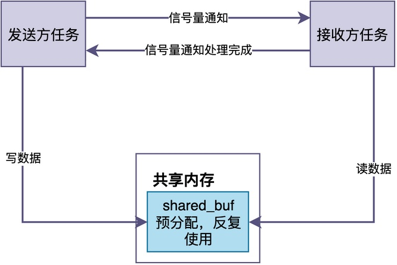
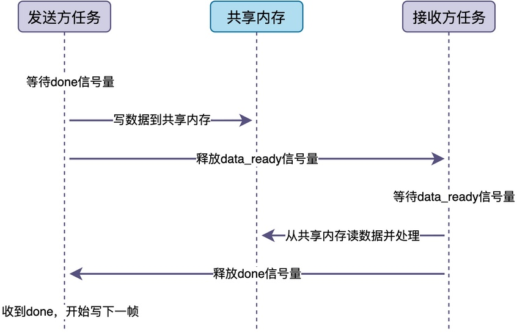

# 怎样在任务之间传递大块消息？

很多人在用RTOS的消息队列传递数据时，都会有这样的疑问：

> 对于几个字节的小消息，比如一个传感器读数，直接把数据发进消息队列完全没问题。
> 可如果消息很大呢？比如一帧图片有几十KB，一段音频有上百KB。
> 这时候还能把整个数据发进消息队列吗？有没有什么问题呢？

在这篇文章中，我就来聊一聊任务之间传递大块消息的正确做法。

## 直接通过消息队列传递

要理解大块消息传递的问题，首先要明白消息队列的底层实现方式。


消息队列在发送消息的时候，**并不是把数据的引用传进去，而是把数据完整地拷贝一份，存到队列内部的消息缓冲区里。接收消息的时候，再从缓冲区里把数据拷贝一份出来，交给接收任务**。

也就是说，一条消息从发送到接收，要经历 **“两次拷贝”** ：<font color="#245bdb">发送时从发送方的内存拷贝到队列缓冲区，接收时从队列缓冲区拷贝到接收方的内存</font>。

对于小消息来说，这两次拷贝的开销可以忽略不计。

> 但是，如果消息是32KB的图片呢？总共需要拷贝64KB！
> 这在主频只有几十MHz的MCU上，可能是**无法容忍**的。因为这可能要花掉几毫秒的时间！

此外，**由于消息队列需要缓存消息，我们将不得不为消息队列缓存区预留较大的内存空间，从而严重占用内存资源**。

## 解决方案：传递指针而不是数据

既然消息过大会导致这些问题，那么我们能不能想办法把消息变小？

举个生活中的例子：

> 假设你要给朋友送一个很大的箱子，里面装满了书。
> 如果直接把这个箱子扛到朋友家里交给他，那又重又费力气，搬一趟可能累得够呛。
> 但如果你只是给朋友打个电话，告诉他"箱子放在楼下快递柜的第3格，你自己去取"，朋友拿到地址之后自己就能找到箱子。
> 这样一来，是不是又轻松又高效？

类似地，我们可以转而采取一种更高效的办法：<font color="#245bdb">不在消息队列中传递数据本身，而是传递指向数据的指针</font>。


采用这种方法之后，整个消息传递过程如下：

1. 发送方分配一块内存，把大块数据填进去。
2. 发送方把这块内存的指针（4字节）发进消息队列。
3. 接收方从消息队列中取出指针。
4. 接收方通过指针访问数据，进行处理。
5. 接收方处理完之后，再释放这块内存。

这样一来，消息队列里传递的只是一个4字节的指针，两次拷贝也就8个字节，开销几乎可以忽略。

消息队列的缓冲区，也只需要考虑缓存的指针数量，不会占用大量的内存。

## 完整的示例

下面这段代码，展示了RT-Thread中，如何用消息队列传递指针的基本过程。

```c
/* 消息队列：只传递指针 */
static rt_mq_t img_mq;

/* 图片数据结构体 */
typedef struct {
    /* 略 */
} image_t;

/* 采集任务 */
static void capture_thread(void *p)
{
    while (1) {
        image_t *img = rt_malloc(sizeof(image_t));

        /* 填充图片数据 ... */

        /* 发送指针（只发4字节） */
        rt_mq_send(img_mq, &img, sizeof(img));
        rt_thread_mdelay(100);
    }
}

/* 处理任务 */
static void process_thread(void *p)
{
    image_t *img;
    while (1) {
        rt_mq_recv(img_mq, &img, sizeof(img), RT_WAITING_FOREVER);

        /* 处理图片 ... */

        rt_free(img);
    }
}
```

在该示例中，采集任务采集了一帧图片，需要传给处理任务进行处理。采集任务并没有将完整的图片数据发进消息队列，而是只发送了指向图片数据的指针；处理任务接收到的也只是一个指针，通过这个指针直接访问图片数据，处理完之后释放内存。

## 另一种方案：共享内存加信号量

在某些情况下，消息比较大且可以采用共享内存的方式时，可以使用另一种方案：共享内存+信号量同步。

这种方案的做法是：

> 预先分配一块共享内存，发送方和接收方都可以访问。
> 发送方往共享内存里写数据，写完之后用信号量通知接收方。
> 接收方收到信号量之后，从共享内存里读数据，处理完之后再用信号量通知发送方可以继续写。


可以看到，这种方案连指针都不需要传递，完全没有任何拷贝，极大减少了内存占用空间。

不过，这种方式也有一个不足：

> 只能一个读一个写，双方必须严格同步，发送方写完之后必须等接收方处理完才能写下一帧。

下面是一个完整的示例，包含发送方和接收方两个任务函数：

```c
/* 共享内存和信号量 */
static unsigned char shared_buf[1024];
static rt_sem_t data_ready;   /* 数据就绪通知 */
static rt_sem_t done;         /* 处理完成通知 */

/* 发送方任务 */
static void sender_thread(void *p)
{
    while (1) {
        /* 等待接收方处理完成，才能写下一帧 */
        rt_sem_take(done, RT_WAITING_FOREVER);

        /* 往共享内存写数据 */
        write_data(shared_buf);

        /* 通知接收方：数据准备好了 */
        rt_sem_release(data_ready);
    }
}

/* 接收方任务 */
static void receiver_thread(void *p)
{
    while (1) {
        /* 等待发送方数据准备好 */
        rt_sem_take(data_ready, RT_WAITING_FOREVER);

        /* 从共享内存读数据并处理 */
        read_and_process(shared_buf);

        /* 通知发送方：处理完成，可以写下一帧 */
        rt_sem_release(done);
    }
}
```

需要注意的是：
> done信号量的初始值应该设为1，这样发送方一开始就能往共享内存写数据；
> data_ready信号量的初始值设为0，等待发送方释放。

针对上述代码，其工作流程如下所示：


首先，发送方先等待done信号量，获得后往共享内存写数据，然后释放data_ready信号量通知接收方；

此时，接收方在等待data_ready信号量，获得后从共享内存读数据并处理，处理完释放done信号量通知发送方可以写下一帧。

如此一来，两个信号量像接力棒一样在两个任务之间传递，保证了共享内存的读写不会冲突。

## 总结

综上所述，我们看到任务之间传递消息的三种方式：

1. **按值拷贝**：适合小消息，简单直接，但大块数据的两次拷贝开销很大。
2. **传递指针**：适合大块消息，消息队列只传递4字节指针，数据本身零拷贝。
3. **共享内存加信号量**：适合超大块或高频发送，完全零拷贝，内存反复使用。

通过对比可知：传递大块消息时，应当采用传递指针或者共享内存的方式，从而大幅降低拷贝开销，提升系统的运行效率。

---

> 如果你希望系统地学习RTOS底层原理，可以了解我的《RTOS开发与实战》课程。
>
> 课程不是简单地讲解FreeRTOS API的使用，而是带你从零开始编写一个RTOS内核，逐步实现任务管理、任务调度、上下文切换、同步与通信等核心机制，并通过一个远程温湿度监控设备项目，将操作系统原理应用到实际嵌入式开发中。
>
> 适合希望深入理解RTOS工作原理、提升嵌入式底层开发能力的同学。
>
> [课程详情](/blog/diyrtos/)
