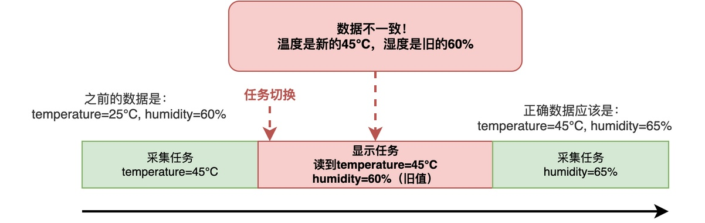

# RTOS中如何实现多个任务共享同一份数据？

在RTOS项目中，多个任务共享同一份数据是非常常见的需求。例如，采集任务负责采集传感器数据，显示任务负责显示数据，这两个任务需要访问同一份数据：温度和湿度，相应的框图如下：


当两个甚至更多任务同时访问同一份数据时，有可能出现一些莫名其妙的问题。

在这篇文章里，我将介绍可能出现的问题以及分析其中的原因，并给出几种解决方法。

## 问题及原因

对于上面的例子，我们可以用如下简化的代码进行具体说明：

```c
static int temperature;
static int humidity;

/* 采集任务 */
void collect_thread_entry(void *parameter)
{
    while (1)
    {
        temperature = read_temperature();
        humidity = read_humidity();

        rt_thread_mdelay(100);
    }
}

/* 显示任务 */
void display_thread_entry(void *parameter)
{
    while (1)
    {
        show_data(temperature, humidity);

        rt_thread_mdelay(500);
    }
}
```

这段代码比较简单：采集任务从传感器读取温湿度值后，存放到全局变量temperature和humidity中，显示任务再从这两个全局变量读取数据值，并刷新显示。

**这里不考虑两个任务之间的同步问题，只分析数据访问本身。实际运行时，可能会发现：显示任务可能显示错误的数据。**

如下图所示，采集任务刚读取温度，还没来得及更新湿度，显示任务就获得了CPU。此时，显示任务读到的可能是温度25℃、湿度60%（上一次的旧值），而非正确的数据温度25℃、湿度65%。



这就是共享数据时常见的竞态问题。也**就是说，多个任务对共享数据的访问顺序受到调度影响，如果缺少适当的保护机制，最终访问结果就可能取决于任务的执行时机。**

## 使用互斥锁

对于多个任务之间共享的数据，互斥锁是最常见的保护方式。

互斥锁的基本思路是：访问共享数据前先获取锁，访问完成后释放锁。当其他任务尝试获取同一把锁时，如果锁已被占用，就需要等待。

例如，我们可以对之前的代码进行修改，在读写之前先上锁，读写完再释放锁。

```c
static int temperature;
static int humidity;
static rt_mutex_t data_mutex;

/* 采集任务 */
void collect_thread_entry(void *parameter)
{
    while (1)
    {
        int temp = read_temperature();
        int humi = read_humidity();

        rt_mutex_take(data_mutex, RT_WAITING_FOREVER);
        temperature = temp;
        humidity = humi;
        rt_mutex_release(data_mutex);

        rt_thread_mdelay(100);
    }
}

/* 显示任务 */
void display_thread_entry(void *parameter)
{
    while (1)
    {
        int temp, humi;

        rt_mutex_take(data_mutex, RT_WAITING_FOREVER);
        temp = temperature;
        humi = humidity;
        rt_mutex_release(data_mutex);

        show_data(temp, humi);

        rt_thread_mdelay(500);
    }
}
```

其中，**如果传感器读取和显示都比较耗时，可以将这些耗时的操作放在锁外面执行**。如此一来，就不会因为这些耗时操作导致其他任务长时间等待。

此外，由于humidity和temperature之间存在关联，需要将其作为整体进行保护。

## 使用调度锁

相对而言，互斥锁的上锁和解锁都是较耗时的操作。

对于访问代码的执行时间非常短，也可以使用调度器锁定机制。利用调度锁，对原问题代码修改如下：

```c
static int temperature;
static int humidity;

/* 采集任务 */
void collect_thread_entry(void *parameter)
{
    while (1)
    {
        int temp = read_temperature();
        int humi = read_humidity();

        rt_enter_critical();
        temperature = temp;
        humidity = humi;
        rt_exit_critical();

        rt_thread_mdelay(100);
    }
}

/* 显示任务 */
void display_thread_entry(void *parameter)
{
    while (1)
    {
        int temp, humi;

        rt_enter_critical();
        temp = temperature;
        humi = humidity;
        rt_exit_critical();

        show_data(temp, humi);

        rt_thread_mdelay(500);
    }
}
```

当调度器上锁后，普通的任务切换就被禁止，任务可以安全地读写共享数据。

注意，锁定调度器不等于关闭中断，中断仍然可能发生。因此，如果中断服务程序也会访问同一份数据，仅靠调度器锁定是不够的。

## 使用关中断

如果访问代码的执行时间非常短，且在中断服务程序中也会访问同一份数据，则可以考虑使用关中断。

举个例子，假设串口接收中断里会更新一个接收计数器，而普通任务里需要读取这个计数器的值，这时候就要用关中断来保护：

```c
static int rx_count = 0;

/* 串口接收中断服务程序 */
void uart_rx_isr(void)
{
    rt_base_t level;

    level = rt_hw_interrupt_disable();
    rx_count++;
    rt_hw_interrupt_enable(level);
}

/* 统计任务 */
void stat_thread_entry(void *parameter)
{
    while (1)
    {
        int count;
        rt_base_t level;

        level = rt_hw_interrupt_disable();
        count = rx_count;
        rt_hw_interrupt_enable(level);

        rt_kprintf("received %d bytes\n", count);

        rt_thread_mdelay(1000);
    }
}
```

**一旦关掉中断，任何中断响应都无法发生，任务切换也不会进行，所以任务和中断都能安全地访问共享数据。**

## 总结

综上所述，多个任务共享同一份数据时，需要防止竞态条件，从而保证数据的一致性。

常用的保护方式主要有三种：互斥锁，适合保护较长的临界区；关调度器，适合保护非常短的任务间临界区；关中断，适合保护任务和中断之间共享的数据。

---

> 如果你希望系统地学习RTOS底层原理，可以了解我的《RTOS开发与实战》课程。
>
> 课程不是简单地讲解FreeRTOS API的使用，而是带你从零开始编写一个RTOS内核，逐步实现任务管理、任务调度、上下文切换、同步与通信等核心机制，并通过一个远程温湿度监控设备项目，将操作系统原理应用到实际嵌入式开发中。
>
> 适合希望深入理解RTOS工作原理、提升嵌入式底层开发能力的同学。
>
> [课程详情](/blog/diyrtos/)
