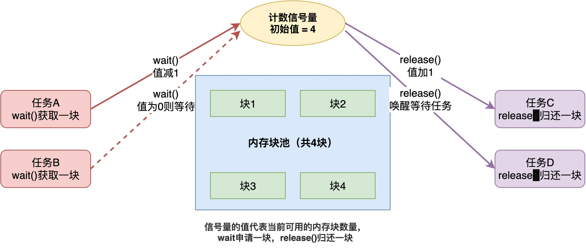

# RTOS中计数信号量如何用于管理多个相同的资源？

在学习信号量的时候，我们知道计数信号量可以用来做任务之间的同步，此时信号量可表示事件发生的次数。

除此之外，计数信号量还有另外一个**很重要的用途：用来管理多个相同的资源，其计数用于指明当前可用的资源数量是多少**。

> 例如，假设系统里预分配了4个固定大小的内存块，组成一个内存池。现在有好几个任务都需要申请内存块来存储数据，此时，怎么保证同一时间不会有两个任务用到同一块内存？
>
> 最简单的做法是设置4个标志位，每个标志位用于标识内存块是否空闲。但是，当所有块都分配出去之后，如果有任务申请内存块，无法实现任务等待和唤醒。

面对这种情况，可以使用计数信号量进行应对。

## 计数信号量的基本思路

利用计数信号量管理多个相同资源的思路很简单：**把信号量的初始值设为资源的总数。**

比如有4个内存块，那就创建一个初始值为4的计数信号量。



每个任务要使用内存块之前，先调用wait()获取一个信号量。如果信号量的值大于0，就减1，然后任务就获得了一个内存块的使用权；如果信号量的值已经是0了，说明4个内存块都被占用了，任务就阻塞等待。任务用完内存块之后，再调用release()释放信号量，信号量的值加1，同时唤醒正在等待的任务。

这样一来，**同一时间最多只有4个任务能使用内存块，不会出现分配冲突**。此时，计数信号量在这里起到了"配额"的作用，它**不关心具体哪块内存被用了，只关心还有几块可用**，同时也不关心内存块如何分配和释放。

## 具体示例

下面以RT-Thread为例，介绍如何使用计数信号量实现内存块的管理。具体实现代码如下：

```c
#define BLOCK_COUNT 4
#define BLOCK_SIZE  64

/* 内存块池 */
static uint8_t mem_pool[BLOCK_COUNT][BLOCK_SIZE];
static uint8_t block_used[BLOCK_COUNT];  /* 标记哪块被占用了 */

/* 计数信号量，初始值为内存块总数 */
static rt_sem_t mem_sem;
/* 互斥锁，保护内存池的遍历操作 */
static rt_mutex_t mem_mutex;

/* 初始化 */
void mem_pool_init(void)
{
    mem_sem = rt_sem_create("mem_sem", BLOCK_COUNT, RT_IPC_FLAG_FIFO);
    mem_mutex = rt_mutex_create("mem_mutex", RT_IPC_FLAG_FIFO);
    rt_memset(block_used, 0, sizeof(block_used));
}

/* 申请一个内存块 */
void *alloc_block(void)
{
    int i;
    void *ptr = RT_NULL;

    /* 先获取信号量，没有空闲块就阻塞等待 */
    rt_sem_wait(mem_sem, RT_WAITING_FOREVER);

    /* 加互斥锁，保护内存池的遍历 */
    rt_mutex_take(mem_mutex, RT_WAITING_FOREVER);

    /* 到这里肯定有空闲块，找一个返回 */
    for (i = 0; i < BLOCK_COUNT; i++)
    {
        if (block_used[i] == 0)
        {
            block_used[i] = 1;
            ptr = &mem_pool[i][0];
            break;
        }
    }

    /* 释放互斥锁 */
    rt_mutex_release(mem_mutex);

    return ptr;
}

/* 释放一个内存块 */
void free_block(void *ptr)
{
    int i;

    /* 加互斥锁，保护内存池的遍历 */
    rt_mutex_take(mem_mutex, RT_WAITING_FOREVER);

    /* 找到是哪块，标记为空闲 */
    for (i = 0; i < BLOCK_COUNT; i++)
    {
        if (&mem_pool[i][0] == ptr)
        {
            block_used[i] = 0;
            break;
        }
    }

    /* 释放互斥锁 */
    rt_mutex_release(mem_mutex);

    /* 释放信号量，唤醒等待的任务 */
    rt_sem_release(mem_sem);
}

/* 任务A使用内存块 */
void task_a_entry(void *parameter)
{
    while (1)
    {
        uint8_t *buf = alloc_block();

        /* 使用内存块 */
        rt_memset(buf, 0, BLOCK_SIZE);
        do_something(buf);

        free_block(buf);
        rt_thread_mdelay(100);
    }
}

/* 任务B使用内存块 */
void task_b_entry(void *parameter)
{
    while (1)
    {
        uint8_t *buf = alloc_block();

        /* 使用内存块 */
        rt_memset(buf, 0, BLOCK_SIZE);
        do_other_thing(buf);

        free_block(buf);
        rt_thread_mdelay(200);
    }
}
```

其中，alloc_block()用于申请内存块，每次申请前先调用rt_sem_wait()等待信号量，如果信号量计数值为0，则进入阻塞状态，等待其他任务释放信号量。只有获取到信号量后，才能从内存池中分配。而free_block()用于释放内存块，只在释放完内存块之后，才调用rt_sem_release()释放信号量。

与此同时，互斥锁负责保护"遍历内存池找块"的操作。通过与信号量的配合，就实现了一个简单但安全的多任务内存块管理。

## 综上所述

综上所述，**通过将信号量的初始值设为资源总数，任务使用资源前等待信号量、用完后释放信号量，就能保证同一时间使用资源的任务数不超过资源总数。**

值得注意的是，**计数信号量只负责跟踪可用资源的数量，不关心具体分配哪个资源以及如何分配**。这种方式在管理多个内存块、缓冲区、DMA通道等相同资源时特别常用。

---

> 如果你希望系统地学习RTOS底层原理，可以了解我的《RTOS开发与实战》课程。
>
> 课程不是简单地讲解FreeRTOS API的使用，而是带你从零开始编写一个RTOS内核，逐步实现任务管理、任务调度、上下文切换、同步与通信等核心机制，并通过一个远程温湿度监控设备项目，将操作系统原理应用到实际嵌入式开发中。
>
> 适合希望深入理解RTOS工作原理、提升嵌入式底层开发能力的同学。
>
> [课程详情](/blog/diyrtos/)
