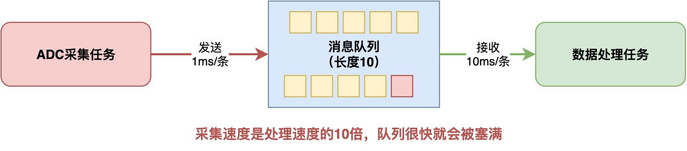
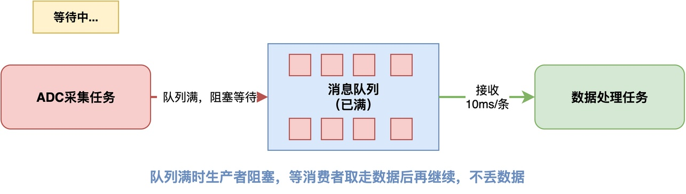
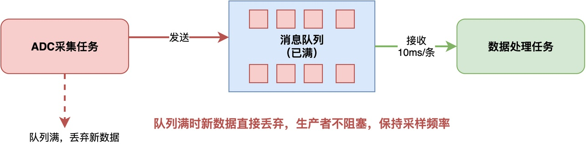
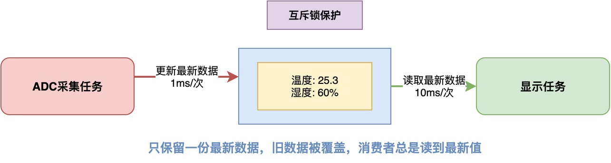

# RTOS中如何避免生产者发送数据的速度超过消费者处理数据的速度？

假设在我们的系统里，ADC采集任务负责从ADC采集数据，每1毫秒采集一次；数据处理任务负责对采集到的数据进行滤波和存储。不过，滤波和存储的处理比较慢，每10毫秒才能处理一条数据。

很明显，由于发送的速度比较快，数据处理任务来不及处理，消息队列很快就会被填满。此时，仍然有不断新采集到的数据产生。

这些新采集到的数据，是丢弃、还是缓存？还是说暂停ADC采集任务的工作？

## 问题一般化

如果将上面的例子一般化，我们就得到了一个之前介绍过的经典模型：生产者-消费者模型。**一个任务负责产生数据，叫做生产者；另一个任务负责处理数据，叫做消费者。消息队列则负责暂存两者之间的数据**。

问题的根源主要在于：**生产者的生产速度太快、消费者的消费速度太慢，两者之间存在速度差异**。而不在于消息队列，消息队列只是一个有限缓冲区，它只能暂存数据，并不能解决速度不匹配的问题。如果生产者持续比消费者快，那么不管队列设多大，迟早都会被塞满。

当消息队列被填满时，我们需要解决如何处理新生产的数据和位于消息队列中的老数据的问题。下面介绍几种处理方法。
## 方法一：队列满时等待

**如果说每一条数据都很重要、不能丢弃，必须加以处理；那么，可以让生产者在队列满时阻塞，等队列有空位后再生产数据。**


例如，在RT-Thread中，可以用rt_mq_send_wait()，并且把等待时间设成RT_WAITING_FOREVER。这样当队列满了的时候，采集任务就会自动阻塞，等消费者取走一条消息腾出空间之后，再去采集ADC数据。


```c
/* ADC采集任务（生产者） */
void adc_task_entry(void *parameter)
{
    while (1)
    {
        rt_uint16_t data = read_adc();

        /* 队列满了就阻塞等待，不会丢数据 */
        rt_mq_send_wait(adc_mq, &data, sizeof(data), RT_WAITING_FOREVER);

        rt_thread_mdelay(1);
    }
}
```

这种方式的好处是不会丢数据，生产者会自动适配消费者的速度。

不过，它也有明显的限制：生产者一旦阻塞，就无法按原来的速度继续产生数据。换句话说，如果采集任务负责严格周期的ADC采样，那么阻塞等待可能导致采样时间不准，甚至错过后续采样。

## 方法二：非阻塞发送，丢弃新数据

**如果系统允许丢失部分数据，或者说偶尔丢几条也不影响整体结果，那么可以采用非阻塞发送。**

当向消息队列写数据时，如果队列有空间就发送，队列满了就直接丢掉这条新数据，生产者继续运行，不会被阻塞。



比如，对于周期性的传感器数据采集，偶尔丢一两个采样点对后续的滤波和分析影响不大，这种情况下让采集任务保持稳定的采样频率，这比每条数据都要发出去更重要。

```c
/* ADC采集任务（生产者） */
void adc_task_entry(void *parameter)
{
    rt_uint16_t data;

    while (1)
    {
        data = read_adc();

        if (rt_mq_send(adc_mq, &data, sizeof(data)) != RT_EOK)
        {
            /* 队列满或发送失败，记录错误计数 */
            dropped_count++;
        }

        rt_thread_mdelay(1);
    }
}
```

上述代码通过使用非阻塞函数rt_mq_send()写消息，并通过返回值判断发送是否成功。

这种方式不会因为队列满而主动等待，但代价是可能丢失数据。因此实际项目应当统计丢弃次数，必要时发出告警，以便判断消费者是否长期跟不上生产者。

## 方法三：使用共享缓冲区，只保留最新数据

在某些场景下，既不需要生产者阻塞，也不需要保留历史数据，而只是希望消费者尽可能拿到最新的数据。

例如，在屏幕显示中，只需要显示当前最新的温度，至于以前的温度是什么无关紧要。**在这种情况下，可以简化设计，在程序中使用一个简单的共享缓冲区，即只保留最新的数据**。



下面的代码给出了相应的例子，latest_data用于存储最新的数据，且使用互斥锁来处理竞态问题。

```c
struct sensor_data
{
    rt_uint16_t temperature;
    rt_uint16_t humidity;
};

static struct sensor_data latest_data;
static rt_mutex_t data_mutex;

/* 生产者：更新最新数据 */
void adc_task_entry(void *parameter)
{
    struct sensor_data data;

    while (1)
    {
        data.temperature = read_temperature();
        data.humidity = read_humidity();

        rt_mutex_take(data_mutex, RT_WAITING_FOREVER);
        latest_data = data;
        rt_mutex_release(data_mutex);

        rt_thread_mdelay(1);
    }
}

/* 消费者：读取最新数据 */
void display_task_entry(void *parameter)
{
    struct sensor_data snapshot;

    while (1)
    {
        rt_mutex_take(data_mutex, RT_WAITING_FOREVER);
        snapshot = latest_data;
        rt_mutex_release(data_mutex);

        display_data(&snapshot);

        rt_thread_mdelay(10);
    }
}
```

## 方法四：优化消费者的处理能力

除了调整生产者的行为之外，我们也**可以优化消费者的消费能力，也就是说，可能提高其处理能力。**

例如，如果让每条数据都写一次Flash，可能会因为频繁写入导致较大的耗时。此时，可以考虑把多条数据积累到一个缓冲区中，再批量写入Flash，从而减少重复操作的开销。

## 总结

综上所述，消息队列本身只是有限缓冲区，不能从根本上解决生产者和消费者速度不匹配的问题。面对速度不匹配的情况，我们需要根据实际需求选择合适的处理策略。

如果每条数据都不能丢失，就让生产者在队列满时阻塞等待；如果数据允许偶尔丢失，就用非阻塞发送，队列满了直接丢掉新数据；如果只关心最新的状态，就用共享缓冲区只保留最新值；如果所有数据都必须处理，就得从算法和流程上优化消费者的处理能力。

---

> 如果你希望系统地学习RTOS底层原理，可以了解我的《RTOS开发与实战》课程。
>
> 课程不是简单地讲解FreeRTOS API的使用，而是带你从零开始编写一个RTOS内核，逐步实现任务管理、任务调度、上下文切换、同步与通信等核心机制，并通过一个远程温湿度监控设备项目，将操作系统原理应用到实际嵌入式开发中。
>
> 适合希望深入理解RTOS工作原理、提升嵌入式底层开发能力的同学。
>
> [课程详情](/blog/diyrtos/)
