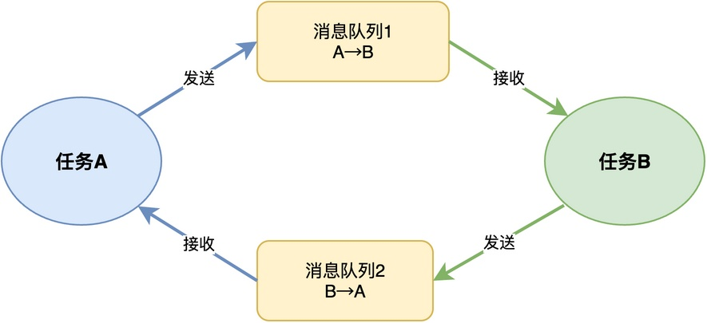
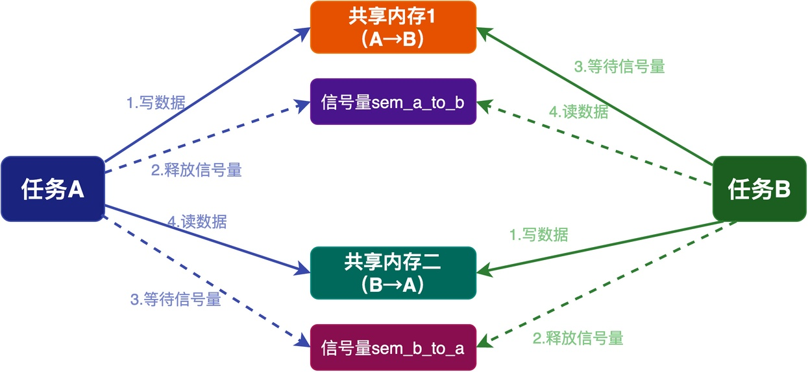

# RTOS中如何实现任务之间的双向通信？

在实际项目中，我们经常会遇到两个任务需要互相传递数据的情况。

比如，数据采集任务负责从传感器读数据，数据处理任务负责计算分析。采集任务要把原始数据传给处理任务，处理任务又要把结果回传给采集任务，让它调整采集参数。


**这种就是典型的双向通信：两个任务之间可以互相发送和接收数据。**

那么，在RTOS中如何实现双向通信呢？这篇文章介绍两种常用方法。

## 方法一：使用消息队列

你可能想到的最简单、最直接的方法是：**使用两个消息队列。一个队列负责A到B的方向，另一个负责B到A的方向，两个加起来就实现了双向通信。**

例如，在下图中，任务A通过消息队列1向任务B发送数据，任务B通过消息队列2向任务A发送数据，两个队列各司其职。



对于上图的示例，在RT-Thread中，可以通过如下代码分别创建两个消息队列：

```c
/* 创建两个消息队列，每条消息大小4字节，最多16条 */
rt_mq_t mq_a_to_b = rt_mq_create("mq_ab", 4, 16, RT_IPC_FLAG_FIFO);
rt_mq_t mq_b_to_a = rt_mq_create("mq_ba", 4, 16, RT_IPC_FLAG_FIFO);
```

当任务A要发送消息时，使用mq_a_to_b；当要接收消息时，使用mq_b_to_a：

```c
void task_a_entry(void *arg)
{
    int send_msg = 0x1234;
    int recv_msg;
    while (1) {
        rt_mq_send(mq_a_to_b, &send_msg, sizeof(send_msg));
        rt_mq_recv(mq_b_to_a, &recv_msg, sizeof(recv_msg), RT_WAITING_FOREVER);
    }
}
```

任务B正好相反，使用mq_a_to_b接收消息，使用mq_b_to_a发送消息：

```c
void task_b_entry(void *arg)
{
    int recv_msg;
    int send_msg = 0x5678;
    while (1) {
        rt_mq_recv(mq_a_to_b, &recv_msg, sizeof(recv_msg), RT_WAITING_FOREVER);
        rt_mq_send(mq_b_to_a, &send_msg, sizeof(send_msg));
    }
}
```

这种方法简单直观、可以缓存消息，是实际项目中用得最多的方法。缺点是需要维护两个队列，占用较多内存。

## 方法二：共享内存加信号量

在某些特殊情况下，出于节省内存和提高消息传递效率的考虑，我们可以采用共享内存加信号量的方式来实现双向通信。

具体思路是：提供两块共享内存，一块用来存放A发给B的数据，另一块用来存放B发给A的数据，并分别通过两个信号量来实现读写同步。这种实现方式如下：


从图中可以看出，两个信号量的作用分别是：信号量1表示"A有数据给B"，信号量2表示"B有数据给A"。

> 当A给B发数据时，先把数据写到共享内存1，再释放信号量1，通知任务B有数据。反过来，B给A发数据时也是一样的流程，只不过用的是共享内存2和信号量2。

代码示例如下，首先定义共享内存的结构和两个信号量：

```c
/* 共享内存，分两个区域 */
struct shared_data {
    int a_to_b[1024];  /* A发给B的数据区 */
    int b_to_a[1024];  /* B发给A的数据区 */
};
struct shared_data *g_shared;

/* 两个信号量，初始值都是0 */
rt_sem_t sem_a_to_b = rt_sem_create("sem_ab", 0, RT_IPC_FLAG_FIFO);
rt_sem_t sem_b_to_a = rt_sem_create("sem_ba", 0, RT_IPC_FLAG_FIFO);
```

当A需要发数据给B时，先将数据写入共享内存，之后释放信号量通知B：

```c
/* A写数据到a_to_b区 */
for (int i = 0; i < 1024; i++) {
    g_shared->a_to_b[i] = i;
}
/* 释放信号量，通知B来取数据 */
rt_sem_release(sem_a_to_b);
```

而B一直在等待信号量，当收到通知后从共享内存读数据：

```c
/* 等待A的数据 */
rt_sem_take(sem_a_to_b, RT_WAITING_FOREVER);
/* 从a_to_b区读数据 */
for (int i = 0; i < 1024; i++) {
    process_data(g_shared->a_to_b[i]);
}
```

反过来，B发数据给A也是一样的流程：

```c
/* B写数据到b_to_a区 */
for (int i = 0; i < 1024; i++) {
    g_shared->b_to_a[i] = i * 2;
}
/* 释放信号量，通知A来取数据 */
rt_sem_release(sem_b_to_a);
```

A等待信号量，收到通知后从共享内存读数据：

```c
/* 等待B的数据 */
rt_sem_take(sem_b_to_a, RT_WAITING_FOREVER);
/* 从b_to_a区读数据 */
for (int i = 0; i < 1024; i++) {
    process_result(g_shared->b_to_a[i]);
}
```

## 总结

综上所述，RTOS中实现双向通信时，可以采用以下两种方法：

1. **两个消息队列**：简单直观，通用性强，适合小数据量，是最常用的方法
2. **共享内存加信号量**：效率高，零拷贝，适合大数据量，但实现稍复杂

另外需要注意，双向通信很容易出现死锁问题，关于死锁的产生原因和解决方法，在我的其他文章中有详细说明。

---

> 如果你希望系统地学习RTOS底层原理，可以了解我的《RTOS开发与实战》课程。
>
> 课程不是简单地讲解FreeRTOS API的使用，而是带你从零开始编写一个RTOS内核，逐步实现任务管理、任务调度、上下文切换、同步与通信等核心机制，并通过一个远程温湿度监控设备项目，将操作系统原理应用到实际嵌入式开发中。
>
> 适合希望深入理解RTOS工作原理、提升嵌入式底层开发能力的同学。
>
> [课程详情](/blog/diyrtos/)
