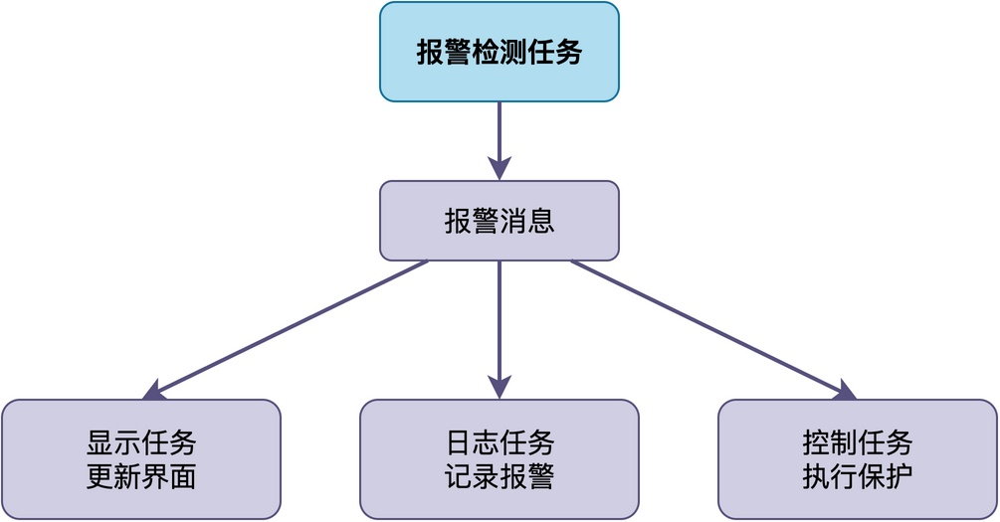
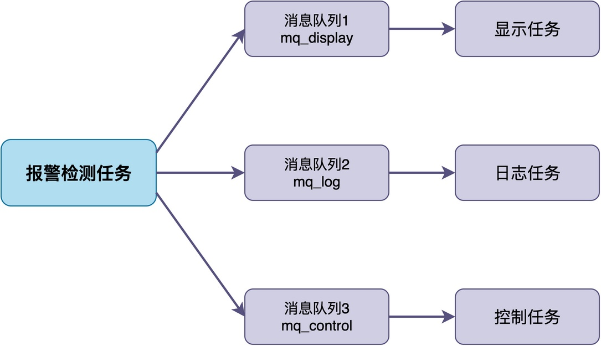
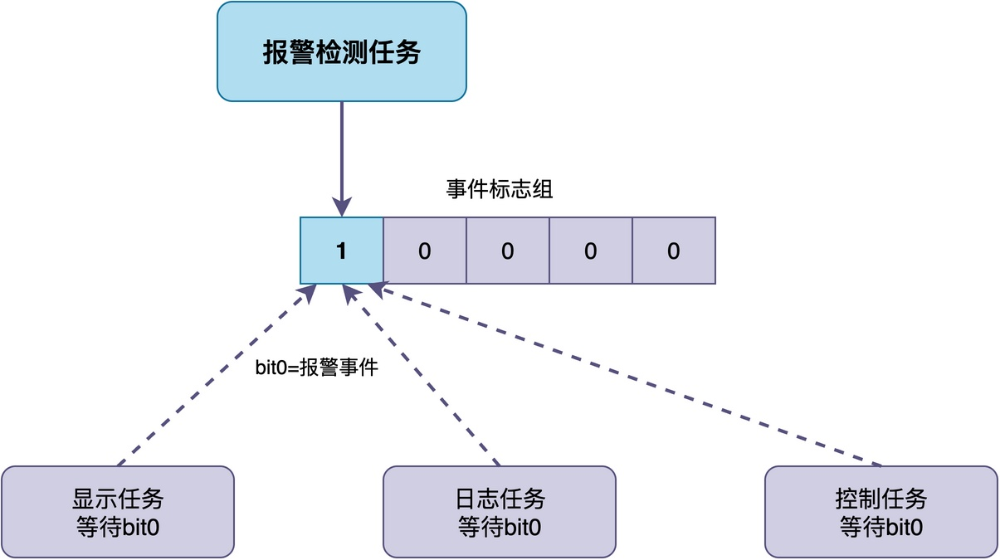
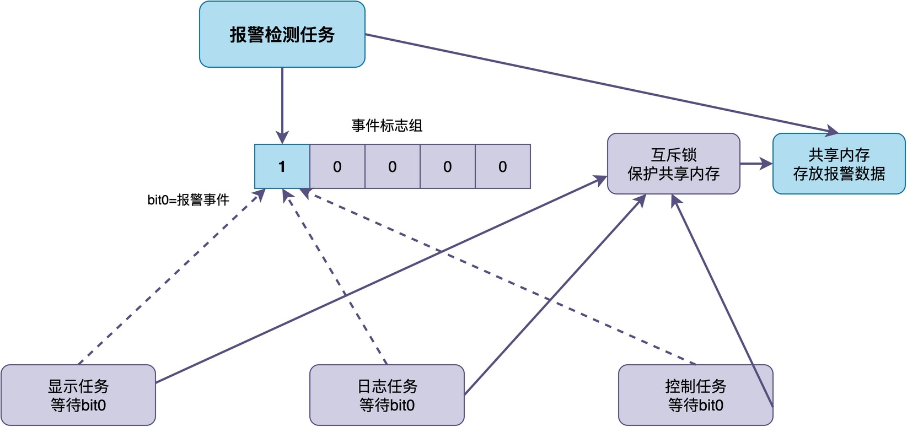

# RTOS中如何实现一个任务向多个任务广播消息？

有位同学在开发物联网项目时，碰到过这样的一个需求：

> 当系统检测到报警信号时，需要同时通知显示任务更新界面、通知日志任务记录报警、通知控制任务执行相应的保护动作。
 
为了实现这种通知操作，应该让报警检查任务向多个任务发送“广播消息”，所有任务都收到相同的消息内容。



那么在RTOS中，如何实现这种“发送广播消息”的功能呢？在这篇文章中，我将介绍三种常用的实现方法。

## 方法一：使用消息队列

提到任务之间的消息通信，你可能首先想到的是使用RTOS的消息队列。

不过，**RTOS提供的消息队列，几乎都并不支持广播发送**，这主要是因为：消息队列采用的是FIFO结构，一条消息放到队列之后，当有多个任务同时等待这个队列时，只有一个任务能把这条消息取走，并不会继续在队列中保留。

因此，如果需要广播发送，可以考虑使用多个消息队列。如下图所示，共创建了三个消息队列。当要广播发送的时候，就依次往每个队列里都发一份同样的消息。这样每个接收任务都能从自己的队列里收到完整的数据，互不干扰。


将这种方式应用到之前的问题，可以分别创建三个消息队列：

```c
/* 给三个接收任务分别创建消息队列 */
rt_mq_t mq_display = rt_mq_create("mq_disp", 32, 8, RT_IPC_FLAG_FIFO);
rt_mq_t mq_log     = rt_mq_create("mq_log",  32, 8, RT_IPC_FLAG_FIFO);
rt_mq_t mq_control = rt_mq_create("mq_ctrl", 32, 8, RT_IPC_FLAG_FIFO);
```

当报警检测任务检测到报警后，依次往三个队列里都发一份同样的报警消息：

```c
/* 报警检测任务 */
void alarm_task(void *arg)
{
    struct alarm_msg msg;
    while (1) {
        if (check_alarm(&msg)) {
            /* 依次往三个队列发送同样的消息 */
            rt_mq_send(mq_display, &msg, sizeof(msg));
            rt_mq_send(mq_log,     &msg, sizeof(msg));
            rt_mq_send(mq_control, &msg, sizeof(msg));
        }
        rt_thread_mdelay(100);
    }
}
```

而每个接收任务从自己的队列里接收消息，然后做相应的处理：

```c
/* 显示任务：从自己的队列收消息，更新界面 */
void display_task(void *arg)
{
    struct alarm_msg msg;
    while (1) {
        rt_mq_recv(mq_display, &msg, sizeof(msg), RT_WAITING_FOREVER);
        update_display(&msg);
    }
}

/* 日志任务和控制任务的实现类似，只是处理函数不同 */
```

可以看到，**这种方法的优点是：可以传递任意数据，每个任务独立处理，互不干扰**。缺点是：**需要维护多个队列，占用内存比较多，而且发送的时候要发多次，效率稍低**。

## 方法二：使用事件标志组

**如果广播的时候不需要传递具体的数据，只需要通知某个事件发生了，使用事件标志组是更为明智的选择。**

当使用事件标志组时，多个任务可以同时等待同一个事件位。当这个事件位被设置的时候，所有等待它的任务都会被同时唤醒。这种特点，可以直接用于实现广播机制。

如下图所示，我们可以选择事件标志组的bit0来表示是否产生了报警事件。报警检查任务可以将该标志位置1，来通知其它任务有报警事件发生，而显示任务、日志任务、控制任务都去等待这个事件位。



将这种方式应用到之前的问题，可以创建一个事件标志组：

```c
rt_event_t event = rt_event_create("event", RT_IPC_FLAG_FIFO);
```

之后，配置三个任务都去等待同一个事件位：

```c
/* 显示任务 */
void display_task(void *arg)
{
    rt_uint32_t e;
    while (1) {
        rt_event_recv(event, 0x01, RT_EVENT_FLAG_OR, RT_WAITING_FOREVER, &e);
        /* 更新显示界面 */
        update_display();
    }
}

/* 日志任务和控制任务的实现类似，只是处理函数不同 */
```

检测到事件后，设置事件位，从而让所有等待的任务都会被唤醒：

```c
/* 报警检测任务 */
void alarm_task(void *arg)
{
    while (1) {
        if (check_alarm()) {
            /* 设置事件位，广播给所有等待的任务 */
            rt_event_send(event, 0x01);
        }
        rt_thread_mdelay(100);
    }
}
```

由此可见，这种方法的优点是：**简单高效，一次设置就能唤醒所有等待的任务**。缺点是：**只能传递事件，不能传递具体的数据**。

## 方法三：事件标志组加共享内存实现广播

如果希望在广播事件的同时，还能传递具体的消息数据，那就可以在事件标志组的基础上，再加上一块共享内存，用于存放消息数据。

**当所有任务被事件唤醒之后，它们各自去共享内存里面读取具体的消息数据**。由于多个任务会同时访问共享内存，所以还需要加一个互斥锁来保护共享内存的读写。这种实现机制如下图所示：



当报警任务检测到报警后，先把报警数据写到共享内存，再设置事件位，从而唤醒所有等待的任务。三个任务被唤醒后，再从共享内存读取数据，并进行处理。

对报警任务的代码进行调整，调整结构如下：

```c
/* 报警检测任务 */
void alarm_task(void *arg)
{
    while (1) {
        if (check_alarm()) {
            /* 先加锁，把报警数据写到共享内存 */
            rt_mutex_take(mutex, RT_WAITING_FOREVER);
            g_alarm_data.type = get_alarm_type();
            g_alarm_data.value = get_alarm_value();
            rt_mutex_release(mutex);
            
            /* 再设置事件位，广播给所有等待的任务 */
            rt_event_send(event, 0x01);
        }
        rt_thread_mdelay(100);
    }
}
```

三个接收任务被唤醒后，从共享内存读取数据：

```c
/* 显示任务 */
void display_task(void *arg)
{
    rt_uint32_t e;
    while (1) {
        rt_event_recv(event, 0x01, RT_EVENT_FLAG_OR,
                      RT_WAITING_FOREVER, &e);
        /* 加锁读取共享内存 */
        rt_mutex_take(mutex, RT_WAITING_FOREVER);
        struct alarm_msg data = g_alarm_data;
        rt_mutex_release(mutex);
        /* 更新显示界面 */
        update_display(&data);
    }
}

/* 日志任务和控制任务的实现类似，只是处理函数不同 */
```

这种方法结合了事件标志组和共享内存的优点，既能**同时唤醒所有任务，又能传递具体的数据**。缺点是：**实现稍复杂，需要额外维护共享内存和互斥锁**。

## 总结

综上所述，RTOS中实现一个任务向多个任务广播消息，可以采用如下三种方法：

1. **多个消息队列**：每个接收任务一个队列，适合需要传数据且任务数量不多的场景。
2. **事件标志组**：最简单高效，一次设置唤醒所有等待任务，适合只需要通知事件不需要传数据的场景。
3. **事件标志组加共享内存**：适合需要同时广播事件和数据的场景。

实际项目中可以根据是否需要传递数据、数据量大小、任务数量等因素来选择合适的方法。如果只需要通知事件，优先用事件标志组；如果需要传小数据且任务不多，用多个消息队列；如果需要广播事件同时带数据，用事件标志组加共享内存。

---

> 如果你希望系统地学习RTOS底层原理，可以了解我的《RTOS开发与实战》课程。
>
> 课程不是简单地讲解FreeRTOS API的使用，而是带你从零开始编写一个RTOS内核，逐步实现任务管理、任务调度、上下文切换、同步与通信等核心机制，并通过一个远程温湿度监控设备项目，将操作系统原理应用到实际嵌入式开发中。
>
> 适合希望深入理解RTOS工作原理、提升嵌入式底层开发能力的同学。
>
> [课程详情](/blog/diyrtos/)
