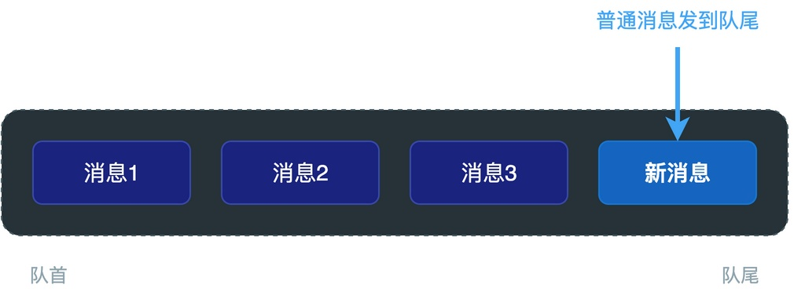
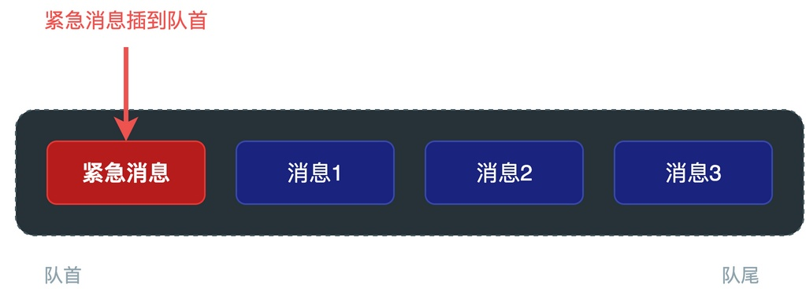

# 什么是紧急消息？RTOS中如何实现发送紧急消息？

有位同学在学习我的《从0手写嵌入式操作系统》课程时，对消息队列中的紧急消息处理机制不太理解。这里写篇文章详细说明。

> 假设在某个工业控制系统中，有一个任务负责处理各种常规控制指令，比如读取温度、调整阀门开度、上报运行状态等等。这些指令都通过消息队列发给该任务处理。
> 这时候如果系统检测到压力超标或者电机过载，触发了紧急停机信号。
> 显然，这个紧急停机消息就非常关键，必须立即处理，不能排在那些常规指令后面等待。

如果按照常规的消息队列处理机制，紧急停机消息默认会插入消息队列尾部，这样做的后果便是：**只有在队列中其他消息处理完之后，才能处理该消息，造成紧急停机动作滞后。**

而如果使用紧急消息机制，紧急停机消息会直接插入到队列头部，优先被处理，效果如下图所示。


这其实就是一个很典型的场景：队列里已经有好几条普通消息在排队等待处理了，这时候突然来了一条非常紧急的消息，需要立即被接收处理，不能排在后面等。

此时，就需要利用到RTOS中消息队列的紧急消息处理机制。

## 紧急消息处理机制的实现原理

要理解该机制的实现原理，我们首先得知道普通消息队列的内部是怎么工作的。

**通常情况下，消息队列内部一般是用链表或者环形缓冲区来实现，构建成一条有序队列。**

普通消息发送的时候，是把新消息插入到队列的尾部。接收消息的时候，从队列的头部把消息取出来。这样就保证了先发的消息先被接收，也就是采用了**先进先出（FIFO）策略**。



如果希望某条消息能够被优先接收，怎么办呢？

方法很简单，只要把这条紧急消息插入到队首，那它自然就会被下一次接收操作优先取到，也就是采用了**后进先出（LIFO）策略**。



通过改变插入方式，紧急消息就跳过了队列中所有正在排队的普通消息，直接排在了最前面，下一次接收的时候就会先取到它。

## RT-Thread中如何发送紧急消息

不仅我的《从0手写嵌入式操作系统》设计的RTOS支持发送紧急消息，RT-Thread等也提供了现成的API可直接使用。

下面给出了发送紧急消息的示例代码：

```c
/* 紧急检测任务发送紧急停机消息 */
void emergency_task(void *arg)
{
    int stop_cmd = 0xFF;
    while (1) {
        if (check_emergency()) {
            /* 紧急消息发送到队首，插队优先处理 */
            rt_mq_urgent(mq, &stop_cmd, sizeof(stop_cmd));
        }
        rt_thread_mdelay(100);
    }
}
```

当需要发送紧急消息时，直接调用专用的接口rt_mq_urgent()即可。

接收任务不需要做任何特殊处理，还是正常地从队首取消息就行，相关示例代码如下：

```c
/* 控制任务，正常接收消息即可 */
void control_task(void *arg)
{
    int cmd;
    while (1) {
        /* 从队首接收消息，紧急消息会优先被取到 */
        rt_mq_recv(mq, &cmd, sizeof(cmd), RT_WAITING_FOREVER);
        
        if (cmd == 0xFF) {
            /* 处理紧急停机 */
            handle_emergency_stop();
        } else {
            /* 处理普通控制指令 */
            handle_normal_cmd(cmd);
        }
    }
}
```

## 总结

综上所述，紧急消息就是需要被优先处理的消息，该消息会被插入到消息队列头部，从而被优先取出处理。

在实际项目中，对于报警、紧急停机、故障处理这类需要立即响应的事件，就可以用紧急消息的方式来发送，保证它们能够得到及时处理。

---

> 如果你希望系统地学习RTOS底层原理，可以了解我的《RTOS开发与实战》课程。
>
> 课程不是简单地讲解FreeRTOS API的使用，而是带你从零开始编写一个RTOS内核，逐步实现任务管理、任务调度、上下文切换、同步与通信等核心机制，并通过一个远程温湿度监控设备项目，将操作系统原理应用到实际嵌入式开发中。
>
> 适合希望深入理解RTOS工作原理、提升嵌入式底层开发能力的同学。
>
> [课程详情](/blog/diyrtos/)
