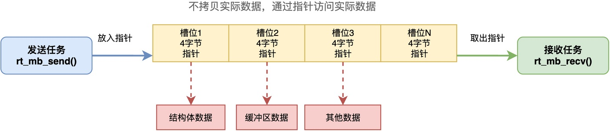

# 可以通过邮箱传递哪些类型的数据？

在RT-Thread中，提供了一种叫做邮箱的机制，用来实现任务之间的数据通信。

我们可以利用如下接口，实现消息的发送和接收：

```c
rt_err_t rt_mb_send(rt_mailbox_t mb, rt_ubase_t value);
rt_err_t rt_mb_recv(rt_mailbox_t mb, rt_ubase_t *value, rt_int32_t timeout);
```

也许你已经注意到，rt_mb_send()的第二个参数是rt_ubase_t类型，也就是一个长度为CPU字长的无符号整数。

那么你可能就有疑问：邮箱只能传递一个机器字长的整数吗？能不能传递一些其他类型的数据呢？这背后的具体原理是什么样的？

接下来，我将从邮箱的工作原理出发，分析可以传入哪些类型的数据。

## 邮箱的工作原理

要理解邮箱能传递什么，首先要明白邮箱的工作原理。

> 本文虽然以RT-Thread为例，但是更侧重于介绍通用性的知识，即不限于某个特定的RTOS。
> 另外，在有些RTOS中，将邮箱称为消息队列，传递的内容称为消息。

大部分RTOS的邮箱，可以缓存多个消息。每个消息的大小等于一个机器字长，在32位系统上是4字节，在64位系统上是8字节，正好是一个指针的大小。

所以，**邮箱在很多时候是用来传递指针的，发送方把一个指针的值放进邮箱的槽位里，接收方从邮箱里取出这个指针，然后通过指针去访问实际的数据**。这个过程如下图所示（以32位处理器为例）：



而指针的大小，正好等于CPU机器字长。这也就是为什么rt_mb_send()的参数value是CPU字长的无符号整数。

## 可以传递哪些类型的数据

既然已经知道可以用来传递指针，那么项目中具体应该如何使用？下面给出了一些例子。

**我们可以用来传递结构体指针**。比如，采集任务采集到数据后，写入传感器数据的结构体，再将这个结构体的指针通过邮箱发给处理任务。

```c
struct sensor_data {
    int temperature;
    int humidity;
};

struct sensor_data data;
rt_mb_send(mb, (rt_ubase_t)&data);
```

也可以用来传递字节缓冲区的指针。比如，当串口接收到一帧数据时，可以将帧缓冲区的指针通过邮箱发给解析任务。这样不需要把整个缓冲区的数据拷贝一遍，效率很高。

```c
char buf[128];
rt_mb_send(mb, (rt_ubase_t)buf);
```

实际上，除了传递指针之外，还可以用来传递其他类型的数据。

例如，**可以用来传递整型值或者枚举值**，如命令码、状态码。这些类型的值长度不超过机器字长，完全可以通过邮箱传送。

```c
enum command {
    CMD_START,
    CMD_STOP,
    CMD_RESET
};

rt_mb_send(mb, (rt_ubase_t)CMD_START);
```

同理，也**可用来传递句柄或者某种ID**，比如设备ID、文件描述符等，这些本质上都是整数或者指针，都可以通过邮箱传递。

也就是说，**只要能够转换成机器字长的数据，都可以将它传给邮箱，只需要在语法上进行强制类型转换（如(rt_ubase_t)CMD_START）**。

邮箱内部在进行传递的时候，只是将内容当作机器字长的无符号整数进行处理。至于这个整数代表什么含义，是由发送方和接收方约定好的。

## 总结

综上所述，邮箱本质上传递的是一个机器字长的整数。

这个整数可以是指向任意数据结构的指针、指向缓冲区的指针、整型值或枚举值、句柄或ID等等。只要数据的长度不超过机器字长，都可以通过邮箱传递。

---

> 如果你希望系统地学习RTOS底层原理，可以了解我的《RTOS开发与实战》课程。
>
> 课程不是简单地讲解FreeRTOS API的使用，而是带你从零开始编写一个RTOS内核，逐步实现任务管理、任务调度、上下文切换、同步与通信等核心机制，并通过一个远程温湿度监控设备项目，将操作系统原理应用到实际嵌入式开发中。
>
> 适合希望深入理解RTOS工作原理、提升嵌入式底层开发能力的同学。
>
> [课程详情](/blog/diyrtos/)
