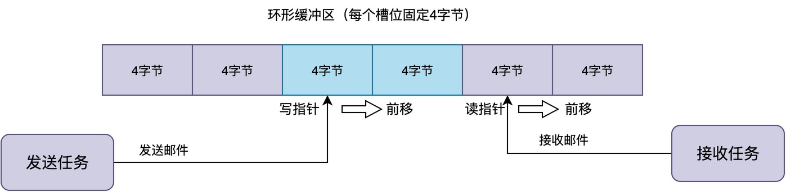
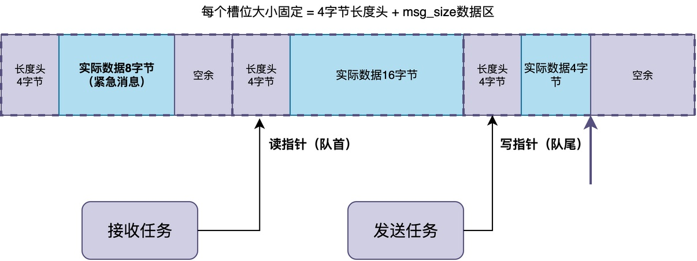
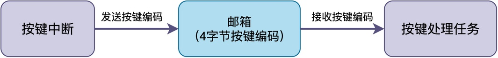
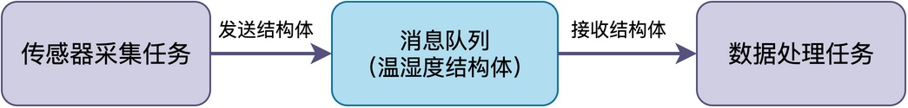

# RT-Thread中邮箱和消息队列有什么区别？什么时候该用邮箱什么时候该用消息队列？

在RT-Thread等系统中，通常提供两种用于任务通信的机制：邮箱和消息队列。

你可能会疑问：这两种机制使用起来似乎差不多，到底有什么区别？实际项目中应当如何选择？

在这篇文章，我将介绍邮箱和消息队列的工作原理。一旦你理解了工作原理，在实际项目便能做出正确的选择。

## 邮箱的工作机制

**邮箱是RTOS里一种比较“轻量”的通信机制，它的特点就是：每封邮件的大小是固定的，在32位系统上就是4字节。**

很多RTOS使用环形缓冲区来缓存邮件，缓冲区中有固定数量个槽位，每个槽位固定4字节，用于存放整数或者指针。所以，邮箱通常用来传递一些简单的信息，比如事件编号、状态码，或者数据缓冲区的首地址。

发送邮件的时候，把4字节数据写到写指针指向的槽位，然后写指针往前移动一格。接收邮件的时候，从读指针指向的槽位取出4字节数据，然后读指针往前移动一格。无论是读指针还是写指针，当移到缓冲区末尾时，再回绕到开头。
## 消息队列的工作机制

与邮箱相比，消息队列更加通用得多，它可以传递可变长度的数据。

消息队列的其中一种设计方法如下图所示，这种方式也采用了环形缓冲区。在创建消息队列的时候，需要指定两个关键参数：单条消息的最大长度、最大消息数量。缓冲区会被划分成固定大小的槽位，每个槽位由两部分组成：前面4字节是消息头，记录这条消息的实际长度；后面是数据区。

发送消息的时候，实际数据长度可以自己指定，只要不超过数据区大小就行。发送时需先把消息长度写到消息头里，再把实际数据复制到数据区。接收的时候，需先从消息头读出实际长度，再根据这个长度把对应的数据复制出来。
## 二者的区别

邮箱和消息队列看起来功能相似，二者的主要区别如下：

1. 传递数据的大小不同：邮箱只能传固定的4字节（32位系统），消息队列可以传可变长度。
2. 运行效率不同：邮箱因为数据大小固定、实现简单，发送接收的速度更快，执行时间更确定。消息队列因为要处理长度头、多次复制数据，速度稍慢。
3. 内存占用不同：邮箱每个槽位固定4字节，管理简单，内存占用少。消息队列需要额外空间存储消息头以及消息内容，内存占用更多。

## 具体例子

下面给出了邮箱和消息队列的使用示例。

第一个场景，当中断里检测到按键按下时，需要通知任务去处理，此时只需要传按键编码给按键处理任务。按键编码可以用4字节来表示，此时用邮箱就非常合适。

第二个场景，传感器任务采集到了一组温湿度数据，包含温度、湿度、时间戳等字段，需要打包成一个结构体传给处理任务。这个结构体的大小远远超过4字节，此时用消息队列把整个结构体传过去更为合适。

有时，如果数据块很大，不想使用消息队列复制来复制去，可以先申请一块内存把数据放进去，然后再用邮箱把这块内存的指针传给接收任务，接收任务处理完再释放内存。这样既避免了大数据复制的开销，又能传递任意大小的数据。

## 总结

综上所述，邮箱轻量高效、但只能传固定4字节，消息队列通用灵活、可传可变长度但开销稍大。

在实际项目中，只需要传递事件编号、状态值或者指针的时候优先选邮箱，需要传递结构体、字符串等复杂数据的时候选消息队列。如果数据量很大，也可以考虑用邮箱传指针加动态内存的方式，在性能和灵活性之间取得平衡。

---

> 如果你希望系统地学习RTOS底层原理，可以了解我的《RTOS开发与实战》课程。
>
> 课程不是简单地讲解FreeRTOS API的使用，而是带你从零开始编写一个RTOS内核，逐步实现任务管理、任务调度、上下文切换、同步与通信等核心机制，并通过一个远程温湿度监控设备项目，将操作系统原理应用到实际嵌入式开发中。
>
> 适合希望深入理解RTOS工作原理、提升嵌入式底层开发能力的同学。
>
> [课程详情](/blog/diyrtos/)
