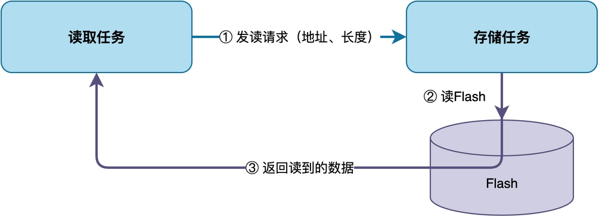
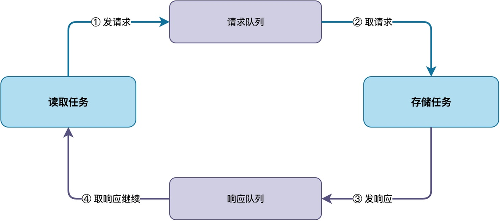
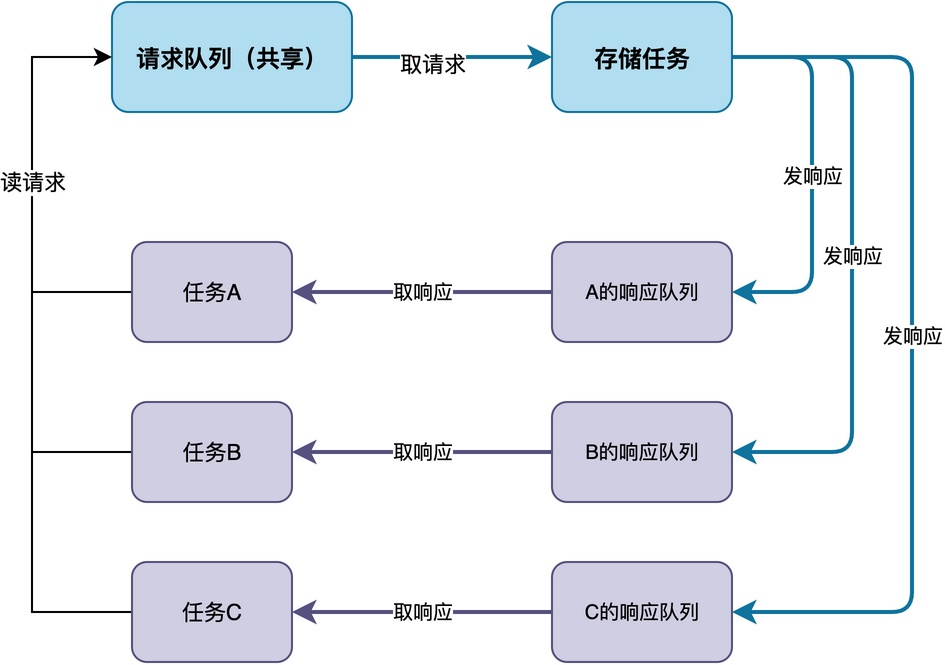
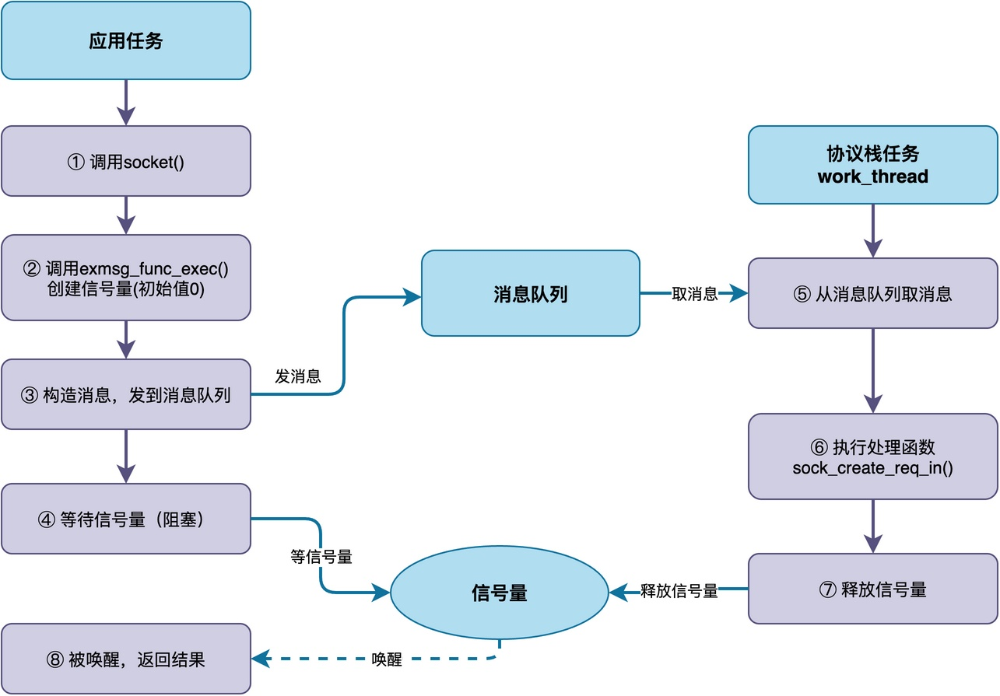

// 注：这种模式在我的手写TCP/IP课程中有用到。。。可以把相关实现示例代码加进来，注意，不要删除这句话

# RTOS中如何实现请求响应模式的通信？

在用RTOS做项目的时候，有时候会用到一种通信方式：任务A向任务B发送请求后，任务A必须等B处理并返回结果之后才能继续运行。这种模式可以简称为“请求-响应模式”。

在这篇文章中，我将介绍这种模式的三种实现方法。同时，你也能看到这种模式在《从0手写TCP/IP协议栈》中，如何用于实现Socket（网络编程套接字）接口。

## 请求响应模式

假设系统里有两个任务：存储任务，负责管理Flash的读写；其他任务（如读取任务）要读数据的时候，需要向存储任务发一个读请求，告诉它要读哪个地址、读多少字节，然后等存储任务把数据读出来返回，才能继续往下执行。



**这种"发送请求—等结果—继续执行"的模式，就是“请求-响应模式”**。发送请求的一方在等待结果时需要暂停运行，等响应回来之后才能继续运行。

为了实现这种模式，我们可以使用消息队列、信号量等机制。下面将给出三种实现方式的说明。
## 使用消息队列

**最简单的、最直接的实现方式是使用两个消息队列：请求队列用于存放读取任务发送的请求，响应队列用于存放读取结果**。 采用这种方式时，之前问题的解决方法如下图所示：



下面给出具体流程：

1. 读取任务把读请求（包含地址、长度等信息）发到请求队列，然后阻塞等待响应队列。
2. 存储任务从请求队列取出请求，执行Flash读操作。
3. 存储任务把读到的数据（或者错误码）作为响应，发到响应队列。
4. 读取任务从响应队列收到响应，继续执行。

如果使用的是RT-Thread，则读取任务的示例代码如下：

```c
void reader_task(void *arg)
{
    struct req_msg req;
    struct resp_msg resp;

    while (1)
    {
        /* 构造读请求 */
        req.cmd = CMD_READ;
        req.addr = 0x1000;
        req.len = 64;

        /* 发送请求，然后阻塞等响应 */
        rt_mq_send(req_mq, &req, sizeof(req));

        /* 等待响应 */
        rt_mq_recv(resp_mq, &resp, sizeof(resp), RT_WAITING_FOREVER);

        /* 使用读到的数据 */
    }
}
```

存储任务的示例代码如下：

```c
void storage_task(void *arg)
{
    struct req_msg req;
    struct resp_msg resp;

    while (1)
    {
        /* 取请求 */
        rt_mq_recv(req_mq, &req, sizeof(req), RT_WAITING_FOREVER);

        /* 处理Flash读 */
        resp.result = flash_read(req.addr, req.len, resp.data);

        /* 发响应 */
        rt_mq_send(resp_mq, &resp, sizeof(resp));
    }
}
```

这种方式实现简单，逻辑清晰。**不过，如果有多个任务同时发送请求，这些读取任务怎么知道哪个响应是给自己的？**

## 每个任务单独的响应队列

**如果存在多个任务同时发送请求，比较好的方式是：为每个请求方任务单独配置响应队列。**

当任务发请求的时候，将自己的响应队列指针也一起放到请求消息里。存储任务处理完请求之后，根据请求里带的响应队列信息，把响应发到对应任务自己的响应队列里。这样每个任务只需要等自己的响应队列就行，不会收到别人的响应。这种方式的工作原理如下图所示：



如果使用的是RT-Thread，则读取任务的示例代码如下：

```c
/* 请求方任务 */
static rt_mq_t resp_mq;  /* 自己的响应队列 */

void request_task(void *param)
{
    struct req_msg req;
    struct resp_msg resp;

    /* 创建自己的响应队列 */
    resp_mq = rt_mq_create("resp", sizeof(struct resp_msg), 4, RT_IPC_FLAG_FIFO);

    while (1)
    {
        /* 构造请求，带上自己的响应队列指针 */
        req.cmd = CMD_READ;
        req.addr = 0x1000;
        req.len = 64;
        req.resp_mq = resp_mq;

        /* 发送请求到请求队列 */
        rt_mq_send(req_mq, &req, sizeof(req));

        /* 阻塞等待自己的响应队列 */
        rt_mq_recv(resp_mq, &resp, sizeof(resp), RT_WAITING_FOREVER);

        /* 处理响应 */
        if (resp.result == 0)
        {
            /* 读取成功，使用resp.data */
        }
    }
}
```

存储任务的示例代码如下：

```c
/* 存储任务 */
void storage_task(void *param)
{
    struct req_msg req;
    struct resp_msg resp;

    while (1)
    {
        /* 从请求队列取请求 */
        rt_mq_recv(req_mq, &req, sizeof(req), RT_WAITING_FOREVER);

        /* 处理请求 */
        if (req.cmd == CMD_READ)
        {
            resp.result = flash_read(req.addr, req.len, resp.data);
        }

        /* 把响应发到请求方自己的响应队列 */
        rt_mq_send(req.resp_mq, &resp, sizeof(resp));
    }
}
```

从上述代码可以看出，由于请求方把自己的响应队列指针放在请求消息里，存储任务处理完之后可以直接根据该指针找到相应的响应队列。整个过程非常清晰，而且多个请求方之间不会互相干扰。

## 示例：实现Socket套接字编程接口

可能你觉得仅仅为了接收响应，为每个任务配置响应队列有些浪费存储空间，那么可以看下面这种更简单一些的实现方法。

这里以我的《从0手写TCP/IP协议栈》课程中构建Socket接口（提供socket()、read()等接口）为例，介绍这种实现方法：**消息队列加信号量**的组合方式。这种方式的实现原理如下图所示：



当应用任务调用socket()函数时，整个流程如下：

1. 应用任务调用x_socket()函数，构造创建socket的请求。
2. x_socket()调用exmsg_func_exec()，该函数内部创建一个初始值为0的信号量。
3. exmsg_func_exec()构造消息，通过消息队列发给协议栈任务work_thread。
4. exmsg_func_exec()调用sys_sem_wait()等待信号量，应用任务进入阻塞状态。
5. 协议栈任务work_thread从消息队列取出请求消息。
6. 协议栈任务执行请求对应的处理函数sock_create_req_in()，完成socket的创建。
7. 处理完成后，协议栈任务调用sys_sem_release()释放信号量。
8. 信号量被释放后，应用任务被唤醒，exmsg_func_exec()返回，x_socket()把创建结果返回给调用者。

下面给出了socket()的部分代码，这个函数是Socket API的入口，应用任务创建socket时调用的就是它，它负责把用户传入的参数打包成请求，然后调用exmsg_func_exec()发给协议栈任务处理：

```c
int x_socket(int family, int type, int protocol) {
    sock_req_t req;
    req.create.family = family;
    req.create.type = type;
    req.create.protocol = protocol;

    /* 发请求给协议栈任务，等待执行完成 */
    exmsg_func_exec(sock_create_req_in, &req);

    return req.sockfd;
}
```

exmsg_func_exec()是整个请求-响应模式的核心函数，它负责创建信号量、把请求消息发到消息队列，然后阻塞等待协议栈任务处理完成，处理完成后再把执行结果返回给调用者：

```c
net_err_t exmsg_func_exec(exmsg_func_t func, void *param) {
    func_msg_t func_msg;
    func_msg.func = func;
    func_msg.param = param;
    func_msg.wait_sem = sys_sem_create(0);  /* 创建信号量，初始值为0 */

    /* 构造消息，发到消息队列 */
    exmsg_t msg;
    msg.type = NET_EXMSG_FUN;
    msg.func = &func_msg;
    fixq_send(&msg_queue, &msg, 0);

    /* 阻塞等待协议栈任务处理完成 */
    sys_sem_wait(func_msg.wait_sem, 0);

    sys_sem_free(func_msg.wait_sem);
    return func_msg.err;
}
```

协议栈任务work_thread是协议栈的主循环，它不断从消息队列取出应用任务发来的请求，执行对应的处理函数，处理完成后释放信号量来唤醒等待的应用任务：

```c
static void work_thread(void *arg) {
    while (1) {
        /* 从消息队列取请求 */
        exmsg_t *msg = fixq_recv(&msg_queue, 0);

        if (msg->type == NET_EXMSG_FUN) {
            /* 执行请求对应的处理函数 */
            msg->func->func(msg->func->param);

            /* 处理完成，释放信号量，唤醒应用任务 */
            sys_sem_release(msg->func->wait_sem);
        }
    }
}
```

**通过上述图示和代码可以看出，整个过程就是典型的请求-响应模式：用一个消息队列传递请求，每次调用创建一个信号量来实现同步等待。**
## 总结

综上所述，请求-响应模式是RTOS中一种常见的同步通信方式，发送方发请求后阻塞等待响应，收到响应后才继续执行。

最直接的实现方式是用两个消息队列，一个发请求一个收响应；如果有多个请求方，可以给每个任务分配独立的响应队列。如果希望减少内存开销，可以使用消息队列+信号量。

---

> 如果你希望系统地学习RTOS底层原理，可以了解我的《RTOS开发与实战》课程。
>
> 课程不是简单地讲解FreeRTOS API的使用，而是带你从零开始编写一个RTOS内核，逐步实现任务管理、任务调度、上下文切换、同步与通信等核心机制，并通过一个远程温湿度监控设备项目，将操作系统原理应用到实际嵌入式开发中。
>
> 适合希望深入理解RTOS工作原理、提升嵌入式底层开发能力的同学。
>
> [课程详情](/blog/diyrtos/)
