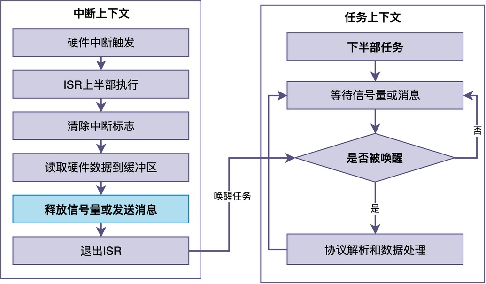

# 为什么不能在中断处理程序（ISR）中做太多事情？如何将事情交给任务处理？

记得我在刚开始学习嵌入式的时候，常看到网上有资料写：**不要试图在中断中执行太多的工作！**

例如：不要在串口收到数据后，在中断里做复杂的协议解析。因为协议解析通常涉及帧头判断、校验和计算、命令分发等多个步骤，如果每收到一个字节就在中断里做这些操作，ISR的执行时间会被大幅拉长，进而影响其他中断的及时响应。

为了简化中断处理程序的工作，在裸机程序中，我们通常的做法是：**在中断中读取数据并设置一个标志位，然后让主循环不断轮询这个标志位。一旦发现标志位被置位，就清除标志位并执行相应的处理逻辑**。下面给出一个简单的代码示例：

```c
/* 全局标志位，必须用volatile修饰 */
volatile uint8_t uart_rx_flag = 0;

/* 串口接收中断 */
void UART_IRQHandler(void)
{
    if (UART_GetITStatus(UART1, UART_IT_RXNE) != RESET) {
        /* 快速读取一个字节到缓冲区 */
        rx_buffer[rx_head++] = UART_ReceiveData(UART1);
        rx_head %= BUFFER_SIZE;

        /* 设置标志位，通知主循环有数据 */
        uart_rx_flag = 1;

        UART_ClearITPendingBit(UART1, UART_IT_RXNE);
    }
}

/* 主函数 */
int main(void)
{
    /* 硬件初始化... */

    while (1) {
        if (uart_rx_flag) {
            uart_rx_flag = 0;          
            parse_protocol();           
            process_command();         
        }

        /* 其他主循环任务... */
    }
}
```

那么，为什么在中断处理程序中不能做太多事情？当引入了RTOS之后，又该如何简化中断处理程序的工作？

今天我们就来聊聊其中的原因，以及在引入RTOS之后，正确的做法是什么。

## ISR的特殊之处

要理解为什么在ISR中不能做太多事情，首先要搞清楚ISR的运行环境，以及它和普通任务究竟有什么不同。

众所周知，ISR运行在**中断上下文中，这是一种非常特殊的执行环境**。与main()函数的运行环境相比，它的主要特点如下：

### 优先级高

只要中断触发，CPU就会立即打断当前正在执行的任何任务，转而去执行ISR。如果ISR执行时间太长，所有任务都得等待，无法及时执行。

### 不能阻塞或挂起

在ISR中，不能调用任何可能引起阻塞和挂起的API。比如不能调用RT-Thread的rt_thread_mdelay()（延时函数），也不能调用printf()（可能阻塞在串口发送上）。

有的同学可能没注意到这点，结果导致整个系统卡死。这是因为，绝大多数RTOS并不支持唤醒阻塞或挂起的ISR。

## 在ISR中做太多事情的问题

在已经了解了ISR的特点之后，让我们来结合几个实际场景，了解在ISR中做太多事情可能带来的问题。

### 场景一：串口接收中断里解析协议

有些同学在串口接收中断中，每收到一个字节，便立即进行协议解析，比如判断帧头、计算校验、处理命令。

当协议比较复杂时，该解析过程可能需要几十微秒甚至更长时间。

在这段时间里，如果有其他更重要的中断（比如电机控制的编码器中断）触发，并且中断优先级不高于串口中断。那么，其他中断就会被延迟响应。在工业控制中，这种延迟可能导致严重后果。

### 场景二：外部中断里直接操作传感器

有些同学在ISR中直接通过I2C读取传感器数据，然后进行数据处理。

由于I2C通信速率本身就比较慢，使得读取一个传感器可能需要几毫秒。这样的耗时，也有可能影响其他中断和主循环的执行。

## 正确做法：上半部+下半部

由此可见，我们不能在ISR中做太多复杂、耗时的事情，而是应该：**减少ISR的整体执行时间，让其他优先级更高、更紧急的事件能够得到处理。**

既然如此，我们应该如何设计自己的程序呢？

> 答案是：**把中断处理分成两部分：上半部分和下半部分。**

### 上半部分

**ISR本身，用于实现必须立即完成、且不能被延迟的快速操作**，比如：
- 清除中断标志位，防止中断重复触发
- 从硬件寄存器中读取少量关键数据
- 释放信号量，或者向消息队列发送消息，通知任务有事件发生

**上半部的执行时间应该尽可能短，通常控制在几微秒、几十微秒以内，甚至更短**。

### 下半部分

**具体表现为一个普通的任务，负责处理耗时的逻辑**，比如：
- 协议解析和数据处理
- 复杂的算法计算
- 传感器数据的读取和滤波
- 业务逻辑和状态机

### 相互协作

在实际应用中，**任务通过等待信号量或消息队列来阻塞自己。当ISR释放信号量或发送消息时，任务被唤醒，在任务上下文中执行耗时的处理逻辑**。

这种协作关系可以用下面的图示来表示：


如上图所示，ISR只做清除中断标志、读取数据、释放信号量等快速操作；而任务通过等待信号量或消息队列阻塞自己。当ISR释放信号量或发送消息后，任务被唤醒并执行耗时的协议解析和数据处理。

这种设计的好处是显而易见的：**ISR快速执行完后退出，以保证系统的中断响应速度；复杂逻辑在任务中执行，任务可以使用阻塞型API，可以被更高优先级的任务抢占，也可以执行耗时的操作**。如此一来，系统的实时性和稳定性都得到了保障。

## 四、RT-Thread中的实现方式

下面给出了RT-Thread中，使用信号量实现ISR与任务相互配合的例子：

```c
/* 定义信号量 */
static rt_sem_t uart_rx_sem;

/* 串口接收中断（上半部） */
void UART_IRQHandler(void)
{
    if (UART_GetITStatus(UART1, UART_IT_RXNE) != RESET) {
        /* 快速读取数据到环形缓冲区 */
        rx_buffer[rx_head++] = UART_ReceiveData(UART1);
        rx_head %= BUFFER_SIZE;

        /* 释放信号量，通知任务有数据 */
        rt_sem_release(uart_rx_sem);

        /* 清除中断标志 */
        UART_ClearITPendingBit(UART1, UART_IT_RXNE);
    }
}

/* 数据处理任务（下半部） */
void uart_process_task(void *parameter)
{
    while (1) {
        /* 等待信号量，阻塞自己 */
        rt_sem_take(uart_rx_sem, RT_WAITING_FOREVER);

        /* 在任务上下文中进行协议解析 */
        parse_protocol();
        process_command();
    }
}
```

在这个示例中，串口接收中断作为上半部，每收到一个字节就将其存入环形缓冲区并释放信号量，然后立即退出；数据处理任务作为下半部，通过rt_sem_take()阻塞等待信号量。一旦被中断释放的信号量唤醒，任务就从环形缓冲区中读取数据，并进行协议解析和命令处理。

如此一来，ISR的执行时间被压缩到最短，而耗时的协议解析工作在任务上下文中完成。

## 总结

综上所述，ISR中不能做太多复杂、耗时的事情，主要原因在于中断环境的特殊性：优先级最高、不能阻塞和挂起。

为了提高系统的可靠性和实时响应性，正确的做法是采用"上半部+下半部"的设计模式：

* **上半部分：ISR中只做快速的硬件操作和事件通知，**
* **下半部分：耗时的处理逻辑交给任务，在任务上下文中执行。**

掌握这种设计模式，是写出稳定、高效、实时的RTOS应用的关键。

---

> 如果你希望系统地学习RTOS底层原理，可以了解我的《RTOS开发与实战》课程。
>
> 课程不是简单地讲解FreeRTOS API的使用，而是带你从零开始编写一个RTOS内核，逐步实现任务管理、任务调度、上下文切换、同步与通信等核心机制，并通过一个远程温湿度监控设备项目，将操作系统原理应用到实际嵌入式开发中。
>
> 适合希望深入理解RTOS工作原理、提升嵌入式底层开发能力的同学。
>
> [课程详情](/blog/diyrtos/)
