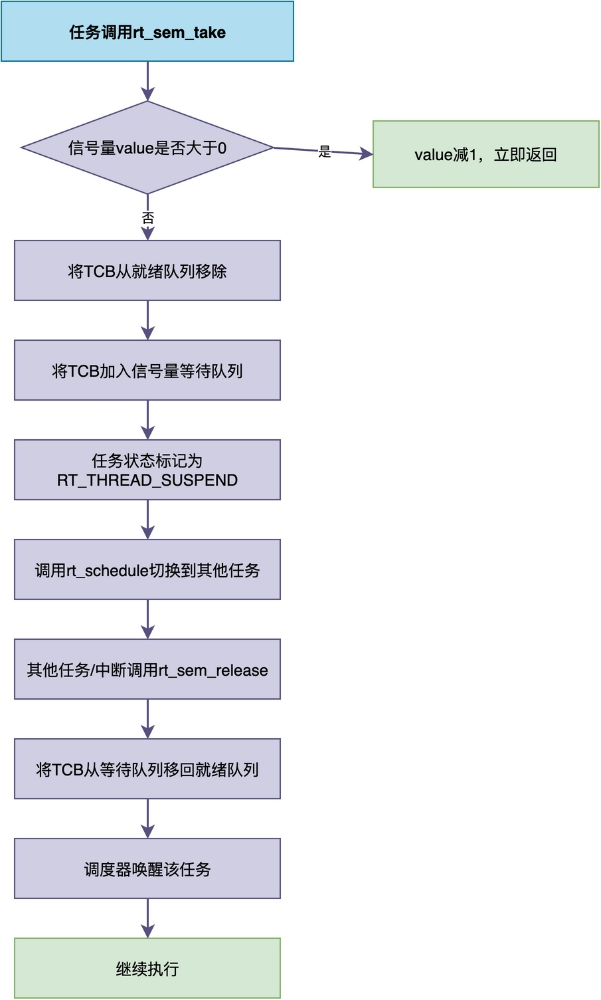

# 为什么中断处理程序中不能调用任务阻塞等接口？

昨天碰到有位同学求助程序运行异常的问题，分析和调试了他的代码之后才发现，问题原因为：**在写中断服务程序的时候，调用的某个函数内部有等待信号量的操作**。结果一运行，系统就莫名其妙地卡死了。他的代码大体类似于：

```c
/* 错误示例：在中断中调用阻塞函数 */
void UART_IRQHandler(void)
{
    /* 等待信号量 —— 这会导致系统卡死！ */
    rt_sem_take(sem, RT_WAITING_FOREVER);

    /* 处理数据 */
    process_data();
}
```

显然，之所以系统卡死，是因为：**中断处理程序中调用任务阻塞或挂起等接口。**

众所周知，中断不能阻塞或挂起，这是RTOS编程中一条非常重要的规则。

不过，很多人只是知其然不知其所以然。

在这篇文章中，我将结合RT-Thread源码，来分析为什么不能阻塞或挂起，以及如果违反了该规则到底会发生什么。

## 什么是任务阻塞和挂起接口

在进行具体的说明之前，让我们先明确一下什么是"任务阻塞和挂起接口"。

**所谓阻塞或挂起接口，指的是那些调用后，可能导致当前任务进入阻塞或挂起状态的函数，也就是会使得任务暂停运行。**

以RT-Thread为例，常见的接口包括：

1. **延时函数**：比如rt_thread_mdelay()。调用后任务会进入阻塞状态，等待指定时间后被唤醒。
2. **接收消息队列**：比如rt_mq_recv()。如果队列中没有消息，任务会阻塞等待，直到有消息发送到队列。
3. **等待事件标志组**：比如rt_event_recv()。如果期望的事件没有发生，任务会阻塞等待。
4. **获取互斥量**：比如rt_mutex_take()。如果互斥量已被其他任务持有，任务会阻塞等待。

这些接口有一个共同特点：**任务可能不会立即从接口中返回，而是会停下来等待直至某个条件满足后，再从接口中返回。**

## 当任务暂停运行时，RTOS内部到底发生了什么

要理解为什么中断不能调用这些函数，我们需要先搞清楚一个问题：**当一个任务调用阻塞函数时，RTOS的底层到底做了什么**？

以任务调用rt_sem_take()等待信号量为例，该过程的源码如下所示：

```c
rt_err_t rt_sem_take(rt_sem_t sem, rt_int32_t timeout)
{
    rt_base_t level;
    struct rt_thread *thread;

    /* parameter check */
    RT_ASSERT(sem != RT_NULL);
    RT_ASSERT(rt_object_get_type(&sem->parent.parent) == RT_Object_Class_Semaphore);
    RT_OBJECT_HOOK_CALL(rt_object_trytake_hook, (&(sem->parent.parent)));

    /* disable interrupt */
    level = rt_hw_interrupt_disable();

    RT_DEBUG_LOG(RT_DEBUG_IPC, ("thread %s take sem:%s, which value is: %d\n",
                                rt_thread_self()->name,
                                ((struct rt_object *)sem)->name,
                                sem->value));

    if (sem->value > 0)
    {
        /* semaphore is available */
        sem->value --;
        /* enable interrupt */
        rt_hw_interrupt_enable(level);
    }
    else
    {
        /* no waiting, return with timeout */
        if (timeout == 0)
        {
            rt_hw_interrupt_enable(level);
            return -RT_ETIMEOUT;
        }
        else
        {
            /* current context checking */
            RT_DEBUG_SCHEDULER_AVAILABLE(RT_TRUE);

            /* semaphore is unavailable, push to suspend list */
            /* get current thread */
            thread = rt_thread_self();

            /* reset thread error number */
            thread->error = RT_EOK;

            RT_DEBUG_LOG(RT_DEBUG_IPC, ("sem take: suspend thread - %s\n",
                                        thread->name));

            /* suspend thread */
            _ipc_list_suspend(&(sem->parent.suspend_thread),
                                thread,
                                sem->parent.parent.flag);

            /* has waiting time, start thread timer */
            if (timeout > 0)
            {
                RT_DEBUG_LOG(RT_DEBUG_IPC, ("set thread:%s to timer list\n",
                                            thread->name));

                /* reset the timeout of thread timer and start it */
                rt_timer_control(&(thread->thread_timer),
                                 RT_TIMER_CTRL_SET_TIME,
                                 &timeout);
                rt_timer_start(&(thread->thread_timer));
            }

            /* enable interrupt */
            rt_hw_interrupt_enable(level);

            /* do schedule */
            rt_schedule();

            if (thread->error != RT_EOK)
            {
                return thread->error;
            }
        }
    }

    RT_OBJECT_HOOK_CALL(rt_object_take_hook, (&(sem->parent.parent)));
    return RT_EOK;
}
```

RTOS的执行过程大致如下：

1. 检查信号量当前是否可用（value > 0），如果可用则将value减1并立即返回；
2. 如果不可用，将当前任务的TCB（任务控制块）从就绪队列中移除；
3. 将当前任务的TCB加入到该信号量的等待队列中（按优先级排序）；
4. 将任务状态标记为"挂起"（RT_THREAD_SUSPEND）；
5. 触发调度器rt_schedule()，选择下一个最高优先级的就绪任务运行；
6. 当其他任务或中断调用rt_sem_release()释放信号量时，内核将等待队列中最高优先级的任务TCB移回就绪队列；
7. 调度器在适当时机将该任务唤醒，继续执行。

为便于理解，整个过程可以用下面的图示来表示：


对于RT-Thread的其他阻塞接口，其工作原理和执行流程也是类似的。

既然我们已经清楚了任务阻塞时RTOS内部的操作过程，那么把同样的函数放到中断中调用，为什么就会出问题呢？

根本原因在于，任务阻塞的整个过程都建立在一个前提之上——**当前执行的是一个被调度器管理的任务。而中断恰恰不满足这个前提**。

具体来说，有以下两个原因：

## 原因一：中断没有TCB，调度器无法管理

rt_sem_take()成功执行的第一步，便是将"当前任务"的TCB从就绪队列中移除。

但问题是：**中断上下文中根本没有"当前任务"这个概念，中断和任务本身不是同一个东西**。

> 中断运行在中断上下文中，它没有对应的任务控制块（TCB），不是一个任务。当CPU在执行ISR时，调度器并不知道"当前正在运行的是谁"，调度器只能识别任务。
>
> 如果在中断中调用rt_sem_take()，RTOS将试图获取"当前任务"的TCB指针（通过rt_thread_self()）。但是，这个指针指向的是被中断打断的那个任务的TCB，而不是中断本身。
>
> 于是RTOS**会错误地把被中断的那个任务从就绪队列中移除、加入等待队列、标记为挂起**。
>
> 但实际上，被中断的任务根本没有调用这个函数，它只是被中断打断了而已。

由此可见，该任务莫名其妙地被挂起了，但它自己并不知道。等中断退出后，调度器才发现这个任务已经不在就绪队列中了，就不会再调度它，导致这个任务"永远沉睡"。

现实中，很多RTOS内部并没有相应的处理逻辑来应对这种异常情况，将会导致系统死机或异常。

## 原因二：违背了中断快速响应的设计原则

此外，还有一个设计原则层面的原因：**中断的设计目标就是快速响应、快速退出，让中断阻塞或挂起违背了这个原则。**

中断是用来处理紧急硬件事件的，它的执行时间应该尽可能短，通常控制在几微秒到几十微秒以内。如果在中断中调用阻塞函数，中断的执行时间就变得不可预测。

同时，根据CPU的工作机制，在中断阻塞等待的这段时间里，同优先级或低优先级的中断都无法得到响应，这将影响系统的实时性和可靠性。

## 总结

综上所述，中断处理程序不能调用任务阻塞等接口，主要原因为：

1. **中断没有TCB，调度器无法管理**：任务阻塞的底层实现依赖于TCB的操作，而中断上下文中没有对应的TCB，调用阻塞函数会破坏系统内部状态。
2. **违背了中断快速响应的设计原则**：中断的执行时间应该短且确定，阻塞会让中断执行时间不可预测，破坏系统实时性。

因此，中断中只做非阻塞的快速操作（如清除中断标志、读取数据等），把阻塞等待和耗时处理交给任务。如果必须处理复杂的任务时，可以通过一定的方式将其转交给任务处理，转交方法可参考我的另一篇文章《怎样将ISR中的复杂事情交给任务完成》。

---

> 如果你希望系统地学习RTOS底层原理，可以了解我的《RTOS开发与实战》课程。
>
> 课程不是简单地讲解FreeRTOS API的使用，而是带你从零开始编写一个RTOS内核，逐步实现任务管理、任务调度、上下文切换、同步与通信等核心机制，并通过一个远程温湿度监控设备项目，将操作系统原理应用到实际嵌入式开发中。
>
> 适合希望深入理解RTOS工作原理、提升嵌入式底层开发能力的同学。
>
> [课程详情](/blog/diyrtos/)
