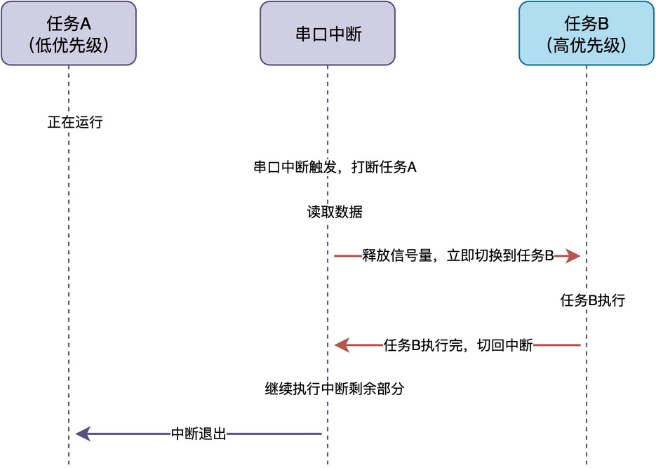
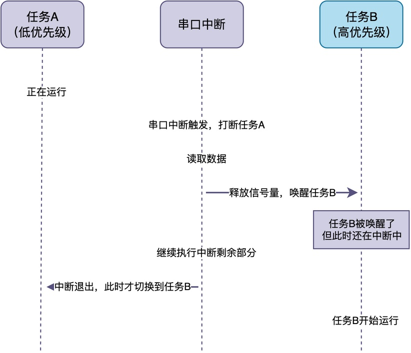
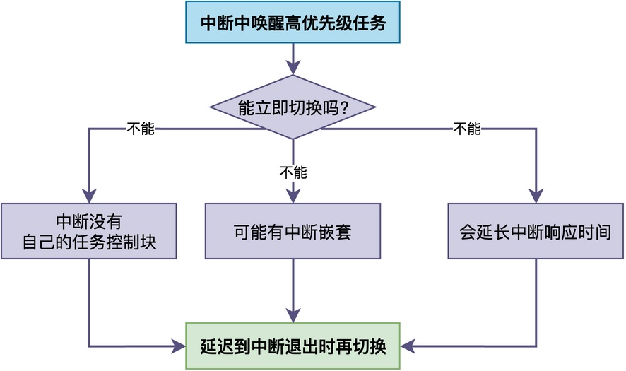
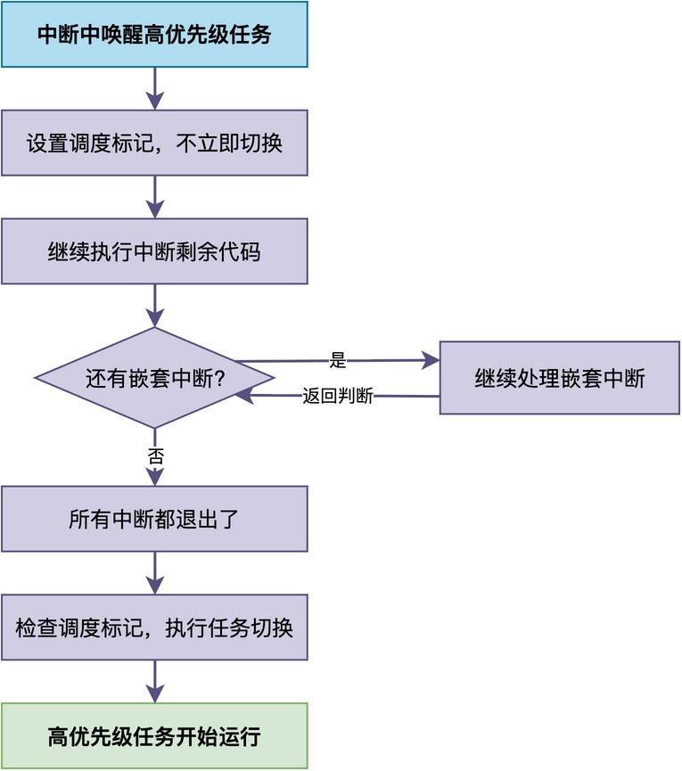
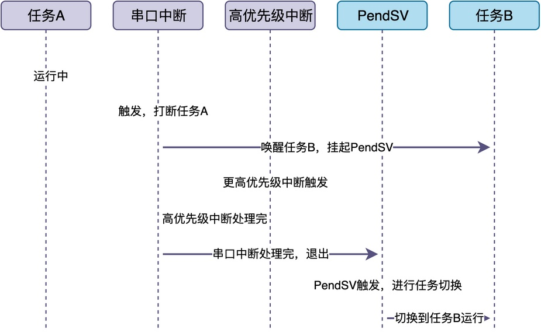

# 为什么在中断处理程序不会进行任务切换？


最近，有一位同学在学习RTOS的时候，遇到了一个困惑。他写了一段这样的代码：

```c
/* 串口接收中断 */
void uart_rx_isr(void)
{
    /* 读取接收到的数据 */
    uint8_t data = uart_read_data();

    /* 释放信号量，唤醒任务B */
    rt_sem_release(uart_sem);

    /* 继续做一些其他处理 */
    uart_clear_flag();
    uart_enable_rx();
}
```

他起初认为：当调用rt_sem_release()释放信号量时，就会立即切换到任务B去执行。而后面的uart_clear_flag()和uart_enable_rx()这些函数，可能会在任务B执行完、切换回来的时候才继续执行。

不过，他也意识到：如果中断处理程序执行到一半就切换出去了，似乎不太对劲？越想越糊涂，于是就来问我。

在今天这篇文章，我就来好好聊一聊这个问题，分析到底会不会出现这种情况，以及具体的原因。

## 问题的具体场景

通过沟通，我大概知道了这位同学的具体问题场景。这个系统中有两个任务：

- 任务A：优先级较低，负责一些日常的处理工作。
- 任务B：优先级较高，负责处理串口接收到的数据。

当任务A正在运行时，突然触发串口接收中断，进入串口中断处理程序去执行。中断处理程序调用了rt_sem_release()释放信号量，唤醒了正在等待的任务B。

**这个同学以为执行流程是这样的：当释放信号量后，立即切换到任务B；当B执行完，再切换回中断，继续执行剩余部分。**


但实际上，**真正的执行流程应该是：释放信号量唤醒B之后，继续执行中断剩余部分；当中断退出后，才切换到任务B运行。**


## 禁止中断中切换的原因

为什么要按照第二种方式来执行呢？具体而言，原因主要有如下三点：


第一，**中断没有自己的任务控制块**。如果在中断里直接切换，被打断任务的上下文该保存到哪里？如何进行保存？保存哪些信息？这会增加RTOS的设计难度。

第二，**中断可能会嵌套**。如果发生了更高优先级的中断，形成中断嵌套。那么，如果在第一个中断里就切换了任务，那第二个中断打断的到底是任务还是第一个中断？此时，调度逻辑会变得非常混乱。

第三，**会延长中断响应时间**。我们知道，中断应该快速处理完就退出。如果切换到其他任务，一旦任务长时间运行，中断后面的代码就一直得不到执行，系统实时性就没法保证了。

## RTOS的常见处理方法

为了让任务切换发生在中断退出后，RTOS使用了一个很巧妙的办法：**延迟调度**。

它的思路很简单：

> **当唤醒任务后，并不立即切换到该任务运行，而是先标记“退出中断后需要调度”。**
> **等当前中断以及嵌套的中断都退出来后，再根据标记情况，决定是否要进行任务切换。**

也就是说，将任务切换延迟到退出中断时进行，整个流程如下图所示：


在Cortex-M架构中，RTOS通常会使用该架构提供的**PendSV异常**来实现延迟调度。PendSV异常可被设置为挂起状态，且优先级最低，可以被所有其他中断打断。

**在实际使用时，PendSV是否为“挂起”状态，表明了“是否需要进行任务切换”。**


整个流程如下所示：

1. 串口中断触发，打断任务A，进入中断处理程序。
2. 串口中断处理程序中释放信号量，唤醒高优先级任务B。
3. RTOS发现任务B优先级比当前被打断的任务A高，于是挂起PendSV异常，标记“延迟调度”。
4. 串口中断处理程序继续执行剩余部分，比如清除中断标志、使能接收等。
5. 如果此时又来了更高优先级的中断，就先处理那个中断，PendSV继续等待。
6. 等所有中断都处理完后，CPU准备退出中断。
7. 此时PendSV异常被触发，在PendSV中完成任务切换。
8. 最终，切换到任务B去运行。

注意到，PendSV的优先级是最低的，所以它会等所有其他中断都处理完之后才会执行。

**这样就保证了中断处理不会被任务切换打断，同时又确保了高优先级任务能够在中断退出后立即得到运行。**

## 实际代码中的体现

下面，我们来看一下RT-Thread中是如何实现的。

RT-Thread要求每个中断处理程序的入口和出口都要调用rt_interrupt_enter()和rt_interrupt_leave()，用来维护中断嵌套计数器。在Cortex-M架构中，当发生系统时钟节拍中断时，将调用SysTick_Handler()；当退出中断时，调用rt_interrupt_leave()。

而在rt_interrupt_leave()中，对中断嵌套计数进行减一。只有当计数器变成0的时候，也就是所有中断都退出了，才会检查是否需要调度，如果需要就调用rt_schedule()。

```c
/* 系统时钟节拍中断 */
void SysTick_Handler(void)
{
    /* 进入中断，中断嵌套计数器加一 */
    rt_interrupt_enter();

    rt_tick_increase();

    /* 退出中断，中断嵌套计数器减一 */
    rt_interrupt_leave();
}

/* 中断退出时的处理 */
void rt_interrupt_leave(void)
{
    /* 中断嵌套计数器减一 */
    rt_interrupt_nest --;

    /* 如果所有中断都退出了，并且需要调度 */
    if (rt_interrupt_nest == 0 && rt_scheduler_is_need_schedule())
    {
        /* 进行任务切换 */
        rt_schedule();
    }
}
```

rt_schedule()将进一步调用底层的任务切换函数rt_hw_context_switch_interrupt()。该函数通常用汇编代码编写，实现如下：

```assembly

rt_hw_context_switch_interrupt    PROC
    ; 略去一些无关代码...
    
    ; 挂起PendSV异常，触发任务切换
    LDR     r0, =NVIC_INT_CTRL
    LDR     r1, =NVIC_PENDSVSET
    STR     r1, [r0]

    BX      LR
    ENDP
```

**注意到，这段代码只是把PendSV异常挂起。等PendSV真正触发的时候，CPU已经退出了中断上下文，才真正进行任务切换。**

## 总结

综上所述，**在中断中唤醒了高优先级任务后，这个任务不会立即开始运行，也不应当立即运行**。RTOS通常采用**延迟调度的方式**来处理：设置一个调度标志，等所有中断都处理完后，再进行任务切换。

---

> 如果你希望系统地学习RTOS底层原理，可以了解我的《RTOS开发与实战》课程。
>
> 课程不是简单地讲解FreeRTOS API的使用，而是带你从零开始编写一个RTOS内核，逐步实现任务管理、任务调度、上下文切换、同步与通信等核心机制，并通过一个远程温湿度监控设备项目，将操作系统原理应用到实际嵌入式开发中。
>
> 适合希望深入理解RTOS工作原理、提升嵌入式底层开发能力的同学。
>
> [课程详情](/blog/diyrtos/)
