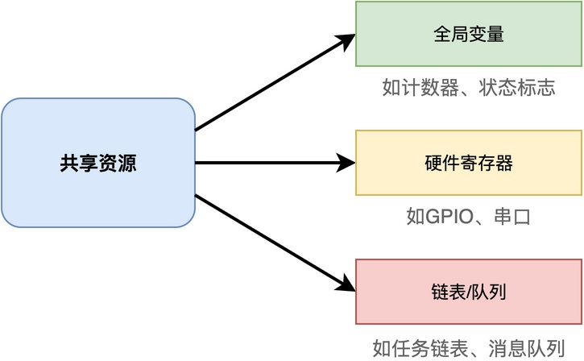
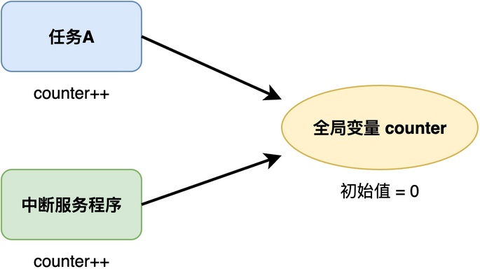
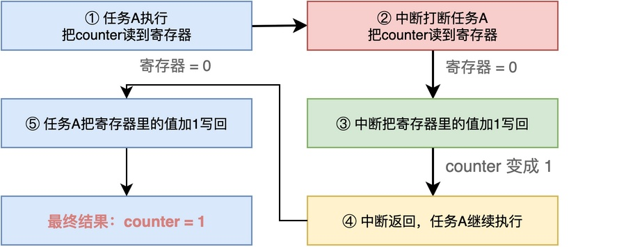
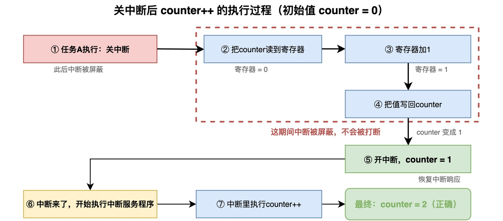
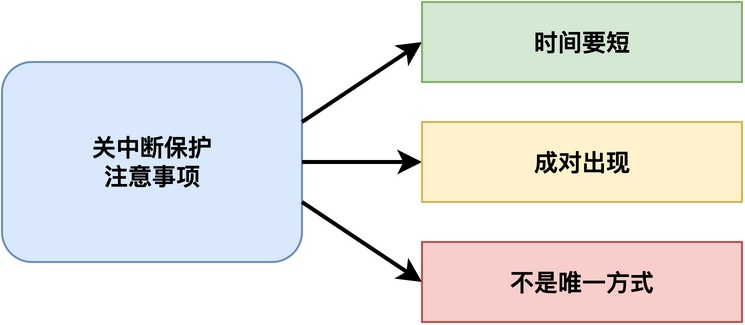

# 什么是临界区？

你可能在看RTOS或者裸机代码的时候，遇到过这样的写法：先关中断，然后操作一段代码，然后再开中断。下面给出一个简单的示例：

```c
void add_counter(void)
{
    // 关中断
    __disable_irq();

    // 操作共享资源
    counter++;

    // 开中断
    __enable_irq();
}
```

很多同学第一次看到这种写法的时候，可能不太理解：对于counter进行自增这样简单的操作，为什么要先关中断？后面，他去查相关资料后，才知道这个东西叫做临界区，在进入临界区之前需要进行保护。

那到底什么是临界区？为什么进入临界区要关中断呢？这篇文章我们就来详细介绍一下。

## 什么是临界区

**简单来说，临界区就是一段访问共享资源的代码，这段代码在执行的时候不能被打断。**

**所谓的共享资源，就是多个任务或者中断都可能访问的资源**，例如全局变量、硬件寄存器、链表队列等等。



当这些任务或中断同时访问共享资源时，就可能出问题。例如，有一个初始值为0的全局变量counter，任务A在执行counter++，中断服务程序里也在执行counter++。你猜最后counter的值会是多少？


你可能认为最后counter的值为2，实际不尽然！

counter++这个操作看起来是一条语句，但在汇编层面其实是三步：先把counter的值读到寄存器，然后寄存器加1，再把值写回counter。就像下面这样：

```asm
ldr r0, [counter]  // 把counter的值读到寄存器
add r0, r0, #1     // 寄存器加1
str r0, [counter]  // 把值写回counter
```

**如果任务A刚把值读到寄存器，还没来得及写回，这时候中断来了，中断里也读了counter的值、加1、写回，然后中断返回，任务A接着把自己寄存器里的值写回去，这样中断里的修改就被覆盖了，counter就少加了一次。**

整个出错的过程如下图所示，从图中可以看出，<font color="#ff0000">最终counter的值为1，这是一个错误的结果！</font>



可以看到，之所以会出现这种情况，是因为：**counter++在指令层面是分为好几个步骤，每一步都可能被打断**。由于执行被打断，影响了任务A和中断对counter的先后访问顺序，导致最终结果不确定。

**为了避免这种情况，就需要把访问共享资源的代码加以保护，避免被打断，这段被保护的代码就是临界区。**

## 为什么要关中断

在嵌入式系统里，中断是最基本的抢占来源。只要中断触发，它就可以打断当前正在执行的任务，转去执行中断服务程序。

如果关掉中断，CPU就不会响应任何中断了，这样临界区的代码就不会被打断，临界区里的操作就能原子地执行完。等临界区执行完了，再开中断，恢复系统的正常响应。

对于前面提到的counter++的例子，如果加上关中断保护，代码就变成这样：

```c
void add_counter(void)
{
    __disable_irq();   // 关中断
    counter++;         // 访问共享资源
    __enable_irq();    // 开中断
}
```

此时，任务A的执行过程就发生了较大的变化：



从图中可以看到，关中断之后，A的counter++的三步操作（读、加1、写回）是连续执行的，中间不会被中断打断。这使得执行完之后，counter的值变为1 。此后，中断再对counter++，counter的值为2，结果就是正确的。
## 注意事项

虽然关中断能保护临界区，但使用的时候需要注意以下几点：



**首先，临界区要尽可能短**。关中断期间，系统不会响应任何中断，如果临界区太长，就会影响系统的实时性，甚至导致中断丢失。所以，临界区里只做最必要的操作，不做延时、打印等耗时的工作。

**其次，要保证关中断和开中断成对出现**。进入临界区关中断，退出临界区一定要开中断，而且要能正确恢复之前的中断状态。

**最后，关中断不是唯一的临界区保护方式。** 对于一些比较长的临界区，或者任务之间的共享资源，可以用互斥锁、调度器上锁等方式。这些方式在我的其他文章中有介绍。

## 总结

综上所述，**临界区就是一段访问共享资源、执行时不能被打断的代码**。

进入临界区时关中断，是因为可以不被任何中断或任务切换打断，从而保证共享资源的操作是原子的。使用关中断保护临界区时，要注意临界区尽可能短，关中断和开中断要成对出现。

---

> 如果你希望系统地学习RTOS底层原理，可以了解我的《RTOS开发与实战》课程。
>
> 课程不是简单地讲解FreeRTOS API的使用，而是带你从零开始编写一个RTOS内核，逐步实现任务管理、任务调度、上下文切换、同步与通信等核心机制，并通过一个远程温湿度监控设备项目，将操作系统原理应用到实际嵌入式开发中。
>
> 适合希望深入理解RTOS工作原理、提升嵌入式底层开发能力的同学。
>
> [课程详情](/blog/diyrtos/)
