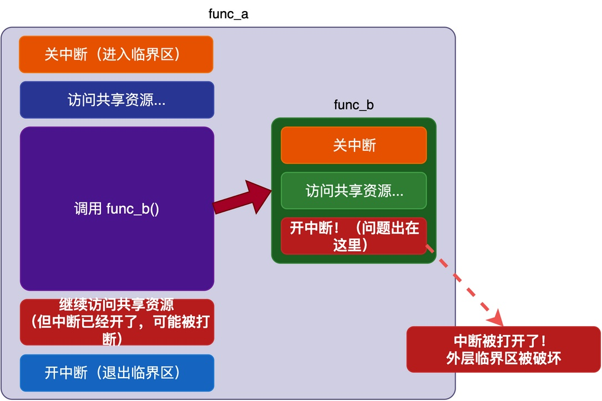
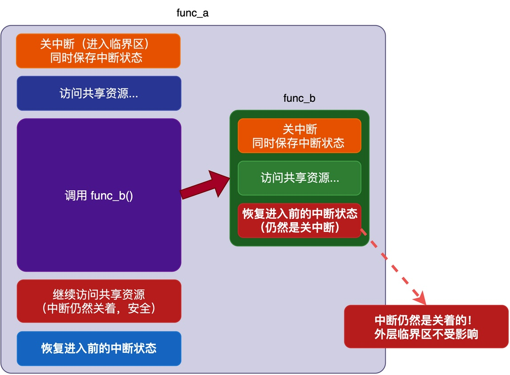
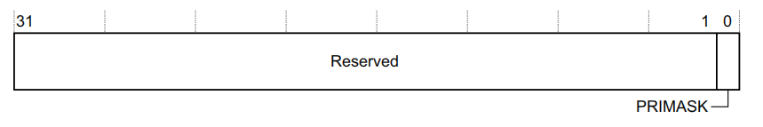

# 什么是临界区的嵌套使用？

我们知道，在引入RTOS后，经常会遇到共享资源访问冲突的问题。对于这些问题，有时可以使用开关中断来进行保护，即进入临界区的时候关中断，退出的时候开中断。

但是，有时候会遇到下面这样的情况：

```c
/* 全局共享变量 */
int shared_data_a = 0;
int shared_data_b = 0;

void func_b(void)
{
    rt_base_t level;
    level = rt_hw_interrupt_disable();  /* 关中断，保存之前的中断状态 */
    shared_data_b++;                     /* 访问共享资源B */
    rt_hw_interrupt_enable(level);       /* 恢复之前的中断状态 */
}

void func_a(void)
{
    rt_base_t level;
    level = rt_hw_interrupt_disable();  /* 关中断，保存之前的中断状态 */
    shared_data_a++;                     /* 访问共享资源A */
    func_b();                            /* 调用func_b，里面也有关中断 */
    rt_hw_interrupt_enable(level);       /* 恢复之前的中断状态 */
}
```

可以看到，func_a()在调用rt_hw_interrupt_disable()关中断之后，调用了func_b()，而func_b()里面又关了一次中断，<font color="#ff0000">这就是典型的临界区嵌套</font>。

有的同学可能会疑问：这样嵌套使用会不会有问题？我将在这篇文章中详细进行分析说明。

## 临界区嵌套会有什么问题

我们可以结合下图来分析这段代码的执行过程。

func_a()首先调用rt_hw_interrupt_disable()关中断，之后访问shared_data_a，接着调用func_b()。接下来，func_b()也关了一次中断。等func_b()执行完，再调用rt_hw_interrupt_enable()开中断。


你可能此时发现了问题：**当回到func_a()后，继续访问共享资源时，中断是开启状态！**

但是，**如果你实际去运行这段代码，会发现实际上并没有这个问题，中断并不会在func_b()退出的时候打开。** 这是为什么呢？

## 正确的处理方式

实际上，像RT-Thread这样的RTOS，在设计关中断和开中断接口的时候，就已经考虑到了嵌套的问题。

我们可以看一下这两个函数的声明，其代码如下：

```c
rt_base_t rt_hw_interrupt_disable(void);
void rt_hw_interrupt_enable(rt_base_t level);
```

具体来说，rt_hw_interrupt_disable()在关闭中断之前，**会先把当前的中断状态（也就是中断是开着的还是已经关了）暂存起来，然后作为返回值**（rt_base_t类型）。而rt_hw_interrupt_enable()接收一个参数level，**用于将之前暂存的中断状态恢复回去**。

如此一来，原先的问题就不复存在了。这里可以结合下图进行分析。


func_a()调用rt_hw_interrupt_disable()时，函数将"中断是否开启"这个状态作为返回值，然后关掉中断。接着，func_b()开始执行时，中断是已经关闭的状态。当func_b()退出时，它使用自己保存的中断状态进行恢复，由于之前是"已经关闭的"，恢复后同样保持中断关闭状态。只有从func_a()退出时，中断才会恢复到开启状态。

**只要每一层退出的时候都恢复到进入这一层之前的状态，使得只有最外层退出的时候才会真正把中断打开，整个嵌套的临界区就都受到了保护。如此一来，不管嵌套多少层，都不会出现之前上一小节中的问题。**

## RT-Thread中的实现

那么，如何实现中断状态的保存呢？这就跟具体的CPU体系架构有关。

以Cortex-M架构为例，PRIMASK寄存器中的最低位用于控制是否开启中断响应，当值为1时，表示关闭所有可屏蔽的中断，为0时表示打开中断。



了解了这些寄存器之后，我们来看RT-Thread的具体实现。开关中断的代码使用汇编语言编写，实现如下：

```asm
rt_hw_interrupt_disable    PROC
    EXPORT  rt_hw_interrupt_disable
    MRS     r0, PRIMASK
    CPSID   I
    BX      LR
    ENDP

rt_hw_interrupt_enable    PROC
    EXPORT  rt_hw_interrupt_enable
    MSR     PRIMASK, r0
    BX      LR
    ENDP
```

这两段代码的实现很简单：

1. rt_hw_interrupt_disable()：用MRS指令把PRIMASK寄存器的值读到r0（作为返回值），再用CPSID I关闭中断（修改PRIMASK）；
2. rt_hw_interrupt_enable()：将传入的参数r0（也就是之前保存的中断状态）写回PRIMASK。

从上述代码可以看出，**rt_hw_interrupt_enable()并不是字面意义上的"开启中断"，而是"恢复到关中断操作之前的状态"。**

## 总结

当嵌套使用开关中断来保护临界区时，容易在内层函数退出时出现中断开启、破坏外层临界区的问题。

不过，好在RTOS通常采用"保存—恢复"机制：关中断时把当前的中断状态保存下来，开中断时把之前保存的状态恢复回去。如此一来，不管嵌套多少层都不会出问题。

---

> 如果你希望系统地学习RTOS底层原理，可以了解我的《RTOS开发与实战》课程。
>
> 课程不是简单地讲解FreeRTOS API的使用，而是带你从零开始编写一个RTOS内核，逐步实现任务管理、任务调度、上下文切换、同步与通信等核心机制，并通过一个远程温湿度监控设备项目，将操作系统原理应用到实际嵌入式开发中。
>
> 适合希望深入理解RTOS工作原理、提升嵌入式底层开发能力的同学。
>
> [课程详情](/blog/diyrtos/)
