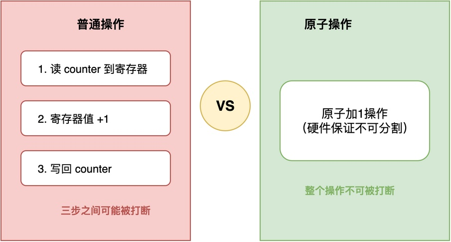
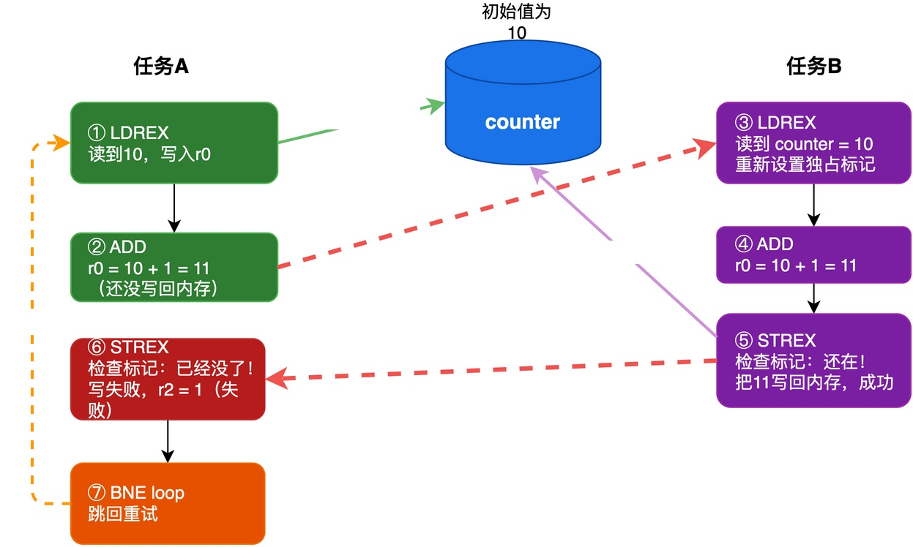

# 什么是原子操作？RT-Thread有哪些原子操作接口？

当工程中引入RT-Thread等RTOS后，我们经常会碰到多任务访问共享资源冲突的问题：

> 例如，两个任务同时对全局变量counter进行自增操作时，有可能出现最终自增结果错误的问题。
> 要解决这个问题，常见的做法是利用关中断或者互斥锁来保护，避免操作过程中被打断。

不过，对于counter++这种简单的操作，使用关中断或互斥锁有点杀鸡用牛刀的感觉。

实际上，在有些CPU架构上，还有另外一种更好的方案可以替代，那就是利用原子操作相关的指令。

## 什么是原子操作

**所谓原子操作，就是执行过程中不能被打断的操作。** 也就是说，**这个操作一旦开始执行，就会一直执行完，中间不会被任何中断或任务切换打断。**

有了原子操作，我们就可以把counter++这样的读-改-写操作，用一个原子操作来完成，这样就不会出现执行到一半被打断的情况了。

例如，在下图中，counter++这条语句实际上分三步执行：读取counter到寄存器、对寄存器+1、回写到counter。这三步执行的过程中，随时有可能被打断。**而当使用原子操作时，这三步操作会被当作一个整体，要么全部执行完，要么完全不执行，中间不会被打断**。



常见的原子操作有：
1. **原子加/减**：把内存中的值加上或减去一个数。
2. **原子比较并交换**：比较内存中的值是否等于预期值，如果相等就换成新值。
3. **原子交换**：把内存中的值和寄存器的值交换。

## 原子操作的实现原理

### 利用CPU的特定指令

虽然很多CPU并不直接提供"对内存中的值进行加1减1"这样的原子操作指令，但是提供了一些更基础的指令，用于组合起来实现各种原子操作。

以ARM Cortex-M架构为例，它主要提供了以下几条指令：

1. **LDREX（独占加载）**：从内存中加载一个值，同时在硬件层面标记这个内存地址已经被独占访问。如果之后有其他任务或中断修改了这个地址，独占标记会被清除。
2. **STREX（独占存储）**：将一个值存回内存。不过，只有当独占标记还存在的时候才会成功，返回0表示成功；如果独占标记已经被清除了，则存储失败，返回1表示失败。
3. **CLREX（清除独占标记）**：手动清除当前的独占标记。

将这三条指令配合起来，实现原子加1操作的汇编代码大致如下：

```asm
add_inc:
    LDREX   r0, [r1]      ; 独占加载r1指向的值到r0
    ADD     r0, r0, #1    ; r0加1
    STREX   r2, r0, [r1]  ; 独占存储r0的值回r1指向的地址，结果存在r2
    CMP     r2, #0        ; 检查是否存储成功
    BNE     add_inc       ; 如果失败（r2不等于0），就重试
```

我们可以结合下图来理解上述代码的工作原理。例如，有任务A和任务B，同时使用add_inc()对counter进行自增操作：



对于上图，各步骤说明如下：

1. 任务A先执行LDREX：从内存中读到counter=10，同时硬件设置独占标记，表示这个地址正在被独占访问。
2. 任务A执行ADD：把寄存器里的值加1变成11。
3. 任务B执行LDREX：读取counter=10，同时重新设置独占标记，任务A之前设置的标记被覆盖。
4. 任务B执行ADD：寄存器里的值也变成11。
5. 任务B执行STREX：检查独占标记发现还在，成功把11写回内存，counter变成11。
6. 任务A继续执行STREX：检查独占标记发现已经没了，写内存失败。
7. 任务A执行BNE：检查发现失败，跳回add_inc重试。

通过分析可知，**LDREX + ADD + STREX + 重试循环，组合起来实现了一个原子操作的效果**。虽然add_inc()执行的过程中有可能被打断，但是仍然不影响最终结果的正确性。

这种实现方式的优点是：**不影响中断响应**，无需关中断。缺点是：**可能会多次重试，有一定的性能开销**。

### 利用关中断

**原子操作并不一定非要用CPU的特定指令来实现**。如果CPU没有提供相关的原子指令，也可以采用关中断的方式来实现。

比如，RT-Thread的软件原子加操作是这么实现的：

```c
rt_inline rt_atomic_t rt_soft_atomic_add(volatile rt_atomic_t *ptr, rt_atomic_t val)
{
    rt_base_t level;
    rt_atomic_t temp;
    level = rt_hw_interrupt_disable();  /* 关中断 */
    temp = *ptr;
    *ptr += val;
    rt_hw_interrupt_enable(level);      /* 开中断 */
    return temp;
}
```

这种方式虽然也能保证原子性，但因为关了中断，会影响系统的实时性，效率不如硬件原子指令高。

不过，**其优点在于较高的可移植性，不依赖特定的CPU指令**。

## RT-Thread的原子操作接口

在RT-Thread中，提供了若干常用的原子操作API，这里简要列举部分如下：

1. **rt_atomic_add(ptr, val)**：原子地将指定地址处的值与给定值相加，返回相加之前的值。
2. **rt_atomic_sub(ptr, val)**：原子地将指定地址处的值与给定值相减，返回相减之前的值。
3. **rt_atomic_load(ptr)**：原子地从指定地址加载一个值。
4. **rt_atomic_store(ptr, val)**：原子地将一个值写入指定地址。
5. **rt_atomic_exchange(ptr, val)**：原子地将指定地址处的值替换为新值，返回替换之前的值。

需要说明的是，这些API的实现依赖于不同的平台：有的使用CPU特定指令，有的采用关中断方式。用户不需要关心底层实现，直接调用即可。

## 总结

综上所述，原子操作就是执行过程中不能被打断的操作，用来解决多任务环境下的竞态条件问题。

原子操作的实现方式有两种：一种是直接利用CPU提供的特殊指令；另一种是利用关中断。具体采用哪一种，取决于所用的CPU架构。

---

> 如果你希望系统地学习RTOS底层原理，可以了解我的《RTOS开发与实战》课程。
>
> 课程不是简单地讲解FreeRTOS API的使用，而是带你从零开始编写一个RTOS内核，逐步实现任务管理、任务调度、上下文切换、同步与通信等核心机制，并通过一个远程温湿度监控设备项目，将操作系统原理应用到实际嵌入式开发中。
>
> 适合希望深入理解RTOS工作原理、提升嵌入式底层开发能力的同学。
>
> [课程详情](/blog/diyrtos/)
