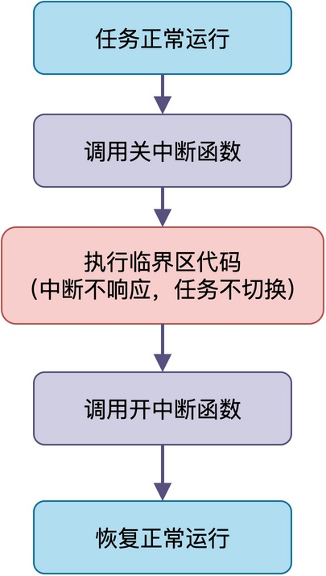
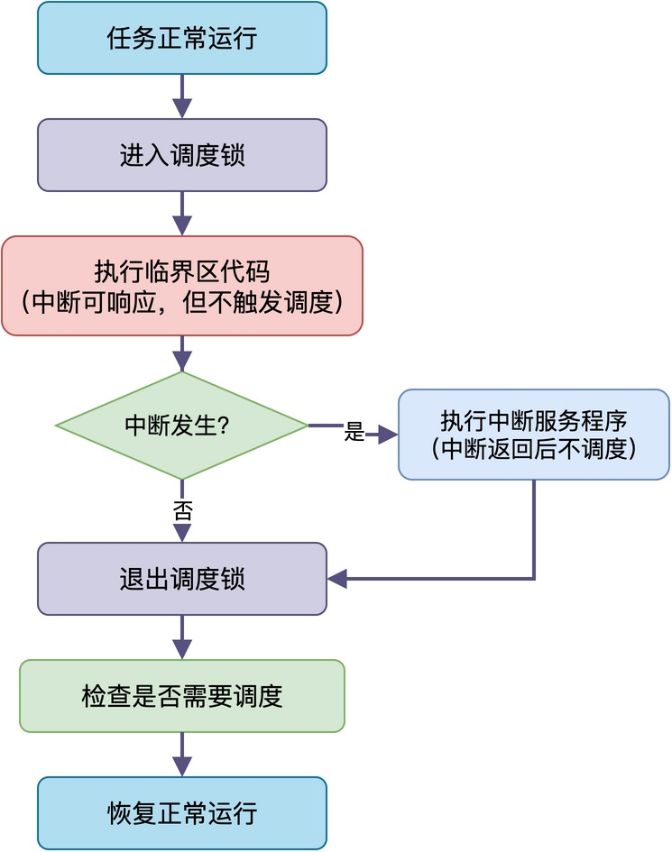
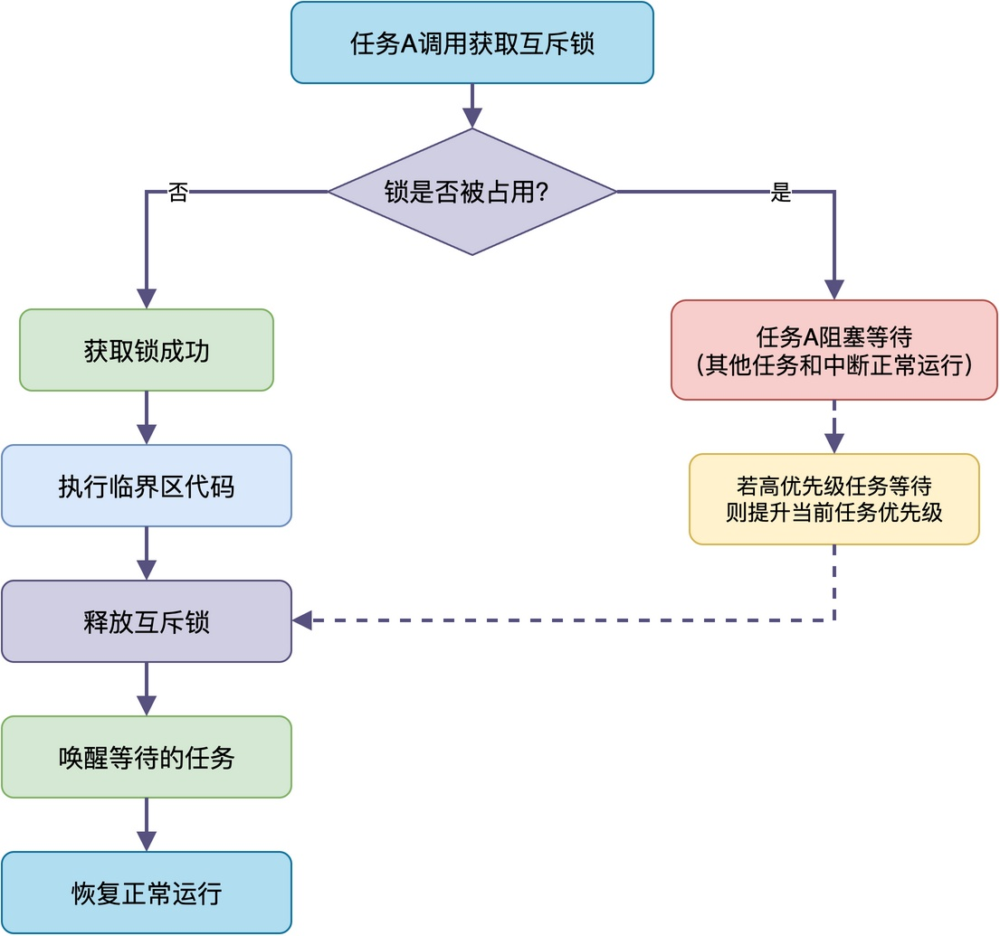
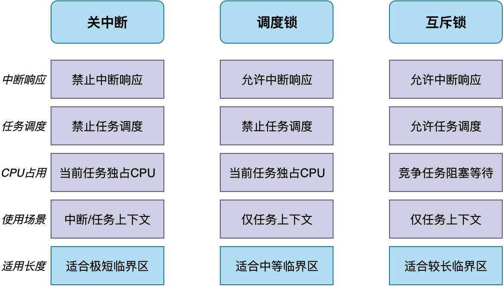
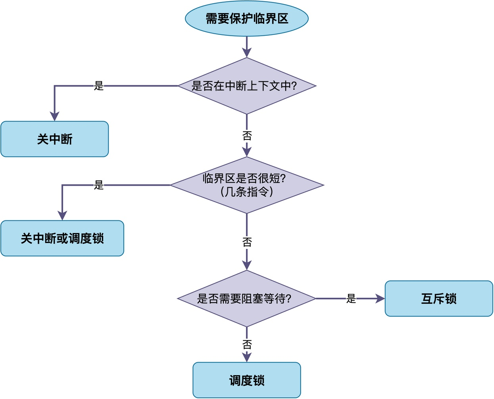

# 关中断、调度锁和互斥锁，分别适合什么场景？

在RTOS中，为了保护临界区代码不被多个任务或者中断同时访问，系统通常提供了三种保护方案：关中断、调度锁和互斥锁。

很多同学刚开始接触的时候，对这三种方式的区别不太清楚，经常随便乱用。结果要么影响了中断的响应，要么降低了系统的实时性。

那么，这三种方式到底有什么区别？分别适合什么场景呢？

## 关中断

关中断是保护力度最强的一种方式。

调用关中断函数之后，CPU不会响应任何外部中断。**由于RTOS的任务调度通常是在中断中触发（如Cortex-M的PendSV），再加上任务不主动进行切换，所以关中断之后既不会有中断响应，也不会有任务切换，当前任务会一直运行到重新打开中断。**



下面给出了一个关中断的示例代码（以RT-Thread为例）：

```c
void write_buffer(uint8_t data)
{
    /* 关中断，保存当前中断状态 */
    rt_base_t level = rt_hw_interrupt_disable();

    /* 临界区：往环形缓冲区写数据 */
    buffer[write_pos] = data;
    write_pos = (write_pos + 1) % BUFFER_SIZE;

    /* 恢复中断状态 */
    rt_hw_interrupt_enable(level);
}
```

上述代码中，在往环形缓冲区写数据之前，先关中断、写完之后恢复，从而保证写缓冲区的过程不会被打断，防止读写指针错乱。

**关中断的优点：简单直接，保护力度最强，任务和中断上下文都能用；缺点：关中断期间所有中断都得不到响应，时间太长会严重影响实时性甚至丢失中断**。

所以，**关中断适合用在中断上下文，或者任务上下文中极短的临界区**，比如修改单个变量。

## 调度锁

相比关中断，调度锁的保护力度要弱一些。

**进入调度锁之后，调度器被锁定，不会发生任务切换，但中断仍然可以正常响应**。当中断服务程序返回时，不会触发调度，而是回到原来的任务继续执行，直到退出调度锁后，调度器才重新检查是否需要切换任务。



下面给出使用调度锁的示例代码：

```c
void add_node(list_node_t *node)
{
    /* 进入调度锁 */
    rt_enter_critical();

    /* 临界区：往全局链表插入节点 */
    node->next = global_list.next;
    global_list.next = node;

    /* 退出调度锁 */
    rt_exit_critical();
}
```

在这段代码中，往全局链表插入节点前后加了调度锁，保证插入操作不会被其他任务打断，防止链表结构被破坏，同时中断仍然可以正常响应。

**调度锁的优点：中断能及时响应，不影响中断实时性；缺点：只能在任务上下文使用，临界区太长的话高优先级任务还是得不到运行**。所以，**这种方式适合：任务上下文中中等长度的临界区**，比如链表操作、队列操作、修改几个全局变量。

## 互斥锁

互斥锁的保护力度最弱但最灵活。

互斥锁本质上是一种特殊的信号量，获取不到时任务会阻塞等待，直到持有锁的任务释放后才被唤醒。**互斥锁不会禁止中断和调度，只是让竞争同一资源的任务阻塞，其他任务和中断都不受影响**。


另外，互斥锁支持优先级继承，高优先级任务等待低优先级任务持有的锁时，可以临时提升低优先级任务的优先级，防止优先级反转。

下面给出了互斥锁的示例代码：

```c
void spi_write_register(uint8_t reg, uint8_t value)
{
    /* 获取互斥锁，获取不到则阻塞等待 */
    rt_mutex_take(spi_mutex, RT_WAITING_FOREVER);

    /* 临界区：通过SPI接口写寄存器 */
    spi_cs_low();
    spi_send_byte(reg);
    spi_send_byte(value);
    spi_cs_high();

    /* 释放互斥锁 */
    rt_mutex_release(spi_mutex);
}
```

在这段代码中，使用了互斥锁保护SPI总线，当多个任务同时调用该函数时，获取不到锁的任务会阻塞等待，从而保证两个任务的SPI操作不会交错在一起导致通信出错。

**互斥锁的优点：影响范围最小，只阻塞竞争同一资源的任务，支持阻塞等待和优先级继承；缺点：只能在任务上下文使用，实现相对复杂，有一定系统开销。**

所以，**互斥锁适合任务上下文中较长的临界区**，比如访问共享外设、操作复杂数据结构、需要阻塞等待的场景。

## 三种方式对比

下面我们将这三种方式的特点整理成下图，以方便大家更直观地理解它们的区别。



从对比中可以看到，**关中断的影响范围最大，连中断都不响应，但可以用在中断上下文里；调度锁的影响范围中等，中断能响应但任务不调度，只能用在任务上下文；互斥锁的影响范围最小，只阻塞竞争资源的任务，只能用在任务上下文。**

## 如何选择

在实际开发中，我们可以按照下面的流程来判断使用哪一种机制。



首先，看是不是在中断上下文里，如果是，那就只能用关中断，因为调度锁和互斥锁都不能在中断里使用。

其次，再看临界区是不是很短，如果只是几条指令的操作，比如修改几个变量，那么关中断或者调度锁都可以，关中断更简单直接。

最后，如果临界区比较长，再看是否需要阻塞等待，如果需要等待资源可用，那就用互斥锁；如果不需要阻塞，只是简单保护一下，那就用调度锁。

当然，以上只是建议，在实际项目中应该根据需求特点灵活选择。

## 总结

综上所述，关中断、调度锁和互斥锁的核心区别在于对系统的影响范围不同。

关中断影响最大，连中断都不响应，适合中断上下文和极短临界区；调度锁影响中等，中断能响应但不调度，适合任务上下文里中等长度的临界区；互斥锁影响最小，只阻塞竞争任务，适合任务上下文里较长的共享资源访问。

在实际开发中，应根据临界区长度、使用上下文和是否需要阻塞等待来选择合适的方式。

---

> 如果你希望系统地学习RTOS底层原理，可以了解我的《RTOS开发与实战》课程。
>
> 课程不是简单地讲解FreeRTOS API的使用，而是带你从零开始编写一个RTOS内核，逐步实现任务管理、任务调度、上下文切换、同步与通信等核心机制，并通过一个远程温湿度监控设备项目，将操作系统原理应用到实际嵌入式开发中。
>
> 适合希望深入理解RTOS工作原理、提升嵌入式底层开发能力的同学。
>
> [课程详情](/blog/diyrtos/)
