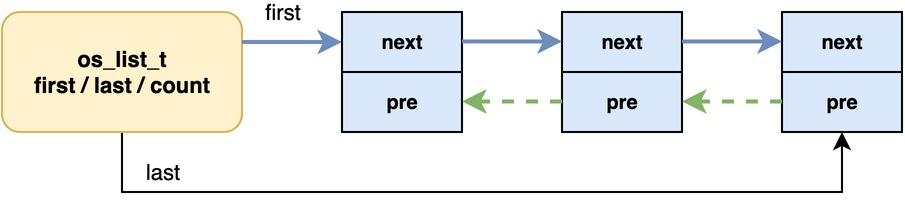
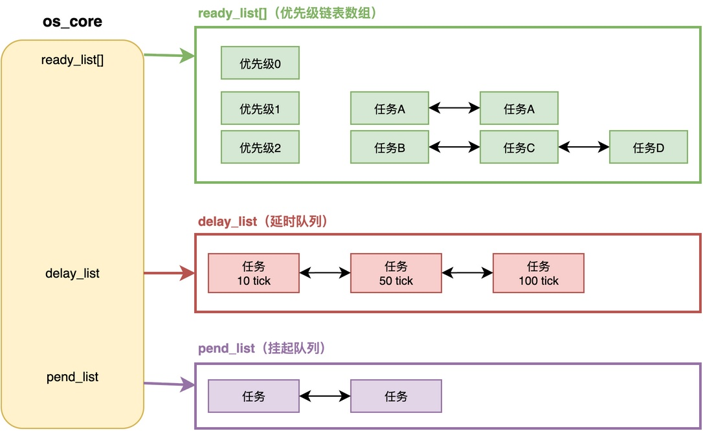
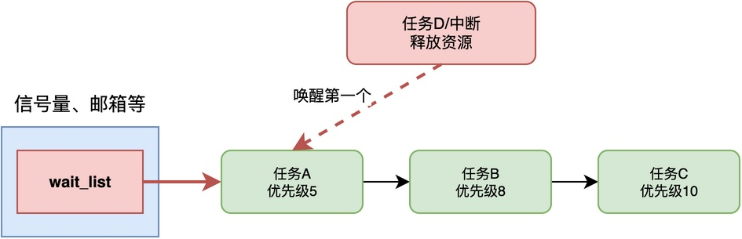
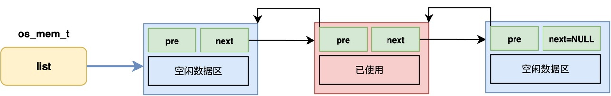

# RTOS中的链表主要用在哪些地方？

当我们深入学习RTOS内核源码的时候，你可能会发现：内核中大量使用了链表这种数据结构，无论是任务管理，还是信号量、定时器，以及内存管理，都使用了链表。

那么，在RTOS中，为什么链表用得这么广泛呢？如何设计链表？链表具体是如何使用的？

在接下来的内容，将以我的课程《从0手写嵌入式操作系统》中的设计为例，详细讲解链表的设计，以及用在了哪些地方。

## 为什么用链表

首先，先聊聊为什么RTOS这么喜欢用链表。

我们知道，**RTOS内核中的很多东西是动态变化的**，比如任务会在就绪、延时、挂起之间来回切换、信号量的等待队列会随着任务的等待和唤醒不断变化，内存块也会不断地被申请和释放。**这些场景都需要频繁地插入和删除元素**。

显然，如果用数组来管理，无论是插入还是删除，都需要移动大量元素，效率很低。相比之下，**采用链表的效率就高**很多了，插入和删除只需要修改几个指针，不需要移动数据。此外，**链表不需要连续的内存空间，可以动态地增加和减少节点**。

由此可见，使用链表是一种更适合的选择。

## 链表设计

在我的课程《从0手写嵌入式操作系统》中，采用的就是一个特殊的双向链表。对于这种链表，相应的结构定义代码如下：

```c
typedef struct _os_list_item_t {
    struct _os_list_item_t * pre;
    struct _os_list_item_t * next;
} os_list_item_t;

typedef struct _os_list_t {
    os_list_item_t * first;
    os_list_item_t * last;
    uint16_t count;
    // 略
} os_list_t;
```

其中，os_list_t为链表结构，first和last分别指向表头和表尾，count指明链表中结点的数量。而os_list_item_t则是链表中结点结构，只存放了pre和next，用于指明前一结点和后一结点。

在实际使用时，可以将结点插入到链表中，具体示例如下：

有的同学可能注意到：os_list_item_t只包含了pre和next指针，并不包含其他应用相关信息。那么，它是如何用于任务管理和内存管理等场合？

关于此问题，感兴趣的同学可以在我的课程视频中详细了解。

## 任务管理中的链表

在内核中，链表大量用于管理任务，可以将多个任务有序地组织起来。

例如，在课程的RTOS中，内核核心结构os_core_t里面定义了好几条链表，用来管理不同状态的任务：

```c
typedef struct _os_core_t {
    // 略

    // 略
    os_list_t ready_list[OS_TASK_IDLE_PRIO + 1];  // 就绪队列（按优先级）
    os_list_t delay_list;        // 延时队列

    os_list_t delete_list;       // 删除队列
    os_list_t pend_list;         // 挂起队列

    // ... 其他字段
} os_core_t;
```

这些链表的功能分别介绍如下：

1. ready_list：这是一个优先级链表数组，每个优先级对应一个链表，相同优先级的就绪任务就放在一个链表里。
2. delay_list：存放所有正在延时的任务，系统节拍中断里遍历这个队列，把到期的任务唤醒。
3. pend_list：存放着被挂起的任务，恢复的时候再移回就绪队列。

这些链表用图示表示如下：


你可以猜到，当任务状态变化的时候，会将任务从一个链表转移到另一个链表。
## 通信同步中的链表

信号量、互斥锁、消息队列、事件标志组这些通信同步机制，也都大量使用链表。

这些IPC对象都包含一个统一的os_event_t结构，该结构中就有一个链表，用于实现任务的等待队列：

```c
typedef struct _os_event_t {
    os_event_type_t type;
    int flags;
    os_list_t wait_list;    // 等待队列
} os_event_t;
```

**每个IPC对象都会维护这个等待队列，当任务获取不到资源的时候，就把任务挂到这个等待队列里，然后阻塞。等资源可用了，再从等待队列里把任务取出来唤醒。**


一般情况下，**这些链表中的任务按优先级进行排序**。这样一来，当任务或中断需要唤醒队列中的任务时，优先唤醒链表开头的任务，从而让处于队列中的高优先级任务来处理事件或获取资源。
## 内存管理中的链表

内存管理同样大量使用链表。课程的RTOS提供了两种管理方式：内存池和堆，这两种方式都使用了链表。

内存池使用os_mblock_t表示，每个内存块用mem_link_t结点结构进行链接。

```c
typedef struct _mem_link_t {
    struct _mem_link_t * next;
} mem_link_t;

typedef struct _os_mblock_t {
    // ... 其他字段
    mem_link_t * list;    // 空闲块链表
    // ... 其他字段
} os_mblock_t;
```

具体来说，所有空闲的内存块都用一个空闲链表串起来，每个内存块的开头都放了一个next指针，把所有空闲的内存块串成一个单链表。（注意，这里没有用双向链表）


堆使用os_mem_t表示，空闲的内存区域也用链表管理，每个内存块都有一个链表节点和状态标记：

```c
typedef struct _os_mem_item_t {
    os_list_item_t item;
    struct {
        uint32_t used : 1;
        uint32_t data_size : 31;
    };
} os_mem_item_t;

typedef struct _os_mem_t {
    os_list_t list;    // 内存块链表
    // ... 其他字段
} os_mem_t;
```

具体来说，所有的内存块都用一个链表串起来，每个内存块的开头都放了一个os_list_item_t结构，把所有的内存块串成一个双向链表。

当申请内存的时候，遍历链表找到合适大小的块，分配出去合适的空间，释放的时候把相邻的空闲块合并。
## 总结

总结来说，链表是RTOS内核中使用最广泛的数据结构，几乎无处不在。该结构主要用在：任务管理，如就绪队列、延时队列、挂起队列；通信同步，如信号量的等待队列；内存管理，用于组织空闲块。

链表之所以用得如此广泛，是因为它插入和删除效率高，不需要连续内存，非常适合RTOS内核中那些频繁变动的动态集合。

---

> 如果你希望系统地学习RTOS底层原理，可以了解我的《RTOS开发与实战》课程。
>
> 课程不是简单地讲解FreeRTOS API的使用，而是带你从零开始编写一个RTOS内核，逐步实现任务管理、任务调度、上下文切换、同步与通信等核心机制，并通过一个远程温湿度监控设备项目，将操作系统原理应用到实际嵌入式开发中。
>
> 适合希望深入理解RTOS工作原理、提升嵌入式底层开发能力的同学。
>
> [课程详情](/blog/diyrtos/)
