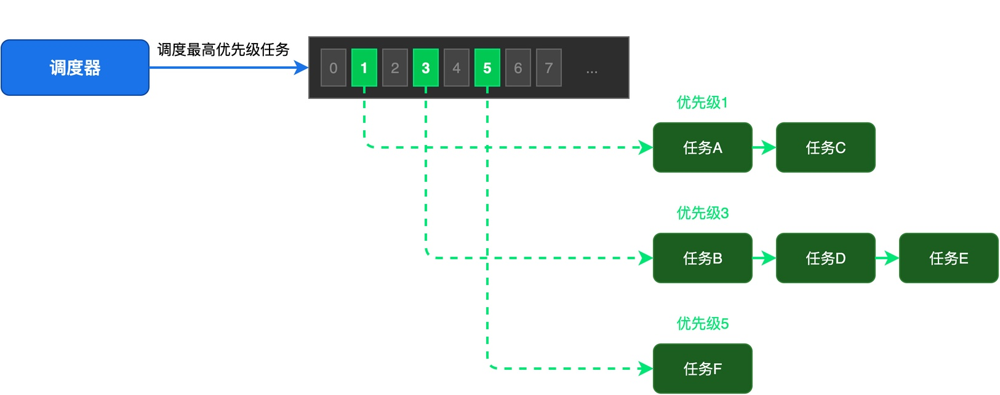
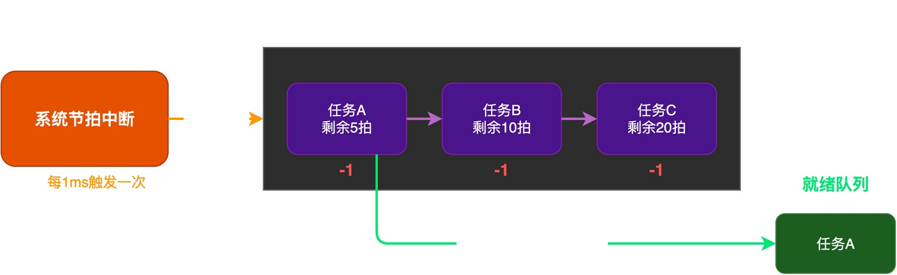
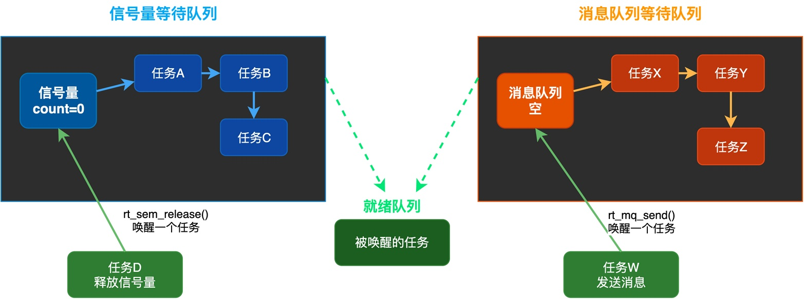
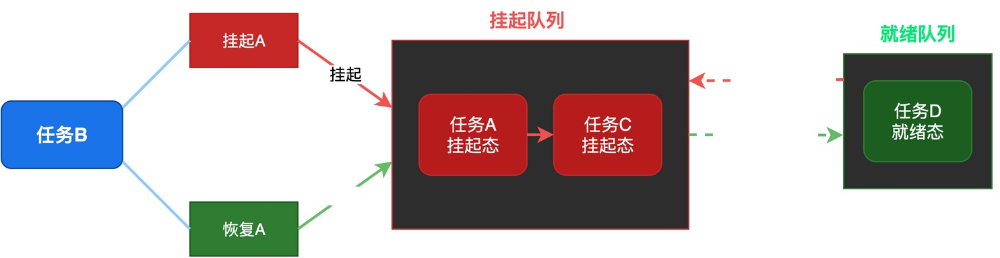
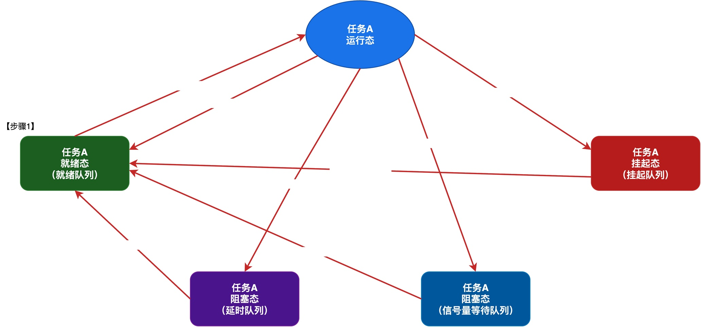

# RTOS内部都有哪些队列？它们是如何管理任务的？

我们知道，在RTOS中可以创建很多个任务，每个任务负责不同的功能。在系统运行的过程中，这些任务的状态是不断变化的，有的任务正在CPU上运行，有的任务在等待信号量，有的任务在延时等待，还有的任务被挂起了。

那么，RTOS内核是如何把这些状态各异的任务有效地管理起来的呢？答案就是：**RTOS内部使用了很多个队列，用于管理不同状态的任务**。

在这篇文章中，我将介绍RTOS内部到底有哪些队列，以及这些队列之间是如何相互配合的。

## RTOS的主要队列

不同的RTOS在具体实现上可能略有差异，但**核心队列主要有：就绪队列、延时队列、阻塞队列和挂起队列。**

### 就绪队列

**就绪队列是最重要的一种队列，里面放的是所有处于就绪态的任务。**

就绪队列通常按优先级来组织。以我的《从0手写嵌入式操作系统》课程中设计的RTOS为例，它**使用的是优先级位图算法，每个优先级对应一条队列，同时用一个位图来记录哪些优先级有任务就绪**，这样可以在O(1)的时间内找到最高优先级的就绪任务。

在上图中，左侧是一个优先级位图，每一位对应一个优先级，位为1表示该优先级有就绪任务。每个优先级下面挂着一条任务队列，队列中的所有任务都处于就绪状态。右侧的调度器会从位图中找到最高优先级，然后从对应的队列中取出任务来运行。

### 延时队列

**延时队列里放的是正在调用rt_thread_mdelay()进行延时的任务。** 当任务进入延时状态时，内核会把任务放在延时队列中，每个任务记录自己还需要延时多少个时钟节拍。

每次系统节拍中断到来时，内核就会遍历延时队列，将每个任务的剩余延时时间减一。如果发现某个任务的延时计数为0，就把这个任务从延时队列移到就绪队列。

在上图中，延时队列里有三个任务，分别还需要延时5个、10个和20个时钟节拍。每次系统节拍中断发生时，中断处理程序就会扫描这个队列，把每个任务的剩余计数减一，当某个任务的计数减到0时，就把它移到就绪队列中。

有的RTOS为了提高扫描效率，会采用一些特殊的排序算法对延时队列中的任务进行排序，此处不赘述。

### 阻塞队列

**阻塞队列不是一个全局的队列，而是位于各个IPC对象（信号量、消息队列等）内部的等待队列。**

比如，每个信号量都有自己的等待队列，每个消息队列也有自己的等待队列。当一个任务等待信号量而信号量不可用时，它就会被挂到这个信号量的等待队列中；当另一个任务释放信号量的时候，内核就从这个等待队列上唤醒一个任务。

在上图中，展示了两种常见的阻塞队列：信号量等待队列和消息队列等待队列。每个队列里都挂着多个正在等待的任务。当其他任务释放信号量或者发送消息时，内核就会从对应的等待队列中唤醒一个任务，把它移到就绪队列。

### 挂起队列

**很多RTOS有一个单独的挂起队列，放那些被挂起的任务。**

在上图中，任务B调用挂起接口将任务A挂起，任务A就被移到了挂起队列中，调度器不会再调度它。只有当任务B调用恢复接口恢复任务A时，任务A才会从挂起队列移回到就绪队列。

**不过，也有些RTOS不单独设挂起队列，而是在任务控制块里加一个挂起标志**。被挂起的任务即使在就绪队列里，调度器也会跳过它。

## 队列之间的配合

接下来，让我们来看看这些队列具体是怎么相互配合，来实现任务的管理。

**其实，核心机制很简单：当任务状态发生变化的时候，RTOS会将任务从原来的队列里摘下来，再挂到新的队列里去。**

下面的图以任务A为例，直观地展示了它在不同队列之间的移动过程。

假设系统里有任务A，我们来看它的状态是如何变化的：

1. 当任务创建时，任务A在就绪队列里，处于就绪态，等待被调度器选中。
2. 调度器选中任务A后，任务A开始在CPU上运行，进入运行态。
3. 任务A调用rt_thread_mdelay()进行延时，就从就绪队列移到延时队列，进入阻塞态。
4. 延时时间到了之后，内核把任务A从延时队列移回就绪队列，重新进入就绪态。
5. 任务A获取一个信号量但信号量不可用，就移到信号量的等待队列，再次进入阻塞态。
6. 其他任务释放了信号量，任务A从信号量等待队列移回就绪队列，重新进入就绪态。
7. 任务A被其他任务挂起，就移到挂起队列，进入挂起态。

通过任务A的状态变化可以看到：**任务处于不同状态时，就会在不同的队列之间来回移动，而RTOS通过这些队列，就能高效地管理所有任务的状态。**

## 总结

综上所述，RTOS内部通过多个队列来分类管理不同状态的任务。

这些队列包括：就绪队列、延时队列、阻塞队列，以及挂起队列。当任务状态变化时，内核会把任务从一个队列移到另一个队列。通过这种多队列的设计，调度器可以快速找到需要运行的任务，也能高效处理各种状态转换。

---

> 如果你希望系统地学习RTOS底层原理，可以了解我的《RTOS开发与实战》课程。
>
> 课程不是简单地讲解FreeRTOS API的使用，而是带你从零开始编写一个RTOS内核，逐步实现任务管理、任务调度、上下文切换、同步与通信等核心机制，并通过一个远程温湿度监控设备项目，将操作系统原理应用到实际嵌入式开发中。
>
> 适合希望深入理解RTOS工作原理、提升嵌入式底层开发能力的同学。
>
> [课程详情](/blog/diyrtos/)
