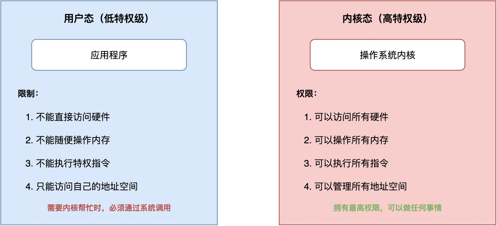
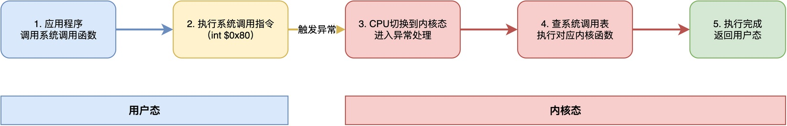
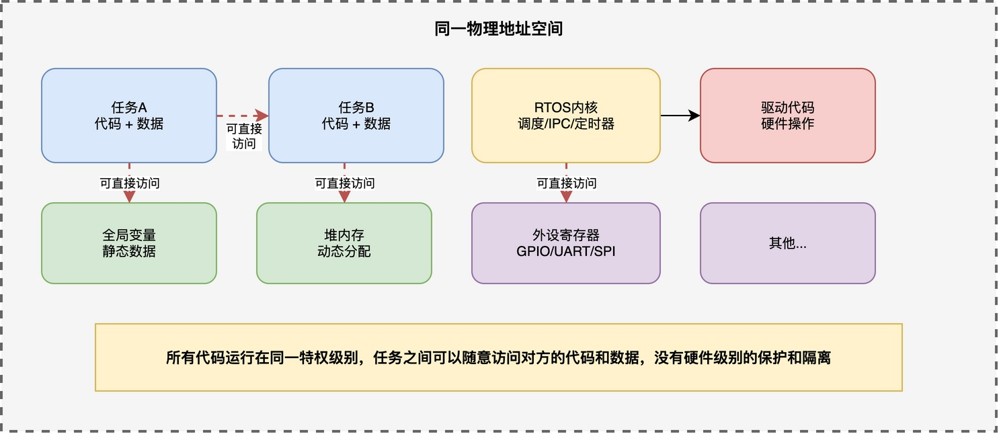

// 注，可以引入下我的手写x86操作系统课程。ARM体系课程。

# 为什么大多数RTOS不使用CPU提供的系统调用指令？

在Linux等通用操作系统中，应用程序如果要访问磁盘、读写文件或者打印一些东西，就必须使用系统调用。

例如，常用的文件访问接口，本质上都是系统调用：

```c
int open(const char *pathname, int flags);
ssize_t read(int fd, void *buf, size_t count);
ssize_t write(int fd, const void *buf, size_t count);
```

这些函数看似是普通函数，其实内部是通过执行特殊的CPU系统调用指令来完成的。以x86架构为例，open()函数的内部实现大致是这样的：

```c
int open(const char *pathname, int flags)
{
    int ret;
    asm volatile(
        "int $0x80"
        : "=a"(ret)
        : "a"(5), "b"(pathname), "c"(flags)
    );
    return ret;
}
```

可以看到，核心就是执行了一条int $0x80指令，触发一个软中断，从用户态陷入到内核态。

但是，在RTOS当中，我们会发现一个很有意思的现象：**RTOS的内核API通常是以普通函数的形式直接暴露出来的。**

这些函数的源码和我们的应用源码一起编译、链接，任务调用这些内核函数时，就像调用自己写的函数一样，直接跳转过去执行，并没有用到什么特殊的CPU特权指令。

例如，在RT-Thread中，可以直接这样调用：

```c
rt_thread_t rt_thread_create(const char *name,
                             void (*entry)(void *parameter),
                             void *parameter,
                             rt_uint32_t stack_size,
                             rt_uint8_t priority,
                             rt_uint32_t tick);

rt_thread_t tid = rt_thread_create("t1", t1_entry, NULL, 1024, 10, 10);
```

那么，这里就有一个问题：为什么RTOS会采用这样一种简单、直接的方式？

## 系统调用的工作原理

要理解这个问题，首先要明白系统调用的工作原理。

在通用操作系统里，CPU通常至少提供两种特权级别：**用户态和内核态**。应用程序运行在用户态，权限受限，无法直接访问硬件；内核运行在内核态，拥有所有权限。



由于权限限制，当应用程序需要内核帮它做事情的时候，比如读文件、分配内存，不能直接调用内核里的函数。此时，需要用到系统调用指令，比如x86系统中的int $0x80指令。

**这条指令会触发一个异常，把CPU从用户态切换到内核态，然后内核根据传入的参数，执行对应的系统调用函数，执行完再返回用户态**。整个过程如下图所示：



所以，系统调用指令的本质作用，实际是：**让低特权级的代码能安全地调用高特权级的内核功能。**

## RTOS为什么不使用系统调用指令

既然系统调用能够划分特权级，避免低权限级的代码有意或无意地破坏系统，那么，为什么RTOS不使用系统调用指令呢？主要原因有以下三点：

### 共享同一物理地址空间

首先，最核心的原因是：**大多数RTOS运行的单片机没有MMU（内存管理单元），无法做到用户态和内核态的地址空间隔离**。

**所谓地址空间隔离，指的是通用操作系统中每个应用程序都有自己独立的虚拟地址空间**，应用程序只能访问自己的地址空间，不能直接访问内核空间，也不能访问其他应用程序的地址空间。这种隔离是由MMU硬件来保证的。

**而在没有MMU的RTOS中，所有的代码和数据都共享同一个物理地址空间**。如下图所示：



在这个统一的地址空间里，任务A的代码可以直接访问任务B的数据，也可以直接读写外设寄存器，甚至可以直接修改内核的全局变量。它们之间没有硬件级别的保护和隔离，所有代码运行在同一个特权级别下。

既然如此，调用内核API可以直接用普通的函数调用跳转过去就行。如果坚持用系统调用指令，反而增加了异常入口、参数传递、特权切换这些额外的开销。

### 减少开销

其次，RTOS追求的是实时性和高效率，无关开销越小越好。

直接函数调用只需要一条跳转指令，几个时钟周期就完成了；**而系统调用要触发异常、保存现场、查系统调用表、切换特权级，可能要几十个甚至上百个时钟周期。**对于资源受限的单片机来说，这个开销是没必要的。

### 任务代码可控

此外，还有一个很重要的实际原因：**RTOS项目中运行的任务代码，通常都是开发人员自己编写的，功能和行为都是确定的、可控的，不存在恶意破坏的情况**。

而通用操作系统上可能会运行各种第三方开发的应用程序，这些程序的质量参差不齐，甚至可能有恶意代码，所以必须用用户态和内核态的隔离来保护系统安全。

## 总结

综上所述，RTOS不使用系统调用指令，是由它的运行环境和应用场景决定的。

RTOS通常运行在没有MMU的单片机上，所有代码共享同一物理地址空间，运行在同一特权级别下，既没有条件也没有必要做用户态和内核态的隔离。此外，直接通过函数调用的方式来调用内核API，效率更高，开销更小。再加上所有代码可控，不需要额外的安全隔离机制。

因此，即便在Cortex-M等具备系统调用指令（SVC指令）的架构上，大多数RTOS并不使用该指令。

---

> 如果你希望系统地学习RTOS底层原理，可以了解我的《RTOS开发与实战》课程。
>
> 课程不是简单地讲解FreeRTOS API的使用，而是带你从零开始编写一个RTOS内核，逐步实现任务管理、任务调度、上下文切换、同步与通信等核心机制，并通过一个远程温湿度监控设备项目，将操作系统原理应用到实际嵌入式开发中。
>
> 适合希望深入理解RTOS工作原理、提升嵌入式底层开发能力的同学。
>
> [课程详情](/blog/diyrtos/)
