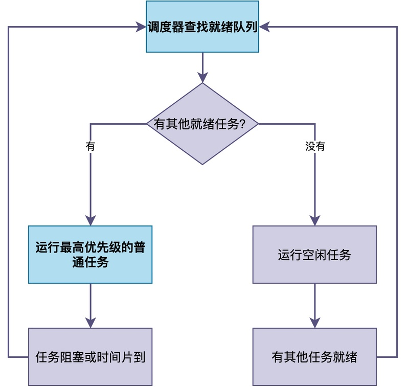

# 空闲任务（Idle Task）是做什么的？

对于喜欢探究原理的你来说，当深入分析RTOS的实现之后，你可能会发现：

> 几乎所有的RTOS（RT-Thread、FreeRTOS、uC/OS等），都会在系统启动时，自动创建一个叫做"空闲任务"的东西。

有的同学可能会想：**这个空闲任务到底是做什么的？能不能把它删掉节省资源（TCB和栈）？既然它叫"空闲"任务，是不是意味着它什么都不做？**

在这篇文章中，让我们深入了解这个看似"没用"但实际上非常重要的空闲任务。

## 什么是空闲任务

简单来说，**空闲任务（Idle Task）是RTOS在系统启动时自动创建的一个特殊任务，它的优先级是全系统最低的，并且永远处于就绪状态。** 

例如，RT-Thread在初始化过程中，会通过rt_thread_idle_init()初始化空闲任务：

```c
/* 初始化空闲任务 */
int rt_thread_idle_init(void)
{
    /* 初始化空闲任务的TCB */
    rt_thread_init(&idle,
                   "tidle",                          /* 任务名称 */
                   rt_thread_idle_entry,             /* 入口函数 */
                   RT_NULL,                          /* 入口参数 */
                   &rt_thread_stack[0],              /* 栈起始地址 */
                   sizeof(rt_thread_stack),          /* 栈大小 */
                   RT_THREAD_PRIORITY_MAX - 1,       /* 最低优先级 */
                   10);                              /* 时间片 */

    /* 启动空闲任务，加入就绪队列 */
    rt_thread_startup(&idle);

    return 0;
}
```
注意，该任务的优先级设置为RT_THREAD_PRIORITY_MAX - 1，也就是系统允许的最低优先级。

也就是说：

> 当系统中有其他任务就绪时，因为其他任务的优先级都比空闲任务高，空闲任务将得不到运行机会。
> 只有当系统中所有其他任务都阻塞了（比如都在等待信号量或者处于延时状态），没有任何就绪任务时，空闲任务才运行。

下面展示了空闲任务与其他任务的调度关系：


空闲任务就像是一个"替补队员"，该队员平时不上场，只有当所有主力队员都下场了，它才上场。而一旦有主力队员回来，它立刻被替换下场。

## 为什么不能删除空闲任务

有的同学可能还是会问：那我能不能把它删掉呢？反正它看起来大部分时间都不运行，删掉还能省一点内存。

答案是：**不能删除。**

不能删除的原因很简单：

> 当系统中所有任务都阻塞（延时）了，此时RTOS内部的就绪队列就会变空，调度器就找不到可运行的任务了。
> 这时候CPU该干什么呢？它没有指令可以执行，很多RTOS并没有针对这种情况做特殊处理。此时，系统就会跑飞或者进入异常。

因此，空闲任务的存在就是为了避免出现这种情况。

由于空闲任务永远处于就绪状态，且优先级最低，所以就绪队列永远不会为空。**当没有其他任务就绪时，调度器就运行空闲任务，CPU至少有事可做**。一旦有其他任务就绪，调度器立即抢占空闲任务，运行新就绪的任务。

## 空闲任务在做什么

虽然叫"空闲"任务，但实际上，在很多RTOS中，空闲任务并不是什么都不做。

以RT-Thread为例，空闲任务的任务函数实现代码如下（其中rt_thread_idle_hook是一个全局函数指针，用于保存用户注册的空闲钩子函数）：

```c
/* 空闲任务入口函数 */
static void rt_thread_idle_entry(void *parameter)
{
    while (1)
    {
        /* 第一步：执行空闲钩子函数（如果用户注册了） */
        if (rt_thread_idle_hook != RT_NULL)
        {
            rt_thread_idle_hook();
        }

#ifdef RT_USING_HEAP
        /* 第二步：回收已删除任务的资源 */
        rt_thread_defunct_cleanup();
#endif
    }
}
```

通常情况下，空闲任务主要承担以下几项工作，下面分别详细说明。

### 执行钩子函数

**用户可以向RTOS注册一个回调函数（叫做空闲钩子函数），当空闲任务运行时，这个函数就会被调用。**

通过空闲钩子函数，用户可以在系统空闲时执行一些自定义的操作，比如喂看门狗、统计CPU使用率、进入低功耗模式等。

在RT-Thread中，通过rt_thread_idle_sethook()函数来设置空闲钩子函数，源码如下：

```c
/* 设置空闲钩子函数 */
void rt_thread_idle_sethook(void (*hook)(void))
{
    rt_thread_idle_hook = hook;
}
```

这个函数很简单，就是把用户传入的函数指针保存到rt_thread_idle_hook变量中。使用方法如下：

```c
/* 定义空闲钩子函数 */
void my_idle_hook(void)
{
    /* 在这里执行自定义操作 */
}

/* 在初始化中注册空闲钩子 */
int main(void)
{
    rt_thread_idle_sethook(my_idle_hook);
    return 0;
}
```

设置好之后，每当空闲任务运行时，my_idle_hook()就会被调用。下面给出几个常见的应用例子。

#### 例子一：CPU使用率统计

在空闲钩子中对一个计数器累加，同时用一个定时器记录总时间。通过比较空闲计数和总计数，就能算出CPU的使用率：

```c
static rt_uint32_t idle_count = 0;  /* 空闲计数 */

/* 空闲钩子：每次空闲任务运行时累加 */
void idle_hook(void)
{
    idle_count++;
}

/* 定时器：每秒计算一次CPU使用率 */
static void cpu_usage_timer(void *param)
{
    static rt_uint32_t total_count = 1000;  /* 假设每秒总计数为1000 */
    rt_uint32_t usage;

    /* CPU使用率 = (总时间 - 空闲时间) / 总时间 */
    usage = (total_count - idle_count) * 100 / total_count;
    rt_kprintf("CPU usage: %d%%\n", usage);

    idle_count = 0;  /* 清零，重新计数 */
}
```

当系统越忙，空闲任务运行的次数越少，idle_count的值就越小，CPU使用率就越高；系统越闲，空闲任务运行的次数越多，idle_count的值就越大，CPU使用率就越低。

#### 例子二：喂看门狗

在一些对可靠性要求高的系统中，会使用硬件看门狗来监控系统是否正常运行。

喂看门狗的操作可以放在空闲钩子中，因为如果系统太忙导致空闲任务得不到运行，说明系统可能已经异常。

```c
void idle_hook(void)
{
    /* 喂看门狗 */
    IWDG_ReloadCounter();
}
```

### 回收已删除任务的资源

当一个任务被删除时，它的TCB和栈空间（如果是动态分配的）并不会立即被释放，而是被标记为"待回收"。**空闲任务在运行时会检查是否有待回收的任务资源，如果有，就将其释放回内存堆**。

之所以这样做，是可以简化任务删除实现上的一些问题。例如，在RT-Thread的空闲任务函数中，调用了rt_thread_defunct_cleanup()进行任务的回收操作。

### 进入低功耗模式

在支持低功耗的系统中，**空闲任务会在运行时进入低功耗模式（比如睡眠模式、停机模式），以节省电能**。当有中断或其他任务就绪时，系统被唤醒，继续正常运行。这是嵌入式设备实现低功耗的常用方式。

最常见的做法是在空闲钩子中进入低功耗模式。当系统空闲时，让CPU进入睡眠状态，节省电能：

```c
void idle_hook(void)
{
    /* 进入睡眠模式，等待中断唤醒 */
    __WFI();  /* Wait For Interrupt，ARM Cortex-M指令 */
}
```

## 能否在空闲任务中挂起或调用阻塞函数

那么，**能不能在空闲钩子函数（或空闲任务本身）中调用阻塞函数，比如rt_thread_mdelay()等？**

答案是：**绝对不能。**

正如前面已经提到的：空闲任务是系统的"兜底"任务，它永远处于就绪状态，保证就绪队列永远不为空。

> 如果在空闲任务中调用了阻塞函数，将使得空闲任务从就绪队列中移除，进入阻塞状态。
> 此时，如果其他任务也都阻塞了，那么将导致就绪队列就空了，CPU再次陷入"无事可做"的状态。

因此，**在空闲钩子函数中，只能执行非阻塞的操作**，比如：
- 操作硬件寄存器
- 执行__WFI()进入低功耗
- 累加计数器、喂看门狗

不能调用rt_thread_mdelay()等阻塞函数，更不能调用rt_thread_suspend()挂起空闲任务自己。

## 总结

综上所述，**空闲任务是RTOS在系统启动时自动创建的一个特殊任务，优先级最低，必须永远处于就绪状态**。

它的**存在保证了调度器的就绪队列永远不为空，系统在任何情况下都不会出现"无任务可运行"的异常**。

用户可以通过**空闲钩子函数**在系统空闲时执行自定义操作，比如低功耗、CPU使用率统计等。需要特别注意的是，钩子函数中只能执行非阻塞操作，绝对不能阻塞或挂起空闲任务，否则可能导致系统崩溃。

---

> 如果你希望系统地学习RTOS底层原理，可以了解我的《RTOS开发与实战》课程。
>
> 课程不是简单地讲解FreeRTOS API的使用，而是带你从零开始编写一个RTOS内核，逐步实现任务管理、任务调度、上下文切换、同步与通信等核心机制，并通过一个远程温湿度监控设备项目，将操作系统原理应用到实际嵌入式开发中。
>
> 适合希望深入理解RTOS工作原理、提升嵌入式底层开发能力的同学。
>
> [课程详情](/blog/diyrtos/)
