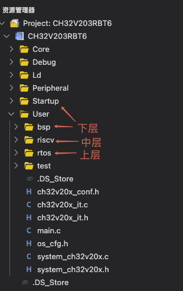
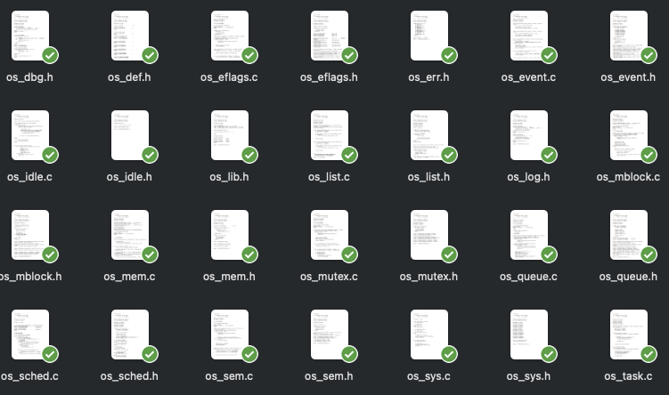
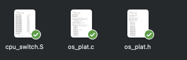

# 同一套RTOS移植到不同MCU时，哪些代码通常需要修改？

我们知道，从RT-Thread等官网下载的示例模板，并不能直接拿来用在自己的项目中，而是需要根据所用的芯片进行适配修改。

> 昨天，刚好有位同学在学习我的《从0手写嵌入式操作系统》课程时也面临类似的问题：
>
> 他想把课程里基于RISC-V开发的RTOS移植到STM32F4上，问我要改哪些代码？是不是整个工程都要推翻重写？

这就引发了一个更普遍的问题：将一个RTOS移植到某个特定的芯片上时，到底需要做哪些修改？

在这篇文章中，我将结合具体的源码文件和代码内容，介绍需要做哪些修改工作。这些思路同样适用于其他RTOS，比如FreeRTOS、RT-Thread。

## RTOS代码的三层结构

当我们打开一个RTOS工程目录时，可以看到其中有不同的目录和源码文件。如果认真分析其文件组织结构，会发现整体上可以从下往上大致分成三层。记住这三层，移植的时候就知道该从哪里下手了。



在我的课程源码里，这三层划分得很清楚：上层是rtos目录，也就是RTOS核心层；中间层是riscv目录，也就是CPU架构移植层；下层是bsp和Startup目录，也就是芯片板级支持包。

## RTOS核心层：不用改动

最上层其实是RTOS的核心功能实现。这些功能几乎全部是用标准C写的，不依赖任何特定的CPU指令，也不操作硬件寄存器。

也就是说，**只要C编译器符合标准，这一层代码在哪个MCU上都能编译运行**。

在我的课程源码里，这一层加起来有将近30个文件，主要用于实现任务管理、调度器、信号量、互斥锁、消息队列、内存管理这些核心功能。



**在进行移植的时候，这些代码几乎不用修改**。不管是从RISC-V换到ARM，编译器都会把它们编译成适合特定CPU的指令。

不过这里要注意一点，就是C编译器的版本问题。如果代码里的某些C语法特性，在老版本的编译器上可能不支持。此时，要么升级编译器，要么把这部分语法改成兼容的写法。但这属于个别情况，绝大多数核心代码都是可以直接复用的。

## CPU架构移植层：同架构复用，跨架构重写

**CPU架构移植层是和特定的CPU架构绑定的**。在我的课程源码里，这一层就是riscv目录下的三个文件：os_plat.h、os_plat.c和cpu_switch.S。



如果是同架构换芯片，比如都是RISC-V架构，只是芯片型号不同，那这一层基本可以原样复用。但如果是从RISC-V换到ARM Cortex-M，这一层就要全部重写了。

当进行跨架构的移植时，我们需要深入了解目标架构的CPU内核寄存器有哪些、中断和异常管理机制是什么样的、内存模型是怎样的，然后**根据目标架构对相关的内核结构进行重写**。

我们来看几个具体的例子。

第一个是上下文结构体的定义。在RISC-V上，os_plat.h里的os_task_ctx_t结构体保存了x1到x31这32个通用寄存器，以及pc和mstatus：

```c
typedef struct _os_task_ctx_t {
    cpu_stack_t pc;
    cpu_stack_t x1_ra;
    cpu_stack_t x2_sp;
    // ... x3到x30省略
    cpu_stack_t x31_t6;
    cpu_stack_t mstatus;
} os_task_ctx_t;
```

如果移植到ARM Cortex-M上，这个结构体就需要完全重写，变成ARM的寄存器：

```c
typedef struct _os_task_ctx_t {
    cpu_stack_t r0;
    cpu_stack_t r1;
    // ... r2到r12省略
    cpu_stack_t r13_sp;
    cpu_stack_t r14_lr;
    cpu_stack_t r15_pc;
    cpu_stack_t xpsr;
} os_task_ctx_t;
```

第二个是关中断的实现。在RISC-V上，关中断是操作mstatus寄存器：

```c
os_int_status_t os_plat_int_disable(void) {
    os_int_status_t status = __get_MSTATUS();
    __set_MSTATUS(0x1880);
    return status;
}
```

而到了ARM Cortex-M上，就变成了操作PRIMASK：

```c
os_int_status_t os_plat_int_disable(void) {
    os_int_status_t status = __get_PRIMASK();
    __disable_irq();
    return status;
}
```

最为复杂的是任务上下文切换的实现。除了要对目标CPU架构比较熟悉之外，还得懂得如何使用汇编来编写代码。比如针对Cortex-M4F的上下文切换代码，大致是这样的：

```c
PendSV_Handler:
    cpsid   I

    mrs r1, psp
    ands r2, lr, #(1 << 4)
    tst r2, #(1 << 4)
    bne skip_save_vfp
    vstmdb r1!,{s16-s31}

skip_save_vfp:
    ldr r0, =int_ctx_from
    ldr r0, [r0]

    stmia r0!, {r4-r11}
    stmia r0!, {r1}
    stmia r0!, {r2}

    bl os_sched_switch_ctx

    ldr r0, =int_ctx_to
    ldr r0, [r0]

    ldmia r0!, {r4-r11}
    ldmia r0!, {r1}
    ldmia r0!, {r2}

    cbnz r2, skip_restore_vfp
    vldmia r1!, {s16-s31}

skip_restore_vfp:
    msr psp, r1

    ldr r0, =0xFFFFFFED
    orr r0, r0, r2
    cpsie i
    BX  r0
```

可以看到，**这部分代码和具体的CPU架构是深度绑定的，换了架构就必须全部重写**。因此，跨CPU架构的移植工作门槛是比较高的，通常都是由RTOS内核开发者去完成的。

## 芯片板级支持包：每次换芯片都要改

**最下一层是和具体芯片型号相关的板级支持包，当移植到不同型号的MCU时都要重新适配。**

在我的课程源码里，这一层包括：bsp目录下的led、beep、button这些外设驱动，Startup目录下的启动文件，中断向量表，系统时钟配置等等。

比如在RISC-V的CH32V203上，系统节拍的配置是由下面的代码完成的：

```c
SysTick->CTLR = 0;
SysTick->CMP = SystemCoreClock / (1000 / OS_SYSTICK_MS);
SysTick->CTLR = 0xF;
```

而到了STM32F4上，就可以用CMSIS的标准接口：

```c
SysTick_Config(SystemCoreClock / 1000);
```

由于不同MCU的外设特性、寄存器定义都不一样，这部分相关的代码必须重写。

## 综上所述

综上所述，**当将RTOS从一个架构移植到另一个架构时，需要将CPU架构移植层和芯片板级支持包重写，而RTOS核心层是无需改动的**。这种分层设计的好处，就是把和硬件相关的东西进行了隔离，这样一来，当将RTOS切换到其他平台时，只需要做相对有限的工作。

绝大多数情况下，作为RTOS的使用者，我们都是利用官方提供的BSP模板，针对具体的芯片做一些适配，不需要自己去做跨CPU架构的移植工作。

---

> 如果你希望系统地学习RTOS底层原理，可以了解我的《RTOS开发与实战》课程。
>
> 课程不是简单地讲解FreeRTOS API的使用，而是带你从零开始编写一个RTOS内核，逐步实现任务管理、任务调度、上下文切换、同步与通信等核心机制，并通过一个远程温湿度监控设备项目，将操作系统原理应用到实际嵌入式开发中。
>
> 适合希望深入理解RTOS工作原理、提升嵌入式底层开发能力的同学。
>
> [课程详情](/blog/diyrtos/)
