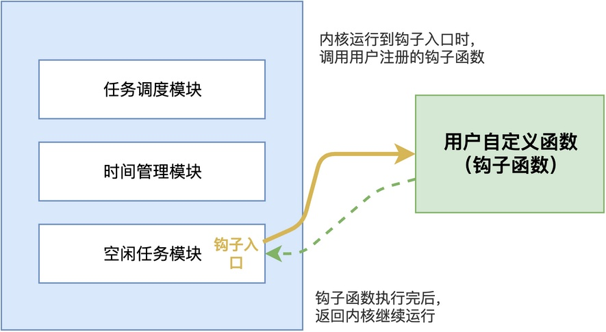

# RTOS的钩子函数（Hook）是干什么用的？

在项目中，我们有时候会希望RTOS在内核运行过程中，执行一些特定的工作，这时候就需要用到钩子函数（Hook）了。

> 例如，RTOS里有一个空闲任务，当系统里没有其他任务就绪的时候才运行。
> 那能不能在系统空闲的时候，让它顺便喂一下看门狗呢？当然可以，这时候就可以用空闲任务钩子。

那这个钩子函数到底是什么？RTOS里还有哪些钩子？这篇文章将以RT-Thread为例，介绍钩子函数的使用方法。

## 钩子函数是什么

简单来说，**钩子函数就是RTOS内核预留的一些"扩展点"**。

> 打个比方，就像你买了一套房子，开发商在客厅、卧室、厨房都预留了电源插座。你想插个电视、插个冰箱，直接往插座上插就行，不需要自己去砸墙布线。钩子函数就是内核给你预留的"插座"。

同样地，在设计RTOS的时候，开发者会在一些关键的运行位置留一个回调入口。当系统运行到那个位置时，就会检查用户有没有注册对应的钩子函数，如果注册了，就调用一下。



这样做的好处是：**不需要修改内核的源码，就能把自己的功能插到内核的运行流程里。**

## 常见的钩子函数

不同的RTOS提供的钩子函数不同，这里以RT-Thread为例，介绍两种钩子函数的使用方法及其调用机制。

### 空闲任务钩子

空闲任务钩子是最常用的一种。

在RT-Thread里，空闲任务钩子需要先调用rt_thread_idle_sethook()函数进行注册，完整的使用方式如下：

```c
/* 先实现自己的钩子函数 */
static void my_idle_hook(void)
{
    /* 系统空闲的时候，就会跑到这里来 */
    /* 可以在这里喂看门狗、做一些低优先级的后台工作 */
}

int main(void)
{
    /* 注册空闲任务钩子 */
    rt_thread_idle_sethook(my_idle_hook);
    return 0;
}
```

注册之后，每当系统进入空闲任务rt_thread_idle_entry()中运行时，内核就会自动调用注册的my_idle_hook()函数。

```c
// 空闲任务
static void rt_thread_idle_entry(void *parameter)
{
    /* 略 */

    while (1)
    {
        rt_size_t i;
        void (*idle_hook)(void);

        for (i = 0; i < RT_IDLE_HOOK_LIST_SIZE; i++)
        {
            idle_hook = idle_hook_list[i];
            if (idle_hook != RT_NULL)
            {
                idle_hook();
            }
        }
    /* 略 */
    }
}
```

这个钩子特别适合做一些低优先级的后台工作，比如统计CPU使用率、喂看门狗、或者做一些不着急的清理工作。

### 任务切换钩子

任务切换钩子是在每次发生上下文切换的时候调用的。当调度器进行任务切换时，内核会调用任务切换钩子，把当前任务和下一个任务的信息传入钩子函数。

在RT-Thread里，任务切换钩子通过rt_scheduler_sethook()进行注册，完整的使用方法如下：

```c
/* 先实现自己的钩子函数 */
static void my_scheduler_hook(struct rt_thread *from, struct rt_thread *to)
{
    /* 从from任务切到to任务时调用 */
    /* 可以在这里记录任务切换轨迹、统计每个任务的运行时间 */
}

int main(void)
{
    /* 设置调度器钩子 */
    rt_scheduler_sethook(my_scheduler_hook);
    return 0;
}
```

之后，每当系统发生任务切换，内核就会调用my_scheduler_hook()函数，并把切换前的任务和切换后的任务信息都传进来。相关调用示例代码如下：

```c
void rt_scheduler(void)
{
    /* 略 */
    if (from_thread != to_thread)
    {
        /* 调用调度器钩子 */
        if (rt_scheduler_hook != RT_NULL)
        {
            rt_scheduler_hook(from_thread, to_thread);
        }

        /* 略 */

        /* 执行上下文切换 */
        rt_hw_context_switch((rt_uint32_t)&from_thread->sp,
                            (rt_uint32_t)&to_thread->sp);
    }
}
```

可以看到，在真正执行上下文切换之前，内核会先检查有没有注册调度器钩子，如果有就调用一下，把当前任务和下一个任务都传进去。

这个钩子主要用于调试和性能分析，比如记录每次切换的任务和时间、获取任务栈信息等。

## 注意事项

由于钩子函数并不是在用户创建的任务中调用执行的，因此在使用钩子函数的时候，有几点需要特别注意。

**第一，不能调用可能导致阻塞的API**。例如，空闲钩子不能调用rt_sem_wait()，这将导致空闲任务阻塞，系统就真的没事可干了。

**第二，不能执行太耗时的操作**。例如，任务切换钩子是在上下文切换的过程中调用的，如果在里面做复杂的计算，将使得切换时间变长，影响整个系统的实时性。

## 综上所述

综上所述，钩子函数是RTOS内核预留的扩展点。

它让我们可以在不修改内核源码的情况下，把自定义功能插到内核的关键运行位置。不同的RTOS提供的钩子种类不同，但其核心思路都是类似的。我们在使用的时候，要注意不能调用阻塞API，也不能执行太耗时的操作，否则会影响系统的实时性。

---

> 如果你希望系统地学习RTOS底层原理，可以了解我的《RTOS开发与实战》课程。
>
> 课程不是简单地讲解FreeRTOS API的使用，而是带你从零开始编写一个RTOS内核，逐步实现任务管理、任务调度、上下文切换、同步与通信等核心机制，并通过一个远程温湿度监控设备项目，将操作系统原理应用到实际嵌入式开发中。
>
> 适合希望深入理解RTOS工作原理、提升嵌入式底层开发能力的同学。
>
> [课程详情](/blog/diyrtos/)
