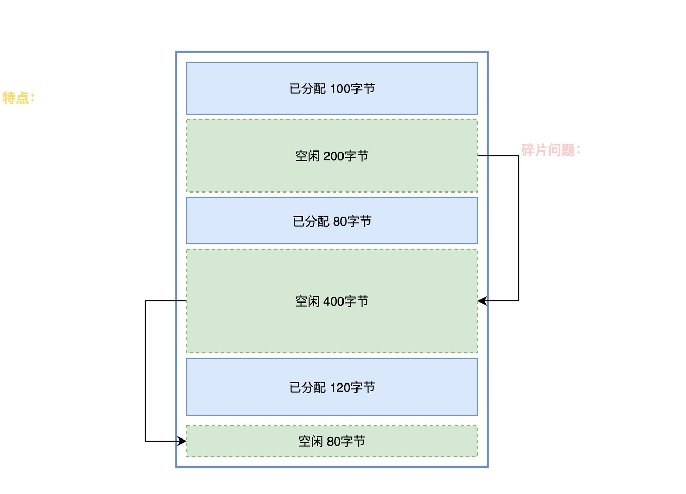
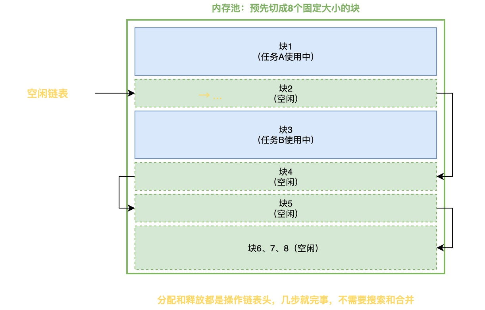

# 什么是内存池？它和动态内存分配有什么区别？

在RTOS中，当我们需要动态申请内存时，通常有两种机制可选：一种是动态内存分配；另一种是内存池。

以RT-Thread为例，这两种机制对应的主要接口如下：

```c
void *rt_malloc(rt_size_t size);
void rt_free(void *ptr); 


rt_mp_t rt_mp_create(const char *name, rt_size_t block_count, rt_size_t block_size); 
void *rt_mp_alloc(rt_mp_t mp, rt_int32_t time); 
void rt_mp_free(void *block);
```

你可能会疑问：

> 动态内存分配机制很好用啊，为什么还要整个内存池出来？
> 这俩到底有什么区别？分别在什么场景下用？

在这篇文章中，我将简要介绍这二者的工作原理，并说明其区别和适用场合。

## 动态内存分配工作原理

首先，让我们来了解动态内存分配机制的工作原理。

在标准C库里，提供了malloc()和free()这两个函数，用于实现动态内存分配。关于这两个函数，相信很多同学都不陌生，此处不作介绍。

系统启动的时候，**会留出一段连续的RAM空间，这段空间叫做堆**，其工作原理如下：

> 当调用malloc()的时候，堆管理器就在堆里找一块大小足够的空闲区域，分配给调用者，剩下的部分留着以后再分配。调用free()释放内存的时候，将这块内存标记成空闲，并且尽量和相邻的空闲块合并成一个大块。

下图展示了一个堆的内部布局图，从图中可以看出：堆里的已分配块和空闲块是交错在一起的。蓝色的是已经分配出去的，绿色虚线的是空闲的。空闲的内存块通过链表进行连接。

这种方式的好处是灵活：**按需分配，不管是8字节还是800字节，都能从堆里分配**。不过，这种分配方式的问题也很明显：

1. **分配速度慢，时间不确定**：每次分配时都要查找，直至找到大小合适的空间再分配，释放的时候还要检查能不能合并，二者执行时间都是不确定的。
2. **会产生内存碎片**：长期运行之后，会留下很多零碎的小空闲块。当想申请一块大内存的时候，却找不到一块连续的区域。

虽然上面介绍的是标准C库的工作机制，但其同样适用于RT-Thread和FreeRTOS等系统。
## 内存池工作原理

为了避免动态内存分配带来的问题，RTOS通常会提供一种简单高效的机制：内存池。

**当程序启动的时候，先分配一大块RAM，将其预先切成N个大小完全相同的小块，这些小块通过链表链接起来**，形成空闲链表。当任务需要内存的时候，就从空闲链表的头部摘下一块给它用；用完之后，再把这块挂回链表的头部。



由于分配和插入都在链表头部进行，这使得该机制具备如下优点：

1. **分配和释放都是O(1)**：无需遍历整个链表，执行时间是固定的、并且非常快速。
2. **没有碎片问题**：所有块大小固定，长期运行不会出现碎片问题。

不过，这种方式有个缺点：**每块大小固定，每次必须分配一整块，如果实际用不了那么多，就会浪费空间**。

不过，对于嵌入式系统来说，任务对内存的需求往往是比较固定的，我们在设计阶段就知道每种数据大概需要多大空间，所以**可以针对不同的需求创建不同块大小的内存池，这样就不容易存在浪费的情况**。

比如说，一个系统里既有ADC数据采集，又有串口帧处理。由于ADC每次采集的数据和串口帧数据的大小也是固定的，那就可以分别创建两个内存池，分别给ADC和串口使用，具体示例代码如下：

```c
/* ADC数据结构体，每次采集的数据大小固定 */
typedef struct {
    //. 略..
} adc_data_t; 

/* 串口数据帧结构体，一帧数据大小固定 */
typedef struct {
    //. 略..
} uart_frame_t; 

int main (void) {
	rt_mp_t adc_mp = rt_mp_create("adc_pool", 64, sizeof(adc_data_t));
	rt_mp_t uart_mp = rt_mp_create("uart_pool", 32, 72);
	
	while (1) {
	}
	return 0;
}
```

## 两者的区别

现在，我们可以将上述两种方式进行简单对比，对比如下表所示：

| 对比项   | 动态内存分配（malloc） | 内存池（mp）       |
| ----- | -------------- | ------------- |
| 块大小   | 任意大小，按需分配      | 固定大小，预先切好     |
| 分配速度  | 慢，需要搜索空闲块      | 快，O(1)，直接摘链表头 |
| 执行时间  | 不确定            | 确定            |
| 内存碎片  | 长期运行会产生        | 几乎没有          |
| 空间利用率 | 高，要多少给多少       | 块大小不匹配就会浪费    |
| 分配失败  | 返回NULL         | 可以阻塞等待        |
| 适用场景  | 大小不一、偶尔申请      | 大小统一、频繁申请释放   |
可以看到，**内存池常常适用于块大小比较固定、申请释放比较频繁的场合；如果是大小比较随机的情况，就更适合使用malloc**。
## 总结

综上所述，RTOS通常提供了动态内存分配和内存池这两种实现机制完全不同的内存管理方式。

动态内存分配按任意大小切割，灵活但慢，长期运行会产生碎片；内存池把大块RAM预先切成固定大小的块，申请释放时间确定、没有碎片，但块大小不匹配会浪费空间。在实际开发过程中，应根据实际的需求灵活选择其中一种方式。

---

> 如果你希望系统地学习RTOS底层原理，可以了解我的《RTOS开发与实战》课程。
>
> 课程不是简单地讲解FreeRTOS API的使用，而是带你从零开始编写一个RTOS内核，逐步实现任务管理、任务调度、上下文切换、同步与通信等核心机制，并通过一个远程温湿度监控设备项目，将操作系统原理应用到实际嵌入式开发中。
>
> 适合希望深入理解RTOS工作原理、提升嵌入式底层开发能力的同学。
>
> [课程详情](/blog/diyrtos/)
