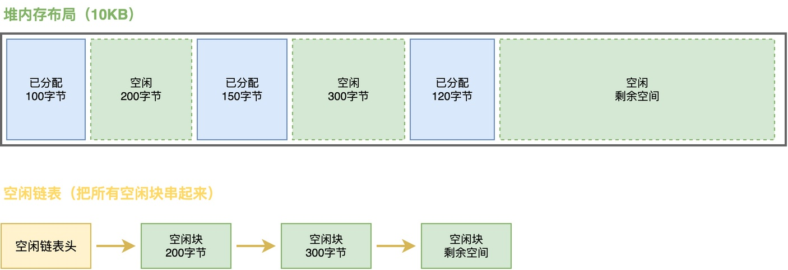
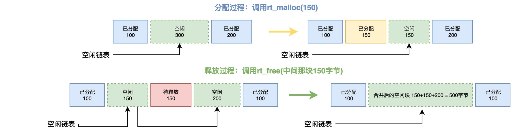
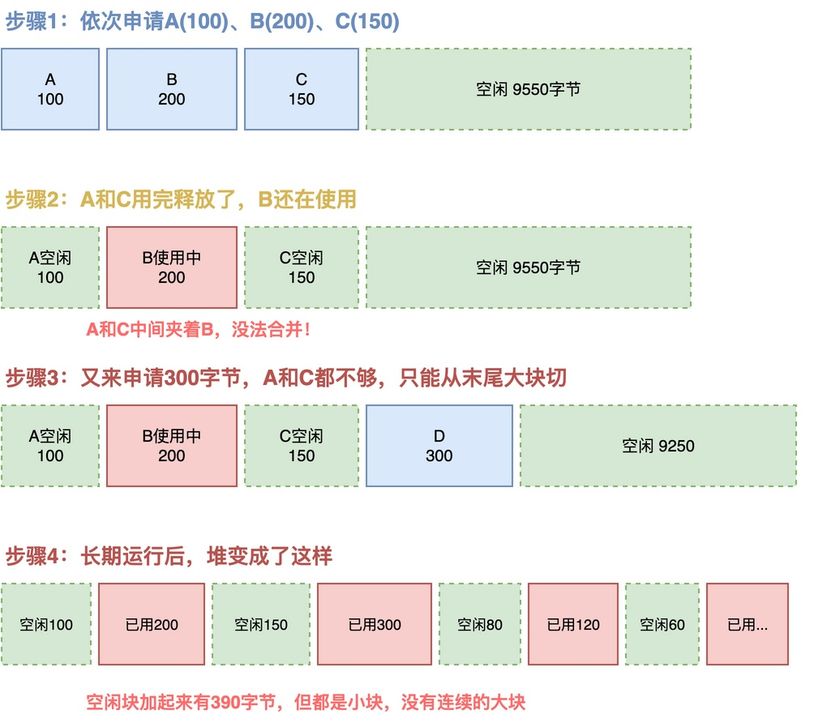

# 为什么频繁申请和释放内存可能产生内存碎片？

有一位同学在做项目时，遇到了一个很奇怪的问题：

> 他在项目中使用了RT-Thread，并频繁调用rt_malloc()和rt_free()来动态申请内存。
> 程序起始跑起来一切正常，但是几天之后，就发现内存分配总是失败。

他可以为是程序不小心把整个堆的内存都分配完了，但实际调试后发现：堆的大小为10KB，分配失败时程序仅用掉了其中5KB。

也就是说，应当还有5KB内存应当是可以用于分配的。但他就搞不清楚了：为什么想再分配200字节内存，都会分配不出来了呢？

在这篇文章中，我将带你一起分析，看看背后的原因到底是什么。究竟是他自己的问题，还是堆的问题？

## 动态内存分配工作原理

要搞清楚问题背后的原因，我们得先理解动态内存分配的基本工作原理。

系统启动的时候，会留出一段连续的RAM空间，这段空间叫做堆。为方便管理，**很多RTOS会把这段堆空间用链表的方式来管理，把所有空闲的内存块串在一个空闲链表上**。

下面这张图展示了堆的内存布局以及空闲链表是如何把空闲块串起来的：

当调用rt_malloc()申请内存的时候，就会从这个空闲链表里查找，找到一块大小足够的空闲区域，分配出来给用户用，剩下的部分作为新的空闲块留在链表里。当应用调用rt_free()释放内存的时候，分配器会把这块内存标记成空闲，并且尽量和相邻的空闲块合并成一个大块。

下面这张图分别展示了分配和释放的具体过程：当分配150字节时，会将空闲的300字节空闲分配出去150字节；当释放的时候，会将这150字节与两边的空闲内存块合并，形成更大的500字节内存。

从整个过程来看，动态内存分配的机制本身是没问题的。那么，为什么还会出现前面那位同学遇到的问题呢？原因在于产生了内存碎片：

## 碎片的产生过程

我们可以模拟一下实际开发中最常见的场景，看看碎片到底是怎么一步步产生的。

假设系统的堆总大小是10KB，程序运行过程中依次申请了三块内存：A块100字节、B块200字节、C块150字节，这三块在堆里是紧挨着的。

过了一段时间，A块和C块被释放掉，B块仍在使用。此时，你会发现：A块和C块的中间夹着B块，没法把A和C合成一块。

接下来，又要分配出去300字节。遍历整个空闲链表，发现只能从末尾的空闲区域里切300字节出来，即D块。

**当长时间运行后，堆中就有可能会出现一种“"已用、空闲、已用、空闲"交错的局面。每一块空闲内存都很小，这些内存块不连续，就是典型的碎片现象。**

此时，你会发现：虽然堆里的空闲块容量总计100+150+80+60=390字节，但如果此时要分配200字节内存，会遇到如下问题：

1. **每个空闲块都小于200字节，无法满足需求。**
2. **块与块之间夹着正在使用的块，没法合并。**

最终的结果就是：无法为分配200字节的内存。

而**之所以会出现"刚跑起来好好的，跑了几天内存分配失败"的现像，是因为：碎片是慢慢积累的**。刚启动的时候堆是完整的一大块块，当频繁的分配和释放后，大块内存被切碎，慢慢才开始暴露问题。

## 如何解决这个问题

到此分析可知，问题的根本原因在于：**应用程序申请和释放内存的大小不固定、时机不固定，产生了很多无法合并的碎片**。

要避免产生碎片，我们可以从以下几个方向去处理：

1. **尽量不用动态内存：** 可以采用内存池或者自定义的内存分配方案，避免产生内存碎片。
2. **减少申请和释放的频率：** 如果确实需要使用动态内存，就应该尽量减少申请和释放的频率。
3. **申请和释放的大小尽量统一**： 减小碎片产生的可能性。

## 综上所述

内存碎片，简单来说就是：空闲内存被切成了很多个不连续的小块，这些小块无法进行合并。

内存碎片有时对系统的影响是致命的，它会导致程序在运行一段时间后，明明还有空闲内存，却分配失败，最终可能造成系统崩溃或者功能异常。在实际使用过程中，应当尽量避免使用动态内存，优先采用内存池等更可控的内存管理方式。

---

> 如果你希望系统地学习RTOS底层原理，可以了解我的《RTOS开发与实战》课程。
>
> 课程不是简单地讲解FreeRTOS API的使用，而是带你从零开始编写一个RTOS内核，逐步实现任务管理、任务调度、上下文切换、同步与通信等核心机制，并通过一个远程温湿度监控设备项目，将操作系统原理应用到实际嵌入式开发中。
>
> 适合希望深入理解RTOS工作原理、提升嵌入式底层开发能力的同学。
>
> [课程详情](/blog/diyrtos/)
