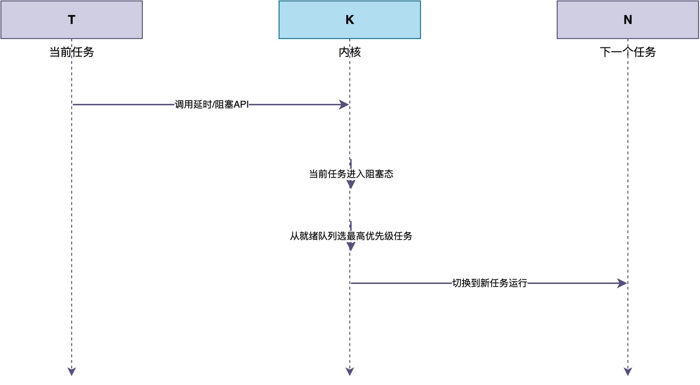
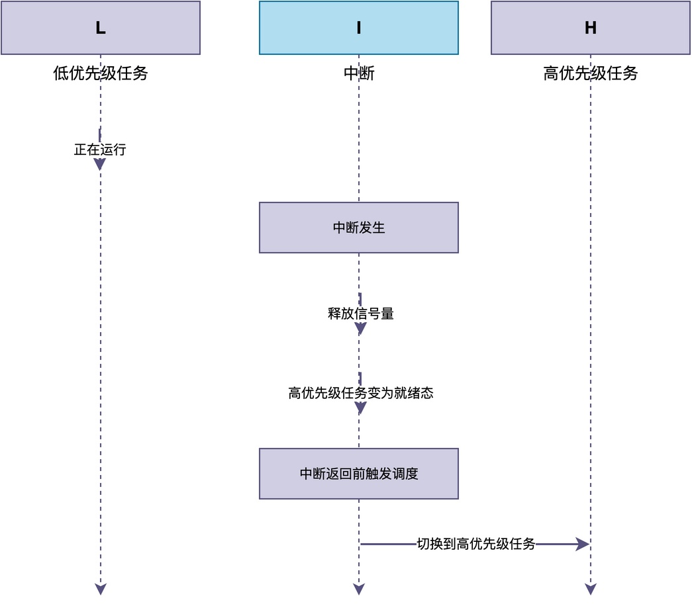

# 正常执行的任务，在什么情况下会被切换出去？

在调试RTOS程序时，如果你正在专注地单步跟踪某个函数的执行流程，突然发生了一件“让人讨厌的事情”：

> 刚刚调试到一半时，单步调试下一条语句时，程序突然就跳到了另一个任务的代码运行！
> 这种现像让人感觉非常“恼火”，极大降低了调试效率！

为什么会出现这种现像？是程序跑飞了吗？

显然不是，而是**RTOS的调度器进行了任务切换，把CPU执行权从当前任务手里拿走，交给了另一个任务**。

那么，一个正在正常执行的任务，究竟在什么情况下会被切换出去呢？在这篇文章中，我将详细介绍四种情况。

## 任务主动放弃CPU

最常见的情况，是任务自己主动放弃了CPU。

当任务调用了延时函数进行延时，或者等待一个还不可用的信号量，又或者等待消息队列中的消息。这些操作都会让当前任务进入阻塞状态，主动把CPU让出来。



例如，在RT-Thread中，当某个任务调用rt_thread_mdelay()进行延时，当前任务会进入阻塞状态，高优先级任务开始运行。

```c
void task_entry(void *parameter)
{
    while (1) {
        /* 读取传感器数据 */
        read_sensor();

        /* 延时100ms, 任务在此处主动放弃CPU */
        rt_thread_mdelay(100);
    }
}
```

## 更高优先级的任务就绪

**如果出现了一个更高优先级的就绪任务，也会发生任务切换，也就是抢占式调度。**

这种情况通常发生在中断处理过程中。如下图所示，一个低优先级任务正在运行，此时产生了中断，中断处理程序里调用了释放信号量、发送消息等接口，而正在等待的任务优先级比当前运行的任务更高。



此时，即使低优先级任务没有主动放弃CPU，RTOS也会在中断返回前进行一次调度检查。一旦发现有更高优先级的任务就绪，就会立即把CPU切换给高优先级任务。


```c
void uart_isr(void)
{
    /* 读取接收到的数据 */
    uint8_t data = uart_read_byte();

    /* 释放信号量, 唤醒等待数据的任务 */
    rt_sem_release(&uart_sem);
}
```

## 时钟节拍中断

RTOS依赖一个周期性的时钟中断来维护系统时间。

在每个时钟节拍中断里，除了检查有没有延时到期的任务外，还会执行时间片轮转调度。

也就是说，**当系统中有多个相同优先级的任务时，RTOS可以让它们轮流使用CPU，每个任务运行一个固定的时间片，时间片用完了就强制切换到下一个同优先级任务**。这样可以保证同优先级的任务都能获得CPU时间，不会出现一个任务一直占着CPU不放的情况。


因此，一个正在运行的任务，即使它没有主动放弃CPU，也没有更高优先级的任务就绪，它的时间片一旦用完，同样会被切换出去。

## 任务退出或被删除

最后一种情况，任务执行完毕退出，或者被其他任务删除。

在这种情况下，任务主动或被动放弃CPU执行权，其所占用的资源会被回收。

例如，在下面的代码中，监控任务调用rt_thread_delete()删除工作任务。当工作任务被删除后，内核立即切换其他任务运行。

```c
void monitor_task(void *parameter)
{
    while (1) {
        if (error_count > 10) {
            /* 错误次数过多, 删除工作任务 */
            rt_thread_delete(worker_thread);
        }
        rt_thread_mdelay(1000);
    }
}

void worker_thread (void * parameter) {
	while (1) {
		do_work();
	}
}
```

## 总结

综上所述，一个正常执行的任务被切换出去，主要有以下几种情况：

- **任务主动放弃CPU**：调用延时、等待信号量等阻塞型API时，当前任务进入阻塞态。
- **更高优先级的任务就绪**：中断释放信号量、发送消息等操作，可能让更高优先级任务就绪，发生抢占。
- **时钟节拍中断**：当前任务的执行时间片用完，切换至其他任务运行。

此外，当任务执行完毕退出，或被其他任务删除，也会发生任务切换。

现在你可能理解了：本文开头提到的其实是一种“正常”现像，有可能是当前任务的时间片用完或者发生了高优先级抢占导致。

---

> 如果你希望系统地学习RTOS底层原理，可以了解我的《RTOS开发与实战》课程。
>
> 课程不是简单地讲解FreeRTOS API的使用，而是带你从零开始编写一个RTOS内核，逐步实现任务管理、任务调度、上下文切换、同步与通信等核心机制，并通过一个远程温湿度监控设备项目，将操作系统原理应用到实际嵌入式开发中。
>
> 适合希望深入理解RTOS工作原理、提升嵌入式底层开发能力的同学。
>
> [课程详情](/blog/diyrtos/)
