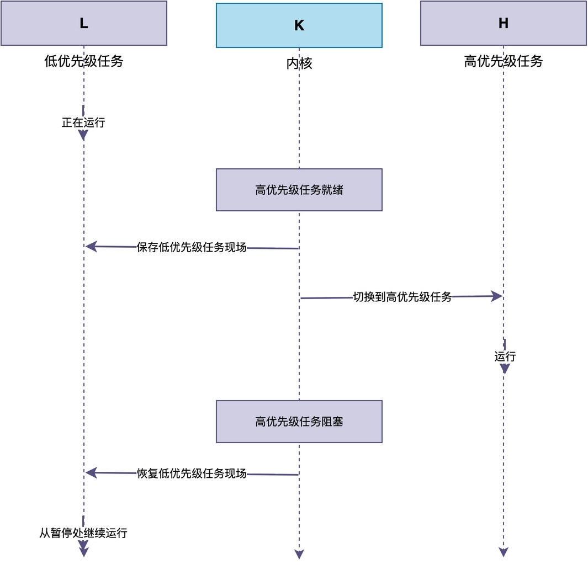
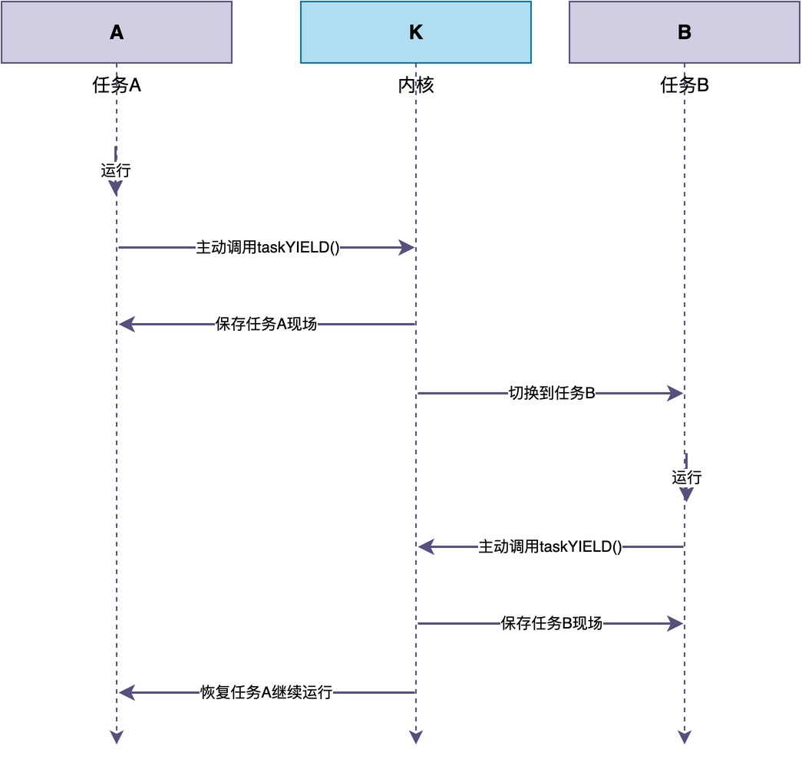

# 什么是抢占式调度？什么是协作式调度？

当你听到"抢占式调度"这个词的时候，你想到了什么？是想到了很多任务在"争抢CPU的运行权"吗？

在这篇文章中，我就来详细介绍一下什么是抢占式调度，同时也会介绍另一种调度：协作式调度。

## 生活中的例子

为了说明什么是抢占式调度，我们可以用厨房的场景来理解。

> 假设厨房里有很多厨师在同时做菜，但锅只有一口。
> 一个厨师正在用这口锅炒菜，炒到一半的时候，另一个厨师说一道非常紧急的菜必须马上做。这时候怎么办呢？

如果厨房的规矩是"谁先拿到锅，谁就一直用到做完"，那么后来的厨师只能干等着，哪怕他的菜再紧急也没用。

但如果厨房的规矩是"紧急的菜可以先做"，那么正在炒菜的厨师就会被打断，等紧急的菜做完了，再回来继续炒自己的菜。

## 抢占式调度的含义

类似地，RTOS的抢占式调度指的是：

> 当有一个比当前任务优先级更高的任务变为就绪态时，内核会立即暂停当前正在运行的低优先级任务，把CPU交给高优先级任务使用。

这种调度方式的工作流程如图所示：



如上图所示，低优先级任务正在运行时，高优先级任务变为就绪态，内核立即保存低优先级任务的现场，把CPU切换给高优先级任务。等高优先级任务运行完毕进入阻塞态后，内核再恢复低优先级任务的现场，让它从暂停的地方继续运行。

与前面提到的厨房例子相比，任务类似于“要炒某道菜”，CPU类似于“锅”，更紧急的菜可以优先使用锅炒完。

在RT-Thread中，可以创建不同优先级的任务来触发抢占式调度。

在下面的例子中，即使计算任务正在执行，只要中断里释放了key_sem唤醒了高优先级的按键处理任务，计算任务就会被立即打断。

```c
/* 低优先级计算任务 */
void calc_task(void *parameter)
{
    while (1) {
        /* 正在做复杂计算 */
        do_complex_calculation();
        rt_thread_mdelay(100);
    }
}

/* 高优先级按键处理任务 */
void key_task(void *parameter)
{
    while (1) {
        rt_sem_take(&key_sem, RT_WAITING_FOREVER);
        /* 立即响应按键 */
        handle_key_press();
    }
}

/* 按键中断处理函数 */
void key_isr(void)
{
    /* 释放信号量, 唤醒按键处理任务 */
    rt_sem_release(&key_sem);
}
```

现在的绝大多数RTOS，比如RT-Thread、FreeRTOS、uC/OS等，默认都支持抢占式调度，以保证紧急事件能够得到优先响应。

## 和协作式调度的区别

与抢占式调度相对的，是协作式调度。

在协作式调度中，**任务只有在自己主动放弃CPU的时候，才会发生切换。内核不会强制打断一个正在运行的任务**，哪怕有更高优先级的任务已经就绪了，也必须等当前任务主动让出CPU。

```c
/* FreeRTOS配置为协作式调度 */
#define configUSE_PREEMPTION 0

/* 任务A */
void taskA(void *pvParameters)
{
    while (1) {
        /* 任务A做一些工作 */
        do_work_A();

        /* 必须主动让出CPU, 否则任务B无法运行 */
        taskYIELD();
    }
}

/* 任务B */
void taskB(void *pvParameters)
{
    while (1) {
        /* 任务B做一些工作 */
        do_work_B();

        /* 必须主动让出CPU, 否则任务A无法继续运行 */
        taskYIELD();
    }
}
```
例如，在上面的示例中，任务A正在运行，它必须主动调用taskYIELD()让出CPU之后，才会切换到任务B。同样地，任务B运行一段时间后，也必须主动调用taskYIELD()，内核才会切换回任务A。如果不主动释放CPU，就会某个任务长时间占用CPU的情况，导致其他任务无法运行的情况。

在整个过程中，内核不会主动打断任何一个任务，相应的图示如下。


对于协作式调度，很多RTOS并不支持，比如RT-Thread。如果你想使用协作式调度，可以使用FreeRTOS，并将configUSE_PREEMPTION配置宏设为0，系统就会运行在协作式调度模式下。


## 总结

综上所述，这两种调度模式指的是：

* 抢占式调度：内核会立即打断当前正在运行的低优先级任务，把CPU交给高优先级任务运行。
* 协作式调度：内核不会主动打断任何任务，只能靠任务主动调用让出CPU时，才会发生任务切换。

相比之下，抢占式调度更能保证紧急任务得到及时响应。

---

> 如果你希望系统地学习RTOS底层原理，可以了解我的《RTOS开发与实战》课程。
>
> 课程不是简单地讲解FreeRTOS API的使用，而是带你从零开始编写一个RTOS内核，逐步实现任务管理、任务调度、上下文切换、同步与通信等核心机制，并通过一个远程温湿度监控设备项目，将操作系统原理应用到实际嵌入式开发中。
>
> 适合希望深入理解RTOS工作原理、提升嵌入式底层开发能力的同学。
>
> [课程详情](/blog/diyrtos/)
