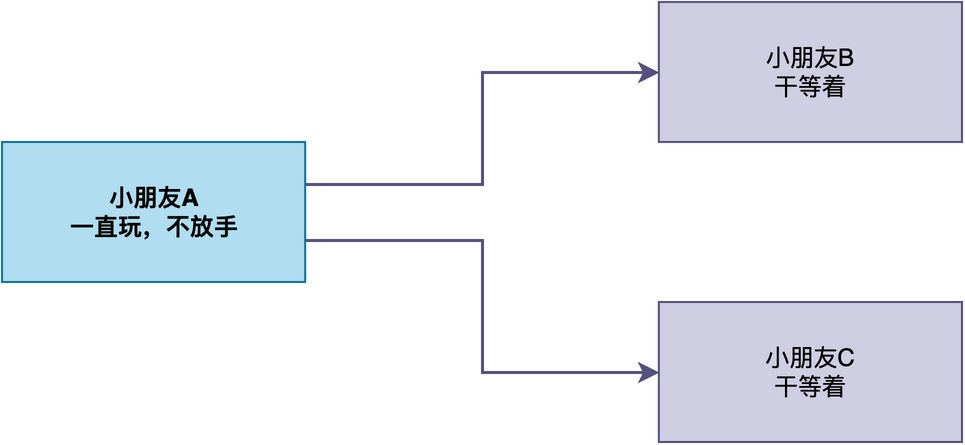
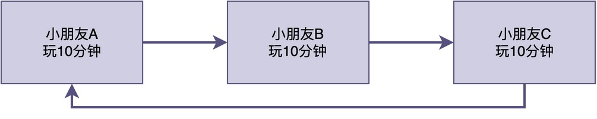
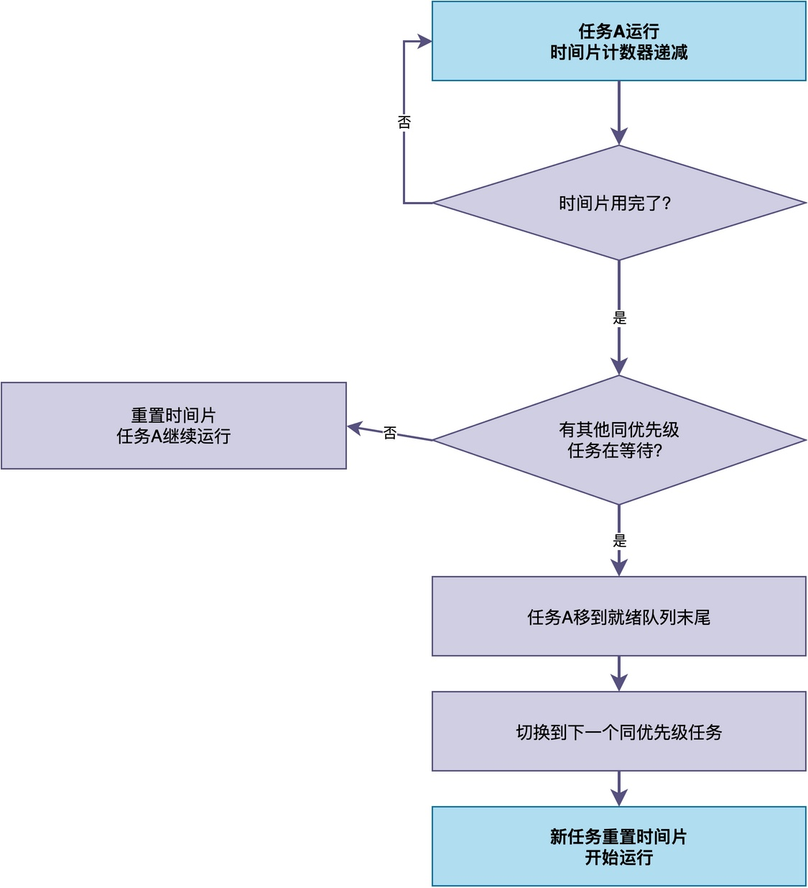
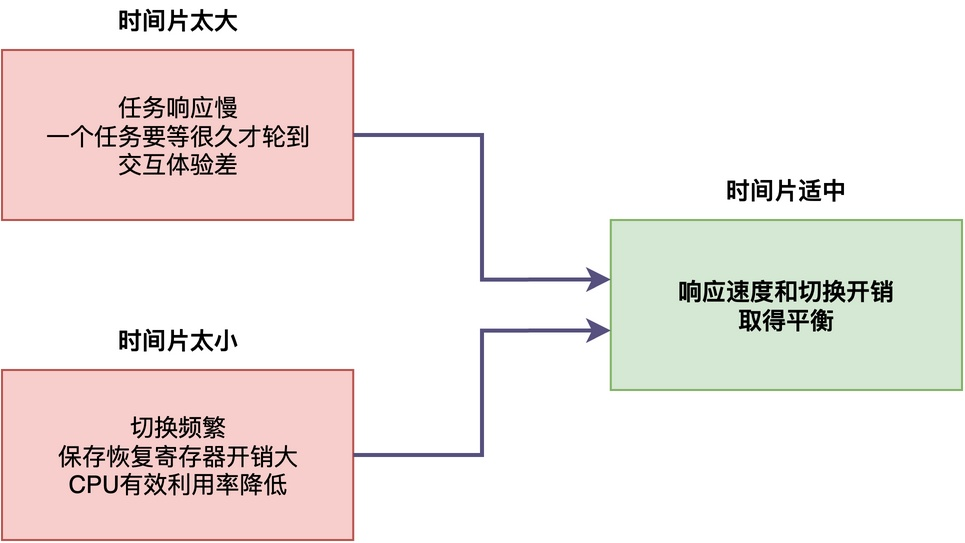

# 什么是时间片轮转调度？

有些同学用过一些功能较简单的RTOS（如uC/OS的早期版本），可能会碰到这样一个有趣的现象：

> 系统里两个相同优先级的任务，如果其中一个长时间占用CPU运行，另一个任务则一直得不到运行的机会。

为什么会出现这种现象？现在常见的RTOS（如RT-Thread、FreeRTOS）仍然会有这种问题吗？

在这篇文章中，我们就先来分析一下出现这种现象的原因，然后再请出今天的主角：时间片轮转调度。

## 先从生活中的例子说起

首先，我们先来看一个生活中的场景。

假设家里有三个小朋友，都想玩同一个游戏机。如果没有任何规则，可能就会出现这样的情况：


> 第一个小朋友拿到手柄之后就一直玩，根本不愿意放手，另外两个小朋友只能在旁边干等着，谁也玩不上。时间一长，矛盾就来了，没玩到的小朋友肯定会不高兴。

那怎么解决这个问题呢？很简单，大家约定一个规则：每个人轮流玩，每次玩10分钟，时间到了就把手柄交给下一个人。



这样一来，虽然游戏机只有一台，但每个人都能轮流玩到，不会出现一个人一直占着的情况。

<font color="#245bdb">这就是"轮转"的思想：通过轮流使用，保证每个人都能公平地获得使用机会。</font>

在RTOS里，原理也是类似的。由于CPU只有一颗，而同时可能有多个优先级相同的任务都想运行。如果仅按优先级来决定先运行谁，某个任务一旦开始运行，只要它不主动让出CPU，其他同优先级的任务就永远得不到运行机会。

为了解决这个问题，RTOS引入了时间片轮转调度机制。

## 时间片轮转的工作原理

时间片轮转的核心思路很简单：

> 给每个同优先级的任务分配一个固定的时间片（时间长度）。任务运行的时候时间片不断递减，减到0的时候，调度器就把它移到就绪队列的末尾，然后让就绪队列里的下一个同优先级任务运行。

具体的实现过程是这样的：

1. 每个任务的任务控制块里都有一个时间片计数器，创建任务的时候设置一个初始值，比如10个tick。
2. 任务运行的时候，每来一个系统时钟中断，时间片计数器就减1。
3. 当时间片计数器减到0的时候，如果就绪队列里还有其他同优先级的任务，调度器就触发一次任务切换，把当前任务移到就绪队列的末尾，让下一个任务运行。
4. 新任务开始运行的时候，它的时间片计数器被重置为初始值，然后开始递减。
5. 这样循环往复，所有同优先级的任务就能公平地轮流使用CPU。



这样即使某个任务不主动放弃CPU（延时或阻塞），RTOS也会强制将CPU切换到其他任务运行。

需要注意的是，**时间片轮转只在同优先级任务之间生效**。如果有更高优先级的任务就绪，它会立即抢占当前任务，不管当前任务的时间片有没有用完。时间片用完了才切换，只是针对同优先级任务的。

## 时间片大小应该如何配置

在很多RTOS中，支持配置时间片的大小。

例如，在RT-Thread中，时间片是在创建任务的时候设置的，rt_thread_create()的最后一个参数就是时间片，单位是tick。比如设置时间片为10，指的是这个任务每次最多连续运行10个tick。

```c
/* 创建任务，时间片设为10个tick */
rt_thread_t tid = rt_thread_create("task", task_entry, RT_NULL,
                                     1024, 10, 10);
```

时间片的大小是一个需要权衡的参数，太大和太小都会带来问题：



那时间片设多少合适呢？这里给出几点建议，假设系统节拍定时器周期为1ms：

1. **交互性要求高的场景**，比如UI显示、按键响应，时间片可以设小一点，比如5到10个tick，以加快响应。
2. **计算密集型场景**，比如数据处理、加密解密，时间片可以设大一点，比如20到50个tick，这样减少切换开销，提高CPU利用率。
3. **一般场景**，10到20个tick是比较常用的选择，在响应速度和切换开销之间取得平衡。

最终时间片配置成多少，还需要针对自己的项目实际要求，进行权衡。

## 总结

综上所述，时间片轮转调度是同优先级任务之间的调度方式。

当多个任务优先级相同时，每个任务运行一个固定的时间片，时间到了就切换到下一个同优先级任务，这样所有同优先级任务就能公平地轮流使用CPU，不会出现一个任务一直占着CPU不放的情况。此外，时间片的大小需要在响应速度和切换开销之间权衡。

---

> 如果你希望系统地学习RTOS底层原理，可以了解我的《RTOS开发与实战》课程。
>
> 课程不是简单地讲解FreeRTOS API的使用，而是带你从零开始编写一个RTOS内核，逐步实现任务管理、任务调度、上下文切换、同步与通信等核心机制，并通过一个远程温湿度监控设备项目，将操作系统原理应用到实际嵌入式开发中。
>
> 适合希望深入理解RTOS工作原理、提升嵌入式底层开发能力的同学。
>
> [课程详情](/blog/diyrtos/)
