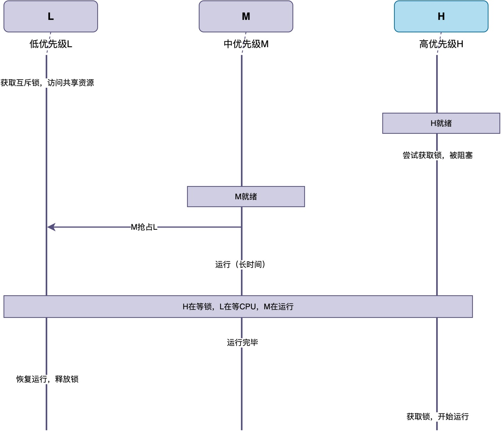
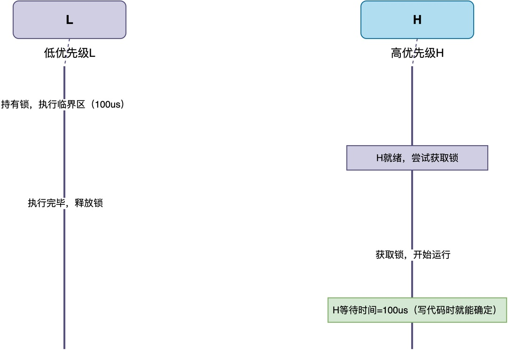
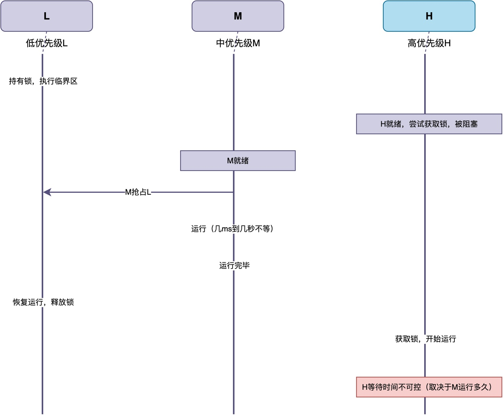

# 什么是优先级反转？为什么低优先级任务会影响高优先级任务？

有位同学在学习我的《从0手写嵌入式操作系统》课程时，对互斥锁中的优先级反转处理机制疑惑不解，因而特地写了这篇文章更详细地解答相关知识点。

有关RTOS中的“优先级反转”现像，经常被引用的一个例子如下：

> 1997年，NASA的火星探路者号探测器在火星执行任务时，出现了周期性系统重启。
> 排查后发现是由于优先级反现像转导致的。
> 
> 这种现像导致系统中某个高优先级任务迟迟无法运行。而看门狗定时器监控的正是这个高优先级任务的执行状态，由于任务被阻塞后无法按时完成工作，导致看门狗检测到超时后触发了系统重启。

那么，什么是优先级反转？它有什么问题？这种危害一定要加以解决吗？在这篇文章中，我将详细对这些问题加以解答。

## 什么是优先级反转

要理解什么是优先级反转，需要先理解该现像的发生过程。

在如下图所示的示例中，共包含三个任务：高优先级任务H、中优先级任务M、低优先级任务L。其中，H和L均通过互斥锁对同一共享资源进行访问。

整个过程分别介绍如下：

1. **L获取锁**：L先获取互斥锁，开始访问共享资源。
2. **H阻塞等待**：H开始运行，也需要访问共享资源，但锁已经被L持有，H只能阻塞等待。
3. **M抢占L**：M变为就绪态。由于M的优先级比L高，M抢占L开始运行。
4. **L释放锁**：当M运行完毕后，被抢占的L恢复运行，继续访问共享资源，之后释放锁。
5. **H获取锁**：H获取互斥锁，开始访问共享资源。

关键问题在于第3步：**由于L被M抢占后，在M运行的整个期间，H因为无法获取锁而无法运行。** 结果就是，**优先级最高的H，反而因为M的运行而长时间得不到执行**。

这**就好像H的优先级被"反转"了，变成了比M还低，这种现像叫做优先级反转。**
## 优先级反转带来的问题

读到这里，你可能会有一个疑问：**H由于等信锁而暂停运行，这不是很合理的现像吗？这种现像有什么问题呢？**

问题的关键在于等待的时间。如果没有优先级反转（假设没有M），那么高优先级任务H只需要等低优先级任务L执行完临界区，**等待时间就是L的临界区长度，该长度是可控且可预测的**。

例如，在图中，L执行临界区的时间是100us，那么H等待的时间也是100us。

当发生优先级反转时，M抢占了L，导致L无法继续执行也无法释放锁，**H的等待时间被M的运行时间拉长，变得不可控**。而M可能只运行几毫秒，也可能运行几百毫秒，此时H的响应时间受此影响，变得无法预测。

这样便体现出了优先级反转的问题：

> 高优先级任务本来只需要等低优先级任务执行完临界区，等待时间有明确的上限。
> 但因为中优先级任务的存在，高优先级任务的实际等待时间被中优先级任务影响，等待时间不可预测，就好像它的优先级变得比中优先级任务还低。
## 优先级反转问题要不要解决

你可能会问：这个问题严重吗？是不是所有系统都需要解决它？

其实，**在很多对实时性要求不高的场合，优先级反转的影响不大**。例如，在一个智能家居设备中，高优先级的按键处理任务因为优先级反转多等了几十毫秒，用户其实根本感觉不到，也不会造成什么后果。

不过，**在对实时性要求严格的系统中，这种不可控的延迟就可能造成严重后果**。这类系统里，高优先级任务都有明确的截止时间。例如，在汽车电子里，高优先级的刹车控制任务如果被不可控地延迟，可能导致刹车不及时，此时它是一个必须解决的问题。

所以，**优先级反转到底要不要解决，取决于系统对高优先级任务的响应时间是否有严格要求**。

## 总结

综上所述，优先级反转的原因是：

> 高优先级任务因为等待低优先级任务持有的锁，而被中优先级任务间接阻塞的现象。

这种现像将高优先级任务"拉低"到了和低优先级任务一样的水平，最终导致高优先级任务的响应时间被不可控地拉长。

---

> 如果你希望系统地学习RTOS底层原理，可以了解我的《RTOS开发与实战》课程。
>
> 课程不是简单地讲解FreeRTOS API的使用，而是带你从零开始编写一个RTOS内核，逐步实现任务管理、任务调度、上下文切换、同步与通信等核心机制，并通过一个远程温湿度监控设备项目，将操作系统原理应用到实际嵌入式开发中。
>
> 适合希望深入理解RTOS工作原理、提升嵌入式底层开发能力的同学。
>
> [课程详情](/blog/diyrtos/)
