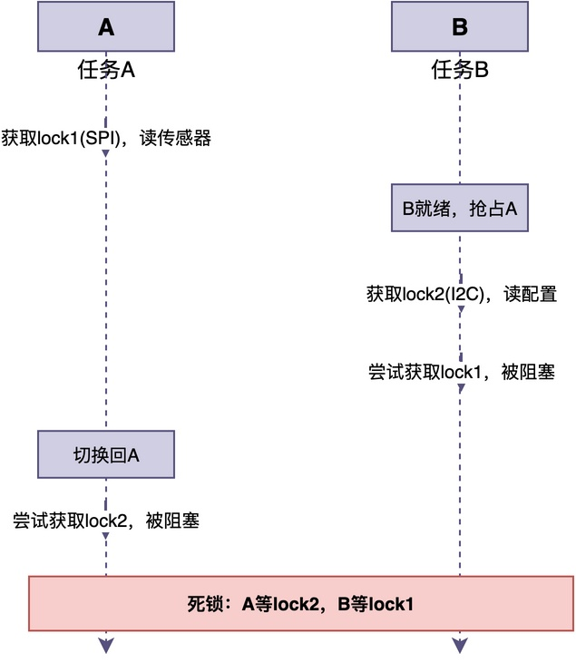
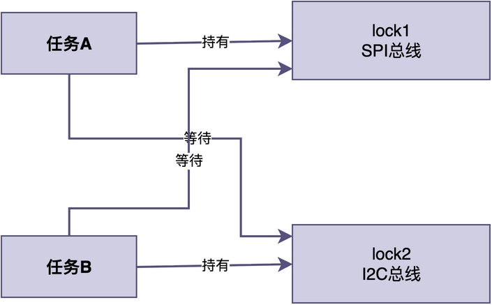
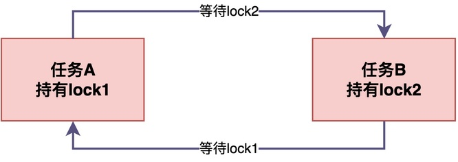
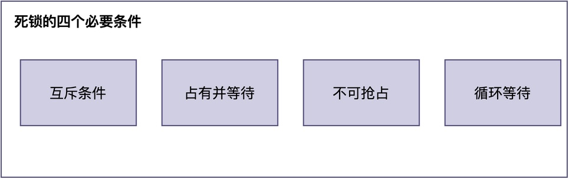

# 两个任务互相等待对方释放资源，会发生什么？

在生活中，我们可能遇到这样的有趣场景：

> 两个人一起干活，A手里拿着锤子，B手里拿着螺丝刀，A需要用螺丝刀，B需要用锤子。由于两个人都想等对方先把工具递过来，最终的结果是谁也干不了活。

这种"你等我、我等你，谁也不让步"的僵持局面，在RTOS中也会出现。

当多个任务需要访问共享资源时，也可能出现两个任务都拿着对方需要的资源，又都在等对方先释放的情况，最终两个任务都无法继续运行。

这种情况，就是死锁。

## 死锁是怎么发生的

假设有两个任务A和B，以及两个共享硬件资源：SPI总线和I2C总线。其中，SPI总线上接了一个传感器，I2C总线上同时挂了OLED显示屏和配置EEPROM。

1. 任务A的工作是从SPI传感器读取数据，再通过I2C总线写到OLED显示。
2. 任务B的工作是通过I2C总线读取存储器配置参数，再通过SPI总线写传感器寄存器。

下面给出这两个任务的代码示例。

```c
/* 任务A: 从SPI传感器读数据 -> 通过I2C写到OLED */
void task_a(void *parameter)
{
    while (1) {
        rt_mutex_take(lock1, RT_WAITING_FOREVER);
        /* 从SPI传感器读取数据 */
        int data = spi_read();

        rt_mutex_take(lock2, RT_WAITING_FOREVER);
        /* 通过I2C写到OLED显示 */
        i2c_write(data);

        rt_mutex_release(lock2);
        rt_mutex_release(lock1);
    }
}

/* 任务B: 从I2C读配置 -> 通过SPI写传感器寄存器 */
void task_b(void *parameter)
{
    while (1) {
        rt_mutex_take(lock2, RT_WAITING_FOREVER);
        /* 从I2C读取配置参数 */
        int config = i2c_read();

        rt_mutex_take(lock1, RT_WAITING_FOREVER);
        /* 通过SPI写传感器寄存器 */
        spi_write(config);

        rt_mutex_release(lock1);
        rt_mutex_release(lock2);
    }
}
```

假定出于某种要求，任务A对传感器和OLED的操作必须是原子性的，即不可被打断；任务B对存储器和传感器的读写操作也是原子性的。

那么，有可能出现下图所示的特殊情况：



在该图示中，任务A先运行，获取了lock1，从SPI传感器读数据。就在它准备获取lock2之前，任务B抢占了A。接下来，任务B获取了lock2，开始从I2C读配置，然后尝试获取lock1，但由于lock1被A持有，B只能阻塞等待。此时，调度器切换回A，A尝试获取lock2，但lock2被B持有，A也只能阻塞等待。

最终的状态变成了：A持有lock1（SPI总线），等待lock2（I2C总线）；B持有lock2（I2C总线），等待lock1（SPI总线）。**两个任务都在等对方释放资源，谁也无法继续执行，也无法释放自己持有的锁**。


## 什么是死锁

简单来说，**死锁就是两个或多个任务都持有对方需要的资源，又都在等对方先释放，导致谁也无法继续执行的现象**。

死锁的关键在于"循环等待"：每个任务都在等另一个任务释放资源，**形成了一个"闭环"，没有任何一个任务能主动打破这个循环**。



死锁一旦发生，涉及的任务会永远阻塞下去，既不会继续执行，也不会释放自己持有的资源。

在嵌入式系统中，如果死锁涉及的是关键任务，系统的核心功能会直接失效。而且死锁不会导致系统崩溃，只会让系统"看起来还在运行"，但某些功能已经失效了，排查起来非常困难。

## 死锁产生的四个必要条件

分析前面的例子，可以看出：死锁的产生，需要同时满足以下四个条件。



- **互斥条件**：任意资源在同一时刻只能被一个任务持有。
- **占有并等待**：任务已经持有了至少一个资源，同时又在等待其他任务持有的资源。
- **不可抢占**：资源只能由持有者主动释放，不能被其他任务强制夺走。
- **循环等待**：每个任务都在等待下一个任务持有的资源，形成环路。

**当这四个条件同时满足时，死锁才会发生。反过来，只要破坏其中任何一个条件，就能解除死锁。**

## 如何预防死锁

目前，大多数RTOS的功能比较简单，并不提供死锁的自动检测和恢复机制。

因此，**最好的方法是在代码开发阶段就进行预先分析，判断有没有可能发生死锁，如果有就采取一定的方式去预防。**

**最常用也最简单的预防方法，是破坏循环等待条件：让所有任务都按照相同的顺序获取多个锁**。

比如，强制所有任务必须先获取lock1，再获取lock2。这样就不会出现A拿lock1等lock2、B拿lock2等lock1的情况了。

```c
/* 任务A: 按相同顺序获取锁 */
void task_a(void *parameter)
{
    while (1) {
        rt_mutex_take(lock1, RT_WAITING_FOREVER);
        rt_mutex_take(lock2, RT_WAITING_FOREVER);
        /* 处理共享资源 */
        rt_mutex_release(lock2);
        rt_mutex_release(lock1);
    }
}

/* 任务B修改后: 也按先lock1再lock2的顺序获取 */
void task_b(void *parameter)
{
    while (1) {
        rt_mutex_take(lock1, RT_WAITING_FOREVER);
        rt_mutex_take(lock2, RT_WAITING_FOREVER);
        /* 处理共享资源 */
        rt_mutex_release(lock2);
        rt_mutex_release(lock1);
    }
}
```

除此之外，还有其他可用的预防方法：

- **一次性获取所有资源**：任务在开始执行前，一次性获取所有需要的资源。如果获取不到全部，则释放任何已持有的资源。这破坏了“占有并等待”条件，但降低了资源利用率。
- **使用带超时的获取操作**：在获取锁时设置超时时间，超时后主动释放已持有的锁并重试。这可以在死锁发生后自动恢复，但不能完全预防。
- **尽量减少锁的数量**：比如，尽量用一个锁保护所有共享资源。

## 总结

综上所述，**死锁就是两个或多个任务都持有对方需要的资源，又都在等对方先释放，导致谁也无法继续执行的现象**。

死锁的产生需要同时**满足互斥、占有并等待、不可抢占、循环等待四个条件**。由于大多数RTOS不会自动检测和恢复死锁，**最常用的预防方法，是让所有任务按照相同的顺序获取多个锁。**

---

> 如果你希望系统地学习RTOS底层原理，可以了解我的《RTOS开发与实战》课程。
>
> 课程不是简单地讲解FreeRTOS API的使用，而是带你从零开始编写一个RTOS内核，逐步实现任务管理、任务调度、上下文切换、同步与通信等核心机制，并通过一个远程温湿度监控设备项目，将操作系统原理应用到实际嵌入式开发中。
>
> 适合希望深入理解RTOS工作原理、提升嵌入式底层开发能力的同学。
>
> [课程详情](/blog/diyrtos/)
