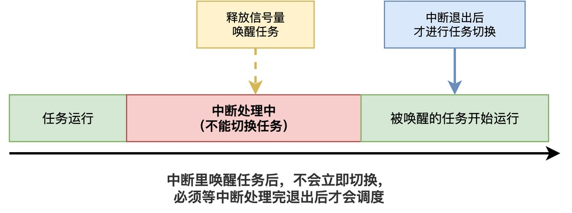
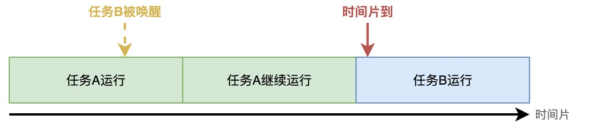

# RTOS中任务被唤醒后，为什么不一定能立即运行？

昨天有位学习RT-Thread的同学咨询了这样一个问题：

他的项目中有两个任务，其功能大致如下。

```c
/* 任务A */
void task_a_entry(void *parameter)
{
    while (1)
    {
        rt_sem_release(sem);
        do_something();
    }
}

/* 任务B */
void task_b_entry(void *parameter)
{
    while (1)
    {
        rt_sem_take(sem, RT_WAITING_FOREVER);
        handle_event();
    }
}
```

当任务A调用rt_sem_release()释放了信号量，唤醒正在等待的任务B后，为什么任务B有时会立即执行handle_event()，有时却要等一会儿？

实际上，任务B被唤醒后，何时开始运行，主要取决于任务优先级、调度时机以及当前内核是否允许进行任务切换等多方面的因素。

## 当前任务的优先级更高

通常，**RTOS支持基于优先级的抢占式调度：只有当就绪队列里出现了比当前任务优先级更高的任务时，才会触发切换**。

也就是说，如果刚唤醒的任务优先级比当前运行的任务低，那它就只能在就绪队列里等着，直至当前任务主动放弃CPU，比如延时、等待信号量。


如上图所示，如果任务A的优先级比任务B高，那么任务A释放信号量后，任务B虽然被唤醒了，但任务A会继续运行，直到任务A主动让出CPU，任务B才有机会运行。

## 当前处于中断服务程序中

除了前面提到的例子，在中断服务程序中也存在类似现象。

例如，我们经常会在串口、定时器或其他外设的中断服务程序中通知任务处理数据。**常见的做法是，在中断处理程序中释放信号量，唤醒负责解析数据的任务。**


**为了不影响系统的实时性、处理嵌套中断等问题，内核一般会在中断退出、恢复任务上下文的过程中处理必要的调度**。

这就使得即使被唤醒的任务优先级很高，通常也不能直接在中断处理尚未结束时像普通任务一样开始执行。

## 调度器被锁定

RTOS通常会提供一种特殊接口，用来临时关闭调度器，比如RT-Thread里的rt_enter_critical()。

```c
rt_enter_critical();
rt_exit_critical();
```

当关闭调度器后，将不再允许进行任务切换。这样一来，**即使有更高优先级的任务就绪，该任务只能在就绪队列中继续等待，直至调度器重新打开才能运行**。
## 时间片未到

如果刚唤醒的任务和当前运行的任务优先级相同，也不一定会立即切换。

当优先级相同时，RTOS往往采用时间片轮转调度，即每个任务运行一个固定的时间片，时间到了才切换到下一个同优先级任务。**如果当前任务的时间片还没用完，那它就会继续运行，等时间片到了才会轮到刚唤醒的任务**。



当然，这不代表任务B必须等到任务A的时间片完全耗尽才有机会运行。如果任务A主动让出CPU（调用rt_thread_yield()）、进入阻塞状态等，任务B也可能获得运行机会。

## 总结

综上所述，任务被唤醒后并不一定会立即运行，而是取决于多种因素。常见的因素有四种：当前有更高优先级的任务在运行、正在中断处理中、调度器被锁定、同优先级任务的时间片还没到。

---

> 如果你希望系统地学习RTOS底层原理，可以了解我的《RTOS开发与实战》课程。
>
> 课程不是简单地讲解FreeRTOS API的使用，而是带你从零开始编写一个RTOS内核，逐步实现任务管理、任务调度、上下文切换、同步与通信等核心机制，并通过一个远程温湿度监控设备项目，将操作系统原理应用到实际嵌入式开发中。
>
> 适合希望深入理解RTOS工作原理、提升嵌入式底层开发能力的同学。
>
> [课程详情](/blog/diyrtos/)
