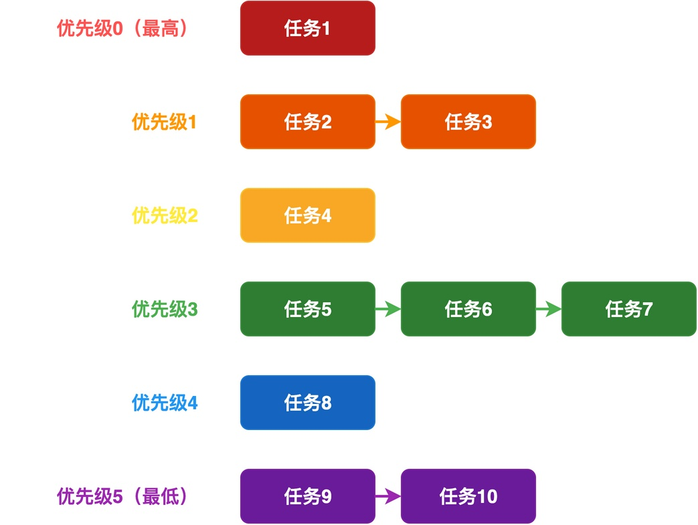
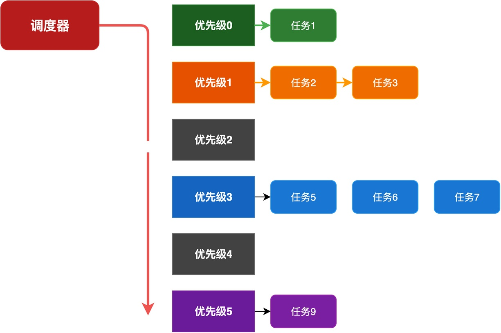
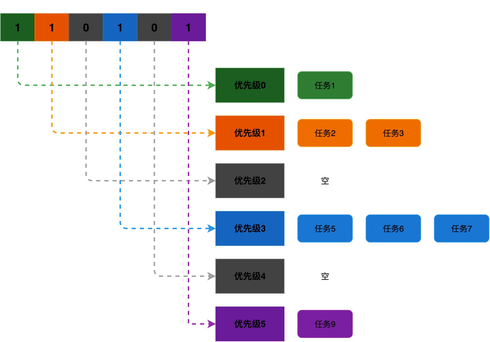
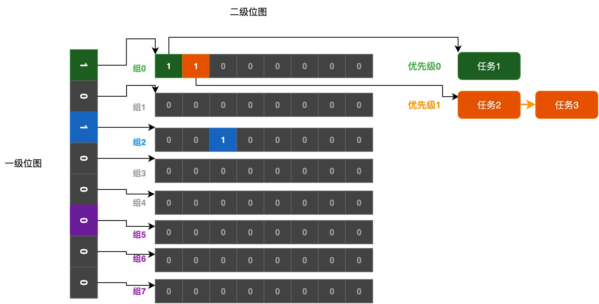

# 什么是优先级位图算法？RTOS如何实现O(1)复杂度的任务调度？

在RTOS中，我们可以创建很多个任务，并为每个任务都会配置一个优先级。为了让系统能够高效运行，RTOS需要对它们进行有效的管理。

通常情况下，RTOS会把相同优先级的任务排成一个队列。如此一来，系统里就会有很多个队列，每个优先级对应一个队列。例如，下图共有6条队列，每条队列中可以排队相同优先级的任务。




那么，问题来了：**调度器如何才能以最快的速度，从众多任务中找到最高优先级的就绪任务去运行呢？**

在这篇文章，我将一步步介绍，这种算法和数据结构是如何设计出来的。

## 第一步：用数组管理优先级队列

我们首先最容易想到的方案是：**把所有的优先级队列组成一个数组，数组的下标就是优先级，每个数组元素指向对应优先级的任务队列。**

当调度器需要找最高优先级任务的时候，**就从优先级最高的数组元素开始遍历，依次检查每个优先级对应的队列里有没有任务。如果找到了第一个非空队列，就取这个队列的头部任务去运行**。

如下图所示，调度器先查看优先级0的队列，发现里面有任务1，就直接取任务1运行，无需再扫描其他队列。




这个方案实现起来很简单，但是有一个问题：**效率比较低**。

如果系统支持128个优先级，最坏情况下，调度器需要遍历128次数组元素。也就是说，**遍历的时间和优先级的数量成正比，这对于追求实时性的RTOS来说是不能接受的**。
## 第二步：增加优先级位图

为了解决遍历效率低的问题，**我们可以考虑给每个优先级队列设置一个标志位，用来表示这个队列是否有任务**。如果有，则对应的标志位就设为1；如果没有，就设为0。

这样就形成了一个优先级位图，每一位和一个优先级一一对应。如下图所示，优先级0、1、3、5有任务，所以位图的第0、1、3、5位是1，其他位是0。



有了这个位图之后，调度器就不需要遍历整个数组，只需要在这个位图里找到最低位的1是第几位，就能知道最高优先级是多少。

那怎么快速找到位图里最低位的1呢？当系统的优先级数量较小时，如小于32位，可以利用CPU的专门指令来完成此事。比如，ARM架构有CLZ指令，RISC-V有__builtin_clz()内置函数，x86有BSF指令。

但是，如果优先级数量超过32位，应该怎么办？

## 第三步：二级位图加速

**当优先级的数量较大时，可以使用二级位图来加速**。

这种加速的思路是：把所有的优先级分成若干组，为每组配置一个位图位。也就是说，一共两级位图：

1. **第一级位图**：每一位对应一组，当值为1时，表示该组里有任务，为0时表示没有。
2. **第二级位图**：每组一个8位的位图，分别表示相应优先级是否有任务。

例如，下图给出一个简单的优先级位图示例（为节省篇幅，省去了一些内容）。



根据上图，查找的时候分两步：
1. 先在第一级位图里找到最低位的1，确定是哪一组。在上图中，为组0。
2. 再在这一组对应的第二级位图里找到最低位的1，确定具体是哪个优先级。在上图中，从组0中找，找到第0位，即优先级0。

通过这种设计，使得系统里不管有多少个优先级，只需要进行两步查找，就能快速找到最高优先级，查找时间为O(1)，不受优先级数量影响。

## 具体实例

前面介绍了优先级位图算法的设计思路，这里以我的《从0手写嵌入式操作系统》课程中的内容为例，介绍如何实现。

### 数据结构定义

首先，优先级位图相关的数据结构定义在os_core_t结构体中：

```c
typedef struct _os_core_t {
    /* ... 其他成员 ... */
    uint8_t ready_group;          /* 一级位图：8位，每一位对应一组 */
    uint8_t ready_map[8];         /* 二级位图：8组，每组8位 */
    os_list_t ready_list[OS_TASK_IDLE_PRIO + 1];  /* 优先级队列数组 */
    /* ... 其他成员 ... */
} os_core_t;
```

可以看到，该结构采用了二级位图的结构：
- ready_group：一级位图，共8位，每一位对应一组。
- ready_map[8]：二级位图，每组为一个8位的字节，记录组内哪些优先级有任务。
- ready_list[]是优先级队列数组，每个优先级对应一个任务队列。

### 查找算法

当需要查找最高优先级的任务时，只需要调用sched_next_run_task()。该函数的实现非常巧妙，采用了查表法来快速找到一个字节中最低位的1。

```c
os_task_t * sched_next_run_task (void) {
    static const uint8_t map_table[] = {
        /* 00 */ 0xff, 0, 1, 0, 2, 0, 1, 0, 3, 0, 1, 0, 2, 0, 1, 0,
        /* 10 */ 4,    0, 1, 0, 2, 0, 1, 0, 3, 0, 1, 0, 2, 0, 1, 0,
        /* ... 省略中间部分 ... */
        /* F0 */ 4,    0, 1, 0, 2, 0, 1, 0, 3, 0, 1, 0, 2, 0, 1, 0
    };

    /* 第一步：在一级位图中找到最低位的1，确定是哪一组 */
    uint8_t group = map_table[os_core.ready_group];

    /* 第二步：在该组的二级位图中找到最低位的1，确定具体优先级 */
    uint8_t prio = (group << 3) + map_table[os_core.ready_map[group]];

    /* 第三步：去对应优先级的队列中取第一个任务 */
    os_task_t * to = (os_task_t *)os_list_first(os_core.ready_list + prio);
    return to;
}
```

其中，map_table是一个256字节的查找表，用字节值作为数组索引，得到的结果为这个字节中最低位的1是第几位。比如，当用数值5（二进制值为101）作为索引时，map_table[5]的结果为0，表示最低位的1在第0位。

查找的过程很简单，分三步：

1. **确定组号**：把一级位图ready_group作为下标查表，得到最高优先级任务所在的组号。
2. **计算具体优先级**：group << 3相当于组号乘以8，得到这一组的起始优先级；再把该组的二级位图ready_map[group]作为下标查表，得到组内的偏移量；两者相加就是具体的优先级号。
3. **取任务**：得到最高优先级后，直接去ready_list[prio]队列中取第一个任务。

通过这种查表的方式，不管系统里有多少个优先级，都只需要两次查表就能找到最高优先级的任务，时间是固定的O(1)。

## 总结

综上所述，RTOS为了快速找到优先级最高的任务，会采用某种特殊的算法，常见的算法为优先级位图算法。

这种算法利用位图来快速查找，它的优点是查找效率高，保证了系统的实时性。不过，缺点是需要额外的位图存储空间。

---

> 如果你希望系统地学习RTOS底层原理，可以了解我的《RTOS开发与实战》课程。
>
> 课程不是简单地讲解FreeRTOS API的使用，而是带你从零开始编写一个RTOS内核，逐步实现任务管理、任务调度、上下文切换、同步与通信等核心机制，并通过一个远程温湿度监控设备项目，将操作系统原理应用到实际嵌入式开发中。
>
> 适合希望深入理解RTOS工作原理、提升嵌入式底层开发能力的同学。
>
> [课程详情](/blog/diyrtos/)
