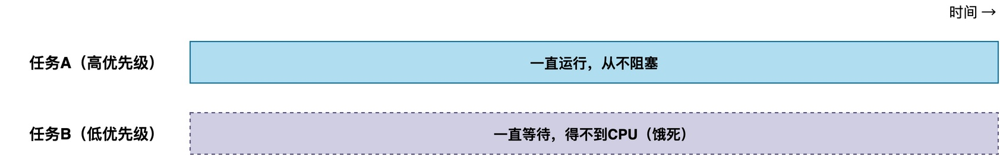
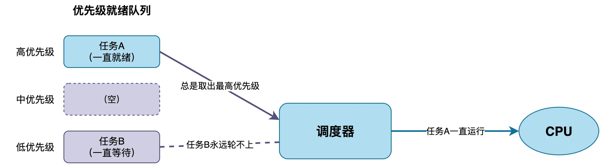
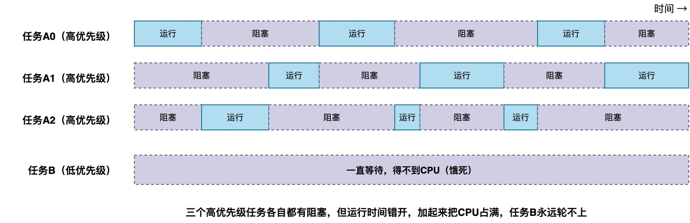
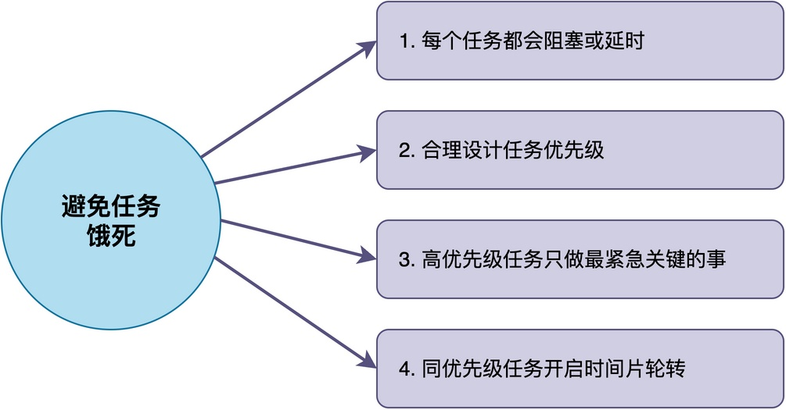

# 什么是任务饿死？如何防止任务饿死？

我们知道，在抢占式优先级调度的RTOS中，高优先级任务可以抢占低优先级任务，这似乎是一个非常好的机制。

但是，很多同学没有意识到：**如果优先级没有配置恰当，可能会导致低优先级任务永远得不到运行，这种现象就叫任务饿死。**

在这篇文章中，我将介绍任务饿死究竟是怎么回事，以及如何避免。

## 什么是任务饿死

首先，来看一个简单的场景。假设系统里有两个任务，任务A优先级高，任务B优先级低。有些同学第一次使用RTOS时，可能无意间写出以下这种有问题的代码。

```c
void task_A(void *param)
{
    while (1) {
        // 一直在计算，从不阻塞也不延时
        do_some_work();
    }
}

void task_B(void *param)
{
    while (1) {
        // 永远得不到运行机会
        do_other_work();
    }
}
```

其中，高优先级任务A既不延时也不等待任何事件。**在抢占式调度里，调度器总是选优先级最高的就绪任务来运行**。由于任务A优先级高，而且它一直是就绪态，所以调度器永远选取任务A运行，任务B永远没有运行的机会，这导致任务B饿死。

这种运行结果的时序图如下所示。可以看到，任务B一直无法得到运行的机会。



正确的写法应该是高优先级任务处理完事情之后就阻塞或者延时，把CPU让出来，比如：

```c
void task_A(void *param)
{
    while (1) {
        do_some_work();
        rt_thread_mdelay(10);  // 延时，让出CPU
    }
}
```

## 任务饿死产生的原因

**任务饿死的根本原因，主要是因为高优先级任务一直不让出CPU**，这种现象如下图所示。



正常情况下，任务A应该在处理完一件事之后，阻塞等待下一个事件（如等信号量）或者延时一段时间。这样一来，任务阻塞的时候，调度器就会选下一个优先级最高的任务来运行。如果没有高优先级的任务，低优先级任务B就有机会运行。

但是，现在任务A却是一直在计算、一直在跑，这导致该任务一直占着CPU，调度器永远不会从就绪队列中选取低优先级任务B，任务B自然永远没机会。

此外，**系统里可能有好几个高优先级任务，它们轮流运行。虽然每个任务在运行过程中会阻塞，但是这些任务仍然可能把CPU占满，导致低优先级任务还是得不到运行**。


例如，上图中，任务A0、A1、A2这三个任务各自在运行过程中都会进入阻塞状态，但是从整体来看，仍然将CPU占满，导致任务B永远无法运行。

除此之外，还有一种特殊情况：**如果系统不支持时间片轮转调度，那么同优先级的任务之间也可能出现饿死现象**。不过现在主流的RTOS基本上都支持时间片轮转调度，所以这种情况比较少见，这里就不做详细介绍了。

## 如何避免任务饿死

既然已经知道任务饿死的原因，那么可以通过一些方法进行避免，常见的方法有：



1. **保证每个任务都会阻塞或延时**：每个任务在处理完事情之后就应该阻塞等待下一个事件，或者至少加一个延时。
2. **合理设计任务优先级**：优先级应该根据任务的实时性要求来设，只有那些对响应时间要求很高的任务才设高优先级。
3. **高优先级任务不要做太多工作**：高优先级任务应该只做最紧急、最关键的事情，做完就马上阻塞，把CPU让出来。耗时的、不紧急的工作应该交给低优先级任务去做。
4. **同优先级用时间片轮转**：如果有多个任务优先级相同，可以开启时间片轮转，让它们轮流运行，每个任务跑一个时间片就让出CPU。

## 总结

综上所述，**任务饿死就是高优先级任务一直占用CPU导致低优先级任务长期得不到运行的现象。** 要避免任务饿死，就是保证每个任务在处理完事情后都会主动让出CPU，同时合理设计优先级，让高优先级任务只做最关键的工作。

---

> 如果你希望系统地学习RTOS底层原理，可以了解我的《RTOS开发与实战》课程。
>
> 课程不是简单地讲解FreeRTOS API的使用，而是带你从零开始编写一个RTOS内核，逐步实现任务管理、任务调度、上下文切换、同步与通信等核心机制，并通过一个远程温湿度监控设备项目，将操作系统原理应用到实际嵌入式开发中。
>
> 适合希望深入理解RTOS工作原理、提升嵌入式底层开发能力的同学。
>
> [课程详情](/blog/diyrtos/)
