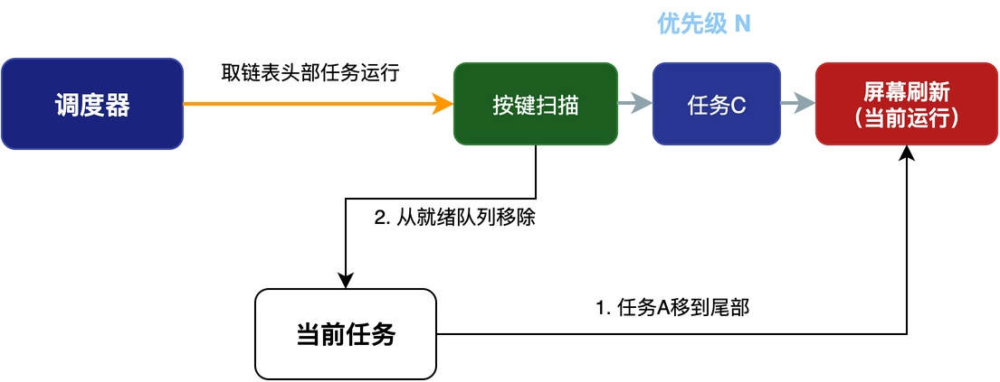

# RT-Thread中rt_thread_yield工作原理

假设系统里有两个优先级相同的任务：屏幕刷新任务task_screen和按键扫描任务task_key。屏幕刷新是个比较耗时的操作，而按键扫描需要比较及时的响应，用户按下按键之后希望能尽快得到反馈。这两个任务的实现示例如下：

```c
void task_screen(void *arg)
{
    while (1) {
        /* 填充帧缓存，比较耗时 */
        lcd_fill_framebuffer();
        rt_thread_yield();  /* 填充完一帧后主动让出CPU，让按键任务先响应 */
        lcd_flush();
    }
}

void task_key(void *arg)
{
    while (1) {
        if (key_pressed()) {
            handle_key_event();
        }
    }
}
```

虽然时间片轮转机制能保证两个任务都有运行的机会，但是在刷新屏幕的过程中，按键响应仍然可能有延迟。

**如果我们希望在屏幕刷新的过程中，即使时间片没用完也能主动让出CPU，给task_key一个运行的机会，该怎么做呢？**

为了解决此问题，可以调用rt_thread_yield()，下面将介绍该接口的工作原理和使用方法。

## yield()的工作原理

首先，我们来看这个函数的功能，该函数的完整原型如下：

```c
rt_err_t rt_thread_yield(void);
```

当调用这个函数时，当前任务并不会阻塞：**而是从运行态回到就绪态，调度器重新从就绪队列里选择下一个任务来运行。**

也就是说，该函数的**主要功能是：让任务主动让出CPU，让其它任务也有运行的机会。**

我们知道：**RTOS内部的就绪队列是按优先级来分组的，每个优先级对应一条任务队列，同一个优先级的所有就绪任务都挂在这条队列上。调度器选任务的时候，先找到最高优先级的非空队列，然后取这条链表头部的任务来运行**。

rt_thread_yield()做的事情其实很简单，主要完成两件事情：**将当前任务移到所在队列的尾部、进行一次任务调度。**

如下图所示，当task_screen调用rt_thread_yield()时，RT-Thread会将屏幕刷新任务的TCB插入到队列的尾部，然后进行一次任务调度。而由于此时按键扫描任务正处于队列首部，该任务将被调度器移除，进入运行状态。


（注：在有的RTOS中，当前任务始终位于队列首部，所以只需要将任务从队首移到队尾。）

所以，<font color="#245bdb">rt_thread_yield()的本质是："把自己排到同优先级队列的末尾，让同优先级的其他任务先跑"</font>。

进一步可以推知：**如果当前优先级只有一个任务，该任务调用rt_thread_yield()时，下一步运行的还是该任务**。

## 使用方法

回到本文开始给出的例子，真正耗时的操作其实在lcd_flush()函数内。该函数需要逐行把帧缓存的数据写到LCD控制器里。

我们可以在该过程中插入rt_thread_yield()，比如每刷新若干行就让出一次CPU：

```c
void lcd_flush(void)
{
    /* 逐行将帧缓存刷到LCD屏幕 */
    for (int y = 0; y < LCD_HEIGHT; y++) {
        lcd_write_line(y, framebuffer + y * LCD_WIDTH);

        /* 每刷新8行，主动让出一次CPU */
        if ((y % 8) == 0) {
            rt_thread_yield();
        }
    }
}
```

这样一来，按键扫描任务不需要等一整屏全部刷新完，而是最多等8行的刷新时间就能得到运行机会，按键响应的延迟就大大降低了。

## rt_thread_yield()的适用场合

在实际项目中，rt_thread_yield()可以用于以下场合：

1. **同优先级任务之间主动让步**：比如前面说的屏幕刷新任务，在刷新的间隙主动让出CPU，让按键任务有机会及时响应。
2. **任务里轮询等待某个条件**：比如任务在轮询某个硬件标志位时，让其他任务也有机会运行，不至于把CPU占满。
3. **大段耗时操作中间穿插让步**：当任务要做耗时计算时，可以中途主动让出CPU，让其他任务也有运行的机会。

## 总结

rt_thread_yield()的主要功能是让任务主动放弃CPU，给其他同优先级任务使用CPU的机会。

它的工作原理是把当前任务移到同优先级就绪链表的尾部，然后触发一次调度，适用于：同优先级任务让步、轮询等待、大段操作中间穿插让步等场景。

---

> 如果你希望系统地学习RTOS底层原理，可以了解我的《RTOS开发与实战》课程。
>
> 课程不是简单地讲解FreeRTOS API的使用，而是带你从零开始编写一个RTOS内核，逐步实现任务管理、任务调度、上下文切换、同步与通信等核心机制，并通过一个远程温湿度监控设备项目，将操作系统原理应用到实际嵌入式开发中。
>
> 适合希望深入理解RTOS工作原理、提升嵌入式底层开发能力的同学。
>
> [课程详情](/blog/diyrtos/)
