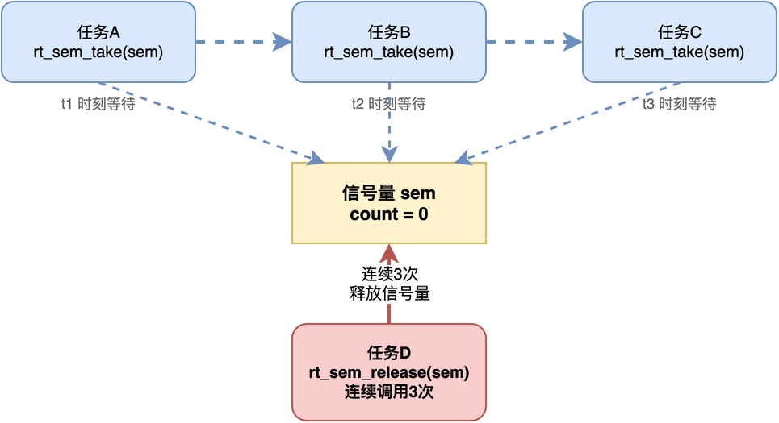
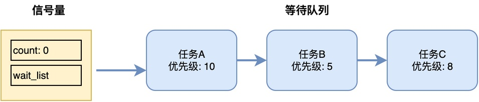
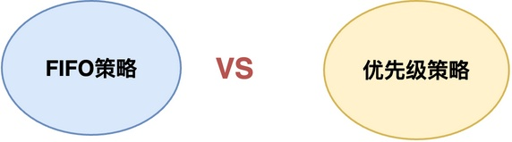
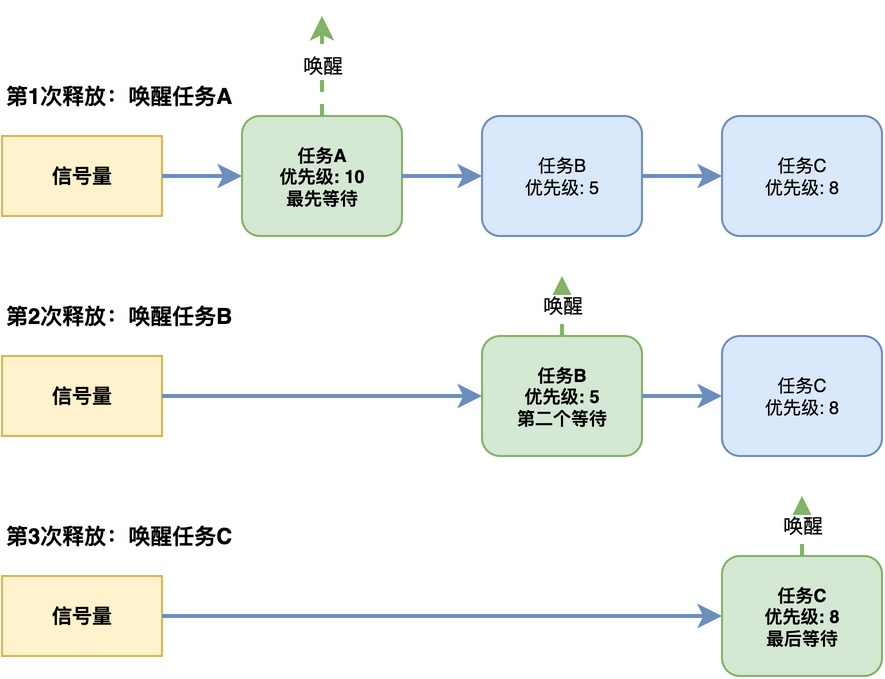
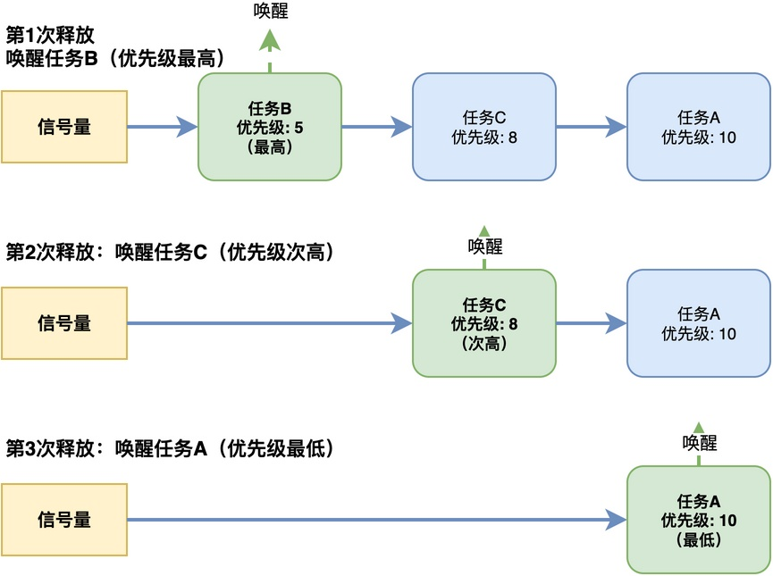

# 多个任务同时等待同一个信号量，谁会先被唤醒？

假设在RT-Thread中，有A、B、C三个任务，它们在不同的时间先后去等待同一个信号量。这个时候，另外一个任务D连续三次释放了这个信号量。



那么，请问，A、B、C这三个任务，谁会先被唤醒？谁会后被唤醒？它们的唤醒次序是按照什么策略来决定的呢？

要回答这个问题，我们就需要了解：信号量内部的等待队列是怎么组织任务的、唤醒机制和策略是什么？

## 信号量的等待队列

为了让任务能够在信号量上等待，每个信号量内部都会维护一个等待队列。

**当任务调用等待函数发现信号量不可用的时候，内核就会把这个任务从就绪队列移到信号量的等待队列里，然后让任务进入阻塞状态。**



因此，当A、B、C任务都在等待同一个信号量时，这些任务都在该等待队列里排队。当D释放信号量的时候，内核就从等待队列里选一个任务出来唤醒。

那到底选哪个呢？这取决于等待队列的组织方式，主要有两种策略：FIFO策略和优先级策略。



下面将分别介绍这两种策略。

## FIFO策略：先等的先醒

第一种策略是FIFO，也就是先进先出。

**在这种策略下，等待队列就是一个普通的链表，任务按照进入等待队列的先后顺序排列**。**释放信号量的时候，内核就从队列头部取出第一个任务**，也就是等得最久的那个任务，将该任务唤醒。



正如上图所示，任务A最先进入等待队列，然后是任务B，最后是任务C。当任务D连续三次释放信号量的时候，第一次唤醒的是任务A，第二次唤醒的是任务B，第三次唤醒的是任务C。

因此，在FIFO策略下，唤醒顺序是：A→B→C，该顺序仅与谁先进入等待队列有关。

这种策略的好处是：**公平，先来后到**，坏处是：**低优先级任务可能相对高优先级任务先唤醒，这可能影响系统实时性**。

## 优先级策略：优先级高的先醒

第二种策略是优先级策略。

在这种策略下，**等待队列中的任务是按照优先级排序的，优先级高的任务排在队列前面。释放信号量的时候，内核就取出队列头部任务（优先级最高）来唤醒**。



正如上图所示，虽然任务A最先进入等待队列，但是任务B的优先级最高（优先级数值5），任务C次之（优先级数值8），任务A最低（优先级数值10）。所以等待队列会按照优先级重新排序，任务B排在最前面，然后是任务C，最后是任务A。

当任务D连续三次释放信号量的时候，唤醒顺序是：B→C→A，该顺序仅与任务的优先级有关。

这种策略的好处是：**保证高优先级任务能优先获得资源，符合实时系统的设计目标**，坏处是：**可能出现总是唤醒高优先级任务、低优先级任务可能一直等不到，出现"饥饿"现象**。

## 不同RTOS的实现

很多RTOS同时支持这两种策略，在RT-Thread中，创建信号量的时候，可以通过flag参数指定等待队列的组织方式：

```c
rt_sem_t rt_sem_create(const char *name, rt_uint32_t value, rt_uint8_t flag);
```

其中flag参数可以取以下两个值：

1. **RT_IPC_FLAG_FIFO**：采用FIFO策略，按照任务进入等待队列的先后顺序唤醒。
2. **RT_IPC_FLAG_PRIO**：采用优先级策略，按照任务优先级高低唤醒。

在将任务插入等待列表中时，RTOS会调用_ipc_list_suspend()函数，其实现代码大致如下：

```c
rt_inline rt_err_t _ipc_list_suspend(rt_list_t        *list,
                                     struct rt_thread *thread,
                                     rt_uint8_t        flag)
{
    rt_thread_suspend(thread);

    switch (flag)
    {
    case RT_IPC_FLAG_FIFO:
        rt_list_insert_before(list, &(thread->tlist));
        break; /* RT_IPC_FLAG_FIFO */
    case RT_IPC_FLAG_PRIO:
        {
            struct rt_list_node *n;
            struct rt_thread *sthread;
            for (n = list->next; n != list; n = n->next)
            {
                sthread = rt_list_entry(n, struct rt_thread, tlist);
                if (thread->current_priority < sthread->current_priority)
                {
                    rt_list_insert_before(&(sthread->tlist), &(thread->tlist));
                    break;
                }
            }

            if (n == list)
                rt_list_insert_before(list, &(thread->tlist));
        }
        break;/* RT_IPC_FLAG_PRIO */
    }

    return RT_EOK;
}
```

从这段代码可以看到，RT-Thread会根据创建信号量时指定的flag来组织等待队列。
* 如果是RT_IPC_FLAG_FIFO，插入队列尾部。
* 如果是RT_IPC_FLAG_PRIO，按优先级插入排序；
## 总结

综上所述，多个任务同时等待同一个信号量时，谁先被唤醒取决于等待队列的管理策略。

FIFO策略讲究先等待先唤醒，优点是公平，不会出现饥饿；优先级策略保证高优先级任务优先唤醒，优点是符合实时系统的设计目标，但可能出现低优先级任务饥饿的问题。在实际开发中，应根据项目的需求选择合适的策略。

---

> 如果你希望系统地学习RTOS底层原理，可以了解我的《RTOS开发与实战》课程。
>
> 课程不是简单地讲解FreeRTOS API的使用，而是带你从零开始编写一个RTOS内核，逐步实现任务管理、任务调度、上下文切换、同步与通信等核心机制，并通过一个远程温湿度监控设备项目，将操作系统原理应用到实际嵌入式开发中。
>
> 适合希望深入理解RTOS工作原理、提升嵌入式底层开发能力的同学。
>
> [课程详情](/blog/diyrtos/)
